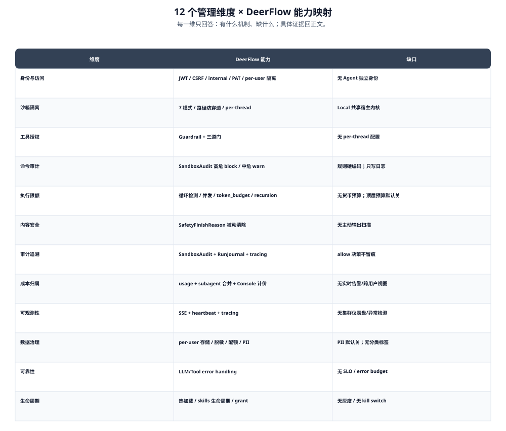
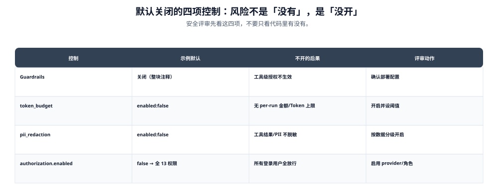
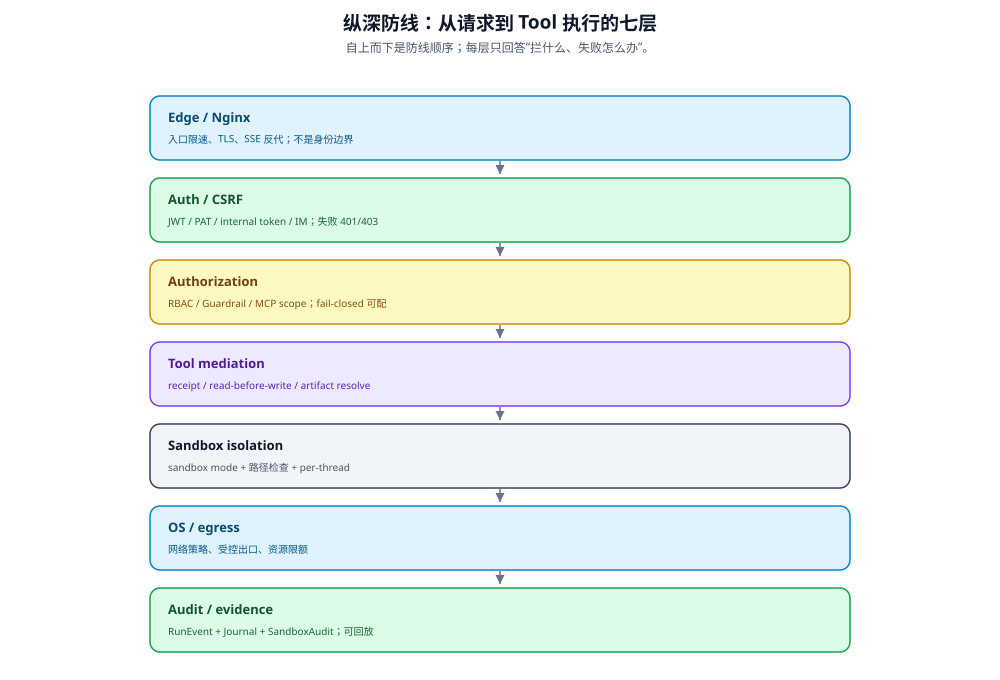

# IT 治理全景：12 个管理维度

DeerFlow 不是 IT 管理平台。但它内建了一批治理原语。
**知道这些原语在哪、覆盖什么、缺什么**，是评估部署风险的前提。

> **图读法**：按行看“能力/缺口”；这张图是索引，具体证据回到各域正文。

> **图读法**：安全评审先看这四项，不要只看代码里有没有。

本卷**判断性段落**附 `file:line`；介绍性文字与明确标注为部署决策的条目除外，可自行复核。

## 1. 12 个维度 × 能力矩阵

| # | 维度 | 核心问题 | DeerFlow 能力 | 缺口 |
|---|------|---------|-------------|------|
| 1 | **身份与访问** | Agent 用谁的身份跑？ | JWT + CSRF + 内部 token + per-user 隔离（4 条认证路径） | **无 Agent 独立身份**，继承用户权限 |
| 2 | **沙箱隔离** | Agent 能碰系统文件吗？ | 7 种沙箱模式（3 类隔离）+ 路径防穿透 + per-thread 隔离 | Local 模式共享宿主内核 |
| 3 | **工具授权** | 谁能决定 agent 调什么工具？ | GuardrailMiddleware（可插拔 provider）+ 三道门（名单 / 风险概率 / decisions 接口） | 无 per-thread 配置项；未探测的工具是绕过路径 |
| 4 | **命令审计** | bash 里能写危险命令吗？ | SandboxAuditMiddleware：高危 block + 中危 warn（JSON，只写 gateway.log） | 规则硬编码；**只写日志不落库** |
| 5 | **执行限额** | Agent 能无限跑下去吗？ | 循环检测 + 并发上限（默认执行 3 / 截断 64） + `token_budget`（顶层默认关；子代理默认开）+ `recursion_limit` 100 | **无货币预算**；顶层 token 预算默认关闭 |
| 6 | **内容安全** | Agent 输出有害内容怎么办？ | SafetyFinishReasonMiddleware（被动清除被污染的 tool_calls） | 无主动输出扫描；无独立输入 guardrail |
| 7 | **审计追溯** | 出事了能查到谁干的吗？ | SandboxAudit 日志 + RunJournal + tracing | subagent 的 guardrail 无决策字段；正常 allow 决策不留痕 |
| 8 | **成本归属** | Agent 花了多少钱？ | TokenUsageMiddleware + subagent 用量合并 + per-model `stream_usage` + Console 单用户计价 | 无实时成本告警；无跨用户视图；无货币预算执行 |
| 9 | **可观测性** | Agent 现在在干什么？ | StreamBridge SSE + heartbeat + tracing span | 无行为异常检测；无集群仪表盘 |
| 10 | **数据治理** | 用户数据隔离吗？PII 安全吗？ | per-user 存储 + 路径脱敏 + 上传配额 + **PII 脱敏（默认关）** | PII 脱敏默认关闭；无数据分类标签 |
| 11 | **可靠性** | Agent 挂了怎么恢复？ | LLMErrorHandling（retry + 熔断）+ ToolErrorHandling | 无 agent 级 SLO；无 error budget |
| 12 | **生命周期** | Agent 怎么上线、回滚、下架？ | 配置热加载 + skills 生命周期 + 插件 grant 重启绑定 + skill mutation 七步流 | 无版本管理；**无灰度**；**无 kill switch** |

## 2. 三处需要更正的旧说法

早期版本的本页有三处断言停留在 2.1，已按 v2.2.0 源码订正：

| 旧说法 | 订正后 | 证据 |
|---|---|---|
| 子代理并发「≤3」 | **默认执行并发仍是 3**（`config/subagent_runtime_config.py:12`）；「64」是响应级截断上限（`subagents_config.py:17`）。两者经 `clamp_subagent_concurrency` 取小值，所以**默认仍是 3** |
| 「无 per-run 预算上限」 | **有 `token_budget`**（双阈值，默认关闭） | `config.example.yaml:105-111` |
| 「Guardrail deny 不写 RunJournal」 | **会写**，落 `middleware:guardrail` 事件 | `packages/harness/deerflow/guardrails/middleware.py:171` |

三处的展开说明分别在 [cost/03-budgets-and-limits.md](cost/03-budgets-and-limits.md)、
[audit/01-audit-chain.md](audit/01-audit-chain.md)。

## 3. 成熟度自评

这是一份**事实判断**，不是合规结论。

| 成熟度 | 描述 | DeerFlow 自评 |
|--------|------|-------------|
| Level 1: Reactive | 事后人工审核，无自动控制 | — |
| Level 2: Partial | 输出过滤，全局策略，无决策级审计 | — |
| **Level 3: Structured** | 多策略分层，但人工审核不规模化 | **← 主体在这里** |
| Level 4: Designed-In | 实时强制执行 + 决策级审计 + per-agent 域隔离 + 按需合规报告 | **仅「实时拦截」一项达到** |

具体到子项：

| 子能力 | 层级 | 依据 |
|---|---|---|
| tool 执行时实时拦截 | **Level 4** | Guardrail 实时 deny、SandboxAudit 实时 block |
| 行级命令审计 | Level 3 | 有分类但规则硬编码 |
| 决策级审计 | **Level 3** | deny 有事件，allow 无 |
| **人工审核规模化** | **Level 2** | 无强制审批闸门（见 [compliance/04-eu-ai-act.md](compliance/04-eu-ai-act.md)） |
| 按需合规报告 | **Level 1** | 无报告生成能力 |

**整体 3 级偏上**——「能拦」这件事做得比「能证明」好。

## 4. 最该提前知道的三个边界

> **图读法**：自上而下是防线顺序；每层只回答“拦什么、失败怎么办”，不是调用时序。

### 4.1 Agent 没有独立身份

Agent 在用户上下文里跑，继承用户全部权限。
用户能写，agent 就能写；没有「agent A 只读、agent B 可写」的机制。

子代理进一步继承父级身份（`batch_acceptance.py:38-40`），
审计上无法区分动作由谁发起。详见 [identity/04-agent-identity-gap.md](identity/04-agent-identity-gap.md)。

### 4.2 「有审计」不等于「能查」

三条具体的盲区（详见 [audit/04-event-coverage.md](audit/04-event-coverage.md)）：

| 盲区 | 后果 |
|---|---|
| subagent 的 guardrail 拒绝 | 无**决策字段**；拒绝文本在 `subagent.step` 里 |
| allow 决策 | **不留痕**——「证明被授权」比「证明被拒绝」难 |
| bash 之外的工具 | 文件读写等**不走**审计 |

另外 SandboxAudit 只写 `gateway.log`，**不入库**——
要查必须依赖日志系统，且需用 `thread_id` 反查用户。

### 4.3 限额存在，但没有一个是钱

| 维度 | 可限 |
|---|---|
| token 总量 | 是（默认关闭） |
| 递归步数 | 是（100 步） |
| 并发 | 是（默认执行 3）；响应级截断上限 64 |
| **金额** | **否** |

框架不知道模型单价，所以「每个 run 最多花 X 元」无法表达。
详见 [cost/03-budgets-and-limits.md](cost/03-budgets-and-limits.md) §4。

## 5. 按问题找篇章

| 你关心的问题 | 从这里开始 |
|---|---|
| 能不能接 SSO / 怎么做权限 | [identity/](identity/README.md) |
| 谁能决定 agent 调什么 | [authorization/](authorization/README.md) |
| 数据存哪、能不能删干净 | [data/](data/README.md) |
| 出事能不能查到 | [audit/](audit/README.md) |
| 能不能过审计 | [compliance/](compliance/README.md) |
| 花了多少钱、怎么限 | [cost/](cost/README.md) |
| 怎么上线回滚 | [lifecycle/](lifecycle/README.md) |
| agent 能碰什么 | [execution/](execution/README.md) |
