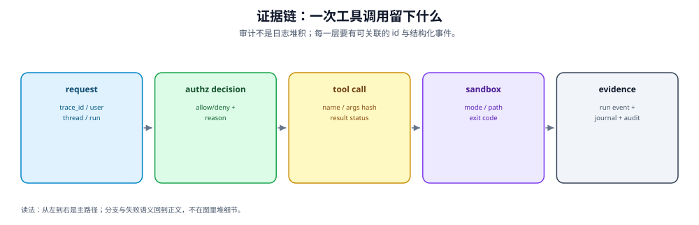
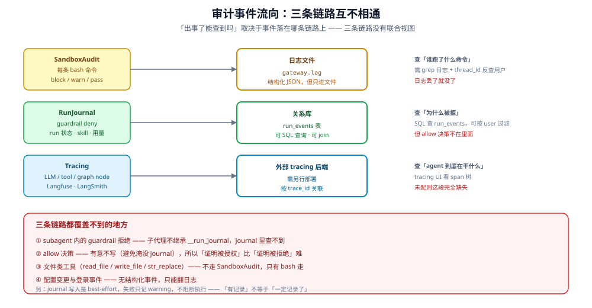

---

title: "事件覆盖矩阵"
description: '哪些事件真的被记录下来：RunJournal 六个记录方法、Guardrail 决策、SandboxAudit 日志，以及三条明确的盲区（subagent、embedded、allow 决策）。'
topics: [governance, audit, events]
verified_against: v2.2.0
last_verified: 2026-11-08
---

# 事件覆盖矩阵

> **图读法**：审计不是日志堆积；每一层要有可关联的 id 与结构化事件。

「有审计」这句话必须细化到**哪类事件、记在哪、能不能查**。
本页把这个问题摊开成矩阵。

## 1. RunJournal 的记录入口（不只六个）

`packages/harness/deerflow/runtime/journal.py` 的 `record_*` 方法只是一部分；
`run.start`/`run.end`/`run.terminal`/`run.error`、`llm.ai.response`/`llm.tool.result`、
`subagent.*`、`workspace_changes` 也由 journal 落库（`runtime/events/catalog.py:56-88`）。

| 方法 | 行 | 记录什么 |
|---|---|---|
| `record_middleware` | `:1520` | 中间件决策（含 guardrail） |
| `record_skill_usage` | `:819` | 技能使用 |
| `record_interrupted_ai_responses` | `:898` | 被中断的 AI 回复 |
| `record_external_llm_usage_records` | `:1450` | 外部 LLM 用量（累加进 RunRow，不是 journal 事件） |
| `record_memory_context` | `:1585` | 记忆上下文 |
| `record_delivery` | `:1646` | 投递事件 |

**这六个方法不是「结构化审计」的全部范围**——`run.*`、`llm.*`、`subagent.*`、
`workspace_changes`、`middleware:*` 同样落库。把它们漏掉，覆盖矩阵就会低估审计面。

## 2. 覆盖矩阵

| 事件 | 记录机制 | 落库 | 可查 |
|---|---|---|---|
| **bash 命令** | `SandboxAuditMiddleware` → `logger.info` | **否**（只进 gateway.log） | 需查日志 |
| **Guardrail deny** | `journal.record_middleware(tag="guardrail")` | 是 | journal |
| **Guardrail allow** | — | **否**（正常 allow 有意不写；provider 报错放行写 `allow_tool_call_after_provider_error`） | 不可查 / 部分 |
| **run 状态变更** | RunJournal | 是 | journal |
| **技能使用** | `record_skill_usage`（`:819`） | 是 | journal |
| **LLM 用量** | `record_external_llm_usage_records`（`:1450`） | 累加进 **RunRow** | RunRow / Console |
| **记忆上下文** | `record_memory_context`（`:1585`） | 是 | journal |
| **投递** | `record_delivery`（`:1646`） | 是 | journal |
| **登录/认证** | 标准日志 | **否** | 需查日志 |
| **配置变更** | — | **否** | 不可查 |
| **文件读写** | 不走 SandboxAudit；`llm.tool.result` 记录 ToolMessage | **部分** | journal 可查 |
| **MCP 调用** | 走 `on_tool_end`；`llm.tool.result` | 是 | journal |

### 2.1 记录方法的完整路径

上面的 `:NNN` 都相对同一个文件（`packages/harness/deerflow/runtime/journal.py`）。三条代表性入口：

| 方法 | 完整锚点 |
|---|---|
| guardrail 决策落点 | `packages/harness/deerflow/runtime/journal.py:1520` |
| 技能使用 | `packages/harness/deerflow/runtime/journal.py:819` |
| 投递 | `packages/harness/deerflow/runtime/journal.py:1646` |

## 3. 三条明确的盲区

### 3.1 subagent 里的 guardrail 拒绝

`audit/01-audit-chain.md` 已记录这条：

> **没有 `__run_journal` 的运行时不写**：embedded client 与 subagent 执行都跳过持久化。
> 所以 **subagent 里的 guardrail 拒绝没有 `middleware:guardrail` 决策字段**。

**准确的边界**：拒绝的 ToolMessage 会被 executor 捕获并作为 `subagent.step` 落库，
按 `task_id` 可以查到拒绝文本；缺的是 `allow`/`policy_id`/`reason_codes` 这些**决策字段**。
所以「完全看不见」是过度表述，「看不见决策」才准确。

### 3.2 正常 allow 决策不落库

`guardrails/middleware.py:131` 的 `_record_guardrail_event` 只在
**deny** 与 **provider 报错后放行** 两种情形写事件。

正常放行**不产生事件**——这是有意的设计，避免每个 tool call 都写一条把 journal 淹没。

| 问题 | 能否回答 |
|---|---|
| 某个时间段 agent 被拒绝了哪些操作 | **能**（查 journal） |
| 某个时间段 agent 被允许了哪些操作 | **不能**（只能从 tracing/usage 侧推） |

**合规视角的含义**：「证明某操作被授权执行」比「证明它被拒绝」更难。

### 3.3 bash 之外的工具

`SandboxAuditMiddleware` **只管 `bash`**（见 [03-sandbox-audit.md](03-sandbox-audit.md) §1）。
`read_file` / `write_file` / `str_replace` 等文件工具**不走这条命令分类审计**；
但它们的调用与结果会以 `llm.ai.response` / `llm.tool.result` 落 journal
（`runtime/journal.py:887-896`），不是「完全无审计」，而是「有工具结果、无命令级分类」。

## 4. best-effort 语义

`guardrails/middleware.py:140-146` 的 `_record_guardrail_event` docstring 原话：

> audit persistence is best-effort and must never change tool execution behavior

| 含义 | 后果 |
|---|---|
| 记录失败只记 warning | **不阻断执行** |
| 不改变工具行为 | 审计不是强制闸门 |

**所以「有记录」不等于「一定记录了」**：库写失败时，操作照样执行、记录丢失。

## 5. 按问题查表

| 要回答的问题 | 查哪里 | 覆盖完整性 |
|---|---|---|
| 这个 thread 跑了什么 | journal | **部分**（缺 subagent guardrail 决策、配置变更、认证事件） |
| 谁执行了危险命令 | gateway.log 的 `[SandboxAudit]` | 需 thread_id 反查人 |
| 为什么这个工具调用被拒 | journal 的 `middleware:guardrail` | 完整（主代理） |
| 子代理被拒了吗 | journal 无决策字段；`subagent.step` 有拒绝文本 | **部分** |
| 允许了哪些操作 | 正常 allow 查不到；provider 报错放行可查 | **部分** |
| 谁改了配置 | **查不到** | **盲区** |
| 谁读了哪个文件 | `llm.tool.result` 有 ToolMessage；无统一查询 | **部分** |
| 花了多少 token | journal 的 usage 记录 | 完整 |

## 6. 缺口汇总

| 缺口 | 状态 | 边界 |
|---|---|---|
| subagent 的 guardrail 事件 | **无** | 无 `__run_journal` 即跳过 |
| allow 决策的留痕 | **无** | 有意不写，避免淹没 |
| 文件操作审计 | **无** | 只有 bash 走 SandboxAudit |
| 配置变更审计 | **无** | `config.yaml` 改动无事件 |
| 认证事件入库 | **无** | 只有标准日志 |
| 记录的强一致性 | **无** | best-effort，失败不阻断 |
| 跨层统一查询 | **无** | journal / 日志 / tracing 三处分离 |

最后一条是运维层面的实际问题：要回答一个跨层问题（如「这个用户上周做了什么」），
需要同时查 journal 库、gateway.log 和 tracing 后端，没有联合视图。

## 7. 与其他章节的关系

- 审计链路总览：[01-audit-chain.md](01-audit-chain.md)
- 沙箱命令审计细节：[03-sandbox-audit.md](03-sandbox-audit.md)
- 可观测性：[02-observability.md](02-observability.md)
- SOC 2 的审计要求：[../compliance/03-soc2-iso27001.md](../compliance/03-soc2-iso27001.md) §3
