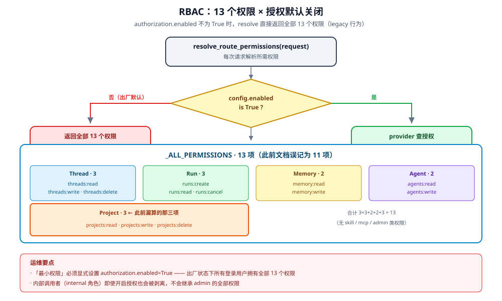

# RBAC 权限全表

DeerFlow 的路由授权由 `app/gateway/authz.py` 定义。最重要的一个事实是：
**默认不启用**——不配 provider 时，每个登录用户都拿到全部权限。

## 1. 权限常量



`app/gateway/authz.py:63-86` 定义 `Permissions` 类，`resource:action` 格式：

| 资源 | 权限 | 守护的路由 |
|---|---|---|
| `threads` | `threads:read` / `write` / `delete` | 会话读写删 |
| `runs` | `runs:create` / `read` / `cancel` | 运行创建/读取/取消 |
| `projects` | `projects:read` / `write` / `delete` | 项目工作区 |
| `memory` | `memory:read` / `write` | `/api/memory*` 的用户记忆 |
| `agents` | `agents:read` / `write` | `/api/agents*` 与 `/api/user-profile` |

**共 13 个**（不是 11 个——`projects` 三项常被漏算）。

`_ALL_PERMISSIONS`（`app/gateway/authz.py:161-175`）把它们列成一份权威清单，
`resolve_route_permissions` 就按这份清单逐项求值。

## 2. 默认关闭：最重要的企业事实

`app/gateway/authz.py:288-290`：

```python
config = await _route_authorization_config_async()
if config.enabled is not True:
    return list(_ALL_PERMISSIONS)
```

`resolve_route_permissions` 的 docstring 说得更直接（`app/gateway/authz.py:281`）：

> Disabled authorization preserves the legacy all-permissions behavior.

| 状态 | 每个登录用户拿到的权限 |
|---|---|
| 未启用（默认） | **全部 13 个** |
| 启用 + provider 允许 | 按 provider 决策 |
| 启用 + provider 失败 + `fail_closed` | **空（全拒）** |
| 启用 + provider 失败 + 非 `fail_closed` | 全部 13 个 |

**含义**：默认部署下，`admin` 与 `user` 在路由层**没有权限差别**——
唯一的角色差异体现在管理端点的 `@require_admin` 类检查上，不是在这 13 个权限里。

### 2.1 启用方式

**不必自己实现 provider**：仓库自带 `RbacAuthorizationProvider`
（`deerflow/authz/rbac.py:78-101`），在 `config.yaml` 里配 `roles` 即可
（完整样例见 `config.example.yaml:3389-3444`）。也可以实现自定义
`AuthorizationProvider`，由 `_get_cached_route_provider`（`app/gateway/authz.py:293`）加载：

```python
provider = _get_cached_route_provider(config)
```

provider 实例按配置签名缓存（docstring 说 "hot-reload safe"），
所有 13 个权限并行求值（`app/gateway/authz.py:336-342`），
单个 provider 失败只影响那一个权限，不拖垮整次请求。

## 3. `fail_closed` 语义

provider 抛异常时（`app/gateway/authz.py:296-298`）：

```python
except Exception:
    logger.warning("Failed to resolve authorization provider for Gateway routes", exc_info=True)
    return [] if config.fail_closed else list(_ALL_PERMISSIONS)
```

| `fail_closed` | provider 故障时 | 适用 |
|---|---|---|
| `true` | 拒绝一切（返回空权限列表） | 需要「宁可不可用，不可越权」 |
| `false` | 放行一切（返回全部权限） | 需要高可用优先 |

**这是企业必须显式决定的开关**：`false` 时授权服务的任何故障都退化成「人人全权」。

逐权限求值时的失败处理（`app/gateway/authz.py:336-342`）同样遵循这个语义。

## 4. 装饰器表达不了的权限：`runs:cancel`

`app/gateway/authz.py:139` 的 `require_cancel_permission_if` 是一个**特殊检查**，
因为取消能力不只在取消路由上：

`app/gateway/authz.py:142-150` 的 docstring：

> Cancel capability reaches the run lifecycle through more than the dedicated
> cancel route: `?action=interrupt|rollback` on the join-stream entry and
> `multitask_strategy=interrupt|rollback` on run creation both terminate an
> already-active run. A credential whose scopes omit `runs:cancel` (e.g. a
> create- or read-only PAT) must not reach any of those paths, and **decorators
> cannot express query- or body-parameter-conditional permissions**, so callers
> apply this check where the capability is known.

| 入口 | 参数 | 需要 `runs:cancel` |
|---|---|---|
| 专用取消路由 | — | 是 |
| join-stream | `?action=interrupt` / `?action=rollback` | 是 |
| 创建 run | `multitask_strategy=interrupt` / `=rollback` | 是 |

**企业评审要点**：一个只有 `runs:create` 的 PAT，不能通过
`multitask_strategy=interrupt` 去终止别人的运行——这条防线在
`require_cancel_permission_if` 里，不在装饰器上。

## 5. 内部调用者的角色处理

`system_role="internal"` 的内部调用者不是真正的 RBAC 角色
（`app/gateway/authz.py:300-308`）：

```python
# internal callers (IM channel workers, scheduler) have system_role="internal",
# which is not a real RBAC role. Omit it so default_role applies, mirroring
# inject_authenticated_user_context which pops user_role for internal callers
# without a resolved owner.
```

内部调用者走 `config.default_role`，与「未解析出 owner 的内部调用」保持一致。
这是 `Phase 1B` 工具路径的既定行为（注释明确说 "Align with Phase 1B's tool path"）。

## 6. 缺口

| 缺口 | 状态 | 边界 |
|---|---|---|
| 内置 RBAC 角色 | **有** | `RbacAuthorizationProvider` 支持 role→routes/tools/models/sandbox 映射（`authz/rbac.py:78-101`；样例 `config.example.yaml:3389-3444`） |
| 资源级授权（如「只能读自己 project」） | **无** | provider 收到 `target=permission` 与 `principal`，但框架不传具体资源 ID |
| 默认启用 | **无** | 默认关闭（`enabled is not True` 即全放行） |
| 权限的配置化 | **部分** | 13 个权限常量硬编码在 `authz.py`；角色→权限映射可配，增删权限本身需改代码 |
| 前端可见的权限提示 | **有** | `GET /auth/me` 返回用户信息与 `permissions`（`auth/models.py:52-55`、`routers/auth.py:592-614`）；前端是否消费另说 |

## 7. 与其他章节的关系

- PAT 的 9 个作用域与此表的关系：[../identity/08-pat.md](../identity/08-pat.md) §2
- Guardrail（工具级授权，与路由级并存）：[01-guardrail-layer.md](01-guardrail-layer.md)
- 策略可配置性总览：[03-configurability.md](03-configurability.md)
