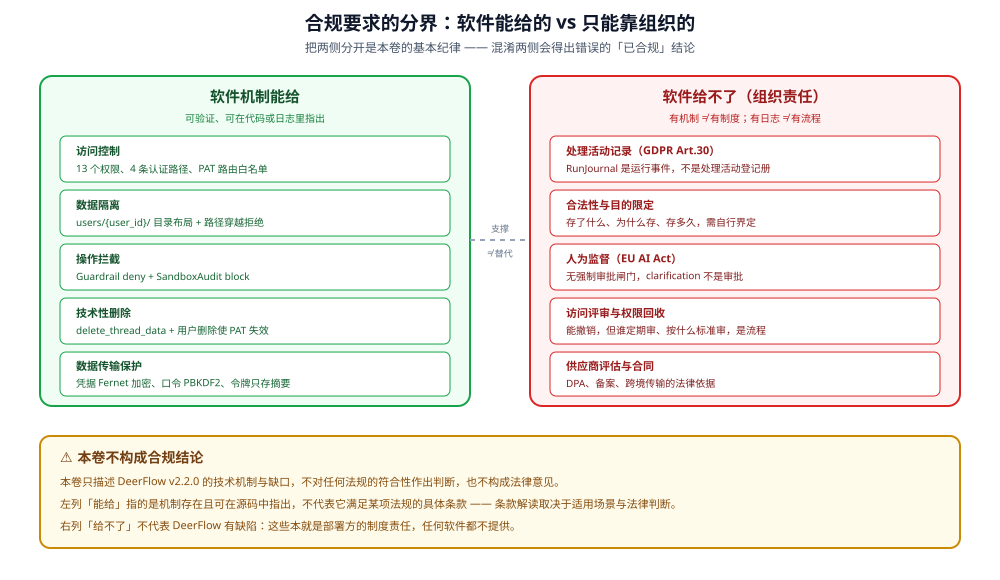

# 合规对照总览

本页是入口。四套要求各自展开成一篇，本页只给**一句话现状**与定位。

## 1. 四套要求的定位

| 标准 | 性质 | DeerFlow 能提供什么 |
|---|---|---|
| **GDPR** | 法规（欧盟） | 技术机制 + 明确的缺口清单 |
| **SOC 2** | 审计框架（服务商） | 控制项的技术证据 |
| **ISO 27001** | 管理体系（组织） | 同上 |
| **EU AI Act** | 法规（欧盟） | 透明度与人工监督的技术点 |

**共同的边界**：DeerFlow 自身**不出具任何合规证明**。它能提供的是
「某项控制有没有对应实现、证据在哪」。证书与审计报告由部署方取得。

> ⚠️ **本卷不构成合规结论**。以下对照只描述「有/没有对应技术机制」，
> 不判定任何系统是否满足某项标准，也不替代法律或审计意见。
> 每条结论都附 `file:line` 供自行复核。

## 1.1 控制项 → 机制 → 证据 → 状态（摘录）

| 标准 | 控制项 | DeerFlow 机制 | 证据 | 状态 |
|---|---|---|---|---|
| GDPR | Art.15 访问权 | per-user 存储可导出，但无导出端点 | `paths.py:344` | **部分** |
| GDPR | Art.17 删除权 | thread/run 事件删除；事件删除置证据 `partial` | `routers/threads.py:758`、`:850-854` | **部分** |
| GDPR | Art.30 处理记录 | RunJournal（run.*、llm.*、middleware:*） | `runtime/journal.py:1520` | **有但不覆盖** |
| GDPR | Art.5 最小化 | PII 脱敏，默认关闭 | `config.example.yaml:1538` | **有但不覆盖** |
| GDPR | Art.5 存储限制 | 项目回收站 30 天 TTL | `projects_config.py:49-53` | **部分** |
| GDPR | Ch.V 跨境 | 取决于 provider endpoint 与部署地域 | — | **取决于部署** |
| SOC 2 | CC6 访问控制 | 13 个 RBAC 权限，默认关闭 | `authz.py:161-175` | **有（默认关）** |
| SOC 2 | CC7 日志 | RunJournal + SandboxAudit | `journal.py:1520` | **部分** |
| SOC 2 | CC8 变更管理 | 配置热加载边界 + 迁移版本 | `reload_boundary.py:52-100` | **部分** |
| ISO 27001 | A.8 资产/访问 | 同 SOC 2 技术控制 | 同上 | **部分** |
| EU AI Act | 透明度 | guardrail 决策可查 | `guardrails/middleware.py:131` | **部分** |
| EU AI Act | 人类监督 | clarification，模型自主触发 | `clarification_middleware.py:75-92` | **有但不覆盖** |

## 2. GDPR 一句话现状

详细见 [02-gdpr.md](02-gdpr.md)。

| 权利/要求 | 现状 |
|---|---|
| 访问权 | per-user 存储使导出**技术上可行**，但**无导出端点** |
| 删除权 | thread 可删（`routers/threads.py:758`）；memory、上传无 TTL，需手工 |
| 处理记录 | RunJournal + tracing 有记录能力；结构化程度见 [../audit/01-audit-chain.md](../audit/01-audit-chain.md) |
| 数据最小化 | PII 脱敏**默认关闭**（`config.example.yaml:1538`） |
| 存储限制 | 仅项目回收站有 30 天 TTL（`projects_config.py:49-53`） |
| 跨境传输 | 取决于 provider endpoint 配置；另有 TypeSafe 出站不受脱敏覆盖 |

## 3. SOC 2 / ISO 27001 一句话现状

详细见 [03-soc2-iso27001.md](03-soc2-iso27001.md)。

四个控制域里，DeerFlow 在**技术控制**上的覆盖较好（访问控制、审计、变更管理），
在**组织与文档**层面完全不提供——那不是软件能提供的东西。

## 4. EU AI Act 一句话现状

详细见 [04-eu-ai-act.md](04-eu-ai-act.md)。

DeerFlow 是通用框架，**本身不做风险分级**；某个用途是否落入高风险类别，
由部署方 + 法律判断（[04-eu-ai-act.md](04-eu-ai-act.md) §1）。它提供的人工监督原语
（clarification、approval）**不等于**高风险系统要求的「人在回路审批」。
两者的差别在展开篇里逐条对照。

## 5. 三条贯穿性结论

| # | 结论 | 依据 |
|---|---|---|
| 1 | **有技术控制，无合规证明** | 全部四篇 |
| 2 | **默认配置偏宽松**（PII 脱敏关闭、注册开放、授权默认关闭） | `config.example.yaml:1538`、`auth_config.py:101`、`authz.py:288-290` |
| 3 | **缺口集中在数据生命周期**（保留期、导出、驻留） | [../data/06-retention-and-residency.md](../data/06-retention-and-residency.md) |

第 2 条不是缺陷——默认值面向「快速跑起来」；但它意味着
**合规姿态不能靠默认值达成**，必须显式配置。

## 6. 与其他章节的关系

- 审计证据链：[../audit/01-audit-chain.md](../audit/01-audit-chain.md)
- 数据生命周期：[../data/06-retention-and-residency.md](../data/06-retention-and-residency.md)
- PII 脱敏：[../data/05-pii-redaction.md](../data/05-pii-redaction.md)
- 授权默认关闭：[../authorization/04-rbac-permissions.md](../authorization/04-rbac-permissions.md) §2
