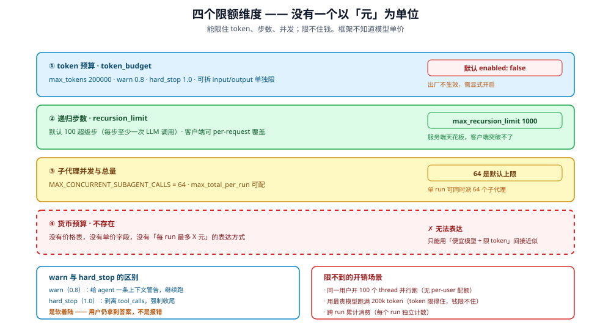

# 预算与限额

DeerFlow 的用量控制有**三个可限额维度**：token、递归步数、并发。
它们都能限制开销，但**金额没有对应的执行层限额**——这个区别必须讲清楚。

## 1. token 预算（默认关闭）




`config.example.yaml:105-111`：

```yaml
token_budget:
  enabled: false                # Set to true to activate budget enforcement
  max_tokens: 200000            # Total token limit (input + output) per run
  max_input_tokens: null        # Optional separate input-only limit
  max_output_tokens: null       # Optional separate output-only limit
  warn_threshold: 0.8           # Warn at 80% of the budget
  hard_stop_threshold: 1.0      # Force stop at 100% of the budget
```

| 键 | 默认 | 作用 |
|---|---|---|
| `enabled` | **`false`** | 顶层**不做任何 token 限制**；子代理层 `subagents.token_budget` 默认开启（2M/1M） |
| `max_tokens` | 200000 | 单次 run 的总量（输入 + 输出） |
| `max_input_tokens` | `null` | 可选的单独输入上限 |
| `max_output_tokens` | `null` | 可选的单独输出上限 |
| `warn_threshold` | 0.8 | 80% 时警告 |
| `hard_stop_threshold` | 1.0 | 100% 时强制停止 |

### 1.1 双阈值的行为差异

`config.example.yaml:101-104` 的说明：

> When `warn_threshold` is crossed, the agent receives an in-context warning.
> When `hard_stop_threshold` is crossed, **tool_calls are stripped** and the agent
> is forced to produce a final answer immediately.

| 阈值 | 动作 | 是否中断 |
|---|---|---|
| `warn_threshold`（0.8） | 给 agent 一条上下文内的警告 | **否**——继续跑 |
| `hard_stop_threshold`（1.0） | **剥离 tool_calls**，强制立即产出最终答案 | 是（软着陆） |

**"forced to produce a final answer"** 是关键：不是粗暴杀掉 run，
而是去掉工具后让模型收尾——用户仍能得到一个结果，而不是错误。

## 2. 递归上限（两级）

`config.example.yaml:119-124`：

```yaml
recursion_limit: 100
max_recursion_limit: 1000
```

| 键 | 默认 | 含义 |
|---|---|---|
| `recursion_limit` | 100 | 单次 run 的 LangGraph 超级步上限（每步至少一次 LLM 调用） |
| `max_recursion_limit` | 1000 | **服务端天花板**——客户端不能超过它 |

### 2.1 两级设计的意义

`config.example.yaml:116-117`：

> Clients may override the default per request; invalid or non-positive client
> values fall back to this configured default.

`config.example.yaml:121-122`：

> The Gateway never trusts a configured or client-supplied value above this
> ceiling, preventing runaway API cost / DoS.

| 层 | 谁能改 |
|---|---|
| `recursion_limit` | 客户端可 per-request 覆盖 |
| `max_recursion_limit` | **只有运营方**（且不可被客户端突破） |

**这是「可覆盖但不可越界」的模式**：灵活性给客户端，安全性留给服务端。

> 调度器创建的 run 使用 `scheduler.recursion_limit`，默认 **1000**（`config.example.yaml:2872`），
> 不受这里的 100 约束。

## 3. 最根本的边界：没有货币预算

| 维度 | 是否可限 | 单位 |
|---|---|---|
| token 总量 | 是（`token_budget`） | token |
| 输入/输出分别 | 是（`max_input_tokens`/`max_output_tokens`） | token |
| 递归步数 | 是（`recursion_limit`） | 超级步 |
| 子代理执行并发 | 是（`subagent_runtime.max_running`，默认 3） | 个 |
| 每 run 子代理总派发量 | 是（`max_total_per_run`，默认 6） | 个 |
| **金额** | **否** | — |

**为什么这是根本边界**：不同模型单价差几十倍，同样的 token 数花费完全不同。
DeerFlow 统计和限制 token；**执行层不做货币预算**。框架本身不内置价目表，
但 Console 侧支持 `models[*].pricing` 做**事后** cache-aware 计价——
所以「每个 run 最多花 X 元」仍然无法在执行层表达，
只能通过「选便宜模型 + 限 token 数」间接近似。

### 3.1 成本归属是事后统计

`TokenUsageMiddleware` 在 AIMessage 上标注 `usage_metadata`，
subagent 用量由 `SubagentTokenCollector` 合并（见 [01-cost-attribution.md](01-cost-attribution.md)）。

| 特征 | 事实 |
|---|---|
| 统计粒度 | 每次 LLM 调用 |
| 是否实时 | 运行中可累积 |
| 是否能换算货币 | **不能**（框架不知道单价） |

## 4. 三个维度的组合效果

| 场景 | 是否被挡住 |
|---|---|
| 单个 run 无限循环调 LLM | **是**（`recursion_limit` 100 步） |
| 单个 run 塞入超长上下文 | **开启后是**（顶层 `token_budget` 默认关闭；开启后 ≥200k 触发） |
| 一次派发 64 个子代理 | **截断**——默认只保留 `min(max_running=3, remaining_total=6)` 个，64 只是响应级安全上限 |
| 同一用户开 100 个 thread 同时跑 | **不挡**——无 per-user 并发限制 |
| 用最贵的模型跑 200k token | **不挡**——token 限得住，钱限不住 |

**第 3–5 行是「有 token 限制 ≠ 有成本控制」的具体体现。**

## 5. 缺口

| 缺口 | 状态 | 边界 |
|---|---|---|
| 货币预算 | **无** | 无价格表，无法换算 |
| 默认启用 token 预算 | **无** | `enabled: false`（`config.example.yaml:106`） |
| per-user / per-tenant 配额 | **无** | 所有限额都是 per-run 或全局 |
| 预算耗尽的告警 | **部分** | 有 warn 上下文警告（给模型），无运维告警 |
| 跨 run 的累计上限 | **无** | 每个 run 独立计数 |
| 模型级单价配置 | **部分** | `models[*].pricing` 是 extra 字段（无 schema 强制）；Console 仅在配置后计价 |
| 预算执行的 journal 事件 | **无** | 触发 hard stop 会写 `runs.stop_reason`（`backend/packages/harness/deerflow/agents/middlewares/token_budget_middleware.py:303-314`），但没有 journal 事件与运维告警 |

**最后一条值得注意**：`hard_stop_threshold` 触发时剥离 tool_calls，
但这个动作**不产生结构化事件**——事后无法从 journal 里看出「这次 run 是被预算掐停的」。

## 6. 与其他章节的关系

- 成本归属与 token 统计：[01-cost-attribution.md](01-cost-attribution.md)
- 多实例部署的成本影响：[04-multi-instance.md](04-multi-instance.md)
- 并发与调度：[05-concurrency-and-scheduling.md](05-concurrency-and-scheduling.md)
- 自主性边界：[../authorization/02-bounded-autonomy.md](../authorization/02-bounded-autonomy.md)
