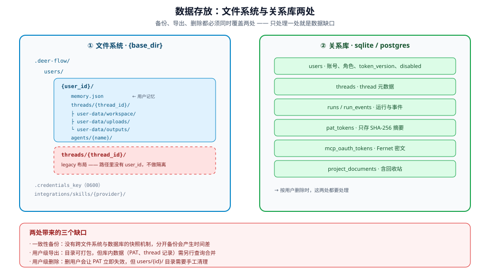

# 数据存储与隔离

「数据存在哪」决定了三件事：能不能备份、能不能按用户删除、能不能做数据驻留。
DeerFlow 的数据分散在**文件系统**与**关系库**两处，必须分开看。

## 1. 四类数据与存放位置




| 类别 | 存放 | 说明 |
|---|---|---|
| **用户记忆** | `{base}/users/{id}/memory.json` | 从对话提取的事实与偏好 |
| **用户画像** | `{base}/users/{id}/USER.md` | per-user profile（`paths.py:199-205`） |
| **per-user skills** | `{base}/users/{id}/skills/` | 用户自定义 skill（`paths.py:284-295`） |
| **thread 数据** | `{base}/users/{id}/threads/{tid}/user-data/` | workspace / uploads / outputs |
| **自定义 agent** | `{base}/users/{id}/agents/{name}/` | `SOUL.md` + `config.yaml` |
| **会话与运行元数据** | 关系库（sqlite / postgres） | thread 记录、run、事件、PAT、用户 |

前三类在**文件系统**，第四类在**数据库**。备份与删除策略必须两处都覆盖。

**`{base}` 默认是 `{project_root}/.deer-flow`**（`config/runtime_paths.py:23-27`；
可用 `DEER_FLOW_HOME` 覆盖）。PLAN §0.1 订正过的「`backend/.deer-flow/users/`」旧说法，
指的是早期版本；当前以 `Paths` 的权威树为准（`paths.py:131-152`）。

### 1.1 目录布局的权威定义

`packages/harness/deerflow/config/paths.py:344` 的 `thread_dir` 是两个布局的唯一来源：

```
{base}/users/{user_id}/threads/{thread_id}/      ← user_id 提供时
{base}/threads/{thread_id}/                      ← legacy（user_id 为 None）
```

三个沙箱可见目录都从它派生（`paths.py:364`、`:372`、`:380`）：

| 目录 | 沙箱内路径 | host 路径 |
|---|---|---|
| workspace | `/mnt/user-data/workspace` | `{...}/user-data/workspace` |
| uploads | `/mnt/user-data/uploads` | `{...}/user-data/uploads` |
| outputs | `/mnt/user-data/outputs` | `{...}/user-data/outputs` |

**隔离点在 `thread_dir` 一处**——只要它用对了 `user_id`，三类目录全部被隔离。
这也是为什么 ID 校验（拒绝 `/` 与 `..`，`paths.py:355-358`）是隔离的关键前提。

## 2. user_id 的来源

| 模式 | user_id |
|---|---|
| 认证开启 | session/JWT 解析 |
| 内部调用带 owner 头 | 该 owner 经 `make_safe_user_id` 归一化后的 id（有损但确定性，`internal_auth.py:15`、`:43-68`） |
| auth-disabled | `"default"`（`user_context.py:98`） |

**没有 `user_id` 时落到 legacy 路径**，即 `{base}/threads/{tid}/`——
这条路没有用户维度，升级后未迁移的旧数据就走在这里
（详见 [../identity/03-user-isolation.md](../identity/03-user-isolation.md) §3）。

## 3. Assistants 兼容层：一个只读 stub

Gateway 的 `/api/assistants` **不是**完整的 OpenAI Assistants API，而是
LangGraph Platform 兼容的只读 stub：`assistants_compat.py:1-10` 自述
"minimal stub"，只提供 search/get/graph/schemas 四条路由（`:89`、`:109`、`:118`、`:136`），
数据来自 `langgraph.json` 与 `config.yaml` 的 agent 定义。

| 项 | 行为 |
|---|---|
| 身份验证 | 走同一套 JWT/session 中间件 |
| 数据落盘 | **无**——stub 只读注册表，不写 thread/run 数据 |
| 隔离规则 | **没有第二份实现**，但也没有完整的 Assistants 语义（无 create/run/thread 端点） |

**含义**：它不会成为「第二条数据路径」，但也不能被当成 OpenAI Assistants 的完整替代。

## 4. 存储后端的选择

`database.backend` 决定元数据存哪：

| 值 | 适用 | 对治理的影响 |
|---|---|---|
| `memory` | 单进程临时使用 | **重启即丢**；多实例闸门会拒绝 |
| `sqlite` | 单机 | 可用 |
| `postgres` | 多实例 | 唯一被多实例闸门接受的值（见 [../cost/04-multi-instance.md](../cost/04-multi-instance.md) §2） |

**关键约束**：启动闸门要求 `database.backend='postgres'`（`deps.py:220-223`）。
所以「想扩容」会倒逼存储后端升级，不能只加副本。

## 5. 缺口

| 缺口 | 状态 | 边界 |
|---|---|---|
| 文件与库的**一致性**备份 | **无** | 无跨两者的快照机制；分开备份会产生时间差 |
| 按用户导出（数据可携带） | **无** | 无「导出某用户全部数据」的端点 |
| 按用户删除（被遗忘权） | **部分** | 删用户会连带使 PAT 失效（`pat.py:224-228`）；但文件系统目录需自行清理 |
| 加密存储 | **部分** | 通道/集成凭据 Fernet 加密（见 [04-credentials.md](04-credentials.md)）；普通 thread/memory/上传文件无字段级或目录级加密，依赖底层磁盘加密 |
| 数据驻留（按区域分库） | **无** | 单一后端，无按用户路由到不同地域的能力 |
| 存储配额 | **无** | 无 per-user 或全局磁盘配额 |
| memory.json 的版本化 | **无** | 单文件 JSON，无 schema 版本或迁移机制 |

## 6. 与其他章节的关系

- 隔离的实现细节与 no-auth 风险：[../identity/03-user-isolation.md](../identity/03-user-isolation.md)
- 输出脱敏（防止路径泄露）：[02-redaction.md](02-redaction.md)
- PII 脱敏：[05-pii-redaction.md](05-pii-redaction.md)
- 保留期与数据驻留：[06-retention-and-residency.md](06-retention-and-residency.md)
