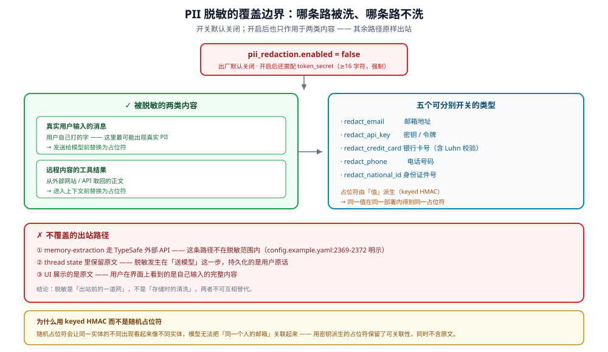

# PII 脱敏

这是本卷里**「有但不覆盖」最典型的例子**：功能存在、实现细致、默认关闭、
且明确不覆盖若干关键出口。三件事必须一起讲，只说前两件会误导评审。

## 1. 默认关闭




`config.example.yaml:1537-1538`：

```yaml
pii_redaction:
  enabled: false
```

**默认 `false`** 意味着出厂状态**不做任何 PII 脱敏**。

## 2. 五类可脱敏内容

`config.example.yaml:1539-1543` 列出五个开关（默认均为 `true`，但只在 `enabled: true` 时生效）：

| 开关 | 目标 |
|---|---|
| `redact_email` | 邮箱地址 |
| `redact_api_key` | API 密钥 |
| `redact_credit_card` | 信用卡号 |
| `redact_phone` | 电话号码 |
| `redact_national_id` | 身份证件号 |

## 3. `token_secret` 是强制项

`config.example.yaml:1544-1551` 用大段注释说明，不是可选：

| 要求 | 值 |
|---|---|
| 何时必需 | `enabled: true` 时 |
| 非空 | 是 |
| 最小长度 | **16 字符** |
| 不满足 | **config validation 失败**（拒绝启动） |

### 3.1 为什么必须是 keyed HMAC

原文注释（`config.example.yaml:1547-1550`）：

> an unkeyed digest would be a publicly computable, globally linkable fingerprint
> of the raw values (guessable for phone numbers)

| 若用无密钥 digest | 后果 |
|---|---|
| 可离线计算 | 拿到占位符就能反推原文（手机号空间小，可穷举） |
| 全局可关联 | 同一手机号在不同部署里映射成同一 token，跨库可关联 |

**有密钥后**：占位符只在**本部署内**可关联（`config.example.yaml:1546-1547`：
"Tokens are linkable only within this deployment and cannot be re-derived offline"）。

### 3.2 只作用于两类内容

`config.example.yaml:1526-1528` 界定了输入范围：

> emails, phone numbers, API keys, credit-card numbers (**Luhn-validated**) and
> national IDs found in **genuine user messages** and **remote-content tool
> results** (`web_fetch` / `web_search` / `image_search` / `web_capture` and MCP tools)

| 来源 | 是否脱敏 |
|---|---|
| 真实用户消息 | **是** |
| 远程内容类工具结果（`web_fetch`/`web_search`/`image_search`/`web_capture`/MCP） | **是** |
| **其他工具结果**（本地文件读取、代码执行输出等） | **不在声明范围内** |
| 系统提示词 | 否（不是要脱敏的对象） |

**信用卡号做 Luhn 校验**（`config.example.yaml:1526`）——所以 16 位随机数字
不会被误判成卡号。这是减少误报的具体手段。

## 4. 覆盖范围

`config.example.yaml:1525-1536` 说明了脱敏发生在哪些环节：

| 环节 | 是否脱敏 | 证据 |
|---|---|---|
| 发往模型的内容 | **是** | `config.example.yaml:1525-1530` |
| `/goal` 续写（隐藏） | **是**（存之前） | `config.example.yaml:1532` |
| 排队的 memory-extraction 载荷 | **是** | `config.example.yaml:1533-1534` |
| 压缩（compaction）输入 | **是** | `config.example.yaml:1534-1535` |
| 配置的 LLM 标题生成输入 | **是** | `config.example.yaml:1534-1535` |
| `/goal` 评估器输入 | **是** | `config.example.yaml:1534-1535` |
| **thread state 中的原始文本（供 UI 显示）** | **否** | `config.example.yaml:1533`（"Raw text stays in thread state for the UI"） |

**“发往模型的内容”不是全部消息**：只覆盖 genuine user messages 与远程工具结果
（`web_fetch`/`web_search`/`image_search`/`web_capture`/MCP）；assistant 消息与本地工具结果
不在这一层。见 `pii_redaction_middleware.py:425-427`、`:499-511`。

### 4.1 占位符是「值派生」的

`config.example.yaml:1530-1531`：

> placeholders are value-derived, so an identity redacted before compaction renders
> the same token afterwards.

**含义**：同一个邮箱在压缩前后得到**同一个占位符**，
所以压缩后模型看到的仍是「同一个实体」的一致视图，不会被当成两个不同对象。

## 5. 明确不覆盖的路径

这是本篇最重要的部分。

### 5.1 memory-extraction 的出站（TypeSafe API）

`config.example.yaml:2369-2372`：

> **EGRESS**: the formatted conversation text (user + final assistant turns, which
> may contain file paths or credentials) is sent to the TypeSafe API — a second
> destination beyond your own extraction model. Existing memory is never sent.
> **`pii_redaction_middleware` does not cover this path.**

| 关键点 | 说明 |
|---|---|
| 去向 | TypeSafe API —— **你自有抽取模型之外的第二个目的地** |
| 内容 | 格式化的对话文本（user + 最终 assistant 轮次） |
| 可能含 | 文件路径、凭据 |
| 是否脱敏 | **否** |
| 已有 memory | **不外发** |

**这是数据出境/第三方共享层面的事实**：即使开了 `pii_redaction`，
这条路径仍然把原始对话文本发给第三方。

### 5.2 UI 与 thread state

原始文本保留在 thread state 供 UI 显示（`config.example.yaml:1527-1528`）。
所以脱敏是**发往模型时**做的，不是**存储时**做的。

**含义**：数据库里存的是原文。数据库访问权限 = 原始 PII 的访问权限。

### 5.3 意外的 fail-open

`pii_redaction_middleware.py:396-402` 的 docstring 明确：
"Unexpected errors fail open (the original content reaches the model)"。
脱敏器本身报错时，原文仍会到达模型；这是有意的 trade-off（一行坏数据不该中断 run），
但企业评审要知道**它不是 fail-closed**。

## 6. 三条独立结论

| 结论 | 依据 |
|---|---|
| 出厂不做 PII 脱敏 | `enabled: false` |
| 打开后覆盖模型输入侧，不覆盖 TypeSafe 出站与本地存储 | 上述 §4、§5 |
| 占位符不可离线反推，但**本部署内可关联** | keyed HMAC + `token_secret` |

## 7. 缺口

| 缺口 | 状态 | 边界 |
|---|---|---|
| 默认启用 | **无** | `enabled: false` 是出厂值 |
| TypeSafe 出站路径的脱敏 | **无** | 配置注释明确声明不覆盖（`config.example.yaml:2372`） |
| 存储层脱敏 | **无** | 原文留在 thread state（`config.example.yaml:1527-1528`） |
| 自定义 PII 类型 | **无** | 五类硬编码；无正则/词典扩展点 |
| 脱敏命中统计 | **无** | 无「本次运行脱敏了多少处」的指标或事件 |
| NER 式识别 | **无** | 模式匹配为主；无基于模型的实体识别 |

## 8. 与其他章节的关系

- 路径脱敏（另一套机制，防目录泄露）：[02-redaction.md](02-redaction.md)
- 存储布局与保留期：[01-storage-and-isolation.md](01-storage-and-isolation.md)、[06-retention-and-residency.md](06-retention-and-residency.md)
- 合规映射：[../compliance/02-gdpr.md](../compliance/02-gdpr.md)
