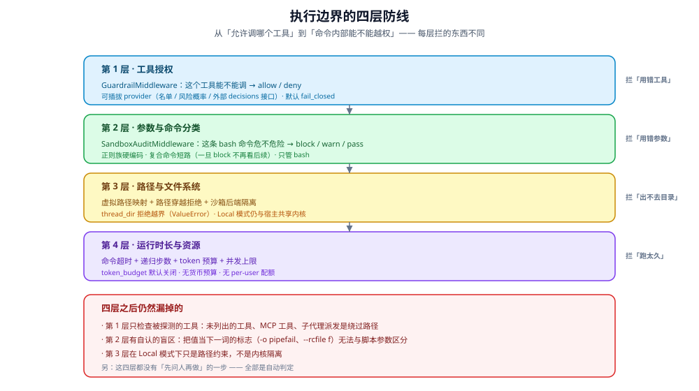

# 七种沙箱模式

从 Local 路径映射到 K8s Provisioner，三种隔离级别。

## 七种沙箱模式

| 模式 | `sandbox.use` | 隔离级别 | 适用场景 |
|------|--------------|---------|---------|
| **Local** | `deerflow.sandbox.local:LocalSandboxProvider` | 无进程隔离，共享 host 内核 | 个人开发、信任环境 |
| **Docker (AioSandbox)** | `deerflow.community.aio_sandbox:AioSandboxProvider` | 容器隔离 | 团队部署 |
| **K3s (Provisioner)** | 同 `AioSandboxProvider` + `sandbox.config.provisioner_url`（`aio_sandbox_provider.py:257-269` 据此选用 `RemoteSandboxBackend`，不是独立 provider 类） | Pod 隔离 | 多租户、高安全需求 |
| **BoxLite** | `deerflow.community.boxlite:BoxliteProvider` | Micro-VM（自有内核） | 单机强隔离、OCI 镜像 |
| **E2B** | `deerflow.community.e2b_sandbox:E2BSandboxProvider` | 云端远程沙箱 | 免运维、弹性 |
| **Tenki** | `deerflow.community.tenki:TenkiSandboxProvider` | 云端 Micro-VM | 免运维、强隔离 |
| **OpenSandbox** | `deerflow.community.opensandbox:OpenSandboxProvider` | 云端远程沙箱 | 免运维、可自托管域 |

> 表中 7 行对应 7 种运行模式，但只有 6 个 provider 类——Provisioner 是 AIO provider 配置 `provisioner_url` 后的一种模式。详见 [concepts/sandbox/abstract-interface-and-seven-impls.md](../../concepts/sandbox/abstract-interface-and-seven-impls.md)。

**Local 模式的特殊风险：** agent 的 bash 命令直接在 host 上执行。所有隔离依赖虚拟路径翻译——如果路径翻译有 bug，agent 就能碰到系统文件。

