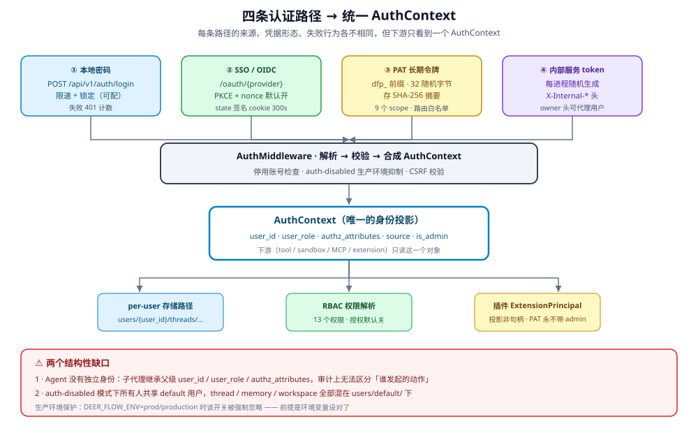

---


title: "认证模型"
description: '四条并行认证路径：本地密码、SSO/OIDC、个人访问令牌、内部服务 token。它们共享同一套 Gateway 中间件，但准入条件与生命周期完全不同。'
topics: [governance, identity]
verified_against: v2.2.0
last_verified: 2026-11-08
---

# 认证模型

「谁能进来」这个问题在 DeerFlow 有**四条**答案，不是一条。它们共享
`app/gateway/auth_middleware.py` 这层中间件，但凭据形态、有效期、可撤销性各不相同。

## 1. 四条路径



| 路径 | 凭据 | 准入端点 | 有效期 | 可撤销 |
|---|---|---|---|---|
| **本地密码** | HttpOnly session cookie | `POST /api/v1/auth/login/local`（`app/gateway/routers/auth.py:431`） | JWT 过期 | 改密 → `token_version` +1 |
| **SSO / OIDC** | 同上（回调后发 cookie） | `GET /api/v1/auth/callback/{provider}`（`app/gateway/routers/auth.py:1030`） | 同上 | 同上 |
| **个人访问令牌** | `Authorization: Bearer dfp_...` | 白名单路由（见 [08 §3](08-pat.md)） | 可设 1–365 天；缺省不过期 | `DELETE /auth/pats/{id}` 或停用账号 |
| **内部服务 token** | `X-DeerFlow-Internal-Token` | 内部 HTTP 调用 | 不过期 | 换 env 值重启 |

**共同点**：四条最终都解析成一个 `user`，后续授权一视同仁。
**差异点**：PAT 与内部 token **不经过** JWT 校验，因此「登出」对它们无效。

## 2. 本地密码与 SSO 共用 session

两条路径的终点相同：签发 HttpOnly session cookie。

```
本地：POST /auth/login/local → 验密码 → 发 cookie
SSO ：GET  /auth/callback/{provider} → 验 ID token → provisioning → 发 cookie
```

所以「改密码」和「SSO 登录」产生的会话形态完全一致，
`token_version` 机制（`app/gateway/auth/models.py:36`，改密时 +1 使旧 JWT 失效）对两者都生效。

**没有 refresh endpoint**：登录响应只返回 `expires_in` / `needs_setup`，
过期即需重新登录。SSO 会话过期后要走一次 IdP 往返。

## 3. PAT 不走 session 路径

PAT 由 `auth_middleware.py` 单独分支处理，核心逻辑在 `app/gateway/auth/pat.py:201` `authenticate_pat`：

| 特征 | 说明 | 证据 |
|---|---|---|
| 前缀识别 | 只认 `dfp_` 开头的 Bearer | `app/gateway/auth/pat.py:210-211` |
| 存储 | 只有 SHA-256 摘要，无明文 | `app/gateway/auth/pat.py:175` |
| 账号联动 | 用户删除或停用 → 令牌立即失效 | `app/gateway/auth/pat.py:224-233` |
| 路由边界 | **默认拒绝**，仅白名单可达 | `app/gateway/auth/pat.py:60` |
| 权限叠加 | 作用域只能收窄，不能超越所属用户 | `app/gateway/auth/pat.py:7-8` |

`app/gateway/auth_middleware.py:165` 是强制点，`app/gateway/app.py:1210` 另外压制 PAT 的 admin 能力
（`#5041`：PAT credentials never carry admin capability）。

详解见 [08-pat.md](08-pat.md)。

## 4. 内部服务 token

`backend/app/gateway/internal_auth.py` 管理 Gateway 与内部调用方（IM channels 等）之间的凭据：

| 项 | 值 | 证据 |
|---|---|---|
| Header | `X-DeerFlow-Internal-Token` | `app/gateway/internal_auth.py:14` |
| 来源 | 环境变量 `DEER_FLOW_INTERNAL_AUTH_TOKEN` | `app/gateway/internal_auth.py:16`、`:21` |
| 未设置时 | 进程启动随机生成（`secrets.token_urlsafe(32)`） | `app/gateway/internal_auth.py:24` |
| 生命周期 | 不随 JWT 过期 | — |

**多 worker 的关键约束**：随机生成是**每进程**的，所以 `GATEWAY_WORKERS > 1`
或跑多个副本时**必须显式设置同一个 env 值**，否则各 worker 互不认对方的内部 token。

详解见 [02-internal-token.md](02-internal-token.md)。

## 5. 统一解析与授权

四条路径在中间件后段收敛成同一个 `AuthContext`，后续 13 个
`resource:action` 权限由 `@require_permission` 装饰器检查（`app/gateway/authz.py:63-86`）。

**对企业的含义**：认证方式的差异大部分不传导到授权层——不管用哪条路进来，
能做什么都由同一个 RBAC 表决定。但有两个例外：**PAT 的 scope 会直接收窄路由权限**
（见 [08-pat.md](08-pat.md) §2），**内部 token 带 owner 头时 run 层会继承 owner 上下文**
（路由层仍是 `internal`/`default_role`，见 [02-internal-token.md](02-internal-token.md) §3）。

## 6. 缺口

| 缺口 | 状态 | 边界 |
|---|---|---|
| 统一登出所有会话 | **部分** | 有 `POST /auth/logout` 清 cookie（`app/gateway/routers/auth.py:517`）、`token_version` 可作废 JWT；但**不**作废 PAT |
| 会话列表 / 踢出设备 | **无** | 无「查看我的活跃会话」端点 |
| 禁用本地密码登录 | **无** | SSO 部署里 `/auth/login/local` 始终开放（见 [10-registration-policy.md](10-registration-policy.md) §5） |
| refresh token | **无** | 过期需重新登录 |
| Agent 独立身份 | **无** | 见 [04-agent-identity-gap.md](04-agent-identity-gap.md) |

## 7. 与其他章节的关系

- SSO/OIDC 完整契约：[07-sso-and-oidc.md](07-sso-and-oidc.md)
- PAT 作用域与路由边界：[08-pat.md](08-pat.md)
- 登录限速与多副本锁禁：[09-login-throttle.md](09-login-throttle.md)
- 注册策略与密码强度：[10-registration-policy.md](10-registration-policy.md)
- 13 个 RBAC 权限：[../authorization/04-rbac-permissions.md](../authorization/04-rbac-permissions.md)
