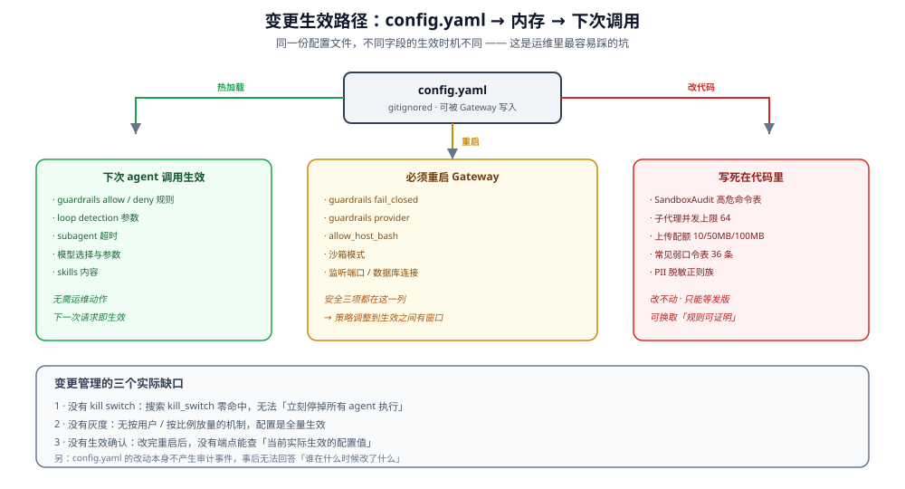

# 变更控制

扩展与插件授予、Skill mutation 七步流。

### 🆕 扩展与插件的变更控制（2.2.0）

扩展生态引入了一类新的生命周期对象：**插件能力授予**。它的合规特征是"重启绑定"——不是热更新的。

| 对象 | 变更方式 | 生效时机 | 来源 |
|------|---------|---------|------|
| 安装/启用/禁用插件 | `deerflow extensions install/upgrade/enable/disable/remove` 或 `make extension-*` | **重启 Gateway**（每次变更都必须重启） | `config.yaml -> plugins:` |
| `host_access` 授予 | 运维手写 `config.yaml` | **重启**；启动期校验不过就**装配失败** | `extensions/loader.py:55` 的 `_validate_host_identity` |
| 插件 settings | 插件自有管理路由（`permissions.write`） | 立即 | 插件控制 |
| Skill mutation | 四操作协议（stage/check/commit/revert）+ 集成侧读快照/读 bundle/重试，共七步 | 提交即生效，带回滚窗口 | `deerflow_extension_api/skill_mutations.py:34`、`:136-154` |

**为什么插件清单故意不在 `extensions_config.json`**：那份文件是 **API 可写**的（MCP + skills 由前端直接保存）。插件清单会 **import 代码**，且 import 的代码以 Gateway 权限运行——所以它留在运维掌控的 `config.yaml -> plugins:` 里，进程启动时加载一次。这条边界是合规意义上的关键控制点：**能改插件清单 = 能在生产上执行任意 Python**。

### 🆕 Skill mutation 的发布闸门

skill 变更（agent 自主改写 skill）是 agent 生命周期里最需要管控的一环。2.2.0 用一个七步流水线替代了"直接写文件"：

| 闸门 | 机制 | 运维含义 |
|------|------|---------|
| **拓扑断言** | `HostCapabilities.start()` 要求显式 `topology="single_host_local"`，否则 `HostCapabilityError("UNSUPPORTED_TOPOLOGY")`（`backend/packages/harness/deerflow/extensions/host_capabilities.py:52-53`；`backend/packages/harness/deerflow/skills/mutations/service.py:65` 再次校验） | 多副本部署**开不起来** mutation 面——这是刻意的，不是缺陷 |
| **owner ⊆ evidence owners** | mutation 里的 owner id 必须是已完成 run evidence 里的 owner 子集，否则 `HostCapabilityError("INVALID_GRANT")`（`backend/packages/harness/deerflow/extensions/host_capabilities.py:55`） | 插件只能改自己有证据链的技能 |
| **版本乐观并发** | 每次写都带 `AssetRevision`；不匹配即失败 | **没有 force-overwrite 逃生门** |
| **提案 TTL** | `proposal_ttl_seconds=86400`（1 天，`deerflow_extension_api/skill_mutations.py:42`）、`check_ttl_seconds=900`（15 分）、`rollback_ttl_seconds=2592000`（30 天，`:44`） | 过期即作废，必须重来 |
| **配额** | `max_pending_proposals=20`（`skill_mutations.py:34`）、`max_owner_plugin_scans_per_hour=20`、`max_concurrent_scans=4`（单插件 2） | 防单插件把扫描配额吃光 |
| **包大小** | 主文件 128 KiB、整包 16 MiB、256 文件、20 源 | 整包/文件数上限与浏览器资产同源；单文件上限不同（浏览器 4 MiB vs skill 128 KiB） |

`operation` 记录保留 `generation` 与 `superseded_by_generation`，所以"这次变更被哪一代替换"是可追溯的——
但字段只记代号，**不记替换者身份**；能说"哪一代"，不能说"谁"。

### Agent 停用/删除

- **Thread 删除：** `DELETE /api/threads/{id}` 删除 LangGraph thread + 本地 thread 目录
- **Custom agent 删除：** `DELETE /api/agents/{name}`（`agents.py:765-825`）；`agents_api.enabled` 默认 `false`，启用后删 config/SOUL/memory
- **Skill 关闭：** `PUT /api/skills/{name}` → `enabled: false`