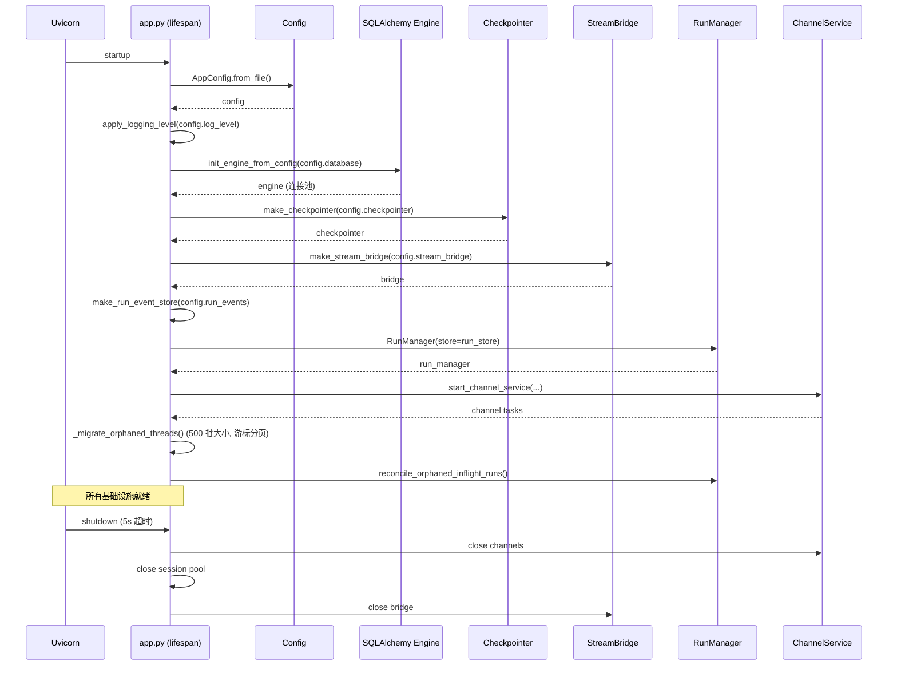

---


title: "网关架构全景"
description: '网关架构全景：架构、契约与源码锚点。'
topics: [gateway, api, rest]
verified_against: v2.2.0
last_verified: 2026-11-08
---

# 网关架构全景

## 文件

- `app/gateway/app.py` — FastAPI 应用 + lifespan
- `app/gateway/deps.py` — 依赖注入
- `app/gateway/health.py` — `/health`（liveness）与 `/health/ready`（数据库就绪探针）🆕
- `app/gateway/auth_middleware.py` — JWT 认证中间件
- `app/gateway/csrf_middleware.py` — CSRF 双重提交 Cookie 模式
- `app/gateway/internal_auth.py` — 内部服务认证
- `app/gateway/authz.py` — 基于角色的权限装饰器
- `app/gateway/services.py` — 后台服务编排
- `app/gateway/artifact_archive.py` — run 产出 ZIP 归档（fail-closed 构建）🆕
- `app/gateway/skill_export.py` — 自定义 Skill 导出 worker 与流式响应 🆕
- `app/gateway/capabilities.py` — Capability Center 适配器注册表（`mcp`/`business`/`lark`/`skills`）🆕 v2.2.0
- `app/gateway/knowledge_scope_admission.py` — 每条消息的知识检索 scope 准入（422 details）🆕 v2.2.0
- `app/gateway/persistent_writes.py` — `run_drained_write()`：所有持久化写路由统一经它跨取消排空 🆕 v2.2.0
- `app/gateway/run_origin.py` — `resolve_request_origin()`：服务器自有的 `deerflow_origin` 解析 🆕 v2.2.0
- `app/gateway/sse_headers.py` — 所有 SSE 端点共享的响应头（`no-transform` / `X-Accel-Buffering: no`）🆕 v2.2.0
- `app/gateway/checkpoint_retention.py` — thread 级 checkpoint 保留（只删「尾随 duration-only 叶」与 opt-in「无子叶兄弟分支」，契约见 `docs/checkpoint-retention-contract.md`）🆕 v2.2.0
- `app/gateway/scheduled_task_access.py` / `scheduled_task_errors.py` / `scheduled_task_validation.py` — 定时任务的授权、编码错误（`{code,message,params}`）与共享校验 🆕 v2.2.0
- `app/gateway/personal_mcp_access.py` — 把 personal MCP 的 admin 判定绑到 Gateway 账户表 🆕 v2.2.0
- `app/gateway/mcp_oauth_tokens.py` — MCP OAuth token 经应用数据库在一个 Gateway 生命周期内共享 🆕 v2.2.0
- `app/gateway/extension_agent_runs.py` / `extension_artifacts.py` — 把常规 Gateway run 路由适配成**可吊销的扩展能力**（HMAC 句柄）与扩展产物有界读取（不走符号链接、不重读可变路径）🆕 v2.2.0

## 认证流程

```mermaid
flowchart TD
    REQ[HTTP 请求] --> AM{AuthMiddleware}
    AM -->|Authorization: Bearer| JWT[JWT 验证]
    AM -->|X-DeerFlow-Internal-Token| IT[内部 Token 验证]
    AM -->|无认证| ANON[匿名 — 公开端点]

    JWT -->|有效| JWT_OK[设置 request.state.auth]
    JWT -->|过期/invalid| JWT_ERR[精细错误: token_expired/token_invalid/user_not_found]

    IT -->|匹配| IT_OK[内部服务 — 无用户上下文]
    IT -->|不匹配| IT_ERR[403]

    ANON -->|公开路径 ✅| PUB[允许通过]
    ANON -->|受保护路径 ❌| AUTH_ERR[401]

    JWT_OK --> CSRF{CSRFMiddleware}
    CSRF -->|有 Cookie + Header| CSRF_OK[传递]
    CSRF -->|不匹配 (常数时间比较)| CSRF_ERR[403]
    CSRF -->|豁免路径: /api/v1/auth/me, login, register| PASS[传递]

    JWT_OK --> AZ{authz 装饰器}
    AZ -->|owner_check| OWN[验证 user_id == resource.owner_id]
    AZ -->|require_existing| EX[缺失行 → 404 拒绝]
```

## Lifespan 启动序列



## 配置热重载边界

```mermaid
flowchart LR
    subgraph 重启必需
        DB[database.*]
        CP[checkpointer.*]
        RE[run_events.*]
        SB2[stream_bridge.*]
        SAND[sandbox.use]
        LOG[log_level]
        IM[channels.*]
    end

    subgraph 热重载
        MOD[models.*.max_tokens]
        SUM[summarization.*]
        TITLE[title.*]
        MEM[memory.*]
        SUB[subagents.*]
        TOOLS[tools[*]]
        PROMPT[system prompt]
    end

    CONFIG[config.yaml 变更] -->|下次请求| HR[get_app_config 返回新值]
    HR --> HOT[热重载字段生效]
    HR --> COLD[重启必需字段: 警告或忽略]
```

## 权限系统 (`authz.py`)

```python
@require_permission("threads", "write", owner_check=True, require_existing=True)
```

三种权限模式：

| 参数 | 行为 |
|------|------|
| 默认 | 检查请求者是否有指定权限 |
| `owner_check=True` | 验证 `request.state.auth.user_id` 与资源所有者匹配 |
| `require_existing=True` | 缺失行 → 404（静默拒绝，防止所有权枚举） |
| `require_existing=False` | 允许缺失行（旧版未跟踪线程的向后兼容） |

**13** 个已定义权限（`Permissions` 类 `authz.py:63-87`，`_ALL_PERMISSIONS` 列表 `:161-175`）：`threads:read/write/delete`、`runs:create/read/cancel`、`memory:read/write`、`agents:read/write`、`projects:read/write/delete`。授权关闭时所有已认证用户被授予全部 `_ALL_PERMISSIONS`。

`authz.py` 另有三类**非装饰器**授权入口：`authorize_model_use()`（`:413`，`GET /api/models/{name}` 的 `model:use` 决策，fail-closed **403**）、`authorize_sandbox_for_request()`（`:478`，上传后 sandbox 同步跳过而非失败）、`authorize_plugin_action_for_request()`（`:733`，插件 action 的 provider 决策，在 body 被读取**之前**执行以免被拒调用方消耗输入预算）。

## 内部认证 (通道 Worker)

IM 通道 worker 发送三头模式：

```
X-DeerFlow-Internal-Token: <auto-generated urlsafe(32)>
X-CSRF-Token: <value from csrf_token cookie>
Cookie: csrf_token=<value>

→ 内部 Token 绕过 JWT
→ CSRF Token/Cookie 对通过 CSRF 检查
→ 所有通道消息以 "default" 用户身份运行
```

## 线程元数据防伪造

```python
_SERVER_RESERVED_METADATA_KEYS = frozenset(["owner_id", "user_id"])
```

这些键通过 Pydantic `@field_validator` 从所有入站元数据中剥离。客户端无法伪造线程所有权。

## 日志注入防护

```python
def sanitize_log_param(value: str) -> str:
    return value.replace("\n", "").replace("\r", "").replace("\x00", "")
```

## 孤儿线程数据迁移

`_migrate_orphaned_threads()` 使用 **游标分页**（每批 500）迭代所有没有 `user_id` 的 LangGraph store 线程，并分配管理员账户。这是旧版本升级路径。

## 🆕 2.1 新增路由

| Router | 端点 | 说明 |
|--------|------|------|
| **Features** | `GET /api/features` | Config-gated feature flags（`agents_api`/`browser_control`/`mcp_tasks`/`subagent_batches`）供前端门控 |
| **Console** | `GET /api/console/stats`, `/runs`, `/usage` | 跨 thread 可观测性面板（需 SQL backend） |
| **Input Polish** | `POST /api/input-polish` | Composer 草稿润色（一次性 LLM，不创建 run） |
| **Channel Connections** | `GET /api/channels/providers`、`GET /api/channels/connections`、`POST /api/channels/{provider}/connect`、`DELETE /api/channels/connections/{id}`、`GET/POST/DELETE /api/channels/{provider}/runtime-config` | 用户绑定的 IM channel 连接管理；runtime-config 三个端点是 admin-only（与 `channels.py` 共用 `/api/channels` 前缀） |
| **OIDC Auth** | `GET /api/v1/auth/oauth/{provider}`, `GET /api/v1/auth/callback/{provider}` | OIDC/SSO authorization code flow + session 管理 |
| **GitHub Webhooks** | `POST /api/webhooks/github` | HMAC 验证的 GitHub event 接收 |
| **Thread Branches** | `POST /api/threads/{id}/branches` | 从 checkpoint 分支创建新 main thread |
| **Manual Compaction** | `POST /api/threads/{id}/compact` | 手动上下文压缩 |
| **Thread Goal** | `GET/PUT/DELETE /api/threads/{id}/goal` | Goal continuation 管理 |
| **Subagents** | `GET/POST /api/subagents`，`PUT/DELETE /api/subagents/{name}` | 托管 subagent 目录 + admin 管理（managed-worker CRUD） |
| **Subagent Batches** | `GET /api/threads/{id}/subagent-batches[/{batch_id}...]` | 持久化原生 subagent 批进度/控制（pause/resume/cancel/retry、`results.jsonl` 导出） |
| **MCP Tasks** | `GET /api/threads/{id}/mcp-tasks[/{task_id}]`，`POST /{task_id}/cancel` | 长时 MCP 持久化任务的 owner-scoped 只读视图 + 取消 |

### 🆕 v2.1.0-rc0 新增路由（同步 #6）

| Router | 端点 | 说明 |
|--------|------|------|
| **Projects** | `POST/GET /api/projects`，`GET/PATCH/DELETE /api/projects/{id}`，`POST /{id}/archive`、`/{id}/restore`，`GET /{id}/threads`，`GET /config` | 项目工作区 CRUD + 归档/恢复 + 成员线程列表 + 配置界限（instructions/shelf 上限） |
| **Project Documents** | `GET/POST /api/projects/{id}/documents`，`POST /from-thread`，`POST /{doc}/attach-to-thread/{tid}`，`GET /{doc}/content`，`DELETE /{doc}` | Document shelf：上传（有界 staging）、从线程晋升、附加到线程、内容读取、删除（进 trash） |
| **Trash** | `GET /api/trash/documents`，`POST /documents/{id}/restore`、`/{id}/purge`，`POST /purge` | 回收站：列出/恢复/永久清除（单条+批量）。restore 是 DB 重指向（文件不移动）；purge 行锁事务内 unlink 原件+派生 markdown；`trash_retention_days` 保留期清扫兜底 |
| **User Preferences** | `GET/PATCH /api/v1/auth/preferences` | 账号级偏好持久化（跨浏览器，migration `0023_user_preferences`），前端 settings 同步的后端 |
| **PAT** | `routers/auth.py` 扩展（`auth/pat.py` 核心，migration `0017`） | Personal Access Tokens：程序化 API 访问的令牌签发/吊销 |
| **Skill Export** | `gateway/skill_export.py` | 自定义 skill 包导出 + revision-bound preview |
| **Artifact Archive** | `gateway/artifact_archive.py` | run 文件打包 zip 下载 |
| **Conversation Access/Reader** | `gateway/conversation_access.py`、`conversation_reader.py` | run context 携带 `conversation_references` 的归属与分页读取（供 `read_conversation` 工具，owner 校验每次读取都做） |
| **Upload Ingestion** | `gateway/upload_ingestion.py` | 上传摄取统一入口（去重文件名 255 字节上限） |
| **Readiness** | `GET /health/ready` | 公开无认证探针，探测 Gateway 实际使用的持久化（DB bootstrap 状态）——`make up` 就绪等待用它 |

其他 rc0 Gateway 行为：**idempotent thread runs**（同 run key 重试不重复执行）、**paginated thread run history**（`thread_runs.py` 大改，migration `0023_run_change_seq` 支持稳定分页游标）、renamed thread title 全端同步。

### Router 全表核对（v2.2.0，41 个 router 文件 / 221 条端点）

上两张表只列「2.x 新增」的 router，**不完整**。下面对 `app/gateway/routers/` 的**全部 41 个 router 文件**逐行核对（v2.1.0 时是 31 个）；每条 `(方法, 路径)` 的穷举清单、鉴权与状态码见 [01-api-reference.md](01-api-reference.md)（共 **221** 条）。

v2.2.0 新增的 10 个 router 文件（表中标 🆕 v2.2.0）：`admin_users.py`、`capabilities.py`、`im_notification_preferences.py`、`knowledge.py`、`managed_models.py`、`personal_mcp.py`、`plugins.py`、`skill_mutations.py`、`thread_activity.py`、`routers/AGENTS.md`（契约文档，不是路由）。

| # | Router 文件 | 端点组（前缀 + 数量） | 关键点 | 此前是否已覆盖 |
|---|------------|---------------------|--------|---------------|
| 1 | `models.py` | `/api/models`（2） | 模型目录；`GET /{name}` 做 `model:use` 授权，fail-closed **403** | ❌ 本次补 |
| 2 | `features.py` | `/api/features`（1） | 前端能力门控（`agents_api`/`browser_control`/`mcp_tasks`/`subagent_batches`/`conversation_references`） | ✅ |
| 3 | `console.py` | `/api/console/*`（3） | 跨 thread 可观测性；无 SQL backend **503** | ✅ |
| 4 | `mcp.py` | `/api/mcp/config`、`/config/server(s)`、`/cache/reset`（7） | 全部 admin-only（**403**）；配置非法 **400** | ⚠️ 只提 PATCH |
| 5 | `mcp_tasks.py` | `/api/threads/{id}/mcp-tasks`（3） | owner-scoped 只读 + cancel；worker 未运行 **503** | ✅ |
| 6 | `memory.py` | `/api/memory`、`/reload`、`/config`、`/status`、`/export`、`/import`、`/facts`（10） | 后端不支持 **501**；并发冲突 **409** | ⚠️ 只提 4 条 |
| 7 | `skills.py` | `/api/skills`、`/custom/*`、`/install[/upload]`、`/reload`（14） | 管理端点 admin-only；扫描阻断 **400**；包体超限 **413** | ⚠️ 部分 |
| 8 | `integrations.py` | `/api/integrations/lark/*`（7） | 写操作 admin-only；`GET /status` 对非 admin 只脱敏；CLI 超时 **504** | ❌ 本次补 |
| 9 | `artifacts.py` | `/api/threads/{id}/artifacts/{path}`（2） | 编辑受 412/413/415；读取支持 `Range` **206/416** | ⚠️ 部分 |
| 10 | `assistants_compat.py` | `/api/assistants/*`（4） | LangGraph Platform SDK 兼容 stub | ❌ 本次补 |
| 11 | `browser.py` | `/api/threads/{id}/browser/navigate`（1）+ `WS .../browser/stream` | 受 `browser_control` 门控；未启用 **404**，依赖缺失 **501**，失败 **502** | ❌ 本次补 |
| 12 | `uploads.py` | `/api/threads/{id}/uploads`（4） | 413 三个来源（文件数/单文件/总量） | ⚠️ 部分 |
| 13 | `threads.py` | `/api/threads`、`/{id}`、`/{id}/state`、`/{id}/goal`、`/{id}/history`、`/{id}/branches`、`/{id}/compact`、`/{id}/move`、`/search`（14） | run 在跑统一 **409**；checkpoint 模式不匹配 **409**/切换中 **503** | ⚠️ 部分 |
| 14 | `thread_runs.py` | `/api/threads/{id}/runs*`、`/messages*`、`/token-usage`（20） | 幂等键 **409**、策略不支持 **501**、GET stream `action` **405**、归档 **413/429/503** | ⚠️ 部分 |
| 15 | `runs.py` | `/api/runs/stream`、`/api/runs/wait`、`/{id}/messages`、`/{id}/feedback`（4） | stateless；强制 `runs:create` | ⚠️ 部分 |
| 16 | `feedback.py` | `/api/threads/{id}/runs/{rid}/feedback`（6） | rating 非法 **400**；run/反馈不存在 **404** | ✅ |
| 17 | `suggestions.py` | `/api/suggestions/config`、`/api/threads/{id}/suggestions`（2） | 生成失败**静默降级**为空数组 | ⚠️ 部分 |
| 18 | `input_polish.py` | `/api/input-polish`（1） | LLM 失败 **503** | ✅ |
| 19 | `agents.py` | `/api/agents*`、`/api/user-profile`（8） | `agents_api.enabled` 关闭 **403**；已存在 **409**；未知 model **422** | ❌ 本次补 |
| 20 | `scheduled_tasks.py` | `/api/scheduled-tasks*`、`/api/threads/{id}/scheduled-tasks`（11） | `_ensure_task_mutable` **409**；派发失败 **502** | ❌ 本次补 |
| 21 | `projects.py` | `/api/projects*`（9） | 缺失/他人/已归档统一 **404** | ✅ |
| 22 | `project_documents.py` | `/api/projects/{id}/documents*`（6） | 归档项目上架 **404**；内容缺失 **409**；超限 **413** | ✅ |
| 23 | `project_thread_files.py` | `/api/projects/{id}/thread-files`（1） | `projects:read` + `threads:read` | ⚠️ 只提一句 |
| 24 | `trash.py` | `/api/trash/*`（4） | 文件清理失败 **500**（行留回收站可重试） | ✅ |
| 25 | `user_preferences.py` | `/api/v1/auth/preferences`（2） | 仅 session（PAT/内部 **403**）；账号切换 **409** | ✅ |
| 26 | `channel_connections.py` | `/api/channels/providers`、`/api/channels/connections`、`/{provider}/connect`、`/{provider}/runtime-config`（6） | 连接码超限 **429**；503 在 read 路径被刻意吞掉降级 | ✅ |
| 27 | `channels.py` | `/api/channels/`、`/{name}/restart`（2） | service 未运行 **503**；restart admin-only | ❌ 本次补 |
| 28 | `auth.py` | `/api/v1/auth/*`（13） | 登录/注册/OIDC 公开；PAT 管理要 session；登录锁定 **429**；OIDC discovery 失败 **502** | ⚠️ 部分（OIDC/PAT） |
| 29 | `github_webhooks.py` | `/api/webhooks/github`（1） | HMAC 失败 **401**；未配置 secret 时**不挂载 → 404** | ✅ |
| 30 | `subagents.py` | `/api/subagents*`（4） | 名称保留/已存在 **409**；未知 model **422** | ✅ |
| 31 | `subagent_batches.py` | `/api/threads/{id}/subagent-batches*`（8） | worker 未运行 **503**；retry 非 failed **409** | ✅ |
| 32 🆕 v2.2.0 | `admin_users.py` | `/api/v1/admin/users`（2） | 全部 `require_admin_user`（**403**）；无字段 **422**；未知 role **422**；用户不存在 **404**；降级最后一个 admin / 禁用最后一个活跃 admin **409** | ❌ 新增 |
| 33 🆕 v2.2.0 | `capabilities.py` | `/api/capabilities`（3） | `catalog` 公开可读；`installations/{adapter}` 由 `scope=` 决定 admin 需求；未知 adapter **422**；部署级安装非 admin **403** | ❌ 新增 |
| 34 🆕 v2.2.0 | `knowledge.py` | `/api/knowledge`（3） | 全部 `threads:read`；只读检索目录 + 每 assistant `/capabilities`，资源授权由 provider 适配器负责 | ❌ 新增 |
| 35 🆕 v2.2.0 | `managed_models.py` | `/api/managed-models`（4） | 全部 admin；`route_class=RedactedModelRoute`（响应脱敏）；`POST /test` 是流式且强制关掉 thinking | ❌ 新增 |
| 36 🆕 v2.2.0 | `personal_mcp.py` | `/api/mcp/personal/config`（5） | **owner-only**（与平台级 MCP 的 admin-only 分离）；`personal_mcp_access.py` 把 admin 判定绑到账户表 | ❌ 新增 |
| 37 🆕 v2.2.0 | `plugins.py` | `/api/plugins`（5） | 诊断 admin-only；`modules/*.mjs` 与 `assets/...` 由 revision 内容哈希钉住（`immutable` + `CSP: sandbox`）；action **413** >256 KiB / **409** viewer 变更 / **504** 30s 超时 / **502** 其它 | ❌ 新增 |
| 38 🆕 v2.2.0 | `skill_mutations.py` | `/api/skill-mutations`（4） | 全部 admin；worker 不可用 **503**；操作列表末页 `next_cursor: null` | ❌ 新增 |
| 39 🆕 v2.2.0 | `thread_activity.py` | `/api/thread-activity`（1） | 需 SQL 持久化否则 **503**；游标 `"seq:run_id"`，非法游标 **422** `invalid_cursor`；limit 1–500（默认 200） | ❌ 新增 |
| 40 🆕 v2.2.0 | `im_notification_preferences.py` | `/api/channels/notification-preferences`（2） | 两个方法都要求 `X-Expected-User-Id` 头；账号变更 **409**；无 session factory **503** | ❌ 新增 |
| 41 | `features.py`（改） | `/api/features`（1） | 🆕 v2.2.0 载荷扩到 8 组：`agents_api`/`browser_control`/`mcp_tasks`/`subagent_batches`/`conversation_references`/`knowledge_base`/`scheduled_tasks`/`thread_activity` | ✅ |

非 `routers/` 的入口：`GET /health`（`app.py:1446`）、`GET /health/ready`（`app.py:1455`）与 `WS /api/threads/{id}/browser/stream`（`routers/browser.py:214`）；`/docs`/`/redoc`/`/openapi.json` 在 `app.py:1096-1098` 由 `config.enable_docs` 门控。

Router mount 顺序（`app.py:1327-1441`）：`managed_models`(:1327) → … → `plugins`(:1412) → `auth`(:1415) → `user_preferences`(:1416) → `im_notification_preferences`(:1417) → `feedback`(:1420) → `thread_runs`(:1423) → `runs`(:1426) → `github_webhooks`（条件挂载 `:1441`）。扩展贡献路由在**所有 host 路由之后** mount（见 §Gateway contribution points）。

### 🆕 v2.1.0 补丁版变更（同步 #7，upstream #5535 / #5517）

`DELETE /api/threads/{id}` 的清理语义被补全（此前只删文件系统数据 + checkpoints + thread_meta）：整个清理过程持有一条 **durable `delete` reservation**，然后按顺序清除

**文件系统 thread 数据 → checkpoints → 历史 run 行 → run events → feedback → `threads_meta` 行 → 关闭残留 browser session**

其中 filesystem 那步不是 best-effort（`_delete_thread_data()` 会把 `ValueError` 映射成 422、其他异常映射成 500 直接中止），其余各步 best-effort。

关键点：

- 历史 run 行只删 `operation_kind == "run"` 的（`RunRepository.delete_by_thread()`）——**保护本次请求的那条 reservation 行必须活到 `reserve_thread_operation()` 退出**，否则 DELETE 会在中途丢掉自己的跨 worker 互斥；批量删也**故意不 bump run-change clock**（顺带绕开 #5516 的 `run_change_clock` 缺失问题）。
- run events 是**用户可见的会话历史，不是缓存**：不清掉的话，被删线程的 feed 仍能通过 `GET /threads/{id}/messages` 读回来。事件存储的删除与写者共享同一串行域（见 [observability/02-run-events-and-journal.md](../../observability/02-run-events-and-journal.md)）。
- 所有者身份在请求开头**解析一次**：文件系统 bucket、runs / events / feedback、`threads_meta` 用同一个 `user_id`，各步骤不得各自解析作用域。
- 第三方（legacy）`RunEventStore` 的旧签名 `delete_by_thread(thread_id)` 仍兼容：Gateway 先 `inspect.signature` 探测，只有签名接受 `user_id` 时才传；探测失败或后端内部抛出的 `TypeError` 不会触发重试。
- **边界**：本清理只删"已存在的行"，不负责阻止一个**已被准入**的写者在线程删除后把状态写回来——那是 thread incarnation 的独立契约。详见 [internals/runtime/05-run-ownership-and-rollback.md](../../internals/runtime/05-run-ownership-and-rollback.md)、[internals/persistence/db-checkpointer-store-backends.md](../../internals/persistence/db-checkpointer-store-backends.md)。

同一套 thread-operation reservation 也覆盖 **run 之外的 checkpoint 写入**：`services.reserve_checkpoint_write()`（`app/gateway/services.py:98`）组合进程内 `goal_thread_lock()` 与 durable `checkpoint_write` reservation，被手动 compaction、`POST /api/threads/{id}/state`、`PUT`/`DELETE /api/threads/{id}/goal`、以及 `/history` 归因回写后台任务使用；已有 run 挡住写入，该 reservation 也挡住新的 reject/interrupt/rollback run（跨 worker），冲突返回 409。

同一补丁版还把 `RunChangeClockRow` / `UserPreferenceRow` 补进 ORM 模型注册表，并用 `0025_repair_run_change_seq` 修复被"插队"的 `0023_run_change_seq` 留下的 schema 空洞（upstream #5517，见 persistence digest 迁移一节）。

## 🆕 Cache-aware Cost Accounting

Console 的 cost estimation 支持 **cache-aware pricing**：

- `RunJournal` 从 `usage_metadata.input_token_details.cache_read` 提取 prompt-cache hit tokens
- 存入稀疏 `cache_read_tokens` bucket（按 model name keyed）
- Cache-hit input tokens 按 `input_cache_hit_per_million` 定价
- 未配置 `input_cache_hit_per_million` → 退化为 miss price（保守上界）
- Legacy rows（无 cache 数据）→ 回退到 run-level totals
- 无定价配置的 model → `cost: null`

这使得 Console `/usage` 的 per-model cost breakdown 能区分缓存命中和未命中的实际成本。

## 🆕 Gateway contribution points（打包扩展接线）

`create_app()` 是打包扩展唯一的 Gateway 接线点（`app/gateway/app.py:740-886`），加载模型见 [../../internals/harness-hooks/09-packaged-extensions.md](../../internals/harness-hooks/09-packaged-extensions.md)：

1. **加载一次**：`get_app_config().plugins` 解析配置的 plugin 列表（config.yaml 缺失/损坏是配置失败，不是扩展失败，不套 fail-open guard）→ `load_extensions(configured_plugins)`。`required: true` 的扩展失败时 `ExtensionLoadError` 直接中止启动；可选扩展 fail-open。
2. **两个暴露面**：结果同时存入进程级单例 `set_loaded_extensions()` 和 `app.state.extensions`；`app.state.extension_diagnostics` 是规范 live 诊断列表（`record_runtime_diagnostics()`）。
3. **Principal resolver**：`create_app()` 在 `AuthMiddleware` 之后、贡献路由 mount 之前，把一个 `_resolve_extension_principal(request)` 装到 `app.state`（key = `EXTENSION_PRINCIPAL_RESOLVER_KEY`）。它把 `request.state.user` **投影**成中性 `ExtensionPrincipal`（user_id / is_admin / is_internal / roles），而不是把 host 的 `AuthContext` 句柄交给扩展。
4. **贡献路由最后 mount**：`include_contributed_routers(app, loaded_extensions)`（`deerflow/extensions/gateway.py`）在所有 host 路由（含 `/health`、条件路由）之后执行，host 处理器总是赢；确定阴影被原子拒绝。FastAPI 按注册顺序分发，所以“最后 mount”就是优先级保证。
5. **Service 生命周期**：`start_services` 在持久化引擎 + session factory 就绪后按注册顺序启动，`stop_services` 在 run/subagent drain 之后、store/checkpointer/engine teardown 之前逆序停止（每个 stop 独立有界超时）。
6. **通知 loop**：Gateway 注册一个 canonical extension-notification loop，await 的 lifecycle 钩子与 async system 观察都派发到它；同步 system 回调 fire-and-forget 提交。shutdown 先停止接受 detached 观察，再 memory flush，最后等 in-flight run/subagent drain 才 reset loop。

配套 feature flag：`GET /api/features` 现在上报 `mcp_tasks`（`app.state.mcp_tasks_available`，startup-scoped）与 `subagent_batches`（`repository_available` 与 `worker_running` 分离，worker 停了不隐藏历史/导出），供前端门控。

## 🆕 `/health/ready` 数据库就绪探针

`app/gateway/health.py`（#5166）— `GET /health` 保持纯 liveness 信号（进程活着即 200）；`GET /health/ready` 额外并发探测 Gateway 实际依赖的**两个**持久化后端：

| 探针 | 目标 |
|------|------|
| `database` | `database:` 背后的 ORM engine（应用仓储），`SELECT 1` |
| `checkpointer` | 生效的 LangGraph checkpointer/Store 后端（legacy `checkpointer:` 段优先，否则从 `database:` 派生；memory/sqlite/postgres） |

- 单端点 deadline **3s**（`_READINESS_DEADLINE_SECONDS`）覆盖两个并发探针（健康响应耗时不叠加），单探针 **2s**（`_PROBE_TIMEOUT_SECONDS`）；任一 `unreachable` → **503 `degraded`**，否则 200 `ready`
- checkpointer 配置从 **startup 快照**解析（`app.state.checkpointer_config`，`resolve_checkpointer_config` 镜像 runtime 的选择）——探测热重载后的配置可能查到运行进程根本没在用的后端；解析失败 **fail closed** 为 `unreachable` 而非 `not_configured`
- `backend=memory` 与进程内 SQLite（`:memory:`/`mode=memory`）→ `not_configured`（无外部可探）；SQLite 磁盘库用 `mode=rw` **非创建**打开——缺失的库文件报 unreachable，探针绝不重建它
- `/health/ready` 经 `/health` 前缀公开无认证 → 所有开连接的探针经 per-event-loop `asyncio.Lock`（`_PROBE_GATES`，WeakKeyDictionary）**串行化**，并发探针/攻击者无法打开无限个新 PostgreSQL 连接；等待者仍被端点 deadline 甩掉

## 🆕 Projects（项目工作区）

`app/gateway/routers/projects.py`（#5265）+ `deerflow/persistence/projects/` + migrations `0019_projects` / `0020_threads_meta_project_id` — 在 thread 之上引入"项目"组织维度（Phase 1 仅组织，无文档/回收站）：

- **Thread→project 归属只在三个入口写入**：thread 创建（`POST /api/threads` 带服务端校验的 `project_id`，`ProjectNotAssignableError` → 404 fail closed，缺失/他人/已归档项目不可区分）、分支创建（新行继承源 thread 的 project；归档/已删项目**降级为未归属**而非失败）、显式移动（`POST /api/threads/{id}/move`，组织性操作，历史/run state/文件全不动）；run admission 从不改归属
- `deerflow_project_id` 是 `threads_meta.project_id` 列的 server-reserved **只读**暴露键，客户端写入被剥离
- `/api/projects` CRUD + `POST /{id}/archive|restore` + `GET /{id}/threads`（分页，且只列**未归档**成员——与侧边栏 `archived: false` 一致，归档 chat 只能从全局 Archived 标签回来）
- thread `/search` 支持三态 project 过滤（键缺省=不过滤；**显式 null=仅未归属**；字符串=该 project 成员）与 `archived` 三态过滤

## 🆕 Thread 归档与运行历史分页

- **归档/恢复**（#5236）：`PATCH /api/threads/{id}` 的 metadata `deerflow_archived` 布尔键（server-reserved，非布尔 422）；pin/unpin、archive/restore 属于组织性 PATCH，**不 bump `updated_at`**（与会话活跃度契约分离）
- **Keyset 运行历史**（#5283）：`GET /api/threads/{id}/runs/page` — newest-first 游标分页 `{data, has_more, next_before_created_at, next_before_run_id}`；两个游标字段必须成对提供，否则 422

## 🆕 Artifact 归档 ZIP 下载

`app/gateway/artifact_archive.py`（#5117）+ `POST /api/threads/{id}/runs/{rid}/artifacts/archive`（`GET` 同路径返回 `file_count` manifest）— 把一次**已结束** run 的 `present_files` 产出打成 ZIP：

- **Fail-closed 成员校验**：仅 `/mnt/user-data/outputs/` 下常规文件；拒绝符号链接/junction、`..`/空段、Windows 保留设备名与非法字符、控制字符（白名单 U+200C/U+200D）、`.artifact-edit-` 临时前缀、中间 `.skill` 目录段；NFC+casefold 冲突检测
- **边界**：≤50 文件 / 单文件 50MiB / 总量 100MiB / 条目名 1KiB / 构建 60s deadline（超时 503）；Gateway 侧 `Semaphore(4)` 限并发构建（满时 429）
- **TOCTOU 防御**：`O_NOFOLLOW|O_NONBLOCK` 打开 + 拷贝前后 fstat 身份复验（dev/ino/nlink/size/mtime）+ 全量 SHA-256 复核 + 逐路径组件 lstat 复验；路径清单来自 run 的 `run.delivery` 事件，run 未结束 409

## 🆕 Skill 导出路由

`app/gateway/skill_export.py`（#5332）+ `GET /api/skills/custom/{name}/export-manifest`（revision 绑定的预览 manifest：文件/目录/字节计数、requirements、warnings/blockers）与 `GET /api/skills/custom/{name}/export`（下载 `.skill` ZIP）：

- 每进程**全用户共享 2 个导出槽**（`BoundedSemaphore(2)`，满时 429 `skill_export_busy`）；lease 与结果同进同退，失败路径 drain 后释放
- **取消安全**：文件 IO worker 用 `asyncio.shield` + drain 反复吸收取消——取消 asyncio future 不会停掉 IO worker，重复取消绝不空放槽位或关闭仍在用的文件
- 传输侧 `SkillExportResponse`：120s **idle** 超时（每次 transport 成功 accept 后重排，慢但健康的客户端能完成）；超时按 `ClientDisconnect` 中止——不报成功、不给部分 ZIP 补 JSON

## 🆕 运行幂等与 SSE join 语义

- **幂等 thread runs**（#5258）：thread-scoped 创建端点（`/runs`、`/runs/stream`、`/runs/wait`）接受 `Idempotency-Key` 头；Gateway 把调用方键与 owner+thread_id 一起哈希后进进程级索引（外部裸键绝不能直接进索引）。同键复用但 input/assistant_id 不同 → 409；复用的 `/wait` 返回持久 `status`/`error`（绝不序列化可能已被后续 run 推进的最新 checkpoint）；创建端点复用终态记录且流已消失时发 SSE `gap`/`stream_replay_gap`（`recovery: reload_durable_state`）——观察者 join 仍发 `end`。Stateless `/api/runs/*` 不在此契约内（无显式 thread 的请求会先建临时 thread）
- **GET stream join 只读**（#5092）：`GET /{id}/runs/{rid}/stream` 对 `action` 参数 **405**（SameSite=Lax 下跨站顶层安全导航仍带 session cookie，必须在所有权检查之前拒绝状态变更）；`GET join` 与无 action 的 stream 均为只读观察（`apply_on_disconnect=False`）——观察者断开绝不触发创建者的 cancel-on-disconnect。观察者断连语义由 `tests/test_sse_observer_disconnect.py` 钉住
- **Stateless 端点强制 run-create 授权**（#5030）：`POST /api/runs/stream|/wait` 要求 `runs:create`，可选 body `thread_id` 做 owner 检查
- **事件分页之外的精确 history 归因**（#4953）：`POST /threads/{id}/history` 对 duration 元数据缺失/legacy 的 AI 消息，经 `find_latest_ai_message_run_ids`（事件存储上有界窗口回溯分页）把 message id 精确归因到 run_id，并以后台任务把精确归因与 duration 写回 checkpoint（read-on-read 迁移，含"无事件"负缓存条目避免重复扫描）；精确查找失败时降级为**移除**综合 run_id（响应不完整优于确定性错误）

## 🆕 扩展原地升级与配置中间件构造参数

- **扩展原地升级保留私有配置**（#5347）：`deerflow extensions upgrade SOURCE` = `install(replace=True)` —— staging 目录 + rename 原子替换受管源码快照（失败恢复现场），并保留该扩展在 `plugins:` 里的私有 `config` 与 enabled 状态（`preserve_enabled=True`）
- **配置声明的中间件支持构造 kwargs**（#5312）：`extensions.middlewares` 条目可以是 `module.path:ClassName` 字符串（保持零参构造）或 `{class, kwargs}` 对象；kwargs 必须是 JSON 类型（YAML 日期/时间戳强转为 ISO 字符串以对齐 JSON，拒绝 NaN 等非 JSON 值），未知字段与空 class path 在**配置校验期**失败，构造错误仍在 agent 创建时失败

---

## 🆕 v2.2.0 Gateway 变更总览

v2.2.0（锚点 `v2.2.0` = `58fc5bd5b`）在我域内的改动集中在**四类接线**：新的 HTTP 面（10 个新 router）、统一的持久化写排空、run origin 与 SSE 头这两个跨路由横切面、以及上传安全的第二轮加固（见 [02-upload-security.md](02-upload-security.md)）。

### 新 HTTP 面（10 个新 router + `features` 载荷扩容）

| 面 | 路径前缀 | 权威实现 | 语义要点 |
|----|---------|---------|---------|
| 账户生命周期 | `/api/v1/admin/users` | `routers/admin_users.py:59`（GET）、`:67`（PATCH `/{user_id}`） | 全部 `require_admin_user`；role 必须在 `assignable_role_names()` 里（否则 **422**，因为未知 role 会让 principal 掉回 `default_role`）；降级最后一个 admin / 禁用最后一个**活跃** admin 都是 **409**；两个字段各走一个**串行化**写（最后 admin 计数与写在同一个事务里，两次并发降级不可能都通过）；`disabled` 的**执行**在每个认证面（密码登录、JWT 会话、PAT、OAuth 供给）而不在这里 |
| Capability Center | `/api/capabilities` | `routers/capabilities.py:26`/`:31`/`:36`；适配器注册表 `app/gateway/capabilities.py:218` | `registry`（`:234-238`）注册 `mcp`/`business`/`lark`/`skills` 四个适配器；未知 adapter → **422**「This capability only has a setup guide; no installation adapter is available」；`scope=deployment` 安装非 admin **403**，`scope=user` 只允许 `mcp`/`business` 适配器（其它仍要 admin）；`can_manage = scope == "user" or is_admin_user(...)`；**不新建凭据/配置存储**，全部经既有 integrations/mcp/skills 服务 |
| 知识检索目录 | `/api/knowledge` | `routers/knowledge.py:72`/`:86`/`:100` | 全部 `threads:read`；`/capabilities` 报每个 assistant 的检索能力，另两个是只读检索目录（datasets / datasets/{id}/documents）；**资源授权与映射由 provider 适配器拥有**，路由只做准入 |
| 托管模型 | `/api/managed-models` | `routers/managed_models.py:68`/`:74`/`:114`/`:156` | 全部 admin；`route_class=RedactedModelRoute` 使响应中的密钥脱敏；带 revision 的 GET/PUT；`POST /test` 是**流式**测试且强制关掉 DeepSeek thinking；客户端/存储调用一律 off-loop；YAML 里的名字保留 |
| Personal MCP | `/api/mcp/personal/config` | `routers/personal_mcp.py:113`/`:133`/`:138`/`:143`/`:148` | **owner-only**（平台级 `/api/mcp/config*` 仍是 admin-only）；`personal_mcp_access.py:23 personal_mcp_authority()` 把「是否 admin」的判定绑到 Gateway 的**当前**账户记录（auth 关闭时 `AUTH_DISABLED_USER_ID` 即 admin）；同步工具发现跑在装配 worker 自己的 loop 上时，用 `run_coroutine_threadsafe` 把数据库访问交回 Gateway 的所属 loop（共享连接池不能被跨 loop 用） |
| 全栈插件 | `/api/plugins` | `routers/plugins.py:46`/`:68`/`:101`/`:112`/`:135` | `diagnostics` admin-only 且只回**有界**的入口标识/已知 level/固定摘要（原始消息留日志，绝不清空 sink、绝不扩 PAT 权限）；`modules/{module}/{revision}.mjs` 用**内容哈希**做 revision（不匹配 404）；assets 走 `immutable` + `Vary: Cookie, Authorization` + `CSP: sandbox`（SVG 可当文档打开）；action：`x-deerflow-plugin-viewer` 与当前 principal 不符 → **409**，插件被管理员禁用 → **403**，输入 > 256 KiB → **413**，非 JSON object → **422**，30s 超时 → **504**，其它 → **502**（日志只记异常类型）；`ActionContext.interaction="session"` **只**从认证的 session provenance 推出，绝不从 payload 取 |
| Skill 变更操作 | `/api/skill-mutations` | `routers/skill_mutations.py:31`/`:39`/`:44`/`:49` | 全部 admin；worker 不可用 **503** UNAVAILABLE；列出操作在 `has_more=false` 时返回 `next_cursor: null`（含给了 `after_id` 的空页），只有确实还有下一页时游标才是最后一条返回的操作 |
| Thread 活动流 | `/api/thread-activity` | `routers/thread_activity.py:70` | 基于 `runs.change_seq` 的**每用户**增量 feed；无游标时种入；游标格式 `"seq:run_id"`，非法游标 **422** `invalid_cursor`；`_MAX_CHANGE_SEQ = 2**63-1`；limit 1–500（默认 200）；只列调用方**服务器发起**的 run 所在 thread，交互式行透传；配套 `read_version`；**只用 SQL**，无持久化时 **503**「Thread activity is not available」 |
| IM 通知偏好 | `/api/channels/notification-preferences` | `routers/im_notification_preferences.py:40`/`:46` | 两个方法都要求 `X-Expected-User-Id` 头；与当前登录账号不符 → **409**「The signed-in account changed; reload this page」；无 session factory → **503** |
| 行为开关 | `/api/features` | `routers/features.py:98` | 载荷从 5 组扩到 **8** 组：新增 `knowledge_base.scope_selection_enabled`、`scheduled_tasks`（`available`/`running`/`tool_enabled`/`min_interval_seconds`/`group_notifications`）、`thread_activity.available`；`subagent_batches` 保留 `enabled` 作为 `worker_running` 的兼容别名，同时独立暴露 `repository_available`（worker 停了不隐藏历史/导出）与 `max_running` |

### 持久化写统一排空（`persistent_writes.py`）

`app/gateway/persistent_writes.py:19 run_drained_write(action, func, expected_errors, ...)` 现在是所有持久化写路由的**唯一**排空实现（此前 `routers/agents.py` 的 `_drained_write`、`routers/subagents.py` 的 `_run_store_mutation`、managed-models 的保存各有一份）：

- 为什么必须排空：客户端中途断连会 cancel handler task，而裸 `asyncio.to_thread` 要么取消一个还在排队的 worker（写**静默地**没发生），要么与已在跑的 worker 脱钩（handler 的 `except` 再也不跑，失败被丢掉）。`await_drained` 先让 worker 跑完
- `expected_errors` 命中的领域错误**不记日志**直接重抛（handler 还能把连接上的 4xx 映射出去），其余异常只记**异常类型**——文本可能携带用户内容
- 新增 Agent 包（`routers/agents.py` 的导出/导入）共用 `_persist_new_agent`，所以取消的请求仍会排空它所属的持久化 worker

### Run origin 与 SSE 响应头

- **`run_origin.py:27 resolve_request_origin(request, body_metadata)`**（`app/gateway/run_origin.py`）：只有两个可信来源可以在 run 上写 `deerflow_origin`——① 服务端启动器在**自己构造的请求对象**上设 `request.state.run_origin`（scheduler、MCP 通知、extension handle；HTTP 输入永远到不了 `request.state`）；② 持内部 token 的内部 HTTP 调用方（IM channel manager）在 `body.metadata` 里声明。其它调用方一律 `None`，run admission（`services.start_run`）会**剥掉**客户端塞进来的该键
- **`sse_headers.py:17 sse_response_headers(*, content_location=None)`**：所有 SSE 端点共用 `Cache-Control: no-cache, no-transform`、`Connection: keep-alive`、`X-Accel-Buffering: no`。`no-transform` 阻止压缩代理（`pnpm start` 的 Next.js rewrite）缓冲 SSE 后成块下发；`X-Accel-Buffering: no` 对 nginx 做同样的事。`Content-Location` 只有**创建 run** 的路由才带（LangGraph SDK 只从该头读 run id）

### 知识 scope 准入（`knowledge_scope_admission.py`）

- `KNOWLEDGE_SCOPE_KEY`、`canonicalize_knowledge_scope()`、`execution_scope()`、`validate_scope_capabilities()`、`get_knowledge_capabilities()` 构成「每条消息可带一个检索 scope」的准入链
- `assistant_supports_knowledge_scope()` 先看该 assistant 是否支持；`admit_message_knowledge_scope()` 把非法/不支持的选择拒成 **422** 并在 `details` 里说明（前端据此把选择器回退），而不是静默丢掉 scope
- `/api/features` 的 `knowledge_base.scope_selection_enabled` 是前端门控的唯一判据

### 定时任务的编码错误契约（`scheduled_task_errors.py`）

`/api/scheduled-tasks*` 的**所有**错误改成 `HTTPException(status, detail={"code", "message", "params"})`（`params` 为空时省略），由 `scheduler_error(status, code, message, **params)` 构造：

- code 分两张表：`SCHEDULER_UI_ERROR_CODES`（UI 必须翻译的 33 个，如 `task_running`/`run_queued`/`task_changed`/`task_finished`/`task_quota_exceeded`/`scheduler_not_running`/`limits_exhausted`/`interval_too_short`）与 `SCHEDULER_AGENT_ERROR_CODES`（只有 agent 看得到的 15 个，如 `scheduler_tools_disabled`/`authority_expired`/`note_not_verbatim`/`no_stop_authority`）；权威清单在 `contracts/scheduled_task_errors_contract.json`
- 消息保持英文（API 客户端与 agent 用），Web UI 按 `code` 翻译
- `repository_error(exc)` 是仓储异常的中央映射：`ActiveScheduledTaskMutationConflict` → 409 `run_queued`/`task_running`；`ScheduledTaskQuotaExceeded` → 409 `task_quota_exceeded`（`limit=20`）；`ScheduledTaskLimitsExhausted` → 409 `limits_exhausted`（`limit=end_at|max_runs`）；`fresh_thread_per_run` → 422 `goal_requires_fresh_thread`；`Goal objective` → 422 `invalid_goal`；`at most 10 standing notes` → 422 `note_limit_reached`
- `POST /api/scheduled-tasks` 在校验**之后**才检查本进程 poller 是否在跑：没跑 → **409** `scheduler_not_running`（否则新任务会静默地永不执行）；坏请求仍先报「该改什么」
- `GET /api/threads/{thread_id}/scheduled-task-events`（`routers/scheduled_tasks.py:505`）返回该会话里调用方任务的生命周期事件（一行一条：「Paused by agent」/「Auto-paused」/「Finished」），**带标题快照**所以任务删了行仍在

### MCP / Skills 的可见性与排空细节（README 级不变量）

- `GET /api/skills`、`/api/skills/custom`、`/api/skills/{name}` 对**所有登录用户**开放；`authorization.enabled` 时经 `provider.filter_resources(resource_type="skill")` 过滤（fail-closed → 空列表 / 详情 404；fail-open → 全量）。管理端点（`install`/`upload`/`reload`/custom-skill CRUD）仍是 `require_admin_user`
- 自定义 skill 的 edit/delete/rollback 会同时持**属主 root 的进程互斥**与 `.custom.mutation.lock` sidecar（覆盖「读前驱 → 改存储 → 追加历史」整个临界区），使共享同一 root 的多个 Gateway 进程保持历史顺序
- MCP 配置提交后的**对账**失败由 `fail_mcp_reconciliation` 只记一次（仅异常类型）；`_run_drained_mcp_apply` 把 `_McpCommittedReconciliationError` 作为 expected error 传给 `run_drained_write`，避免重复诊断，且仍在配置锁**之外**排空退役连接池清理
- `mcp_oauth_tokens.py:29 mcp_oauth_token_persistence()` 在 LangGraph runtime **之前**进入、之后退出：runtime 退出时会 drain active run，drain 过程中的 token 刷新仍必须能写进数据库，否则轮换后的 refresh token 会随进程消失

### 未变的横切面（核对后确认 v2.2.0 仍成立）

- 中间件执行顺序（外 → 内）：`TraceMiddleware → CORSMiddleware(可选) → CSRFMiddleware → AuthMiddleware → router`（`app.py:1187` Auth、`:1259` CSRF、`:1270` 扩展中间件、`:1283` Trace）。「CSRF 在 Auth 之前」的推论不变：无 session、无 `X-CSRF-Token` 的 `POST` 先撞 **403**
- 公开面清单不变：`_PUBLIC_PATH_PREFIXES`（`auth_middleware.py:37`）= `/health`、`/docs`、`/redoc`、`/openapi.json`、`/api/v1/auth/oauth/`、`/api/v1/auth/callback/`、`/api/webhooks/`；`_PUBLIC_EXACT_PATHS`（`:51`）= login/local、register、logout、setup-status、initialize、providers
- CSRF 豁免不变：`_CSRF_EXEMPT_EXACT_PATHS = {"/api/v1/auth/me"}`、`/api/webhooks/` 前缀、`DEER_FLOW_AUTH_DISABLED=1` 跳过
- `artifact_archive.py` 与 `skill_export.py` **没有被删除**（v2.2.0 仍存在）；变化只在状态码：归档的并发槽位满 → **429**、构建超时 → **503**（`artifact_archive.py:65`），见 [01-api-reference.md](01-api-reference.md) §2.13/§2.16
