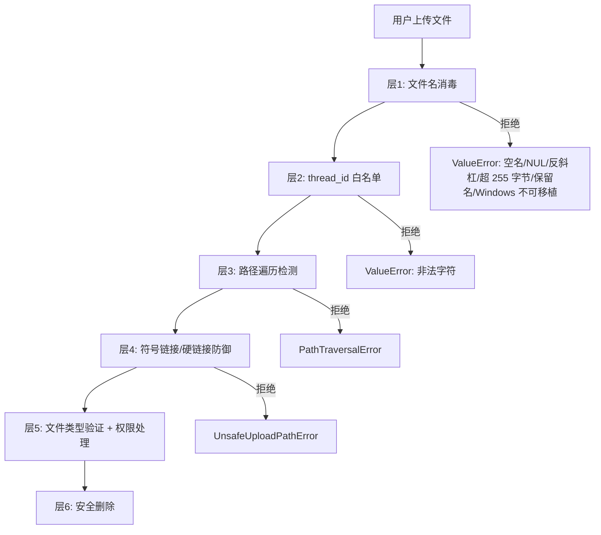
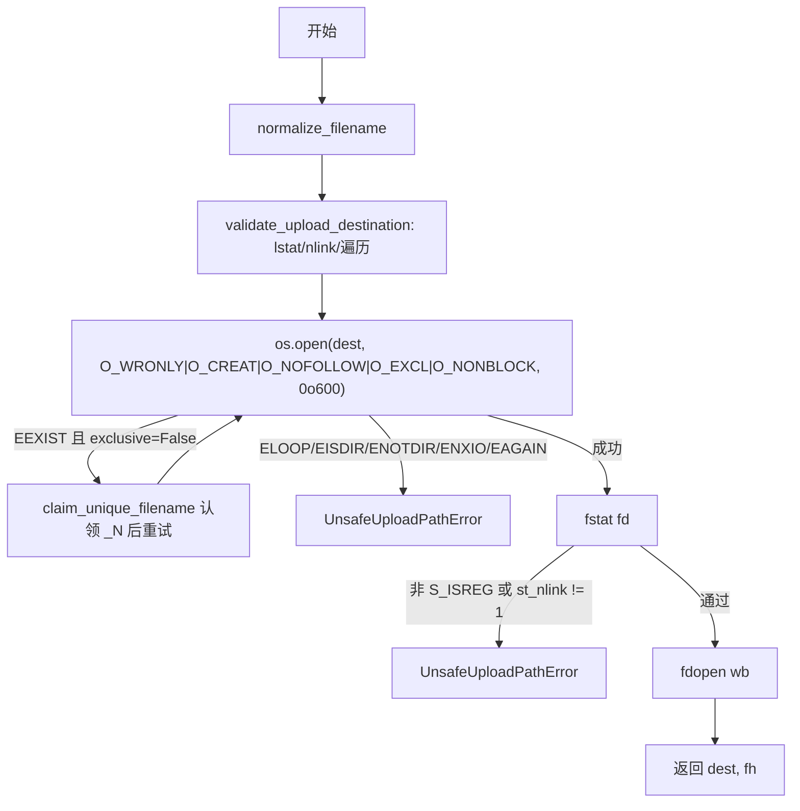
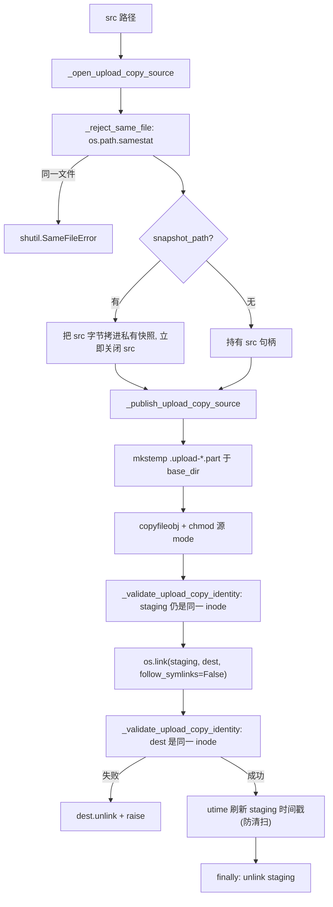
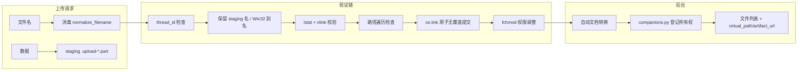

---


title: "上传安全管道"
description: '上传安全管道：架构、契约与源码锚点。'
topics: [gateway, api, rest]
verified_against: v2.2.0
last_verified: 2026-11-08
---

# 上传安全管道

## 文件

`packages/harness/deerflow/uploads/manager.py` (798 行，v2.2.0 实测) — 与 FastAPI 无关的纯业务逻辑。v2.2.0 新增同级模块 `packages/harness/deerflow/uploads/companions.py`（伴随文件所有权记录，见 §伴随文件所有权）与 `packages/harness/deerflow/uploads/AGENTS.md`（不变量清单）。Gateway 侧的 HTTP 适配层在 `app/gateway/routers/uploads.py` 与 `app/gateway/upload_ingestion.py`（见 §HTTP 状态码）。

`manager.py` 公开入口（行号为 v2.2.0 实测）：

| 符号 | 行 | 作用 |
|------|----|------|
| `PathTraversalError(ValueError)` | `:27` | 路径逃出 base |
| `UnsafeUploadPathError(ValueError)` | `:31` | 目标不是独占常规文件 |
| `UPLOAD_STAGING_PREFIX/SUFFIX = ".upload-" / ".part"` | `:37` / `:38` | Gateway staging 文件命名 |
| `UPLOAD_STAGING_MIN_AGE = timedelta(hours=24)` | `:41` | 清扫孤立 staging 文件的最小年龄 |
| `_MAX_FILENAME_BYTES = 255` | `:43` | 文件名 UTF-8 字节上限 |
| `get_uploads_dir` / `ensure_uploads_dir` | `:46` / `:52` | 解析（并创建）thread uploads 目录，先 `validate_thread_id` |
| `normalize_filename` | `:59` | 层 1 文件名消毒（含 NUL / 保留 staging 名 / Windows 可移植性） |
| `_fit_utf8_bytes` | `:94` | 按 UTF-8 边界截断（不劈开码点） |
| `claim_unique_filename` | `:102` | 层 4 去重命名（**大小写不敏感** + 字节预算） |
| `is_upload_staging_file` | `:143` | 识别 `.upload-*.part` |
| `is_reserved_upload_filename` | `:148` | 保留 staging 名（含 Win32 别名）判定 |
| `validate_path_traversal` | `:158` | 层 2 路径遍历检测 |
| `_replacement_destination_is_hardlinked` | `:170` | 硬链接守卫（**仅 POSIX**） |
| `validate_upload_destination` | `:182` | 打开**之前**的目的地校验（`exclusive=` 语义） |
| `_iter_upload_dirs` / `_staging_entry_stat` / `_uploads_dir_entry_stats` / `_staging_name_shares_inode_with_sibling` | `:201` / `:206` / `:212` / `:244` | staging 清扫的目录枚举与 inode 别名判定 |
| `cleanup_stale_upload_staging_files` | `:270` | 启动时清扫硬崩溃残留的 staging 文件 |
| `_existing_dir_names` | `:314` | 目录名快照（供 `_N` 后缀认领） |
| `open_upload_file_no_symlink` | `:323` | 层 3 符号链接/硬链接防御（POSIX 与 Windows 两条路径） |
| `write_upload_file_no_symlink` | `:448` | 上面的薄封装 |
| `_reject_same_file` | `:456` | 复制路径的自复制拒绝（`os.path.samestat`） |
| `_open_upload_copy_source` | `:475` | 持有一个源身份，可选私有快照捕获 |
| `copy_upload_file_no_symlink` | `:491` | 复制到 uploads，不跟随目标符号链接 |
| `_validate_upload_copy_identity` | `:528` | 发布前后身份一致性校验 |
| `_publish_upload_copy_source` | `:537` | staging + `os.link` 无覆盖发布单个尝试 |
| `copy_upload_file_no_replace` | `:575` | 上面的无重试封装（冲突即 `FileExistsError`） |
| `publish_upload_copy` | `:588` | 打开一次源，冲突时认领 `_N` 重试 |
| `apply_upload_sandbox_permits` | `:605` | 绑定 inode 的沙箱权限位调整（`fchmod`） |
| `list_files_in_dir` | `:672` | 列目录（并发删除下 best-effort） |
| `delete_file_safe` | `:726` | 层 6 安全删除（**不再删除伴随 `.md`**） |
| `upload_artifact_url` / `upload_virtual_path` / `output_artifact_url` / `output_virtual_path` / `enrich_file_listing` | `:763` / `:771` / `:776` / `:784` / `:789` | URL/虚拟路径构造 |

## 防御层次

上传文件经过 6 层防御才能到达磁盘（**HTTP 上传**走的是「staging → 原子 link 提交」，见 §Gateway 的 staging 提交路径；`open_upload_file_no_symlink` 是**直接写入**路径的守卫）：



## 层 1：文件名消毒 (`normalize_filename()`，`:59-92`)

```python
_MAX_FILENAME_BYTES = 255            # :43

def normalize_filename(filename: str) -> str:
    if not filename:
        raise ValueError("Filename is empty")
    safe = Path(filename).name                     # basename 提取
    if not safe or safe in {".", ".."}:
        raise ValueError(f"Filename is unsafe: {filename!r}")
    if "\x00" in safe:                             # v2.2.0 新增：NUL 字节拒绝
        raise ValueError(f"Filename contains NUL: {filename!r}")
    if "\\" in safe:                               # 反斜杠拒绝（Linux 上 Path.name 会保留）
        raise ValueError(f"Filename contains backslash: {filename!r}")
    if len(safe.encode("utf-8")) > _MAX_FILENAME_BYTES:
        raise ValueError(f"Filename too long: {len(safe)} chars")   # detail 报「字符数」不是字节数
    if is_reserved_upload_filename(safe):          # v2.2.0 新增：保留 staging 名
        raise ValueError(f"Filename uses reserved upload staging pattern: {filename!r}")
    reason = windows_incompatible_segment(safe)    # v2.2.0 新增：Windows 可移植性
    if reason:
        raise ValueError(f"Filename is not portable to Windows: {filename!r} ({reason})")
    return safe
```

### 保留 staging 名与 Win32 别名 (`is_reserved_upload_filename()`，`:148-155`)

```python
def is_reserved_upload_filename(filename: str) -> bool:
    return is_upload_staging_file(filename.rstrip(" .").lower())
```

Win32 在打开路径时会**去掉尾部的点与空格**并**忽略大小写**，所以 `.upload-abc.part`、`.UPLOAD-abc.part`、`.upload-abc.part.` 、`.upload-abc.part ` 在 Windows 上是同一个文件名。这里在**所有宿主平台**统一拒绝这些别名，但**不改写**名字，也不改 `is_upload_staging_file()`（列表/清扫对外已有文件仍用原谓词，避免把用户既有文件误判为新名冲突）。

### Windows 可移植性 (`windows_incompatible_segment()`，`utils/host_paths.py:44`)

`deerflow/utils/host_paths.py` 的 `windows_incompatible_segment(segment)` 返回拒绝理由（`None` 表示可用）：

- 每个宿主平台都拒绝**保留设备名**：`_WINDOWS_RESERVED_NAMES`（`host_paths.py:41`）= `CON`、`PRN`、`AUX`、`NUL`、`CONIN$`、`CONOUT$` + `COM1..COM9¹²³` + `LPT1..LPT9¹²³`，比较用 `stem.upper()`（即 `CON.txt` 也被拒）
- 尾部点/空格等其余规则同样在**所有**平台生效（不只在 Windows）

### thread_id 白名单 (`validate_thread_id()`)

```python
# deerflow/utils/thread_id.py（不在 uploads/manager.py 里）
THREAD_ID_PATTERN = r"^[A-Za-z0-9_-]{1,64}$"   # 无点号，长度 1-64
_THREAD_ID_RE = re.compile(THREAD_ID_PATTERN)

def validate_thread_id(thread_id: str) -> str:
    if not isinstance(thread_id, str) or _THREAD_ID_RE.fullmatch(thread_id) is None:
        raise ValueError("Invalid thread_id: expected 1-64 ASCII letters, digits, hyphens, or underscores")
    return thread_id
```

`get_uploads_dir()`（`:46`）第一件事就是 `validate_thread_id(thread_id)`，所以非法 thread_id 永远不会被插进主机路径。

## 层 2：路径遍历检测 (`validate_path_traversal()`，`:158-167`)

```python
def validate_path_traversal(path: Path, base: Path) -> None:
    try:
        path.resolve().relative_to(base.resolve())
    except ValueError:
        raise PathTraversalError("Path traversal detected") from None
```

使用 `Path.resolve()`（解析所有符号链接和 `..`）进行真正的绝对路径比较，而不只是检查字符串前缀。

## 层 3：打开前目的地校验 (`validate_upload_destination()`，`:182-198`)

打开文件**之前**的三步校验（顺序重要，且**不改动**已存在的文件）：

```python
def validate_upload_destination(base_dir: Path, filename: str, *, exclusive: bool = False) -> Path:
    safe_name = normalize_filename(filename)
    dest = base_dir / safe_name
    try:
        st = os.lstat(dest)
    except FileNotFoundError:
        st = None
    if st is not None and not stat.S_ISREG(st.st_mode):
        raise UnsafeUploadPathError(f"Upload destination is not a regular file: {safe_name}")
    if not exclusive and st is not None and _replacement_destination_is_hardlinked(st):
        raise UnsafeUploadPathError(f"Upload destination has multiple links: {safe_name}")
    validate_path_traversal(dest, base_dir)                     # 遍历检查放最后
    return dest
```

v2.2.0 的两点变化：

1. **`exclusive=` 关键字参数**（`:182`）：`exclusive=True` 表示调用方**自己拥有**该名字并将在冲突时重试（`_publish_upload_copy_source` 用它），此时常规硬链接被当作**冲突**交给重试循环，而不是安全错误；`exclusive=False`（默认替换/新建语义）保留硬链接拒绝。
2. **硬链接守卫只在 POSIX 生效**（`_replacement_destination_is_hardlinked()`，`:170-180`）：`os.name != "nt" and st.st_nlink > 1`。Windows 在删除一个硬链接后 `st_nlink` 可能残留为 2，用它拒绝会把**正常已发布的上传**误判为攻击；而两种 `O_EXCL` 创建模式都会在打开后要求新文件恰好一个链接（`fstat` 检查）。

## 层 4：重复文件名处理 (`claim_unique_filename()`，`:102-140`)

```python
def claim_unique_filename(name: str, seen: set[str]) -> str:
    claimed = {existing.casefold() for existing in seen}     # v2.2.0：大小写不敏感
    if name.casefold() not in claimed:
        seen.add(name)
        return name
    stem, suffix = Path(name).stem, Path(name).suffix
    counter = 1
    while True:
        tag = f"_{counter}"
        budget = _MAX_FILENAME_BYTES - len(tag.encode("utf-8")) - len(suffix.encode("utf-8"))
        if budget < 1:
            candidate = _fit_utf8_bytes(stem + suffix, _MAX_FILENAME_BYTES - len(tag.encode("utf-8"))) + tag
        else:
            candidate = f"{_fit_utf8_bytes(stem, budget)}{tag}{suffix}"
        if candidate.casefold() not in claimed:
            break
        counter += 1
    seen.add(candidate)
    return candidate
```

同一上传请求中的重复文件名通过 `_1`、`_2` 等后缀自动重命名，因此后续文件不会截断先前的文件。**去重后的名字仍受 255 字节上限约束**：当追加 `_N`（并保留扩展名）会超限时，stem 会在 UTF-8 边界上被截断让位（否则一个最长长度的上传在碰撞后会产生文件系统与后续 `normalize_filename` 都会拒绝的名字）。

v2.2.0 起比较改为 **`casefold()`**（不再区分大小写）：macOS/Windows 的大小写不敏感卷上，`a.pdf` 与 `A.pdf` 是同一个目录项，按大小写敏感判重会让第二次上传静默覆盖第一次。

## 层 5：符号链接 / 硬链接防御 (`open_upload_file_no_symlink()`，`:323-445`)

这是整个上传管道中**最关键的安全功能**。

### 威胁模型

上传目录可能被挂载到本地沙箱中。恶意沙箱进程可以在未来上传文件名的位置放置符号链接。普通的 `Path.write_bytes()` 会跟随该链接，以 gateway 权限覆盖上传目录之外的文件。

### POSIX 路径（Linux/macOS，`:350-405`）



关键的安全属性：

- `O_NOFOLLOW` 使 `open()` 在目标是符号链接时以 `ELOOP` 失败 — **完全消除**该处 TOCTOU 窗口（并额外带上 `O_NONBLOCK`，避免 FIFO/设备文件把打开挂住）
- `O_EXCL` 使同名**已存在**的文件永远不会被打开和截断（#3750）：冲突时由 `claim_unique_filename()` 针对目录**当前内容**（`_existing_dir_names()`，`:314`）认领下一个空 `_N` 名字并用 `O_EXCL` 重试，两个并发同名上传因此落成 `name.ext` 与 `name_1.ext` 而**两条字节流都完整**。返回的 `dest` 是字节**实际落到的名字**，调用方必须回报它而不是请求名
- `exclusive=True` 则在冲突时直接抛 `FileExistsError`，让自己拥有命名策略的调用方保留精确名字认领
- 打开后 `fstat` 确认文件描述符指向**独占**常规文件（`st_nlink != 1` 即拒绝）— 防硬链接攻击
- **不再 `ftruncate`**：`O_EXCL` 保证这是新文件，永远为空，不需要截断（v2.1.0 的 `ftruncate(fd, 0)` 在 v2.2.0 已删除，因为它只对「已存在的文件」才有意义，而那种情况已不可能发生）

### Windows 回退（`:407-445`）

Windows 缺乏 `O_NOFOLLOW`。回退策略：

1. 打开前 `lstat` — 拒绝非 `S_ISREG`；硬链接守卫在此**跳过**（`_replacement_destination_is_hardlinked` 在 `os.name == "nt"` 下恒为 `False`）
2. 用 `O_EXCL`（+ `O_BINARY`）打开，因此**占用的名字原子地被拒绝**，而不是打开后截断
3. 打开后 `fstat` — 再次验证文件类型与 `st_nlink == 1`
4. `FileExistsError` 与 POSIX 同构：认领 `_N` 后缀后重试（`:428-437`）

路径遍历检查在此窗口期间减轻了 `base_dir` 逃逸，尽管它无法处理原子 `replace-with-symlink` 攻击。

### 沙箱权限位 (`apply_upload_sandbox_permits()`，`:605-669`)

Gateway 以 root 身份、`0o600` 写上传文件；AIO/Docker 沙箱以非 root 用户在 bind-mount 路径上运行，因此需要额外的 group/other 位（可写变体再加 write 位）。v2.2.0 把「改权限」绑定到**已校验的 inode**：

1. `lstat` 路径；`FileNotFoundError`/`NotADirectoryError`/符号链接 → **静默跳过**（返回）
2. `os.open(O_RDONLY | O_NOFOLLOW | O_NONBLOCK)`（平台支持时）：`O_NOFOLLOW` 保证打开的不是符号链接；`O_NONBLOCK` 防止沙箱把文件换成 **FIFO** 后 `O_RDONLY` 打开在 `fstat` 之前**阻塞在内核**等写端（会挂住摄取并占用一个协程取消无法打断的 file-IO 线程）
3. `fstat` 非 `S_ISREG` → 跳过；否则 `os.fchmod(fd, mode | extra_mode_bits)` — **用 fd 而非路径名**，沙箱在校验后换符号链接也无法把 chmod 重定向到 uploads 目录外
4. `ENOENT`/`ENOTDIR`/`ELOOP` 视为预期的替换竞态 → 返回；**其它 `OSError`（如 `EACCES`）向上抛**，这样调用方不会把一个沙箱仍读不到的上传报成成功
5. 无 `O_NOFOLLOW`/`fchmod` 的平台（Windows）保留 `os.chmod` + `lstat` 符号链接守卫的兜底

## 层 6：安全删除 (`delete_file_safe()`，`:726-761`)

```python
def delete_file_safe(base_dir: Path, filename: str) -> dict:
    file_path = base_dir / filename
    validate_path_traversal(file_path, base_dir)     # 先验证！

    if file_path.is_symlink() or not file_path.is_file():
        raise FileNotFoundError(f"File not found: {filename}")

    file_path.unlink()

    return {"success": True, "message": f"Deleted {filename}"}
```

v2.2.0 的三点变化：

- **不再删除伴随 `.md`**（#5672，`convertible_extensions` 参数已删除）：转换器按文档 stem 命名 `.md`，名字被占用时回退 `_N`，所以文档旁边的 `.md` 可能属于**同 stem 的另一个文档**、或用户自己的文件。按「后缀相同」猜测删除会删错文件。`.md` 仍出现在列表里，可以单独删除
- **只删常规文件**：`is_symlink() or not is_file()` → `FileNotFoundError`。uploads 目录可被沙箱挂载，沙箱进程可能在上传名下放符号链接，跟随它删除会删掉它指向的上传；该语义与 `list_files_in_dir()` 一致（列为「不存在」）
- 签名简化为 `delete_file_safe(base_dir: Path, filename: str) -> dict`，**返回 dict**（不是路径）

## 复制发布路径：`publish_upload_copy` / `copy_upload_file_no_replace`（v2.2.0 新增）

这是「把已存在的源文件搬进 uploads」的路径（项目 shelf 晋升、文档转换产物、Embedded `DeerFlowClient.upload_files`），与 HTTP 上传的 staging 提交是**两套**机制。



关键属性：

- **不跨文件系统**：staging 建在**同一个** uploads 目录里，所以最后一步的 `os.link` 是原子且无覆盖的（`rename` 会在跨设备时退化为拷贝，`replace` 会覆盖）
- **无覆盖**：`validate_upload_destination(..., exclusive=True)` 已把已存在的名字交给 `FileExistsError`，`publish_upload_copy` 捕获后认领 `_N` 重试；整个重试循环**复用同一个打开的源与同一份源元数据**，每次发布尝试都 `source.seek(0)` 读那份**私有快照**，而不是重新打开调用方的源
- **身份绑定**：发布前后各做一次 `_validate_upload_copy_identity()`（`:528-535`，`os.path.samestat` + `S_ISREG`），确保 staging 名与最终 `dest` 名指向**同一个 inode**；不一致则 `UnsafeUploadPathError`（`Upload copy changed during publication`/`Upload copy disappeared`）并尽力 unlink `dest`
- **自复制拒绝**：`_reject_same_file()`（`:456-472`）用 `os.path.samestat`（`copy2` 自己用的判据）而不是路径文本比较，因此硬链接与不同拼写的同一路径也会被识别，抛 `shutil.SameFileError`
- **时间戳防清扫**：发布完成前用 `os.utime(staged_fh.fileno(), ns=(atime_ns, mtime_ns))` 把 staging 时间戳刷新（继承源的时间戳），这样「源文件很老、但拷贝正在进行」的 staging 不会被 24h 清扫误删
- **平台差异**：支持 `os.link(..., follow_symlinks=False)` 的平台用它；否则退回普通 `os.link` 并**只能收窄**而无法消除 link 时刻的竞态（docstring 明说）

## 伴随文件所有权 (`uploads/companions.py`，v2.2.0 新增)

Gateway 的文档自动转换会为上传生成一个同名 stem 的 Markdown。**「同名 stem 的 `.md`」永远不算所有权证据**：uploads 目录可被沙箱写，沙箱可以自己放一个同名 `.md` 冒充转换产物。v2.2.0 用一个**服务器自有的所有权记录**解决，记录放在 `user-data` **之外**（沙箱挂载点外）：

```python
def _records_dir(uploads_dir: Path) -> Path:          # :23
    thread_dir = uploads_dir.parent.parent if uploads_dir.parent.name == "user-data" else uploads_dir.parent
    return thread_dir / "upload-companions"

def _record_path(uploads_dir: Path, filename: str) -> Path:   # :28
    digest = hashlib.sha256(filename.encode("utf-8")).hexdigest()
    return _records_dir(uploads_dir) / f"{digest}.json"
```

| 符号 | 行 | 作用 |
|------|----|------|
| `_records_dir` | `:23` | `<thread>/upload-companions`（flat `<thread>/uploads` 布局回退到 `uploads_dir.parent`） |
| `_record_path` | `:28` | 记录文件名 = `sha256(原文件名)`（文件名不进路径） |
| `register_companion(original, markdown)` | `:34` | 原子写所有权记录：`mkstemp(prefix=".companion-")` → `os.replace`；失败经 `cleanup_failed_atomic_write(staged_path, fd)` 清理半成品 |
| `unregister_companion(original)` | `:74` | 删除记录，**best-effort**（`OSError` 只记 warning：记录残留会被 `resolve_companion` 的身份校验拒掉，不会解析错） |
| `invalidate_overwritten_upload(path)` | `:86` | 文件被原地重新上传时作废相关关系：先 `unregister_companion(path)`；若 `path` 本身是 `.md`，再扫 `*.json` 删掉 `markdown == path.name` 的记录 |
| `resolve_companion(original)` | `:114` | 只返回**有效记录**指向的 Markdown，否则 `None` |
| `companion_names(uploads_dir)` | `:152` | 当前所有「显式拥有」的派生 `.md` 名字集合 |

记录内容与校验（`register_companion` `:48-56` / `resolve_companion` `:114-150`）：

- `original`（原文件名，必须等于查询名）、`markdown`（必须是 basename、后缀 `.md`）
- `source_identity = [st_dev, st_ino, st_size, st_mtime_ns, st_ctime_ns]`、`markdown_identity` 同结构；`resolve_companion` 逐项比对，任一不符即 `None`
- **legacy 记录 fail-closed**：`source_identity` 只有 3 个字段（缺版本时间戳）→ 拒绝；`markdown_identity` 只有 4 个字段（缺修改时间）→ 拒绝并提示「re-register companion」。**不做时间戳回填**，因为等长内容编辑无法用 3 字段身份区分
- 记录文件本身是符号链接、`original` 是符号链接或 `.md`、`markdown` 不存在/是符号链接 → 全部 `None`
- `register_companion` 前置校验：源与 Markdown **必须在同一个 uploads 目录**、源后缀不能是 `.md`、Markdown 后缀必须是 `.md`，否则 `ValueError`

## staging 文件与清扫 (`cleanup_stale_upload_staging_files()`，`:270-311`)

`.upload-*.part` 对上传列表、agent 上传上下文、sandbox 列目录/搜索工具**隐藏**（`is_upload_staging_file()`，`:143`；`list_files_in_dir()` 在 `:695` 跳过）。

启动时的清扫规则（`:270`）：

1. 枚举 `<base>/threads/*/user-data/uploads` 与 `<base>/users/*/threads/*/user-data/uploads`（`_iter_upload_dirs()`，`:201`）
2. 每个 uploads 目录做**一次** `os.scandir` + `os.lstat` 快照（`_uploads_dir_entry_stats()`，`:212`），使清扫对条目数保持线性
3. 只处理 `is_upload_staging_file()` 且 `S_ISREG` 的条目
4. **孤立 + 年轻** → 保留：uploads 目录可能被多个 Gateway 副本共享，启动时这个 `.part` 可能正被另一副本写入；每次 chunk 写都会刷新 mtime，因此在提交/放弃前一直小于 `min_age`
5. **「孤立」的判定用 inode 别名而非 `st_nlink`**（`_staging_name_shares_inode_with_sibling()`，`:244`）：提交用 `os.link` 发布，瞬时两个名字共享一个 inode，最终名出现后 staged 名只是一个**别名**（崩溃或延迟删除留下的）。这种别名**任何年龄都删**——留着会让该目标在下一次替换上传（走 `copy_upload_file_no_symlink`）时撞上多链接安全检查
   - Windows 删除硬链接后**不会**递减 `st_nlink`，所以用 `(st_dev, st_ino)` 作为可移植信号
   - 任一侧 `st_ino == 0`（FAT/exFAT、部分 SMB/网络共享）**永不匹配**，此时只靠 `min_age` 兜底——否则每个名字都会看起来像别人的别名，清扫会删掉任意年龄的进行中上传
6. **无法 `stat` 的文件一律保留**（`OSError` 只记 warning），绝不基于猜测删除

## Gateway 的 staging 提交路径（HTTP 上传，v2.2.0）

HTTP 上传**不**直接调用 `open_upload_file_no_symlink` 写目标文件，而是「staging + 原子无覆盖 link 提交」（`app/gateway/upload_ingestion.py` 的 `ThreadUploadIngestionService`）：

```
open()                       (:181)  → claim_unique_filename（在请求内去重）
ingest_chunks()              (:249)  逐 chunk 累计 file_size / total_size，超限即 413
  └─ _ingest_chunks()        (:270)  → run_file_io(uploads._prepare_upload_destination, ...) 写 .upload-*.part
                                      → run_file_io(uploads._commit_upload_temp_no_overwrite, ...)  os.link 提交
                                          FileExistsError → 释出下一个 _N 后缀重试（staging 文件保留）
finalize()                   (:439)  权限调整（apply_upload_sandbox_permits）+ 非 mounted provider 的 sandbox 同步
cleanup_written()            (:467)  异常/取消时回滚已写文件
```

对应实现与安全属性：

- `routers/uploads.py:245 _link_staged_no_overwrite()`、`:283 _commit_upload_temp_no_overwrite()` — 用 `os.link`（**no-overwrite**）而非 `rename`，目标已存在时抛 `FileExistsError` 触发重试，绝不静默覆盖；`FileExistsError` 之后用一次事后 `lstat` 分类，非常规文件 → `UnsafeUploadPathError`（`Upload destination is not a regular file`）
- `routers/uploads.py:202 _pure_destination()`、`:225 _prepare_upload_destination()` — 目标是目录/符号链接/多链接时拒绝
- 取消安全：断开连接的请求不会丢写——摄取在 file-IO 线程里跑，取消时经 `await_drained`/`run_file_io` **先排空**再回滚（`cleanup_written()`）
- 上传目录被挂载（`sandbox.thread_data_mounts: true`）时跳过 sandbox acquire/sync；非 mounted provider 走 `SandboxProvider.acquire_async()` 的 request lease
- `ThreadUploadIngestionService` 的两个自定义异常在 `upload_ingestion.py:118 UnsafeFilenameError`、`:122 UnsafeUploadDestinationError`

## HTTP 状态码（Gateway 层，v2.2.0 实测）

「与 FastAPI 无关」的 `manager.py` **不产生任何 HTTP 状态码**；状态码全部由 Gateway 适配层映射（`routers/uploads.py` 前缀 `/api/threads/{thread_id}/uploads`）：

| 码 | 触发点 | detail 摘要 | 源码锚点 |
|----|--------|------------|---------|
| 400 | 未提供文件 | `No files provided` | `routers/uploads.py:394`（POST 处理体 `:409`） |
| 400 | 文件名是保留 staging 图案（**开沙箱之前**整批预检） | `Filename uses reserved upload staging pattern: <name>. Rename the file and upload it again.` | `routers/uploads.py:411-418` |
| 400 | `service.open()` 的 `ValueError`（配置/目录初始化非法） | `str(e)` | `routers/uploads.py:437-438`（`service.open()` 的 `except ValueError`） |
| 400 | list 的 `ValueError` | `str(e)` | `routers/uploads.py:505`（`GET /list`，`except ValueError` 在 `:511-512`） |
| 400 | delete：`PathTraversalError` | `Invalid path` | `routers/uploads.py:517`（DELETE，`except` 在 `:526-534`） |
| 400 | delete：`normalize_filename` 的 `ValueError` | `str(e)` | `routers/uploads.py:527-528` |
| 404 | delete 时文件不存在（`FileNotFoundError`）或目标是符号链接 | `File not found: <name>` | `routers/uploads.py:517`（`except FileNotFoundError` `:527-528`） |
| **413** | 文件数 > `uploads.max_files`（默认 **10**，`DEFAULT_MAX_FILES`） | `Too many files: maximum is <n>` | `routers/uploads.py:70-72`（默认值）、`:418`（抛点） |
| **413** | 单文件 > `uploads.max_file_size`（默认 **50 MiB**，`DEFAULT_MAX_FILE_SIZE`） | `File too large: <name>` | `app/gateway/upload_ingestion.py:330`（`_ingest_chunks` 上限分支） |
| **413** | 单请求总量 > `uploads.max_total_size`（默认 **100 MiB**，`DEFAULT_MAX_TOTAL_SIZE`） | `Total upload size too large` | `app/gateway/upload_ingestion.py:332` |
| 500 | 摄取过程中的其它异常（已 `cleanup_written()`） | `Failed to upload <name>: <e>` | `routers/uploads.py:472`（POST `except Exception`，detail `Failed to upload <name>.`） |
| 500 | delete 的其它异常 | `Failed to delete <name>.`（**固定文本**，`OSError` 的主机路径只进日志） | `routers/uploads.py:529-531` |
| — | `UnsafeFilenameError`（文件名消毒失败） | **静默跳过**（记 warning，计入 `skipped_files`，不算错误） | `routers/uploads.py:453`（POST 逐文件循环） |
| — | `UnsafeUploadDestinationError` | **静默跳过**并加入 `skipped_files` | `routers/uploads.py:453`（POST 逐文件循环） |
| — | 空 part（未命名/零字节的表单部件） | 跳过并记 `"(unnamed file)"` | `routers/uploads.py:453`（POST 逐文件循环） |

`success` 语义（v2.2.0，#7160）：响应里的 `success = bool(uploaded_files)` ——**只有真的写成了文件才是 `true`**；全部被跳过时为 `false`，而不是「请求没抛异常就是成功」。

> 上传/列表/删除/limits 的线程鉴权：`require_permission("threads", "write"|"read"|"delete", owner_check=True)` — 未认证 **401**、owner 不匹配 **404**（`uploads.py:396`/`:496`/`:507`/`:519`）。`GET /api/threads/{thread_id}/uploads/limits`（`:494`，`get_upload_limits`）返回三条实际生效的上限，供前端在挑选文件前门控。
>
> 项目 shelf 的同类上传在 `routers/project_documents.py` 也是 **413**（`File too large: <name>`），且 `UnsafeFilenameError` → **400**（`:423`）、`UnsafeUploadDestinationError` → **500**（`:427`；detail 只报文件名不报原因，`OSError` 的主机路径留在日志里）。
>
> 配置键兼容：`_get_upload_limit()` 接受 legacy key `max_file_count` → `max_files`、`max_single_file_size` → `max_file_size`。

## 上传管道总结


