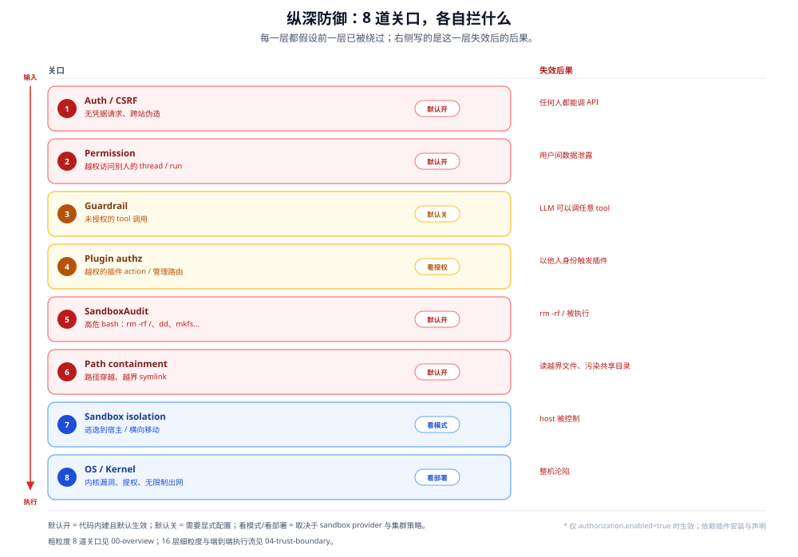
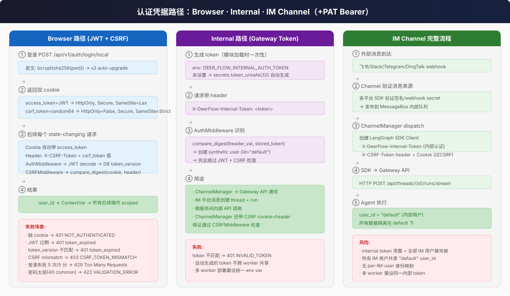

# 安全全景

一段用户 prompt 到 `rm -rf /` 被执行 — 中间到底隔了多少层防护？

## 核心问题

| 问题 | 答案 |
|------|------|
| **纵深多少层？** | 粗粒度 8 道关口 / 细粒度 16 层（2.1 的 14 层 + 🆕 2.2.0 的插件 action 授权、插件管理授权）。详见 [04-trust-boundary.md](04-trust-boundary.md) 逐层代码定位 |
| **七种沙箱运行模式差多少？** | Local(零隔离) → Docker(容器，seccomp 默认 unconfined) → K3s(Pod，allowPrivilegeEscalation) → BoxLite(microVM) / E2B / Tenki / OpenSandbox(云沙箱)；隔离强度与数据去向都不同 |
| **四条认证路径的区别？** | Browser(JWT+CSRF；本地密码或 OIDC 登录) → PAT(Bearer `dfp_`，scope 收窄+默认拒绝路由) → Internal(共享 token，跳过 JWT/CSRF) → IM Channel(平台签名+内部 token+CSRF) |
| **Guardrail 拦截什么？** | 可插拔的 tool_call 执行前授权检查；三选一：`AllowlistProvider` 名单 / 🆕 `TypeSafeGuardrailProvider`（Jev 风险概率）/ 🆕 `OpenAIDecisionsGuardrailProvider`（同一门走 `/v1/decisions`）；默认 fail-closed |
| **哪些命令会被审计拒绝？** | `rm -rf /`、`dd if=`、`mkfs`、base64 管道执行、fork bomb 等 ~20 种高危模式 |
| **最大的安全短板？** | 权限全放行；**无 Agent 独立身份与强制审批**；Docker seccomp=unconfined；K3s 无 NetworkPolicy；插件 code 与 Gateway 同进程同权限（见 [06-extension-boundary.md](06-extension-boundary.md)、[07-enterprise-readiness.md](07-enterprise-readiness.md)） |

---

## 一分钟版本：默认开 / 默认关 / 没有

| 类别 | 内容 |
|------|------|
| **默认开**（代码内建，无需配置） | JWT/CSRF/PAT 认证；6 层路径防护；SandboxAudit（bash）；secrets redaction；输入/工具结果/输出转义；SkillScan；MCP 结果中性化 |
| **默认关**（要显式配置） | `guardrails`（工具级授权）；`authorization`（RBAC，关闭时 13 权限全放行）；`pii_redaction`；`token_budget`；插件 action/management 授权（随 authorization）；Docker egress allowlist；Docker seccomp 收紧；非 root 容器用户 |
| **没有**（代码/产品缺口） | Agent 独立身份（NHI）；强制人工审批状态机；DLP/数据分类；SIEM/eDiscovery 导出；SBOM/签名/SLSA；合规证书；全局 kill switch；多租户 |

> 这张表比「有多少层」更接近企业评审的第一页：**默认关的控制，在评审表里等于没有；没有的控制，配置也补不出来。** 逐条状态见 [08-control-checklist.md](08-control-checklist.md)，差距分析见 [07-enterprise-readiness.md](07-enterprise-readiness.md)。

---

## 纵深防御全景

> **图读法**：自上而下是请求经过的顺序，不是调用时序；绿色/红色只表示默认开关状态，不表示风险等级。右侧写的是这一层失效后的后果。

粗粒度 8 道关口，从外到内逐层收窄（细粒度 16 层见 [04-trust-boundary.md](04-trust-boundary.md)）：

| 关口 | 拦截什么 | 失效后果 |
|------|---------|---------|
| **Auth** | 无凭据的请求 | 任何人都能调 API |
| **Permissions** | 别人的 thread/run | 用户间数据泄露 |
| **Guardrail** | 未授权的 tool | LLM call 任意 tool |
| 🆕 **Plugin Authz** | 越权的插件 action / 管理路由 | 以他人身份触发插件 backend |
| **SandboxAudit** | 高危 bash 命令 | `rm -rf /` 被执行 |
| **Tool 校验** | 路径穿越、过大输出 | 读越界文件、OOM |
| **Sandbox 隔离** | 逃逸到 host | host 被控制 |
| **OS/Kernel** | 内核漏洞利用 | 整机沦陷 |

---

## 认证凭据路径

| 路径 | 认证方式 | 用户标识 | 适用场景 |
|------|---------|---------|---------|
| **Browser** | JWT cookie + CSRF double-submit | 登录用户 ID | Web UI |
| **PAT** 🆕 | `Authorization: Bearer dfp_...`（SHA-256 摘要存储，scope ∩ effective permissions + 默认拒绝路由策略） | 属主用户 ID | 脚本 / CI 程序化 API |
| **Internal** | `X-DeerFlow-Internal-Token` | `"default"` | 组件间调用 |
| **IM Channel** | 平台签名 + Internal Token + CSRF | `"default"` | 飞书/Slack/Telegram |

Internal 路径的 `DEER_FLOW_INTERNAL_AUTH_TOKEN` 在模块加载时自动生成（`secrets.token_urlsafe(32)`），多 worker 部署必须手动设同一个值。

---

## 沙箱隔离速览

| 维度 | Local | Docker | K3s |
|------|-------|--------|-----|
| 进程隔离 | 无 | 容器 namespace | Pod namespace |
| 文件隔离 | 路径映射+穿越检查 | 容器 FS + bind mount | 容器 FS + volume |
| Shell 执行 | `allow_host_bash=false` 阻止 | 完全允许 | 完全允许 |
| CPU 限制 | 无（host 进程） | 默认 2 CPU（可调） | 100m-1000m |
| 内存限制 | 无（host 进程） | 默认 2G / pids 512（可调） | 256Mi-1Gi |
| seccomp | host 默认 | **unconfined（可用 profile 收紧）** | host 默认 |
| 提权 | N/A | **no-new-privileges + cap-drop**（容器用户未固定） | **allow=true** |
| 网络出站 | 全通 | 默认全通；**Docker 28+ 可 isolated/allowlist** | 全通（无 NetworkPolicy） |
| 适用场景 | 单用户开发 | 团队测试 | 生产 |

详见 [02-sandbox-isolation.md](02-sandbox-isolation.md)。

---

## 已知主要缺陷

- **权限全放行** — 13 个权限定义但所有 authenticated user 都获得全部（authorization 默认 disabled；Phase 4 已把 effective permissions 贯通到 /auth/me 与前端 UI 门控，强制点仍在 Gateway）；权限表以 [authorization/04-rbac-permissions.md](../../enterprise-it-governance/authorization/04-rbac-permissions.md) 为准
- **Docker seccomp 显式禁用** — `--security-opt seccomp=unconfined` 移除 ~44 个系统调用过滤；可用 `DEER_FLOW_SANDBOX_SECCOMP_PROFILE` 或 `DEER_FLOW_SANDBOX_SECCOMP_UNCONFINED=0` 收紧
- **Docker 容器用户未固定** — 默认不传 `--user`，AIO 镜像的运行时用户由镜像决定；用 `DEER_FLOW_SANDBOX_CONTAINER_USER` 显式指定
- **K3s 允许提权** — `allow_privilege_escalation: true`，setuid 程序可用；无 NetworkPolicy、无 readOnlyRootFilesystem
- **SandboxAudit 只覆盖 bash** — read_file/write_file/str_replace 无高危内容检测
- **登录限流默认共享，但可退化为进程内** — `throttle_storage: auto` 在 sqlite/postgres 下写共享表，多副本共享同一份锁禁；只有 `memory` 后端或 DB 未初始化时才退化为 per-worker 计数
- **出站策略只在本地 Docker 生效** — `open/isolated/allowlist` 三档需 Docker 28+，不支持 Apple Container、provisioner 与默认 Local；K3s 需自建 NetworkPolicy
- **无 Agent 独立身份 / 无强制审批** — agent 继承用户身份，subagent 进一步继承；高危动作没有「等人批准」的状态机。详见 [07-enterprise-readiness.md](07-enterprise-readiness.md)

---

## AI 特有的风险去哪看

上面的八道关口回答的是「执行时怎么不被逃出去」；它不回答「agent 被一段网页说服了怎么办」「agent 用谁的权限」「出了事拿什么证据」。这三类问题属于 AI 特有风险与治理层，单独放在 [07-enterprise-readiness.md](07-enterprise-readiness.md)：OWASP LLM/Agentic 对照、企业平台与 DSH/Pi 基准、P0/P1 差距清单、责任边界与 20 问应答；逐条控制项见 [08-control-checklist.md](08-control-checklist.md)。
