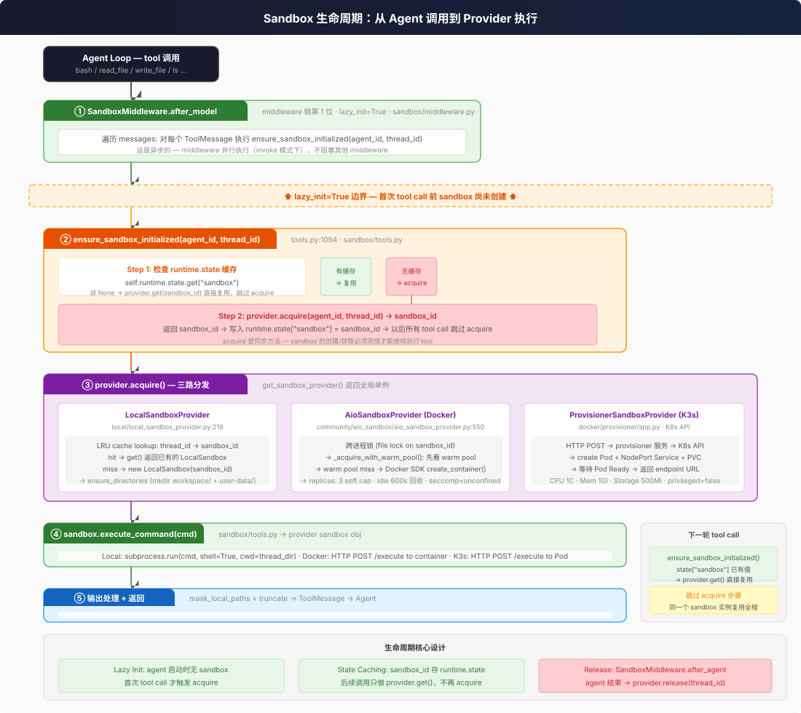

# 沙箱隔离

七种沙箱运行模式（六个 provider 类）覆盖从「零隔离」到容器、Pod、microVM、云沙箱的多种隔离级别。Local 不是沙箱 — 是路径映射；Provisioner 是 AIO 的 remote backend 模式，不是独立 provider 类。本页重点展开默认的 Local、Docker、K3s 三种，其余四种只给安全边界。

> **交叉引用：** Sandbox ABC 抽象 + 七种运行模式（六个 provider 类）架构见 [concepts/sandbox/abstract-interface-and-seven-impls.md](../../concepts/sandbox/abstract-interface-and-seven-impls.md)。IT 治理视角（策略执行、审计可观测性）见 [../../enterprise-it-governance/execution/README.md](../../enterprise-it-governance/execution/README.md)。

## 挂入方式

Sandbox 如何挂入 Agent 执行流？核心是 **SandboxMiddleware** + **lazy init**。



### 入口处思考

作为使用者，sandbox 对你来说是**完全透明的** — 你只需要在配置文件里选一个 provider，Agent 自动在首次 tool call 时创建 sandbox，后续同 thread 的 tool call 全部复用同一个 sandbox 实例。

| 我想... | 去哪里改 |
|---------|---------|
| 用本地沙箱（默认，零隔离） | 无需配置 |
| 换成 Docker 沙箱 | `config.yaml` → `sandbox.use: "deerflow.community.aio_sandbox:AioSandboxProvider"` |
| 换成 K3s 生产沙箱 | `config.yaml` → `sandbox.use: "deerflow.community.aio_sandbox:AioSandboxProvider"` + `sandbox.config.provisioner_url: http://provisioner:8002`（K3s/Pod 模式是 AIO provider 的 `RemoteSandboxBackend`，不是独立 provider 类，`aio_sandbox_provider.py:257-269`） |
| 允许 host 上执行 bash | `config.yaml` → `sandbox.allow_host_bash: true` |
| 调整 Docker warm pool 大小 | `config.yaml` → `sandbox.config.replicas: 5` |
| 看 sandbox 创建/复用日志 | 日志级别 DEBUG，搜索 `ensure_sandbox_initialized` |

### 技术细节

**SandboxMiddleware** 在 middleware 链第 1 位（`sandbox/middleware.py`），`lazy_init=True`：

```
Agent Loop 每轮 step 开始
  → SandboxMiddleware.after_model(state, runtime)
    → 遍历 messages 中的所有 ToolMessage
      → 对每个调用 ensure_sandbox_initialized(agent_id, thread_id)
```

`ensure_sandbox_initialized()` (`tools.py:1094`) 的核心逻辑只有两步：

1. **检查 state 缓存** — `runtime.state.get("sandbox")` 非 None？→ `provider.get(sandbox_id)` 直接复用，跳过 acquire
2. **没有缓存** → `provider.acquire(agent_id, thread_id)` → 存 `runtime.state["sandbox"] = sandbox_id`

> 🆕 **sandbox:execute 授权**：在 `provider.acquire` 之前，`ensure_sandbox_initialized` / `ensure_sandbox_initialized_async` 调用 `authorize_sandbox_execution`（`authz/sandbox_authz.py`）做 `authorize(principal, "sandbox", "execute", target="*")` 检查。deny 抛 `SandboxAuthorizationError`，经工具错误处理转成友好 ToolMessage（"sandbox execution is not permitted for your role"）；复用路径跳过重复检查；`authorization.enabled: false` 或无 `config.yaml` 时是 no-op。详见 [concepts/sandbox/abstract-interface-and-seven-impls.md](../../concepts/sandbox/abstract-interface-and-seven-impls.md)。

**Provider 单例** — `get_sandbox_provider()` 返回全局唯一的 provider 实例，创建一次后缓存在模块级变量。三种 provider 的 acquire 差异：

| Provider | acquire 做了什么 | 复用机制 |
|----------|-----------------|---------|
| **Local** | `new LocalSandbox(sandbox_id)` + mkdir workspace | LRU cache: thread_id → sandbox_id |
| **Docker (AIO)** | 跨进程 file lock → warm pool 优先 → `docker create_container()` | warm pool + replicas soft cap |
| **K3s** | HTTP POST → provisioner → `kubectl create Pod+Service` → 等 Ready | Pod 存活期间复用 |

**Release** — `SandboxMiddleware.after_agent()` 在 agent 结束时调用 `provider.release(thread_id)`：
- Local: no-op（不清理，文件保留在 host）
- Docker: 容器放回 warm pool（idle 600s 后回收）
- K3s: 删除 Pod + Service

**关键设计决策：** sandbox 和 thread 是 1:1 绑定，不是 1:1 per tool call。这意味同一 thread 内的所有 tool call 共享同一个文件系统，Agent 可以在多轮 tool call 之间积累状态（写文件 → bash 操作 → 读结果）。

## 七种模式的安全边界

| # | 模式 / provider | 隔离边界 | 安全要点 |
|---|-----------------|----------|----------|
| 1 | **LocalSandboxProvider**（默认） | host 进程 | **零隔离**；`allow_host_bash: false` 只关 shell，文件操作仍是 host 路径映射 |
| 2 | **AioSandboxProvider**（Docker） | 容器 namespace | cap-drop=ALL + no-new-privileges；seccomp 默认 unconfined；容器用户未固定；egress 可 allowlist（Docker 28+） |
| 3 | **Provisioner**（K3s Pod） | Pod namespace | 有 requests/limits；`allowPrivilegeEscalation: true`、无 NetworkPolicy、无 readOnlyRootFilesystem |
| 4 | **BoxLiteProvider** | 本地 microVM（KVM / Hypervisor.framework） | 内核级隔离强于容器；仍需管镜像、warm pool 与挂载；不是「无风险」 |
| 5 | **E2BSandboxProvider** | 云端沙箱 | 数据离开你的 VPC；看 E2B 的区域、保留、egress 与 DPA；释放时回传 outputs |
| 6 | **TenkiSandboxProvider** | 云端 microVM | 以非特权 `tenki` 用户运行；数据离开 VPC；workspace 作用域要核对 |
| 7 | **OpenSandboxProvider** | 云端沙箱 | 数据离开 VPC；`use_server_proxy` 只解决连通性，不是隔离；API key 要进 KMS/secret 管理 |

**怎么选**：

- **单用户开发**：Local 够用，但不要开 `allow_host_bash` 给不可信输入。
- **团队/生产、数据不出域**：Docker 或 K3s，并把 seccomp、非 root、NetworkPolicy、egress 补齐；高安全场景用 BoxLite 或外部 microVM。
- **要托管、不想运维沙箱**：E2B / Tenki / OpenSandbox 省事，但**信任边界转移到供应商**；企业评审要补数据驻留、子处理者、退出与删除。

> **一个常见误判**：把「用了云沙箱」当成「隔离更强」。云沙箱的隔离可能更强，但数据出了你的边界；安全评审要同时看「隔离」和「数据去向」，两者不是一回事。

---

## 三维度对比

| 维度 | Local | Docker (AIO) | K3s (Provisioner) |
|------|-------|-------------|-------------------|
| **进程隔离** | 无 — `subprocess.run()` 直接在 host | Docker namespace | K8s Pod namespace |
| **文件隔离** | 路径映射 + `..` 遍历检查 | 容器 FS + bind mounts | 容器 FS + volumes |
| **Shell 执行** | `allow_host_bash` 控制 | 完全允许 | 完全允许 |
| **CPU 限制** | 无（host 进程） | 默认 2 CPU（`DEER_FLOW_SANDBOX_CPUS` 可调） | 100m req / 1000m limit |
| **内存限制** | 无（host 进程） | 默认 2G / pids 512（`local_backend.py:240-242`） | 256Mi req / 1Gi limit |
| **存储限制** | 无 | 无 | 500Mi ephemeral-storage |
| **seccomp** | host 默认 | **`unconfined`（显式禁用）** | host 默认 |
| **特权模式** | N/A（已是 host） | 非特权 | `privileged: false` |
| **setuid / 提权** | N/A | **`no-new-privileges` + `cap-drop=ALL`**（加回 5 个必需 cap；容器用户未固定） | **`allowPrivilegeEscalation: true`** |
| **网络出站** | 全通 | 默认全通；**Docker 28+ 可 `isolated`/`allowlist`** | 全通（无 NetworkPolicy） |
| **AppArmor/SELinux** | 无 | 无 | 无 |
| **只读 rootfs** | N/A | 未配置 | 未配置 |
| **no-new-privileges** | N/A | **已配置** | 未配置 |
| **cap-drop** | N/A | **`ALL` + 5 个必需 cap** | 未配置 |
| **容器用户** | host 用户 | **未固定**（镜像决定；可配 `DEER_FLOW_SANDBOX_CONTAINER_USER`） | Pod 默认（未设 `runAsNonRoot`） |

---

## LocalSandbox — 零隔离

`deerflow/sandbox/local/local_sandbox.py:311` — `execute_command()` 就是 `subprocess.run()`，在 host 进程所在的操作系统和用户权限下直接执行。

### `allow_host_bash: false`（默认）

bash tool 直接返回错误，不执行任何命令。但 file 操作（read_file, write_file, ls, glob, grep）仍正常工作 — 在 host 文件系统上，通过路径映射限制在 thread 专属目录。

```python
# tools.py:1344
if not is_host_bash_allowed():
    return "Host bash execution is disabled for LocalSandboxProvider..."
```

### `allow_host_bash: true`

解锁完整 Shell。但 `validate_local_bash_command_paths()` 做了一层 **best-effort** 正则验证（`tools.py:930`），只允许 `/bin/`、`/usr/bin/`、虚拟路径等前缀。代码自己声明了：*"not a secure sandbox boundary"*。

---

## AioSandbox (Docker) — 容器隔离

`deerflow/community/aio_sandbox/` — 通过 `agent-sandbox` 库管理 Docker 容器，所有操作经容器内 HTTP API。

### Docker-out-of-Docker

Gateway 容器本身在 Docker 里时，通过挂载 host 的 `/var/run/docker.sock` 来创建沙箱容器：

```
Gateway 容器 → docker.sock → Host Docker Daemon → 沙箱容器
```

### ⚠️ Docker socket 等于 host root

Gateway 容器挂载 `/var/run/docker.sock` 后，任何能调用 Docker API 的代码——包括被注入的 agent、恶意插件、或拿到 Gateway 权限的攻击者——都能创建 `--privileged` 容器、挂载 host 根目录、读取其他容器的文件。**它不是「部署方便」，是 host root 等价物。**

生产优先级：

1. **Provisioner / K3s 模式**：Gateway 不直接碰 Docker socket，由独立 provisioner 用受限 ServiceAccount 创建 Pod；代价是要维护 K8s。
2. **Rootless Docker / Podman + socket proxy**：只暴露 create/start/stop/inspect 等必要 API，禁止 `--privileged`、host mount、host network；socket proxy 本身也要限制。
3. **至少不要**把 docker.sock 挂给插件或不可信扩展；插件与 Gateway 同进程，拿到 socket 就等于拿到 host。

### 镜像与运行时供应链

- **pin digest**：沙箱镜像用 `@sha256:...`，不要 `latest`；升级前跑镜像扫描。
- **非 root**：用 `DEER_FLOW_SANDBOX_CONTAINER_USER` 指定 uid/gid，并核对挂载权限；默认不传 `--user`。
- **最小镜像**：只装 agent 需要的工具；镜像越大，漏洞面越大。
- **seccomp**：用 `DEER_FLOW_SANDBOX_SECCOMP_PROFILE` 提供 Chromium 兼容的受限 profile；不要长期停在 `unconfined`。
- **只读 rootfs**：在镜像/运行时允许的前提下加 `--read-only` + tmpfs；AIO 镜像可能需要额外验证。

### 关键安全设置

`local_backend.py:1985-2034` — 容器启动参数（节选）：

```
docker run --rm -d -p <port>:8080 \
  --cap-drop=ALL \
  --cap-add=CHOWN --cap-add=FOWNER --cap-add=SETUID \
  --cap-add=SETGID --cap-add=DAC_OVERRIDE \
  --security-opt no-new-privileges \
  --security-opt seccomp=unconfined \
  ...
```

两件事要分开说：

- **已经做的**：`--cap-drop=ALL` 后只加回 AIO 镜像启动必需的 5 个 cap，并显式加 `no-new-privileges`。这两项比旧版文档写的「未配置」要强。
- **仍然弱的**：默认 `seccomp=unconfined`，移除约 44 个系统调用过滤；默认不传 `--user`，容器内用户由镜像决定（可能不是非 root）。前者可用 `DEER_FLOW_SANDBOX_SECCOMP_PROFILE` 换成 Chromium 兼容的受限 profile，或用 `DEER_FLOW_SANDBOX_SECCOMP_UNCONFINED=0` 退回 Docker 内置 profile；后者可用 `DEER_FLOW_SANDBOX_CONTAINER_USER` 显式指定。

### LRU 淘汰 + 空闲回收

- `replicas: 3` soft cap — 活跃容器不杀，超出后最久未用的被 evict
- 空闲 600s 后容器被回收
- 后台线程每 60s 检查一次

---

## K3s (Provisioner) — 生产级

`docker/provisioner/app.py` — 独立的 FastAPI 服务，通过 K8s API 为每个 sandbox 创建 Pod + NodePort Service。

### 资源限制

```yaml
resources:
  requests:  {cpu: 100m, memory: 256Mi, ephemeral-storage: 500Mi}
  limits:    {cpu: 1000m, memory: 1Gi, ephemeral-storage: 500Mi}
```

这是唯一有资源限制的模式，适合生产。

### 安全缺口

```yaml
securityContext:
  privileged: false
  allowPrivilegeEscalation: true   # ← setuid 程序可用
```

未配置 `no-new-privileges`、`readOnlyRootFilesystem`、`runAsNonRoot`、NetworkPolicy；`allowPrivilegeEscalation: true` 是明确的提权面。

---

## 6 层路径防穿越

文件操作经过 6 层验证，任何一层失败都返回 `PermissionError`：

| 层 | 位置 | 机制 |
|----|------|------|
| ① `..` 拒绝 | `tools.py:615` | Normalize 后检查 `..` 段 |
| ② 虚拟路径族 | `tools.py:624` | 必须属于 `/mnt/user-data`/`/mnt/skills`/`/mnt/acp-workspace` |
| ③ mount read_only | `tools.py:624` | skills + acp-workspace 写操作直接拒绝 |
| ④ 解析后 containment | `tools.py:678` | `resolved_path.relative_to(thread_dir)` |
| ⑤ 沙箱层 containment | `local_sandbox.py:127` | `resolved_path.relative_to(local_root)` |
| ⑥ symlink 过滤 | `list_dir.py:42` / `search.py:186` | 越界 symlink 跳过 |

---

## 其他安全机制

**输出截断：**
- bash: middle-truncation, 20000 字符
- read_file: head-truncation, 50000 字符
- write_file: error 截断 2000 字符
- glob: max 200 results
- grep: max 100 results

**输出脱敏：** 在 local 模式下，所有命令输出中的 host 路径被正则替换回虚拟路径（`mask_local_paths_in_output`），防止 host 目录结构泄露给 LLM。

**文件操作加锁：** `str_replace` 和 `write_file` 对 `(sandbox_id, path)` 做细粒度锁，防止同一 sandbox 内并发写冲突。

**TOCTOU race：** `download_file`（`local_sandbox.py:847`）在 `getsize()` 和 `read()` 之间有竞争窗口。代码明确接受（`local_sandbox.py:861-862` 的 TOCTOU note）— 因为这是 "controlled sandbox environment"。

---

## 🆕 v2.1.0-rc0 安全增强

**网络 egress 控制（#5152）**：本地 Docker sandbox 支持出站策略 `open | isolated | allowlist`，allowlist 被拒域可经 Human Input 卡片带 TTL 临时批准；私有/loopback/link-local/metadata 地址始终拒绝（SSRF 防线）。详见 [concepts/sandbox](../../concepts/sandbox/abstract-interface-and-seven-impls.md)。

**authz recheck before sandbox reuse（#5006）**：复用已有 sandbox（warm pool / 同 thread 重入）前重新求值 `sandbox:execute` 授权——权限在 session 生命周期内被撤销后，复用路径同样 fail-closed（`authz/sandbox_authz.py` 大改 +132 行）。

**MCP 结果过信任边界（#4839）**：MCP 来源的 tool 结果经与远程内容相同的 injection 中性化管道，不再因为"来自已配置 server"而豁免。

**Sandbox identity 共享 + acquire 串行化（#5089）**：身份派生单一实现 + 获取路径统一 lease/keyed-lock，消除跨 provider 并发竞态。
