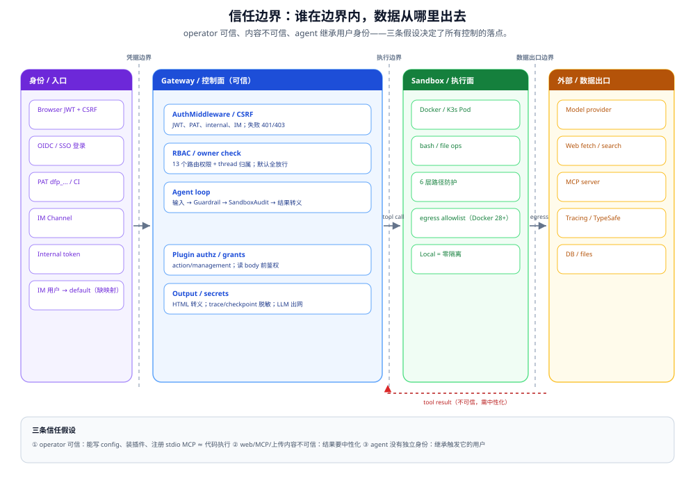

# 端到端信任链

从外部请求到 agent 工具在沙箱中执行，经过的**每一个**安全检查点和它所保护的对象。



> **图读法**：三条竖虚线是信任边界，不是网络拓扑。左边是「谁在调用」，中间是「谁在做决定」，右边是「数据去了哪里」；红色虚线是**不可信内容回流**，它必须经过中性化才能重新进入 prompt。图下的三条假设（operator 可信、内容不可信、agent 无独立身份）是所有控制的起点。

## 完整链路

```
Browser / IM / Internal
  │
  ▼
┌─ Nginx (:2026) ─────────────────────────────────────────────┐
│ 反向代理 · 路由分发 · 限流（未配置）                          │
└──────────────────────────────────────────────────────────────┘
  │
  ▼
┌─ Gateway Middleware 链 ──────────────────────────────────────┐
│                                                              │
│  AuthMiddleware                                              │
│  ├─ 公开路径？→ 放行 (/health, /docs, /api/v1/auth/login..)  │
│  ├─ Internal Token？→ 合成内部用户，跳过 JWT/CSRF              │
│  ├─ Bearer PAT？→ digest 校验 + scope 交集 + 默认拒绝路由策略  │
│  │   └─ 无效 Bearer → 硬 401，不回退 cookie                    │
│  ├─ JWT decode → DB user lookup → token_version 校验          │
│  └─ 设置 request.state.user + ContextVar                      │
│                                                              │
│  CSRFMiddleware                                              │
│  ├─ POST/PUT/DELETE/PATCH 到非 auth 路径？                    │
│  │   └─ compare_digest(cookie.csrf_token, header.X-CSRF-Token)│
│  └─ 登录端点额外 Origin 校验                                   │
│                                                              │
│  CORS (条件启用: GATEWAY_CORS_ORIGINS)                        │
└──────────────────────────────────────────────────────────────┘
  │
  ▼
┌─ Route Handler (services.py) ───────────────────────────────┐
│  @require_permission("runs:create")                          │
│  ├─ owner_check: 验证 user 拥有 thread                       │
│  ├─ require_existing: 不存在的 resource → 404 (非 403)       │
│  └─ model name allowlist 校验                                │
│                                                              │
│  inject_authenticated_user_context()                         │
│  └─ user_id → config["context"]["user_id"]                   │
│     (沙箱执行时即使 request context 丢失也能拿到)             │
└──────────────────────────────────────────────────────────────┘
  │
  ▼
┌─ RunManager → Agent Loop ───────────────────────────────────┐
│  asyncio.create_task(run_agent(config))                      │
│  user_id 在 config 中传递到 graph 执行                     │
└──────────────────────────────────────────────────────────────┘
  │
  ▼
┌─ Middleware Chain (每轮 step) ───────────────────────────────┐
│                                                              │
│  GuardrailMiddleware (第 6 位)                               │
│  └─ 每个 tool_call 执行前: provider.evaluate() → allow/deny  │
│                                                              │
│  SandboxAuditMiddleware (第 7 位)                             │
│  └─ bash 命令: regex 高危模式 block, 中危 warn, 日志记录     │
│                                                              │
│  LoopDetectionMiddleware (第 17 位)                          │
│  └─ 连续 5 次重复 tool_call → 强制产出 text                  │
└──────────────────────────────────────────────────────────────┘
  │
  ▼
┌─ Tool 执行层 ───────────────────────────────────────────────┐
│                                                              │
│  路径防穿越 (6 层)                                           │
│  ├─ ① .. 段检查 (tools.py:615)                               │
│  ├─ ② 虚拟路径族允许列表 (tools.py:624)                      │
│  ├─ ③ mount read_only 检查 (skills/acp)                      │
│  ├─ ④ 解析后 path.relative_to 检查 (tools.py:678)            │
│  ├─ ⑤ 沙箱层 containment (local_sandbox.py:127)              │
│  └─ ⑥ symlink 越界过滤 (list_dir.py:42 / search.py:186)      │
│                                                              │
│  命令执行                                                     │
│  ├─ allow_host_bash=false → bash 直接拒绝                    │
│  ├─ validate_local_bash_command_paths → 前缀白名单(不安全的) │
│  └─ _apply_cwd_prefix → cd workspace && (防 CWD 问题)       │
│                                                              │
│  输出处理                                                     │
│  ├─ 截断: bash(20k) · read(50k) · ls(20k) · glob(200)      │
│  ├─ 脱敏: host 路径 → mask 回虚拟路径                         │
│  └─ 错误清洗: 移除 host 路径                                 │
└──────────────────────────────────────────────────────────────┘
  │
  ▼
┌─ Sandbox Provider ──────────────────────────────────────────┐
│  Local: subprocess.run() 在 host 上                          │
│  Docker: HTTP API → 容器内执行                               │
│  K3s: HTTP API → Pod 内执行                                  │
│                                                              │
│  隔离边界: 无 · Docker namespace · Pod namespace             │
└──────────────────────────────────────────────────────────────┘
  │
  ▼
┌─ OS / Kernel ───────────────────────────────────────────────┐
│  seccomp: host默认 / unconfined(可收紧) / host默认            │
│  AppArmor/SELinux: 未配置                                    │
│  no-new-privileges: Docker 已配置 / K3s 未配置                │
│  egress: Docker 28+ 可选 / K3s 无 NetworkPolicy               │
└──────────────────────────────────────────────────────────────┘
```

本文是细粒度 16 层分析（2.1 的 14 层 + 🆕 2.2.0 的插件 action 授权、插件管理授权）。粗粒度 8 道关口概览见 [00-overview.md](00-overview.md)。

## 保护层汇总

按请求到达顺序：

| # | 保护层 | 位置 | 拦截产物 | 失效后果 |
|---|--------|------|---------|---------|
| 1 | JWT 认证（cookie）/ PAT Bearer | `auth_middleware.py:70` | 无凭据/无效凭据请求 | 任意人调 API |
| 2 | CSRF | `csrf_middleware.py:216` | 跨站伪造 | 其他站点以用户身份操作 |
| 3 | Internal Token | `internal_auth.py:20` | 未授权内部调用 | 未授权组件间通信 |
| 4 | 输入校验 | `services.py` / `routers/auth.py` | 格式错误/弱密码 | SQL注入(ORM防护)/弱凭据 |
| 5 | 权限（路由） | `authz.py:953` `require_permission` | 越权访问 | 用户间数据泄露 |
| 6 | Guardrail | `guardrails/middleware.py:25` | 未授权 tool 调用 | LLM 调用危险 tool |
| 7 | SandboxAudit | `sandbox_audit_middleware.py` | 高危 bash 命令 | 文件破坏/信息泄露 |
| 8 | 路径防穿越 | `tools.py` | 路径逃逸 | 读越界文件 |
| 9 | allow_host_bash | `tools.py` | host shell 调用 | 任意代码执行 |
| 10 | 输出截断 | `tools.py` 多处 | 超大输出 | OOM/context 爆炸 |
| 11 | 输出脱敏 | `tools.py` | host 路径泄露 | 内部目录结构外泄 |
| 12 | 沙箱进程隔离 | `sandbox/` | 容器/Pod 逃逸 | host 被控制 |
| 13 | 登录限流 | `routers/auth.py:165` | 暴力破解 | 弱密码被猜出 |
| 14 | 循环检测 | `loop_detection_middleware` | 死循环 tool call | 资源耗尽 |
| 🆕 15 | 插件 action 授权 | `authz.py:733` | 越权调用插件 backend | 以他人身份触发插件动作 |
| 🆕 16 | 插件管理路由授权 | `deerflow_extension_api/auth.py:87` | 越权管理插件 | 插件权限面被改写 |

> **行号维护约定**：这张表里的行号是 v2.2.0 树上的**起点行**（函数/类定义行），只有前 6 行与第 13 行保留了行号——其余条目由多条调用点构成，写单个行号会长期不成立，故只钉文件。后续同步时优先核对函数名，行号只作辅助。

## 16 层之外：四条不在表里的出口

16 层表按「请求进入 → tool 执行」排列，有四条**数据离开**的路径不在里面，评审时要单独看：

| 出口 | 目的地 | 控制 | 缺口 |
|------|--------|------|------|
| **模型调用** | LLM provider（可能境外/第三方） | API key、provider 配置、`model name allowlist` | 数据驻留/零留存取决于 provider 合同；prompt 里的 PII 是否脱敏取决于 `pii_redaction` |
| **工具出网** | web_fetch/web_search、MCP server、bash `curl` | Docker 本地沙箱 `open/isolated/allowlist`；私网/元数据地址始终拒绝 | 仅 Docker 28+；K3s/Local/Apple 无内置策略；MCP server 自身出网不受控 |
| **审计/追踪** | LangSmith/Langfuse/OTel、TypeSafe/OpenAI Decisions | secrets redaction；风险门参数不脱敏 | 外部 tracing 与风险门都是 egress 通道，需与数据保护对齐 |
| **浏览器自动化** | 任意网页/内部服务 | `browser_navigate` 的 `allow_private_addresses` 默认 false；CDP `allow_unguarded_cdp` 默认 false；各路径共用 egress 策略 | 允许域名内的钓鱼/恶意下载；浏览器 profile/cookie 隔离取决于部署 |

另外两条经常被漏掉的边界：

- **IM channel**：平台签名 + internal token + CSRF，但所有 IM 用户共享 `"default"` user_id；per-IM-user 隔离要额外改造。
- **插件 action**：在 Gateway 路由层鉴权，不在 middleware 链里；读 body 之前鉴权，但它与 Gateway 同进程，不是沙箱。

---

## 信任边界

三条数据流的 trust boundary 不同：

```
Browser:  认证边界在 JWT cookie → user_id 隔离所有数据
Internal: 信任边界在 token 匹配 → 所有请求合并为 "default"
IM:       信任边界在平台 webhook 签名 → 然后走 Internal 路径 → "default"
```

**IM channel 是最弱的边界** — 所有 IM 用户共享 `"default"` user_id，无法区分是哪个 IM 用户发了消息。对于需要 per-user 隔离的生产部署，这需要额外改造。

**PAT 是最窄的凭据边界** — 以属主用户身份运行，但受三重约束：

1. scope 与属主 effective permissions 求交集（只能收窄）；
2. 叠加默认拒绝的路由策略（`auth/pat.py:60` `_PAT_ROUTE_RULES`）——策略外路由（memory 删除、agent 创建、凭据切换、channel 配置、PAT 自管理、**插件动作面 `/api/plugins/*`**、**skill mutation 管理面 `/api/skill-mutations/*`**）即使全 scope token 也 403；
3. 🆕 **扩展面投影里 admin 信号被清空**（`app/gateway/app.py:1214-1221`）：管理员自己签发的 PAT，`is_admin` 为 `False` 且 `roles` 元组被清空，无法经 `require_admin` 把管理能力带回来。

PAT 管理/改密码还额外要求 session 认证来源。

### 🆕 2.2.0 新增的信任边界：插件动作

插件 backend action 在 **Gateway 进程内**执行，因此它的边界位置与其他层不同——不是 middleware，而是 HTTP 路由的**前置判定**（`routers/plugins.py:135`）：

```
POST /api/plugins/{namespace}/actions/{action_name}
  1. 未认证                                   → 401
  2. x-deerflow-plugin-viewer ≠ principal     → 409   账号在另一个标签页变了
  3. namespace 未安装 / action 未声明           → 404   不泄露"插件有哪些 action"
  4. settings 读不出来                          → 503
  5. settings["enabled"] is not True           → 403   管理员可整体关闭插件
  6. authorize_plugin_action_for_request()     → 403   ← 真正的授权边界
  7. 这之后才读 body，>256 KiB                  → 413
  8. body 不是 JSON object                     → 422
  9. handler 超 30s / AgentRunError / ValueError / 其它 → 504 / 原码 / 422 / 502
```

**第 6 步必须在第 7 步之前**：被拒的调用者连输入预算都消耗不到，handler 也永远看不见请求体。反过来（先读 body 再鉴权）会让一个 256 KiB 的上传在 403 之前被接收，构成免费的带宽/内存放大点。

**为什么先解析 action 再鉴权**：这样授权目标里的 `action_name` 一定是宿主校验过的声明名，未知 action 稳定返回 404 而不是 403。（旧版本文档曾写"授权在读 body 之前"这一条在 2.1 并不成立——2.1 没有插件 action 面，这条是 2.2.0 的新属性。）

** 边界之外的部分**：`plugins.py` 只做认证 + 授权，**不做沙箱**。插件代码与 Gateway 同进程同权限，`host_access` 之类的 grant 是"归属 + 防误用"，不是隔离——真正的隔离仍在容器/进程层。详见 [06-extension-boundary.md](06-extension-boundary.md)。

