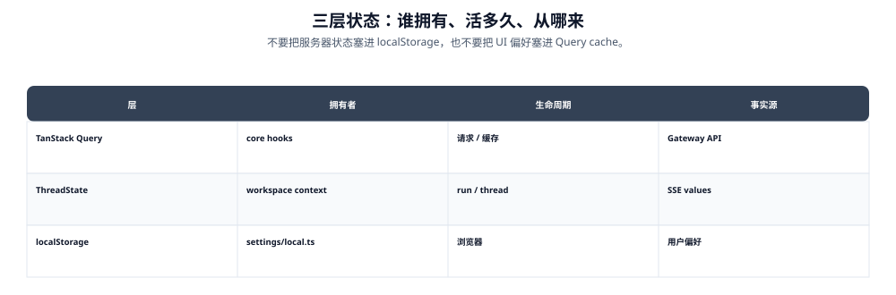

---


title: "状态管理：TanStack Query、ThreadState、localStorage"
description: 'DeerFlow 前端使用三层状态架构：服务端状态（TanStack Query）、流式状态（LangGraph SDK）、本地偏好（localStorage + useSyncExternalStore）。'
topics: [frontend, nextjs, react]
verified_against: v2.2.0
last_verified: 2026-11-08
---

# 状态管理：TanStack Query、ThreadState、localStorage



> **图读法**：不要把服务器状态塞进 localStorage，也不要把 UI 偏好塞进 Query cache。


DeerFlow 前端使用三层状态架构：服务端状态（TanStack Query）、流式状态（LangGraph SDK）、本地偏好（localStorage + useSyncExternalStore）。

## 第一层：服务端状态 — TanStack Query

`QueryClient` 在 `WorkspaceContent` 中通过 `QueryClientProvider` 注入，但**不是进程级单例**：`components/query-client-provider.tsx` 读 `AuthQueryScopeContext`，当账号归属（owner）变化时以 `key={owner}` 重建 `ScopedQueryClientProvider`，卸载时 `queryClient.clear()`。`owner === null`（尚未解析出登录身份）时直接渲染 `null`——**任何带账号前缀的查询键（`["mcpConfig", scope, user.id]`、`["capabilities", "installations", adapter, userId]`、`["admin-users", user?.id]` 等）都不会在身份未定时被发出**，也不会在切换账号后被上一个账号的缓存命中。

### 查询

| Hook | Query Key | 数据来源 |
|------|----------|---------|
| `useThreads(params)` | `["threads", "search", params]` | `client.threads.search()` — 自动分页 |
| `useThreadRuns(threadId)` | `["thread", threadId]` | `client.runs.list(threadId)` |
| `useThreadTokenUsage(threadId)` | `["thread-token-usage", threadId]`（`core/threads/token-usage.ts::threadTokenUsageQueryKey`） | `GET /api/threads/{id}/token-usage`，含 `context_usage` |
| `useRunDetail(threadId, runId)` | `["thread", threadId, "run", runId]` | `client.runs.get()` |
| `useModels()` | `MODELS_QUERY_KEY = ["models"]`（`core/models/hooks.ts:7`） | 后端 API |
| `useMemory()` | `["memory"]` | 后端 API |
| `useSkills()` | `["skills"]` | 后端 API |
| `useMCPConfig()` | `["mcpConfig", scope, user?.id]`（`core/mcp/hooks.ts:25`；2.1.0 的 `["mcp","config"]` 已不存在） | 后端 API |
| `useThreadHistory(threadId)` | `["thread-messages", threadId]`（无限查询） | `GET /api/threads/{id}/messages/page?before_seq=&limit=` |
| 🆕 `useThreadActivity()` | `["threads", "activity"]` | `GET /api/thread-activity`（15s 轮询、单页 200 条；per-QueryClient `WeakMap` 去重，多个组件共享同一次轮询） |
| 🆕 `useCapabilityCatalog()` | `["capabilities", "catalog"]` | `${base}/api/capabilities/catalog`（staleTime 60s） |
| 🆕 `useCapabilityInstallations(adapter)` | `["capabilities", "installations", adapter, userId]` | `installations/{adapter}?scope=all` |
| 🆕 `useFrontendExtensions()` | `[..., user?.id]`（`core/extensions/hooks.ts:14`） | 已启用的前端扩展清单 |
| 🆕 knowledge capabilities（选择器内部 `useQuery`） | `["knowledge", "capabilities", agentName]` | `GET /api/knowledge/capabilities?agent_name=`，`enabled: open && !unavailableReason`、`staleTime: 0`、不重试 |
| 🆕 retrieval catalog | `["knowledge", "retrieval-catalog", agentName, operations, page, search]`（文档列表把 `operations` 换成 `dataset.id`） | `GET /api/knowledge/retrieval-catalog`（分页 + 搜索，键里带 operations 使能力变化时缓存自然失效） |
| 🆕 `useChannelProviders/Connections` | `["channelProviders"]` / `["channelConnections"]`（`core/channels/hooks.ts:15`） | IM 渠道绑定与扫码状态 |
| 🆕 `useFeatures()` 家族 | `["features", <开关名>]`（`browser_control` / `mcp_tasks` / `subagent_batches` / `conversation_references` / `knowledge_base` / `scheduled_tasks` / `thread_activity` / `agents_api`） | `GET /api/features` 的分字段投影 |
| 🆕 `useWorkspaceChanges(...)` | 按 `(threadId, runId)` 区分 `includeDiff` | `GET /api/threads/{id}/runs/{runId}/workspace-changes` |
| `useSubagentBatches(threadId)` | `["subagent-batches", threadId]` | REST API（活跃时 2s 轮询，否则 15s） |
| `useSubagentBatchItems(...)` | `[..., batchId, "items"]` | REST API 无限分页（页 100，仅首页轮询） |
| `useBackgroundTasks(threadId)` | `["background-tasks", threadId]` | REST API（活跃时 3s 轮询，否则 15s） |
| `useProjects(params)` / `useProject(id)` | `["projects", ...]` | 🆕 项目列表/详情/配置（`core/projects/hooks.ts`） |
| `useInfiniteProjectThreads/Documents` | `["projects", "threads"/"documents", id]` | 🆕 项目详情页双 tab 无限分页 |
| `useInfiniteTrashDocuments()` | `["trash", "documents"]` | 🆕 回收站无限分页（`core/trash/hooks.ts`） |
| `useScheduledTaskRunHistory(taskId)` | `["scheduled-tasks", "runs", taskId, page]`（`run-history.ts:34`） | run 历史分页：页大小 50（fetch 51 探测 `hasOlder`），仅第 0 页自动轮询，翻页后停自动刷新；有活跃 run 时 3s、否则 15s（`polling.ts::ACTIVE_POLL_MS/IDLE_POLL_MS`），活跃 run 结束后失效 `["scheduled-tasks"]` 下非 runs 的键 |
| 🆕 `useThreadScheduledTasks(threadId)` / `useScheduledTask(taskId)` | `["scheduled-tasks", "thread", threadId]` / `["scheduled-tasks", "task", taskId]` | 聊天内任务卡与任务详情 |
| 🆕 `useThreadScheduledTaskEvents(threadId)` | `scheduledTaskEventsQueryKey(...)` | `GET /api/threads/{id}/scheduled-task-events`；任务被删后事件行仍存活（用 `threadTasksFingerprint` 判脏） |

### 分支会话树投影（同步 #5）

`useThreads` 返回的线程是平铺分页的；`recent-chat-list.tsx` 通过 `core/threads/thread-branch-tree.ts::flattenThreadBranches()` 把它们投影成**安全的视觉 lineage**，再交给虚拟列表渲染（`└─`/`├─` 缩进 stem + 父标题 aria-label）。投影只信任已加载的、同 pin 分区的 parent——缺失/畸形/跨 pin/自环/成环的 parent 一律保持顶层，所以局部分页或坏 metadata 不会藏起会话。

### 变更

| Mutation | 行为 |
|----------|------|
| `useDeleteThread()` | 删除 thread → 失效 `["threads", "search"]` 查询 |
| `useRenameThread()` | 重命名 → 乐观更新 TanStack Query cache |
| 🆕 `useRestoreDocument()` / `usePurgeDocument()` / `useEmptyTrash()` | 回收站恢复/彻底删除/清空 → 失效 trash + projects 查询；409（内容文件缺失/损坏）时该行留在回收站并提示 |
| 🆕 `useCreateProject/PatchProject/ArchiveProject/RestoreProject/DeleteProject` | 项目生命周期 → 失效 projects + threads 查询 |
| 🆕 `useAttachProjectDocument()` | 项目文档附加到线程 → 配合 `composer-attach.ts` 的跨路由交接（见下） |
| 🆕 `useArchiveThread` / `useThreadArchiveAction` | 会话归档/恢复 → chats 页 Active/Archived 双 tab 切换查询 `useInfiniteThreads({ archived })` |
| 🆕 `useMarkOpenThreadRead`（`chats/use-mark-open-thread-read.ts`） | 打开会话时把"已读水位"推到当前可见消息；`POST /api/threads/{id}/read` 经 1s 去抖（`MARK_THREAD_READ_DEBOUNCE_MS`），卸载时冲刷；成功后失效 `["threads"]` 让未读点消失 |
| 🆕 `useInstallCapability()` | `POST api/capabilities/installations` → 成功后失效 `["capabilities"]`、`["mcpConfig"]`、`["skills"]` |
| 🆕 渠道绑定 mutation | 连接/断开 IM 渠道 → 失效 `["channelConnections"]`（`["channelProviders"]` 只读） |

### 🆕 权限门控（同步 #6，#5294）

`core/auth/permissions.ts`：`GET /api/v1/auth/me` 现在返回 `permissions`（对齐 Gateway `authz.py` Phase 4）。`hasPermission(user, "threads:delete" | "runs:cancel")` 决定 thread-delete-dialog 与 run-cancel 入口是否渲染。语义是**建议性 UI 状态，不是执行点**：`permissions == null`（旧后端或凭据未解析出权限）或用户未加载时一律放行，避免新旧混部时隐藏仍可执行的操作；真正的强制在 Gateway 的 `@require_permission`。

## 第二层：流式状态 — LangGraph SDK useStream

`useStream<AgentThreadState>` 是 LangGraph SDK React 提供的 hook，管理实时 SSE 连接：

### 核心状态

```typescript
thread: {
  messages: Message[]           // 从 values + messages-tuple 事件累积
  values: AgentThreadState      // { title, artifacts[], todos[] }
  isLoading: boolean            // run 是否活跃
  isThreadLoading: boolean      // 初始加载中
  error: Error | null           // 流错误
  submit(messages, config)      // 发送消息 → 启动新 run
  stop()                        // 取消活跃 run
  getMessagesMetadata()         // per-message metadata
}
```

### useThreadStream 增强

`core/threads/hooks.ts:1956` 的 `useThreadStream` 在 useStream 之上添加：

- **乐观消息：** `optimisticMessages` + `optimisticThreadId` + `liveMessagesThreadId` — 在服务端响应前显示，且只在 `currentViewThreadId === displayThreadId ?? threadId` 时参与合并
- **消息合并：** history + transient history + stream + optimistic，最终顺序由 `core/threads/message-order.ts` 裁决
- **Pending usage：** `pendingUsageMessages` — 基线（send 时的 `persistedMessages` 身份集合）之后到达的消息，用于实时 token 计数
- **文件上传状态：** `[isUploading, setIsUploading]` — 乐观 UI 中的上传进度
- **活跃 run 恢复：** `activeRunId` + 重连预算（见 01「新标签页接手活跃 run」）

### 消息合并细节

```
合并顺序 (从旧到新):
  1. history messages (REST API 懒加载, prepend)
  2. stream messages (useStream 实时, 中间)
  3. optimistic messages (本地 state, append)

去重: 按 message.id 或 tool:{tool_call_id} identity
```

> **同步 #6 重构**：合并顺序不再是简单的 "history prepend / stream middle / optimistic append + 后出现者覆盖"。排序抽成纯函数模块 `core/threads/message-order.ts`，以后端盖在 history/values 消息上的 `deerflow_seq` 为可信骨架（earliest-seq-wins）；`values` 帧合并抽成 `core/threads/stream-state.ts`。完整规则见 [01-stream-pipeline.md](./01-stream-pipeline.md)。

## 第三层：本地偏好 — localStorage + useSyncExternalStore

`core/settings/` 使用 `useSyncExternalStore` 实现跨组件、跨 tab 的响应式本地状态：

### 数据结构

```typescript
interface LocalSettings {
  notification: { enabled: boolean }
  tokenUsage: {
    headerTotal: boolean
    inlineMode: "off" | "per_turn" | "step_debug"
  }
  context: {
    model_name?: string
    mode: "flash" | "thinking" | "pro" | "ultra" | undefined
    reasoning_effort?: "minimal" | "low" | "medium" | "high"
  }
}
```

### 实现细节

- **持久化：** `localStorage["deerflow.local-settings"]` → JSON
- **订阅模式：** `window.addEventListener("storage", ...)` → 跨 tab 同步
- **Per-thread 覆盖：** `localStorage["deerflow.thread-model.{threadId}"]` → 对特定 thread 的 model 覆盖
- **两个 hook：**
  - `useLocalSettings()` — 全局设置
  - `useThreadSettings(threadId)` — 带 per-thread model 覆盖的设置

### 🆕 账号偏好跨浏览器同步（同步 #6，#5397）

`core/settings/user-preferences.ts` + `preferences-sync.ts`：`notification / model_name / mode / reasoning_effort` 四个偏好提升为服务端账号偏好（migration 0023，`GET/PATCH /api/v1/auth/preferences`）：

- **Outbox 式同步**：`PreferencesSync` 类维护 `confirmed` + `pending` 两份，编辑先进 pending 立即本地生效，网络空闲时 flush；pending 存 sessionStorage（按 `userId` 隔离 key），崩溃/刷新后可重试，带指数退避
- **`UserPreferencesBoundary`** 包裹整个 `WorkspaceContent`，网络生命周期挂在已认证的工作区上（不参与渲染）；409/403（cookie 换账号）立即停止，**绝不用旧账号身份重试**
- 解析走 zod 逐字段 safeParse——只保留合法偏好，绝不复制任意运行时上下文

### 🆕 模型收藏（同步 #6，#5441）

`core/models/favorites-store.ts` + `use-model-favorites.ts`：按 `userId` 隔离的 localStorage 收藏列表（`favoritesKey(userId)`），存储不可用时降级 memory；`model-picker-content.tsx` 把收藏置顶（旧 `ai-elements/model-selector.tsx` 已删除）。

### 🆕 2.2.0：thread activity 与未读水位

`core/threads/activity.ts` 是"哪些会话有新消息"的唯一来源：

- `GET /api/thread-activity?limit=200` → 每个 thread 的最近活动与未读计数，`["threads","activity"]` 键 15s 轮询
- **per-QueryClient `WeakMap`** 去重：`WorkspaceSidebar`、列表页、未读点等多个组件同时订阅时只跑一次轮询与计时器；离开最后一个订阅者即停
- 打开会话 → `useMarkOpenThreadRead` 以 1s 去抖推送已读水位（`POST /api/threads/{id}/read`），把"未读"精确收敛到用户真正看到的最后一条消息，而不是"打开过整个 thread"
- 未读点的展示语义与 `core/threads/origin.ts` 的来源图标（extension / github / im_channel / mcp_notification / schedule）配套，见 04

### 🆕 2.2.0：知识库 scope 的三段状态

scope 不是普通偏好，它是**随每次 run 一起提交的快照**，所以三层都在场：

| 层 | 位置 | 说明 |
|----|------|------|
| 编辑器态 | `KnowledgeScopeSelector` 的 `draft` | 打开对话框时 `cloneKnowledgeScopeSelection(selection)`，取消即丢弃；展开的数据集、页码、搜索词都是纯 UI state |
| 会话态 | agent chat 页的 `knowledgeScope` state | 决定下次提交注入的内容；`selectorVisible` 还要求 `NEXT_PUBLIC_STATIC_WEBSITE_ONLY !== "true"` |
| 提交快照 | run context 的 `knowledge_scope` | `buildKnowledgeScopeSnapshot()` 产出的不可变快照（`mode: all/selected/disabled` + 数据集/文档 id），上限 100 数据集 / 1000 文档 / 单 id 256 字符 / 整包 64 KiB；超出在这些边界被拒，而不是让后端截断 |
| 回显 | human 消息的 `additional_kwargs` | `KnowledgeScopeSummary` 从消息本身读快照（`data-testid="message-knowledge-scope"`），历史消息重放时显示的还是**当时**的 scope |

### 🆕 2.2.0：Capability 目录与安装状态

`core/capabilities/hooks.ts` 把"有什么能力"和"我装了什么"拆成两个查询：

- `["capabilities","catalog"]` — 静态目录（`builtin.demo.json` + `copy.ts` + `static.ts`），staleTime 60s；插件清单类型在 `types.ts`（`PluginManifest`，`schema_version: 1`，`kind: mcp|cli|native`，`contributions: tools|skills`，`config_schema`）
- `["capabilities","installations",adapter,userId]` — 按适配器（`mcp` / `business` / `lark` …）拉 `scope=all` 的安装记录，query key 带 `userId`
- 装完 → `useInstallCapability()` 一次性失效 `capabilities` / `mcpConfig` / `skills` 三族，避免只刷新一半

## React Context 层

| Context | 数据 | 用途 |
|---------|------|------|
| `ThreadContext` | `{ thread, isMock }` | 将 LangGraph stream 对象注入组件树 |
| `ArtifactsContext` | `{ artifacts[], selectedArtifact, open, select/deselect/setArtifacts }` | Artifact 选择状态 → 右侧面板 |
| `SubtaskContext` | `{ tasks: Record<string, Subtask>, setTasks }` | Subagent 执行状态追踪 |
| `I18nContext` | `{ t: Translations, locale, setLocale }` | 国际化字符串 |
| `PromptInputProvider` | Vercel AI SDK | 输入文本 + 附件管理 |
| `ThemeProvider` | next-themes | Dark/Light/System |
| `SidebarProvider` | shadcn/ui | 侧边栏开合状态（cookie `sidebar_state` + ⌘B）；🆕 `useWorkspaceSidebarExpanded` 读的是"桌面是否展开"，移动端抽屉另有自己的开合 |
| 🆕 `KnowledgeSourcesProvider` | `ReadonlyMap<string, KnowledgeSource>` | 把当前列表里所有 tool artifact 的证据按 id 铺给所有消息节点（`collectKnowledgeSources(messages)` 结果 memo 化），引用徽章不再逐条消息重复解析 |
| 🆕 `MessageDetailsProvider` | `{ onSelect }` | message-details 右面板的选择通道；`key={threadId}` 在换会话时整体重挂，避免残留上一条会话的选中项 |
| 🆕 `AuthQueryScopeContext` | owner（账号标识） | QueryClient 按账号重建的依据（见文首） |
| 🆕 `BrowserViewContext` / `SidecarContext` | 浏览器流句柄 / 侧聊会话 | 右面板切换时复用连接，而不是重建 |
| 🆕 扩展 `FrontendServices` 绑定 | `bindFrontendServices(...)` | 给插件 surface 暴露 `openConversation` 等受控能力，而不是把 React 上下文裸露给插件 |

## 组件本地状态

| 组件 | 状态 |
|------|------|
| `ChatPage` | `isWelcomeMode: boolean` — 对话模式 vs 欢迎模式 |
| `MessageList` | Sentinels + IntersectionObserver — 无限滚动历史加载 |
| `InputBox` | `displayPrompt` — 当前输入的文本（带 mode/model/reasoning-effort 选择器）；🆕 内联 `@` 引用列表与光标配对（caret handoff）、IME 组合态、润色请求的序列号（防旧响应覆盖新文本） |
| `ChatBox` | Panel layout ratio；🆕 `RightPanelKind = sidecar \| browser \| artifacts \| details` 与 `RIGHT_PANEL_DEFAULT_SIZE="40%"` |
| `Reasoning` | `open: boolean` — thinking block 展开/折叠；🆕 自动开合只在"本组件真的流过式"后生效 |
| 🆕 `KnowledgeScopeSelector` | `open` / `draft` / `expandedDatasetId` / `page` / `search` |
| 🆕 `CapabilityCenter` | `?tab=` 是唯一权威（搜索框的水合门控用 `useSyncExternalStore`，避免 SSR 与客户端首帧不一致） |
| 🆕 `ScheduledTask*` | 表单的 `ScheduleType` 草稿、run 历史页码、续期上限草稿 |

## 状态同步方向

```
Backend                LangGraph SDK         React State           localStorage
   │                        │                     │                     │
   │── SSE ────────────────→│                     │                     │
   │                        │── thread.messages ──→│                     │
   │                        │── thread.values ────→│                     │
   │                        │── thread.isLoading ─→│                     │
   │                        │                     │                     │
   │                        │                     │── user toggle ─────→│ (model, mode)
   │                        │                     │←─ storage event ───│ (cross-tab)
   │                        │                     │                     │
   │←── TanStack Query ─────│←── useQuery ────────│                     │
   │                        │                     │                     │
   │←── submit() ──────────│←── sendMessage() ───│                     │
```
