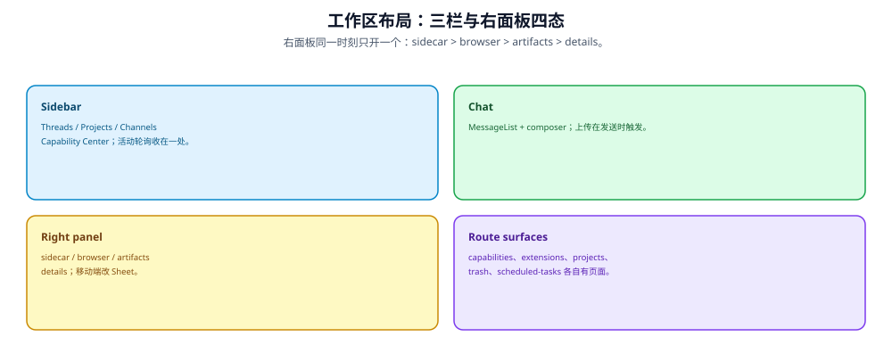

---


title: "工作区布局：Drag 面板、响应式、Command Palette"
description: '工作区布局：Drag 面板、响应式、Command Palette：架构、契约与源码锚点。'
topics: [frontend, nextjs, react]
verified_against: v2.2.0
last_verified: 2026-11-08
---

# 工作区布局：Drag 面板、响应式、Command Palette



> **图读法**：右面板同一时刻只开一个：sidecar > browser > artifacts > details。


## 顶层 Shell

`app/workspace/workspace-content.tsx`（Server Component）：

```
QueryClientProvider（按账号 owner 重建，见 03）
  UserPreferencesBoundary（账号偏好同步）
    ExtensionPageBootstrap（拉前端扩展清单，失败不阻塞工作区）
      SidebarProvider (cookie "sidebar_state" 持久化 open state)
        WorkspaceSidebar (useThreadActivity 只在这里调一次)
          ThreadDeleteDialogProvider
            WorkspaceSidebarFrame (collapsible="icon")
              Header: WorkspaceHeader (brand + New Chat + WorkspaceSidebarTrigger)
              Content:
                ├─ WorkspaceNavChatList (聊天导航)
                ├─ PluginNavigation (🆕 扩展插件页面，无页面时整组不渲染)
                ├─ WorkspaceChannelsList (🆕 IM 渠道)
                └─ sidebar 展开时：ProjectsSection + RecentChatList
              Footer: WorkspaceNavMenu (settings 等)
              SidebarRail (拖拽手柄)
        SidebarInset
          GatewayOfflineBanner / ModelLoadErrorBanner
          {children} — ChatPage
  CommandPalette / SettingsDialogHost / WorkspaceSettingsDeepLink
  Toaster (sonner)
```

`app/workspace/layout.tsx` 用 `dynamic = "force-dynamic"`，按认证状态分支渲染；`workspace-sidebar-frame.tsx` 负责三件容易做错的事：① 桌面"是否展开"的判断（`useWorkspaceSidebarExpanded`，只有 `md+` 且 `!collapsed`）与移动端抽屉开合分离，避免移动端也渲染桌面 rail；② 移动端点击导航链接后先关抽屉；③ 抽屉关闭后把焦点还给触发按钮（`RestoreSidebarFocus`）。移动端自定义了 collapsed rail（#3340），触发按钮带 `aria-haspopup="dialog"`。

> **同步 #6**：最外层新增 `UserPreferencesBoundary`（账号偏好同步，见 03-state-management.md）。
>
> **同步 #8（2.2.0）**：新增 `ExtensionPageBootstrap`（前端扩展清单的启动拉取）、`PluginNavigation`（插件页面导航组）、`WorkspaceChannelsList`（IM 渠道入口），并把 thread 活动轮询收到 `WorkspaceSidebar` 一处调用。

### 🆕 新增工作区路由（同步 #6）

| 路由 | 内容 |
|------|------|
| `/workspace/capabilities` | Capability Center（#5468；🆕 2.2.0 改为 **Plugins / Skills / Extensions 三个 tab**）：tab 由 `?tab=` 决定（`skills` / `extensions` / 其余一律落到 `plugins`），切 tab 走 `router.replace(pathname?tab=…)` 并清空该页其它 query；搜索框在 `useSyncExternalStore` 水合门控前禁用；三个子模块都是 `dynamic()` 懒加载（`plugin-gallery` / `skill-gallery` / `extension-gallery`）。**Settings 里的 skill/tool 设置页删除**（`skill-settings-page.tsx`、`tool-settings-page.tsx` 已删，settings-dialog 瘦身） |
| `/workspace/projects/[id]` | 🆕 项目详情页：Threads / Documents 双 tab（`projects/project-threads-section.tsx` + `project-documents-section.tsx`）；`move-to-project-menu.tsx`（会话移动菜单）与 `projects-section.tsx`（sidebar 分组）把项目接进现有导航 |
| `/workspace/trash` | 🆕 回收站：`trash-view.tsx` 分页列表 + 恢复/彻底删除/清空；配合 `thread-delete-dialog.tsx`（权限门控见 03） |
| `/workspace/chats` | 会话总览改为 Active / **Archived** 双 tab（`useThreadArchiveAction` + `thread-archive-status.tsx`）；🆕 每行带 `ThreadOriginIcon`（clock=定时任务 / provider 图标=来自某个 IM 或 GitHub / 拼图=扩展）、`ThreadChannelBadge` 与 `ThreadUnreadDot`（`thread-channel-source.tsx` 一处收口三者的语义与无障碍名） |
| 🆕 `/workspace/extensions/[namespace]/[surface_id]` | 扩展插件页面：server component 解出 `namespace`/`surfaceId` → `PluginPage`；`core/extensions/pages.ts::pluginPagePath()` 生成路径，`pluginPages()` 只取 `slot === "page"` 的 surface，`surface.navigation` 为真才进侧栏导航组 |
| 🆕 `/workspace/scheduled-tasks` | 定时任务页重写为 **list-first**：任务列表 + 详情（目标、停止条件、次数/时间上限、run 历史分页）+ 续期/删除对话框；`?task=` 直接打开详情 |

项目文档附件走跨路由交接：项目页 Documents tab 附加成功后，`core/projects/composer-attach.ts` 把**已完成的上传结果**（绝不在途上传）暂存 sessionStorage（`deerflow.project-attachment.{threadId}` pending list），跳转到目标线程后 composer 显示为已上传附件，发送或显式移除才清除。

## ChatBox — 可拖拽双面板

`components/workspace/chats/chat-box.tsx` — 使用 `react-resizable-panels` v4。2.2.0 起右侧不再是"artifact 面板"，而是**四选一的面板槽**：

```
ResizablePanelGroup (id = 由 pathname 净化出的 resizableIdBase + "-group")
  ├─ ResizablePanel (chat, minSize 30%)
  │     {children} — MessageList + InputBox
  ├─ ResizableHandle (disabled={!rightPanelOpen})
  └─ ResizablePanel (side, collapsible, collapsedSize 0%, minSize 20%, defaultSize "40%")
        RightPanelKind = sidecar | browser | artifacts | details
```

| 面板 | 内容 | 触发 |
|------|------|------|
| `artifacts` | Artifact 查看器（CodeEditor / Markdown 预览） | `ArtifactsContext.open`、artifact 链接、`NEXT_PUBLIC_STATIC_WEBSITE_ONLY === "true"` 时自动选中首个 artifact |
| `browser` | 浏览器实时画面（WS `frame_format=binary`；10s 握手超时、指数退避 800ms→10s、最多 6 次重连；rAF 合帧 + blob URL 回收，`useSyncExternalStore` 暴露 `frameUrl`） | tool call 里的浏览器预览 |
| `sidecar` | 侧聊（quoted follow-up） | 消息上的"就这段继续问" |
| `details` | message-details 任意详情 | tool call / 消息里的详情项（`MessageDetailsProvider`） |

优先级固定为 `sidecar > browser > artifacts > details`，同一时刻只开一个。动画时长 `RIGHT_PANEL_ANIMATION_MS = 280`；动画期间把内容宽度按 `cqw` 钉死，避免逐帧重排。移动端（`< md`）不开拖拽，改成右侧 `Sheet`。

## ChatPage — 两种视图模式

`app/workspace/chats/[thread_id]/page.tsx`：

### Welcome Mode（新对话或空 thread）

```
┌──────────────────────────────────┐
│          (透明 header)           │
│                                  │
│          <Welcome />             │  ← 品牌 hero 区域
│       (Logo + Tagline)           │
│                                  │
│   ┌──────────────────────────┐   │
│   │       InputBox           │   │  ← 绝对居中垂直对齐
│   │  (mode/model/🆕知识库 scope) │   │     sm: -translate-y-[calc(50vh-96px)]
│   └──────────────────────────┘   │     窄屏 -translate-y-[calc(50vh-48px)]
│                                  │     宽度 max-w-(--container-width-md) / sm 以上 --container-width-sm
└──────────────────────────────────┘
```

🆕 2.2.0 的 composer 上新增两个入口：知识库 scope 触发按钮（`data-testid="knowledge-scope-trigger"`，`aria-pressed`；只在 `GET /api/features → knowledge_base.scope_selection_enabled` 为真且非静态站点时出现），以及行内的 `/goal`、`/compact` 两个内置命令（`/` 菜单不再列其它命令）。

### Conversation Mode（有消息后）

```
┌──────────────────────────────────┐
│ Sticky Header (backdrop-blur)    │
│ ├─ ThreadTitle + 🆕 ThreadOriginIcon / 渠道徽章 │
│ ├─ ThreadArchiveStatus (归档徽标 + 恢复按钮) │
│ ├─ TokenUsageIndicator + 🆕 ContextUsageBadge │
│ ├─ ExportTrigger                 │
│ └─ ArtifactTrigger / 🆕 侧聊·浏览器·详情 触发 │
├──────────────────────────────────┤
│                                  │
│ MessageList                      │
│ ├─ LoadMoreHistoryIndicator      │  ← IntersectionObserver 上滚加载
│ ├─ Conversation                  │
│ │   ├─ MessageListItem × N       │
│ │   ├─ MessageGroup × N          │
│ │   ├─ SubtaskCard × N           │
│ │   └─ StreamingIndicator        │  ← thread.isLoading 时显示
│ └─ (use-stick-to-bottom)         │  ← 自动滚到底部
│                                  │
├──────────────────────────────────┤
│ InputBox (fixed bottom)           │
│ --container-width-md             │
└──────────────────────────────────┘
```

## Projects — 项目工作区（同步 #6）

项目是 thread 之上的新组织维度：thread 通过 `metadata.deerflow_project_id` 归属项目，chat 在项目作用域内创建。

| 组件 | 路径 | 职责 |
|------|------|------|
| 侧边栏项目分组 | `components/workspace/projects-section.tsx` | 可折叠项目组，每组内用 `flattenThreadBranches` 投影成员 thread（与 flat 模式共用 `ThreadSidebarItem`）；标签行提供 **group/flat 显示切换**、新建项目对话框与回收站入口（`projects-trash-link` → `/workspace/trash`） |
| 项目详情页 | `app/workspace/projects/[id]/page.tsx` | header（归档徽标 / New Chat）+ `ProjectThreadsSection`（无限分页成员列表）+ 设置区（重命名/归档/恢复/删除确认对话框）；404 有专门 not-found 态 |
| 移动菜单 | `components/workspace/move-to-project-menu.tsx` | thread 行菜单里把会话移入/移出项目，基于 `projectIdOfThread` 显示当前位置 |
| 作用域新建 | `/workspace/chats/new?project=…` | 聊天页的 project pre-create 在 composer `onPrepareThread` 中先执行——goal 端点会自行物化缺失的 thread 行，未分配行会让幂等 create 返回无项目归属的 thread |

项目详情页的 "New Chat" 链接为 `/workspace/chats/new?project={id}`（未归档项目才显示）。

`GroupedProjectList` 只对已抓取的 infinite thread pages 做**客户端分组**，不额外发请求：`partitionableThreads` 以 `threadListModel.displayedThreads` 为输入，并在路径活跃 thread 超出展示上限时把它追加进来（否则该活跃会话在 flat 列表和项目组里都不显示）；传给各组的 `recentThreadId` 是全局最新 `threadListModel.threads[0]`（与 flat 模式一致），不是各项目组自己的首个 thread；`ArchivedProjectsGroup` 初始折叠。静态 demo 模式（`isStaticWebsiteOnly()`）下整个 section（含新建按钮与显示模式切换）返回 `null`。

### 嵌套 SidebarMenu 的宽度约束（v2.1.0，#5681 → #5682）

grouped 模式用嵌套 `SidebarMenu` 缩进项目内的 thread 行，但 `SidebarMenu` 原语默认带 `w-full`（`cn("flex w-full min-w-0 flex-col gap-1", className)`）：`ml-4`（16px）+ 100% 宽会让容器比侧栏宽 16px，绝对定位的行内 kebab（`right-1`）随之落到可视区外被裁掉；Archived 组（`ArchivedProjectsGroup` 内再套一层 `ProjectThreadGroup`）溢出 32px，kebab 完全不可见。

| 位置 | 修复前 | 修复后 |
|------|--------|--------|
| `ProjectThreadGroup` 的缩进 menu | `border-sidebar-border ml-4 border-l pl-2` | `border-sidebar-border ml-4 w-auto border-l pl-2` |
| `ArchivedProjectsGroup` 的缩进 menu | 同上 | 同上 |
| 根 `SidebarMenu` | 原语默认 `w-full` | 不变 |

`className` 经 `cn()`（tailwind-merge）解析，`w-auto` 覆盖原语的 `w-full`，块级 flex 容器改为「填满剩余宽度 − margin」。回归测试 `frontend/tests/unit/components/workspace/projects-section-nested-menu.dom.test.tsx`（169 行）从预置 query cache 渲染 grouped 模式并展开 Archived 组，断言每个缩进菜单有 `w-auto`、无 `w-full`，根菜单仍为 `w-full`（happy-dom 无布局引擎，故在 class 层面钉住）。

> **可迁移经验**：在定宽容器（侧栏）里给布局原语加横向 margin 时，要同时改掉它的默认宽度（`w-full` → `w-auto`）；`w-full + margin` 必然横向溢出，而绝对定位的尾部操作按钮（kebab）是最先被裁掉的元素。

## Thread 列表虚拟化（同步 #6）

`thread-list-virtualizer.tsx`（`@tanstack/react-virtual`）：侧边栏行、`/workspace/chats` 行、项目页行共用一个最小行模型（只需稳定 `thread_id`），**≥ 60 行才启用虚拟化**；`recent-chat-list.tsx` 用 IntersectionObserver 哨兵触发 `useInfiniteThreads.fetchNextPage()` 无限滚动。列表刷新需用 `calculateScrollMargin` 补偿 root/scroll parent 偏移。

## Command Palette

`components/workspace/command-palette.tsx` — 基于 shadcn/ui `CommandDialog`（底层 `cmdk`）：

全局快捷键（`Cmd` 在非 mac 上对应 `Ctrl`）：
| 快捷键 | 操作 |
|--------|------|
| `Cmd+K` | 打开/关闭 Palette |
| `Cmd+Shift+N` | New Chat（→ `/workspace/chats/new`） |
| `Cmd+,` | Settings（appearance 分区） |
| `Cmd+/` | 键盘快捷键帮助对话框 |
| `Cmd+B` | 切换 Sidebar（`SIDEBAR_KEYBOARD_SHORTCUT = "b"`，`ui/sidebar.tsx:33` 的 keydown effect 处理） |

`SettingsDialog` 的分区是固定 union：`models / users（仅 admin，紧跟 models）/ account / appearance / channels / memory / subagents / notification / about`。

## 主题系统

`next-themes` 的 `ThemeProvider`（`attribute="class"`, `enableSystem`, `disableTransitionOnChange`）：

- **Light 主题：** 暖白色背景 (`oklch(0.9855 ...)`)，黑色 primary
- **Dark 主题：** 深色背景 (`oklch(0.24 ...)`)，白色 primary，轻字重 (`300`)
- Landing page (`"/"`) 强制 dark 主题

CSS 变量通过 `@theme inline` 定义（Tailwind v4 语法）：
- 颜色：`--background`, `--foreground`, `--card`, `--popover`, `--primary`, `--secondary`, `--muted`, `--accent`, `--destructive`, `--border`, `--input`, `--ring`
- Sidebar：`--sidebar`, `--sidebar-foreground`, `--sidebar-primary`, `--sidebar-accent`, `--sidebar-border`, `--sidebar-ring`
- Chart：`--chart-1` 到 `--chart-5`

## 自定义动画

在 `globals.css` 中定义：

| 动画 | 用途 |
|------|------|
| `fade-in` | 词级 text 出现 |
| `fade-in-up` | 消息/组件入场 |
| `skeleton-entrance` | 骨架屏加载 |
| `suggestion-in` | 跟随建议 |
| `shine` | Subtask card shimmer 动画 |
| `ambilight` | Subtask card 活跃光晕 |
| `bouncing` | 省略号跳动 |
| `aurora` | Landing page 背景渐变 |
| `wave` | Landing page 波浪 |

## 响应式

Tailwind v4 的 responsive utilities（`sm:`, `md:`, `lg:`）用于：
- Container 宽度：`--container-width-xs`(72) / `sm`(144) / `md`(204) / `lg`(256)
- Sidebar collapse：窄屏自动图标模式（`collapsible="icon"`）
- Artifact 面板：小屏上全宽显示
