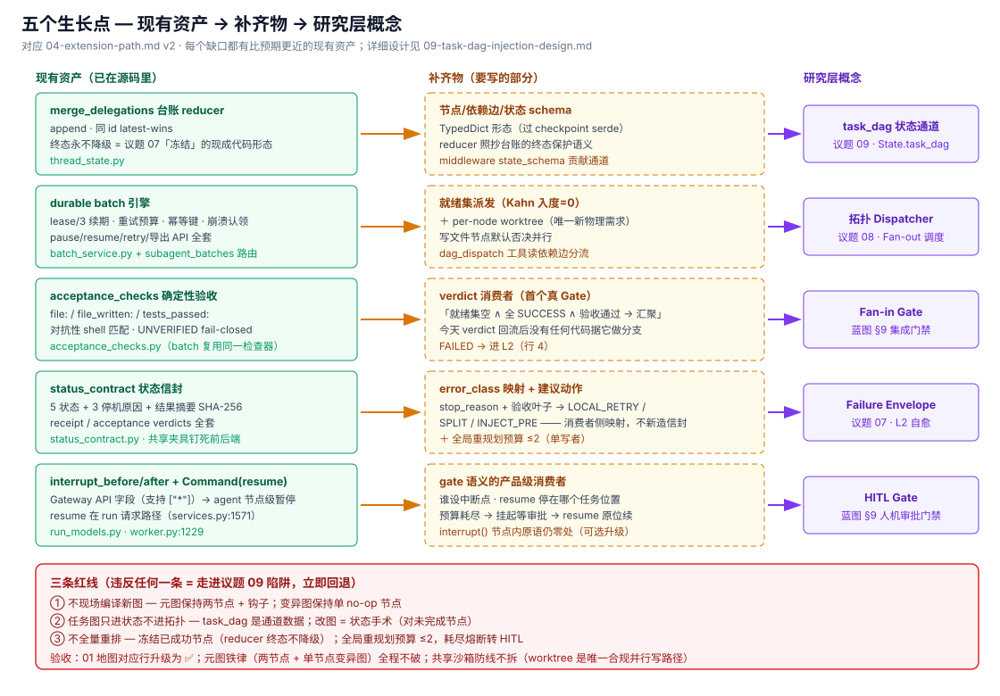

---

title: "扩展路线 — 缺口即路线图"
description: '若要长出''''数据任务 DAG''''半边:五个生长点的最小落点、对研究层注入方案的批判性判读,以及明确不做什么。'
topics: [graph, dag, roadmap, extension]
verified_against: v2.2.0
last_verified: 2026-11-08
---

# 04 · 扩展路线 — 缺口即路线图(v2,深挖修订)

> 前提([03](03-why-no-dag.md)):DeerFlow 刻意不做数据 DAG。本文件回答"如果要补,从哪儿下手"。v2 依据 [05](05-delegation-mechanics.md)/[06](06-langgraph-capability-surface.md) 的深挖,把每个生长点对齐到**已存在的资产**,并判读研究层的注入方案。

## 五个生长点(对齐现有资产)

| # | 缺口(地图行) | 已有资产(比 v1 判定更近) | 还差什么 | 对应研究层议题 |
|---|-------------|------------------------|---------|---------------|
| 1 | `task_dag` 状态通道(#6) | `delegations` 台账 reducer 已实现**终态不降级**语义(`merge_delegations`)——议题 07 的"冻结已成功节点"规则在 DeerFlow 里已有可直接照抄的代码形态 | 节点/依赖边/状态三要素 schema;reducer 照抄台账的终态保护 | 议题 09 `State.task_dag` |
| 2 | 拓扑派发(#7) | durable batch 的 lease/retry/fence 全套引擎语义(05 §7);FIFO 准入控制器;`Send()` 原语(依赖侧) | 就绪集计算(入度=0)+ 依赖边驱动的派发;**必须直面共享沙箱**:并行派发写文件的任务进同一个线程沙箱,正是现行路由策略硬否决的场景——dispatcher 需要 per-node worktree 或保留否决 | 议题 08 Dispatcher |
| 3 | Fan-in Gate(#7/#8) | `acceptance_checks.py` 是现成的确定性 Gate 判定器(file/tests_passed,对抗性匹配,UNVERIFIED fail-closed);`acceptance_verdict` 已回流信封 | 消费者:verdict 目前只给 lead 读,**没有任何代码据它做分支**;需要"全部 SUCCESS 且验收通过 → 汇聚"的确定性判定 | 蓝图 §9 集成门禁 |
| 4 | 失败信封 + L2 预算(#11) | `status_contract` 已是完整**状态信封**(5 状态/3 停机原因/结果指纹/验收判定)——缺的只有 `failure_classification` 分类学与 `suggested_replanning_action` 两个**字段**,不是缺结构 | 分类器(错误 → INFRA/语法/断言/spec 歧义)+ 建议动作枚举 + Kahn 校验器 + 全局重规划预算(≤2) | 议题 07 全部三节 |
| 5 | 图级 HITL(#10) | **原语对已端到端暴露**:`interrupt_before/after`(Gateway 字段)+ `Command(resume=)`(请求路径)——基础设施是现成的 | 产品级消费者:谁设置中断点、resume 后 UI 呈现什么、HITL 停在哪个"任务位置"的语义;`interrupt()` 原语可用于 Gate 节点内 | 蓝图 §9 HITL Gate |

> 关键洞察不变:五个生长点里**没有一个是"换图引擎"**——全部在现有元图 + 工具层之上加"数据与判定"。且 v2 发现每个生长点都有比预期更近的现有资产。

## 对研究层注入方案的批判性判读

针对 [`harness_langgraph_ecosystem/03-bytedance-deerflow.md`](/Users/bowhead/ai_dev_sdlc_aidc/02_research/01_agent_engineering/graph_engineering/harness_langgraph_ecosystem/03-bytedance-deerflow.md) §3 的五步方案(它是本研究主题下最完整的注入设计,方向正确,但五处细节经源码核对站不住):

| 方案步骤 | 问题 | 源码依据 |
|---------|------|---------|
| 步骤 1 `merge_task_dag` | **违反自家议题 07 的冻结规则**:方案里的 reducer 允许任意覆盖(含把 SUCCESS 节点改回 PENDING)——正是"状态抖动"反模式。DeerFlow 的 `merge_delegations` 已实现终态不降级,**照抄即可** | `thread_state.py::merge_delegations`;议题 07 §1 |
| 步骤 1 Pydantic 节点 | `ThreadState` 是 TypedDict 体系,通道值要过 checkpoint 序列化;BaseModel 进通道需确保 serde 与 `adapt_state_schema_for_mode` 兼容,否则 delta 模式下重放会碎 | `thread_state.py` schema 适配链 |
| 步骤 1 `active_ready_queue`/`global_replan_budget` | 无 reducer 的裸字段在并行写下是 last-value 竞态;预算字段应该由单一写者(Gate/L2 节点)独占 | LangGraph 通道语义;06 §4 |
| 步骤 4 `gate_middleware` 返回 dict | **半对半错,需要按 venv 实测改口径**。对的部分:middleware 的 `wrap_model_call` 确实不能返回带 `goto`/`resume`/`graph` 的 `Command`——LangChain 直接抛 `NotImplementedError`。**错的部分(旧 digest 漏了)**:报错文案自带出路——"Use the `jump_to` state field with `before_model`/`after_model` hooks instead",而 `jump_to` 是**真能用的**:DeerFlow 自己的 `subagents/turn_budget.py:31`-`39` 就在拿它做成本模型。所以"middleware 不能控制流向"这句话不成立,准确的是"只能经 `jump_to`,不能经 `Command`"。另外方案的"引入 interrupt"其实**已有基础设施**——`interrupt_before` + `Command(resume)` 已暴露,缺的是消费者不是原语 | venv 实测 `langchain/agents/factory.py:216`-`225`;`subagents/turn_budget.py:31`-`39`;06 §2;`run_models.py:48`;`services.py:1571` |
| 方案全局 | 未处理**共享沙箱**约束:READY 集并行派发写文件任务进同一线程沙箱 = 现行路由策略的硬否决场景;dispatcher 不带 per-node worktree 的话,方案会把 DeerFlow 现有的写冲突防线拆掉 | 05 §1/§4;`subagents/AGENTS.md` #5128 |

另有一处叙事修正(已回写研究层):方案 §2 的"弱契约失败重试:子工具报错后仅回传 ToolMessage,模型只能瞎猜"对**子代理路径不成立**——状态信封 + 验收判定是结构化的(05 §5);弱契约只在普通工具路径成立。

### 生长点 6(v2.2.0 新增):`jump_to` —— 已在船上的非 `Command` 流向原语

上面的步骤 4 判读逼出一个之前没登记的生长点。`jump_to` 让 **middleware 钩子**能声明"我这个钩子可以跳到哪儿"(`hook_config(can_jump_to=...)`),运行时返回 `{"jump_to": "tools" | "model" | "end"}` 即可改流向。它的意义是:

- 它是**在不碰拓扑的前提下拿到局部控制流**的唯一官方口子——正好落在议题 09 的红线内侧(元图仍是两节点,跳转是钩子内的一次转场,不是新节点);
- DeerFlow 已经把它写进了成本模型:`turn_budget.py` 明确算出"任何 jump 都让 turn 上限从精确预算降级为下界",并且 `find_jumping_hooks()` 会在子代理 executor 里**发警告**——说明他们把它当成真实存在的能力而非未用 API;
- 但**今天的中子代理链上没有 middleware 声明 jump**(`turn_budget.py` 的 docstring 结尾原话:"No middleware in today's subagent chain does");lead 链上 `Command(goto=END)` 的唯一用法仍是 clarification 短路。

**因此它既是生长点也是护栏**:若将来要给 Fan-in Gate 加"验收失败 → 回到 model 重规划"的分支,`jump_to` 是比 `Command` 更合规的落点,代价是必须把 L2 重规划预算做进 turn_budget 的成本模型(否则每跳一次,预算就从精确值退化一次)。这恰好印证 §「明确不做什么」的第 2 条:流向变化要表达成**数据 + 钩子**,不是新节点。

## 明确不做什么

回扣议题 09 三大陷阱,红线不变:

1. **不现场编译新图**——不允许任何 `builder.add_node()` 出现在请求路径;元图保持两节点 + middleware 钩子;变异图保持单 no-op 节点;
2. **不把任务图塞进拓扑**——task_dag 是 `ThreadState` 里的**数据**,不是 LangGraph 节点;改图 = 状态手术(对未完成节点插入/切片),外层流转逻辑不变;
3. **不做全量重新生图**——L2 只允许对失败节点的局部切片(冻结已成功节点,语义 = `merge_delegations` 的终态不降级),并有全局预算熔断转 HITL(`interrupt_before` 已可用)。

## 验收判据

路线推进时,用 [01](01-support-map.md) v2 的地图行做验收:每个生长点合入后,对应行从 ◐/❌ 升级为 ✅,并在本目录长出对应的实现解剖编号文件。若某步让 #1 的"两固定节点 + 单节点变异图"铁律失效(出现了随请求变化的第三种图),立即回退——那意味着走进了议题 09 的陷阱。专项判据:#7 的共享沙箱约束不被拆掉(per-node worktree 是唯一合规的并行写路径)。
