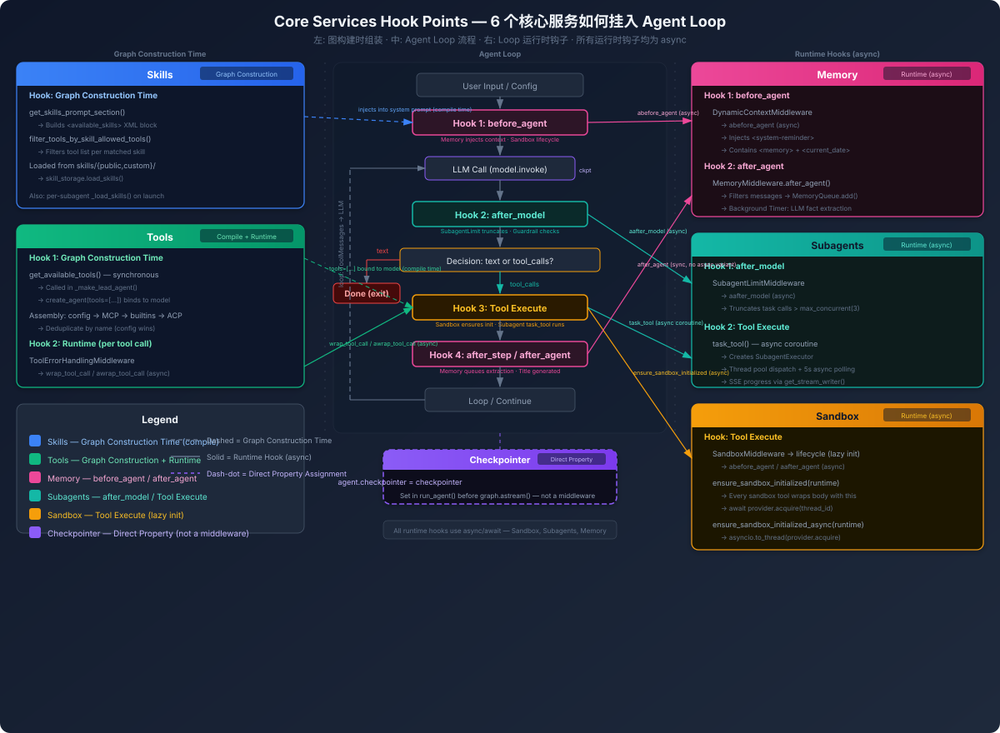

# 扩展点：从内到外怎么往里加东西



> **图读法**：图只标挂点；每个 hook 的契约与失败语义在正文。


前面两篇讲了 loop 的结构和 middleware 的设计。这篇回答实际问题：**我想扩展 DeerFlow，应该从哪个层面加东西？**

## 三层扩展模型

```
                     ┌─────────────────────┐
                     │   Level 3: 通道层    │  ← 加协议、加平台
                     │  (IM channels, API) │
                     └─────────┬───────────┘
                               │
                     ┌─────────▼───────────┐
                     │   Level 2: Agent 层  │  ← 加 middleware、加 subagent
                     │  (middleware 链,     │
                     │   subagent 类型)     │
                     └─────────┬───────────┘
                               │
                     ┌─────────▼───────────┐
                     │   Level 1: Tool 层   │  ← 加 tool、加 skill
                     │  (tools, MCP,       │
                     │   community tools)  │
                     └─────────┬───────────┘
                               │
                     ┌─────────▼───────────┐
                     │   Level 0: 模型层    │  ← 加 provider、调参数
                     │  (LLM providers,    │
                     │   thinking, vision)  │
                     └─────────────────────┘
```

从下往上，扩展的"影响半径"越来越大：
- **Level 0（模型层）**：只影响"LLM 怎么回答"，不影响 loop 行为
- **Level 1（Tool 层）**：影响"agent 能做什么"，仍然在标准 loop 框架内
- **Level 2（Agent 层）**：影响"agent loop 的行为方式"，需要理解 middleware 机制
- **Level 3（通道层）**：影响"用户怎么跟 agent 交互"，在 loop 外面

## Level 0：换模型/加模型

最浅的扩展。DeerFlow 的模型系统通过 `config.yaml` 声明式配置，运行时通过 `create_chat_model()` 反射加载：

```yaml
models:
  - name: my-custom-model
    provider: openai
    model: gpt-4o
    supports_thinking: false
    supports_vision: true
    max_tokens: 4096
```

如果要加一个全新的 provider（不是 OpenAI 兼容的），需要：

1. 实现一个 LangChain `BaseChatModel` 子类
2. 在 `config.yaml` 中配置 `use: mypackage.module:MyChatModel`
3. `create_chat_model()` 通过 `resolve_class()` 动态加载

**对 agent loop 的影响：零。** loop 不关心模型是什么——它只看到 `BaseChatModel` 接口。

## Level 1：加 Tool

这是最常见的扩展。三种方式：

### 方式 A：内置 tool（Python 函数）

```python
# 写一个函数，加上 @tool 装饰器
from langchain.tools import tool

@tool
def my_calculator(expression: str) -> str:
    """Evaluate a mathematical expression."""
    return str(eval(expression))
```

然后在 `get_available_tools()` 中注册，或在 `config.yaml` 中声明 tool group。

**对 loop 的影响：** tool 在 tools node 内被调用。middleware 的 `wrap_tool_call` 会包装它（收据、artifact handle 解析、授权、审计、写前读门、progress、错误处理）。如果 tool 抛异常，`ToolErrorHandlingMiddleware` 把它转成 ToolMessage 而不是让整个 run 崩溃。

🆕 v2.2.0：如果 tool 返回大对象/文件，不要把它整段塞进上下文——让它带 **artifact 引用**。`ArtifactCaptureMiddleware` 会把 tool 结果里的 `art_xxxxxxxx` handle 收进 `ThreadState.tool_artifacts`（`before_model` hook，默认开），下游 tool 调用参数里可以直接写 handle，`ArtifactResolutionMiddleware` 在执行前用 `real_ref` 替换（默认开）。handle 是「(thread_id, ToolMessage.id, tool_call_id, 序号)」派生的标识符，不是所有权凭证。详见 `agents/middlewares/TOOL_ARTIFACTS.md`。

### 方式 B：MCP Server（进程级集成）

```json
// extensions_config.json
{
  "mcpServers": {
    "my-server": {
      "enabled": true,
      "type": "stdio",
      "command": "python",
      "args": ["-m", "my_mcp_server"]
    }
  }
}
```

MCP tools 通过 `langchain-mcp-adapters` 自动发现和转换。tool 列表按 mtime 缓存，改了配置文件自动失效。

**对 loop 的影响：** MCP tool 对 loop 来说跟内置 tool 一样。关键区别是 MCP tool 可能是异步的（stdio/SSE/HTTP transport），在 subagent 的 persistent daemon loop 上也能正常跑。

### 方式 C：Skill（带 prompt 的知识包）

Skill 不是 tool——它是**元数据 + 一段正文**（`SKILL.md`）。v2.2.0 起它的语义被明确收窄：

```
skill 加载流程（v2.2.0）:
  skills/public/my-skill/SKILL.md
    ↓ load_skills() 解析 YAML frontmatter
    ↓ 提取 name / description / allowed-tools
    ↓
  build 时:
    ↓ 只有 name + description 进 system prompt 的 <available_skills>（hashed catalog）
    ↓ allowed-tools 只进 catalog 指纹，不参与工具过滤
    ↓
  run 时（SkillActivationMiddleware）:
    ↓ 用户 `/skill-name task` 触发，或模型读完整 SKILL.md
    ↓ 整个 SKILL.md 正文以转义后的 HumanMessage 上下文注入（一次）
    ↓ 绑定 required-secrets、记录 skill usage
    ↓ 工具集完全不变
```

**关键语义（#6935，v2.2.0）**：enabled/configured skills 是**可发现的元数据，不是对工具集的授权**。`allowed-tools` frontmatter 保留为**兼容元数据**——它仍参与 skill catalog 指纹（`None` / `()` / 非空三种状态可区分，顺序无关），但**永不过滤或授予工具**。工具权限上限由 agent 装配与执行授权（`tool_declarations.py` 的 Layer 1 收窄 + `GuardrailMiddleware` 的 Layer 2 检查）持有。v2.1.0 里做这件事的 `SkillToolPolicyMiddleware` 在 v2.2.0 已删除（`skill_tool_policy_middleware.py` 整文件已删除，配套的 `skills/tool_policy.py` 也已删除）——「已删除」，现行实现不再有任何 tool 过滤路径。

**对 loop 的影响：** Skill 不改变 loop 结构，也不改变可用 tool 集合——它只是在正确时机把领域知识（正文 + 需要的 secret 绑定）放进上下文。这是一种**知识型扩展**，权限边界交给授权层。

### Subagent 里的 skill 加载

Subagent 加载 skill 的方式跟 lead agent 不同——subagent 的 skill 作为**对话内容**而不是 system prompt 注入：

```python
# lead agent: skill 在 system prompt 里
system_prompt = "... <skills>skill content</skills> ..."

# subagent: skill 作为 SystemMessage 插入 message list
messages = [
    SystemMessage(content="skill content"),
    HumanMessage(content=task),
]
```

这是为了兼容 Codex 的 skill 模式，也让 subagent 的 skill 可以跟 agent 本身的 system prompt 分开管理。

## Level 2：加 Middleware

这是最强大的扩展方式，也最需要理解 loop 机制。在这写一个自定义 middleware 的完整流程：

### 第一步：继承 AgentMiddleware

```python
from langchain.agents.middleware import AgentMiddleware
from langchain.agents.middleware.types import ModelRequest, ModelResponse

class MyMiddleware(AgentMiddleware):
    def wrap_model_call(self, request, handler):
        # 修改传给 LLM 的消息
        modified = request.override(
            messages=[*request.messages, HumanMessage(content="extra context")]
        )
        # 调用下一层
        response = handler(modified)
        # 修改 LLM 的返回（可选）
        return response
```

### 第二步：选择定位方式

DeerFlow 提供了 `@Next` / `@Prev` 定位装饰器：

```python
from deerflow.agents.features import Next
from deerflow.agents.middlewares.loop_detection_middleware import LoopDetectionMiddleware

@Next(LoopDetectionMiddleware)
class MyMiddleware(AgentMiddleware):
    ...
```

这意味着你的 middleware 会被插入到 `LoopDetectionMiddleware` **之后**；`@Prev` 则插到它之前。机制上装饰器只给类打标记（`cls._next_anchor` / `cls._prev_anchor`，`deerflow/agents/features.py:49-70`），真正的插入发生在装配期：SDK 路径是 `agents/factory.py::_insert_extra()`（`factory.py:474`），按锚点算下标后再插进链（无锚点的插到 `ClarificationMiddleware` 之前，插完再把 Clarification 弹回尾部）。

### 第三步：注入到链中

- **Lead agent 路径**：`build_middlewares(..., custom_middlewares=[...])` —— 参数名就是 `custom_middlewares`（不是 `extra_middleware`）
- **SDK 路径**：`create_deerflow_agent(..., extra_middleware=[...])` 传自定义实例列表；`features=RuntimeFeatures(...)` 是**另一件事**——它是按槽位开关/替换内置能力（例如 `loop_detection: bool | AgentMiddleware`），不是任意 middleware 的入口

### Middleware 扩展的注意事项

1. **`wrap_model_call` 的实现要调 `handler(request)`**——不调就是跳过 LLM，调了就是继续洋葱链。忘了调用会导致 LLM 永远不执行。
2. **`after_model` 是反向执行的**——你的 hook 会在"后面的" middleware 之后执行
3. **不要在 `after_model` 里插入消息**（除非你确定 tool_calls 配对已经完成）——共享助手 `middlewares/model_response.py` 提供 `last_ai_message` / `has_tool_call_intent` / `has_visible_content` / `append_visible_text` / `finish_reason`，判断"这条响应算不算终态"时优先复用它
4. **middleware 实例是 per-agent 的**——如果同一个进程有多个 agent，每个有自己的 middleware 实例
5. 🆕 **不要靠 `middleware.tools` 声明工具来授权**。LangChain 在宿主工具被过滤**之后**才把 `middleware.tools` 折进绑定集，声明会绕过 Layer 1。若确实要做，必须走 `middlewares/tool_declarations.py` 的 `layer_one_outcome()` → `narrow_declared_tools()` → `verify_declared_tool_view()` 五步（`authorization.enabled` 为真时才生效）；非 list/tuple 的 `tools` 会抛 `DeclaredToolViewError`
6. 🆕 **订阅式扩展优先于改核心**：能通过 `extensions.py` 贡献点（middleware / lifecycle observer / router）表达的，就不该直接改 `_build_runtime_middlewares` / `build_middlewares`

## Level 2.5：加 Subagent 类型

Subagent 是 Level 2 的一个特殊情况——它不只是加 middleware，而是定义一个**全新的 agent 配置**。

内置两种 subagent：
- `general-purpose`: 除了 `task` 以外的所有 tools
- `bash`: 只有 sandbox tools（bash, ls, read, write, str_replace）

注册新的 subagent 类型是**声明式**的——**没有** `register_subagent()` 这类运行时注册 API。`SubagentConfig` 是解析结果的对象形态（`deerflow/subagents/config.py:11`），`subagents/registry.py` 只**查找**它，按下面的顺序解析：

| 顺序 | 来源 | 实现 |
|------|------|------|
| 1 | 内置 subagent（`general-purpose`、`bash`） | `subagents/builtins/` |
| 2 | `config.yaml` 的 `subagents.custom_agents.<name>` | `subagents/registry.py:29` `_build_custom_subagent_config()` |
| 3 | 管理员托管的 subagent 表（部署级目录） | `subagents/registry.py:88` `_build_managed_subagent_config()`；增删改走 Gateway 的 `GET/POST /api/subagents`、`PUT/DELETE /api/subagents/{name}` |
| 4 | `config.yaml` 的 `subagents.agents.<name>` 逐 agent 覆盖（timeout / max_turns / model / skills / token_budget） | `SubagentsAppConfig.get_*_for()`（`config/subagents_config.py:185+`） |

公开查找入口（`subagents/__init__.py` 的 `__all__`）：`get_subagent_config(name)` / `list_subagents(allowed_subagents=...)` / `get_available_subagent_names()`。

### 声明一个自定义 subagent

```yaml
# config.yaml（config.example.yaml:1757+ 有完整注释示例）
subagents:
  timeout_seconds: 600        # 全局默认
  max_turns: 80
  custom_agents:
    my-agent:
      description: "Specialized agent for X"
      system_prompt: "You are an expert at X..."
      tools: ["bash", "read_file", "write_file"]   # allowlist（null = 继承全部）
      skills: ["my-skill"]                         # 发现/激活白名单（null = 全部，[] = 无）
      model: inherit                               # 'inherit' 用父 agent 的模型
      max_turns: 15
      timeout_seconds: 300
```

声明后，lead agent 的系统 prompt 里会出现这个 subagent type，模型可通过 `task(subagent_type="my-agent", ...)`（durable 批量为 `batch_task`）调用它。直接用 `SubagentConfig(...)` 构造对象只出现在内置定义与 durable batch 的 spec 反序列化路径（`subagents/builtins/*.py`、`registry.py:44/92`、`batch_service.py:190`），**不是**对外的注册入口。

**对 loop 的影响：** Subagent 有自己的独立 agent loop（见 [00-loop-anatomy.md](00-loop-anatomy.md) 的 Layer 3 与 [../concepts/subagent/dual-threadpool-and-lifecycle.md](../../concepts/subagent/dual-threadpool-and-lifecycle.md)），有自己的 middleware 链（复用 `build_subagent_runtime_middlewares()`：共享基础层 + 一小撮 lead-only 同类项，见 [01-middleware-as-loop.md](01-middleware-as-loop.md) 的装配段）。它的 loop 不受主 agent 的 middleware 影响，只在 cancel/timing 上受主 agent 控制。

## Level 3：加通道（外部接口）

通道层（IM Channels、REST API、Embedded Client）完全在 agent loop 外面。它们是 loop 的**消费者**：

```
Feishu/Slack/Telegram/DingTalk
  → Channel Manager
    → message_bus.publish_inbound()
      → dispatch_loop
        → client.runs.stream() / client.runs.wait()
          → Gateway API
            → run_agent() → agent.astream() → SSE stream
```

三种消费模式的差异：

| 模式 | 使用场景 | 消费方式 |
|------|---------|---------|
| SSE Stream (Feishu) | 需要增量 UI 更新 | `runs.stream(["values", "messages-tuple"])` → 逐 chunk 更新 |
| Block & Wait (Slack/Telegram) | 消息平台只关心最终结果 | `runs.wait()` → 等 run 结束取最终消息 |
| Embedded Client | Python SDK 直接调用 | `DeerFlowClient.stream()` → yield StreamEvent |

**加一个新通道的步骤：**
1. 实现 `base.py` 中的 `Channel` 抽象类
2. 在 `config.yaml` 的 `channels` 段配置
3. `ChannelManager` 自动发现并启动

对 agent loop 的影响：零。通道只是 listen 和 publish 的适配层。

## 扩展决策速查表

| 我想... | 用哪个 Level | 具体怎么做 |
|---------|-------------|-----------|
| agent 能在 new API 上搜索 | Level 1 | 加 Community Tool / MCP Server |
| agent 在特定领域更专业 | Level 1 | 写一个 Skill (SKILL.md 正文 + description 触发词)；`allowed-tools` 只是兼容元数据，不再限制工具 |
| 控制 agent 在 loop 的某一步做什么 | Level 2 | 写 Middleware + @Next/@Prev 定位 |
| 创建一个专门做某事的子 agent | Level 2.5 | 定义 SubagentConfig + register |
| 支持新的聊天平台 | Level 3 | 实现 Channel 抽象类 |
| 换成公司的内部模型 | Level 0 | 实现 BaseChatModel 子类 + config.yaml |
| agent 遇到某个 tool 的错误不要崩溃 | Level 2 | ToolErrorHandlingMiddleware 已经做了，配置即可 |
| 限制 agent 最多调 N 次 tool | Level 2 | LoopDetection 已经做了，调 config 参数 |
| 在模型调用前自动注入一段提示 | Level 2 | DynamicContextMiddleware 的模式，或自己写 |

## 一个具体例子：从零加一个 "日志审计 middleware"

假设需求：每次 tool 执行后，把 tool name + args + result 写到审计日志。

```python
from langchain.agents.middleware import AgentMiddleware
from langchain.agents.middleware.types import ToolCallRequest

class AuditLoggingMiddleware(AgentMiddleware):
    def wrap_tool_call(self, request: ToolCallRequest, handler):
        # 执行前记录
        logger.info(f"AUDIT: tool={request.tool_call['name']}, args={request.tool_call['args']}")
        
        # 执行 tool
        result = handler(request)
        
        # 执行后记录结果（截断以防太长）
        result_preview = str(result)[:500]
        logger.info(f"AUDIT: result={result_preview}")
        
        return result
```

然后注入：

```python
# 情境: 想在 GuardrailMiddleware 之后、SandboxAuditMiddleware 之前
from deerflow.agents.features import Next
from deerflow.guardrails.middleware import GuardrailMiddleware

@Next(GuardrailMiddleware)
class AuditLoggingMiddleware(AgentMiddleware):
    ...
```

传给 lead 路径的 `build_middlewares(..., custom_middlewares=[...])`，或用 SDK 路径的 `create_deerflow_agent(..., extra_middleware=[...])`。

⚠️ 上面 `@Next(GuardrailMiddleware)` 的写法在 v2.2.0 里只能进 SDK 路径（`extra_middleware` 走锚点插入）；lead 路径的 `custom_middlewares` 是直接 `extend` 到尾部（`ModelContentCompatibility` 之后、`TerminalResponse` 之前），**不解析锚点**。要在 lead 链里精确定位，走 `extensions` 的 middleware 贡献点或改动装配代码。

这就是 DeerFlow 扩展体系的完整图景：**四层扩展，从改配置到写 middleware，从 tool 到 subagent，每一层都有明确的接口和定位规则**。
