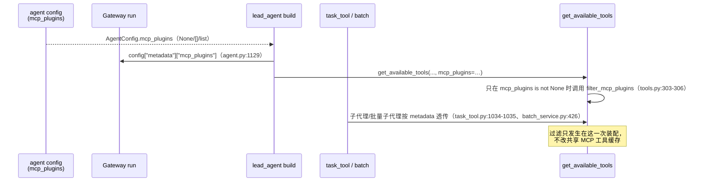

# Installation identity 与 Agent 工具选择

`deerflow/capabilities/runtime.py` 只有 38 行、三个函数，但它是"能力目录"能对 Agent 起作用的全部机械核心。docstring 一句话划清边界（`runtime.py:1`）：*"Stable installation references and agent tool selection, **not an authorization system**."*

三段职责各自独立：

| 函数 | 行号 | 输入 → 输出 | 用在 |
|------|------|-------------|------|
| `installation_id` | `runtime.py:11-17` | `(server_name, 原始 server dict)` → `str` | GET 投影、写入门、工具过滤 |
| `ambiguous_installation_ids` | `runtime.py:20-29` | 整份 `{name: server}` → 重复的 id 集合 | 三处写入门 + GET |
| `filter_mcp_plugins` | `runtime.py:32-38` | `(tools, selected, ExtensionsConfig)` → 过滤后的 tools | `get_available_tools()` |

## 1. `installation_id()`：两级身份（`runtime.py:11-17`）

```python
metadata = server.get("capability")                       # :12
if isinstance(metadata, dict) and isinstance(metadata.get("id"), str) and metadata["id"]:
    return metadata["id"]                                 # :14
return str(uuid5(NAMESPACE_URL, f"deerflow:mcp:{server_name}"))   # :17
```

- **一级**：显式 `capability.id`。`capability` 是 MCP server 定义里的一个非执行元数据块，由安装动作写入：catalog 安装写 `{id: uuid4, plugin_id, version}`（`app/gateway/capabilities.py:143`），个人连接创建写 `{id: uuid4}`（`personal_mcp.py:78-79`）。
- **二级兜底**：**用 server 名做 `uuid5`**。注释解释了为什么（`runtime.py:15-16`）：*"Existing configs are adopted without rewriting them during a GET. Names are existing immutable runtime keys; future saves retain this identity."* 即 2.1.0 之前就存在的 MCP server 没有 `capability` 块，GET 时**不写回文件**也能得到一个确定性的 ID。

由此推出四条必须成立的性质（`test_capability_registry.py:23-26` 逐条钉住）：

1. 身份**不看凭据**：`installation_id("example", {})` == `installation_id("example", {"headers": {"Authorization": "secret"}})`。
2. 身份**不看显示名**：有显式 `capability.id` 时，`installation_id("one", …)` == `installation_id("renamed", …)`。
3. 无显式 id 时，身份**只跟 server 名**：`installation_id("one", {}) != installation_id("two", {})`。
4. 删除后重装 = **新身份**。`test_capability_api.py:69-75`：删除 `team-code` 再装同名，新 `id` 与旧 `id` 不同（因为安装时生成了新的 `uuid4`）。

**改地址 / 改开关 / 改掩码凭据都不影响身份**——这是整个设计的支点，因为 Agent 配置里存的是这个 ID。`test_capability_api.py:50-68` 用一个"不知道 capability 元数据的旧客户端"发 `PUT /api/mcp/config/server`（body 里没有 `capability`），验证保存后 `capability.id` 与 `capability.plugin_id` 都还在。

### 谁负责保住它

`capability` 块不是 `McpServerConfigResponse` 的声明字段，而是 `extra="allow"` 收下的额外键（`routers/mcp.py:481`）。合并逻辑在 `routers/mcp.py:1137-1141`：

```python
# Installation identity belongs to the registry, not the editable transport
# settings. Older clients omit it; neither bulk nor targeted edits may drop
# it and silently detach an Agent's capability selection.
if isinstance(existing_extra.get("capability"), dict):
    update["capability"] = existing_extra["capability"]
```

两条注意：① 这是 `_merge_preserving_secrets()` 里的**无条件覆盖**——客户端即便传了新的 `capability` 也会被**旧值**替换（"身份归注册表，不归可编辑的传输设置"）。② `_mask_server_config()`（`routers/mcp.py:840-894`）会掩码 `env`/`headers`/`oauth`/`user_auth`/`tools`/`model_extra` 等一切敏感面，但 `capability` 不在敏感 key 名单里，因此 GET 返回明文 ID——这正是"客户端可以带着原样 ID 回写"的前提。

> 未逐行核实：`_is_sensitive_extra_key()` 的完整关键字表；本页结论依赖 `test_capability_api.py:58-68` 的实测行为（`capability` 在掩码后仍为原值）。

## 2. `ambiguous_installation_ids()`：撞 ID 就是撞车（`runtime.py:20-29`）

```python
seen, ambiguous = set(), set()
for name, server in servers.items():
    identity = installation_id(name, server)
    if identity in seen:
        ambiguous.add(identity)
    seen.add(identity)
return ambiguous
```

三个语义点：

- **返回的是"被撞的那个 ID"**，不是撞车的 server 名。任何一方都无法声称自己"拥有"这个 ID。
- **disabled 条目也计数**。docstring（`runtime.py:21`）：*"Count disabled entries too: enabling one must never widen another selection."*——先禁用其中一个再启用它，不能凭空多出一个可被选中的身份。
- **legacy 兜底 ID 也可能被显式 ID 撞上**：一个旧 server 兜底得到 `uuid5("deerflow:mcp:legacy")`，另一个新 server 显式写成同一个值 → 两者都进 `ambiguous`。`test_capability_registry.py:81-89` 的 `collision` 参数就是这三类：`explicit` / `fallback` / `disabled`。

### 2.1 三处写入门（全部 fail-closed，全部拒绝而不是"修一下"）

| 入口 | 行号 | 行为 | 重要的细节 |
|------|------|------|-----------|
| `POST /api/mcp/config/servers` + `PUT /api/mcp/config` | `routers/mcp.py:1211-1212` | 400：`"Duplicate MCP installation IDs; remove conflicting entries or assign unique capability IDs in the deployment configuration"` | `_validate_extensions_config_candidate(..., check_installation_ids=True)` 的默认；**删除**路径显式传 `check_installation_ids=False`（`routers/mcp.py:1549`），所以管理员可以逐个拆开历史撞车对，删完之前其他写入继续被挡 |
| `PUT /api/mcp/config/server`、`PATCH /api/mcp/config` | 同一校验器 | 同上 400 | 目标式编辑与启停也过同一道门（`test_capability_api.py:176-197`） |
| `/api/mcp/personal/config*` | `personal_mcp.py:103-104` | 400：`"Duplicate MCP installation IDs"` | 在 `ExtensionsConfig.model_validate()` 之后、`atomic_write_extensions_config()` 之前；写盘前拒绝，文件不改 |

共同的不变量：**拒绝时文件一字节不动**。测试逐条比较 `path.read_bytes()` 前后（`test_capability_api.py:157-197, 201-218`）。

## 3. GET 的 fail-closed 投影（`capabilities.py:102,118-123`）

写入门挡住新撞车，但历史配置里可能已经有撞车。此时**不隐藏、不选一个赢家**，而是把状态显式化：

```python
ambiguous = ambiguous_installation_ids({name: server.model_dump() for name, server in servers.items()})  # :102
identity = installation_id(name, raw)                                                                  # :118
CapabilityInstallation(
    id=f"ambiguous:{installation_id(name, {})}" if identity in ambiguous else identity,   # :121
    selectable=identity not in ambiguous,                                                # :122
    health="ambiguous" if identity in ambiguous else "unknown",                          # :123
)
```

- `id` 加前缀 `ambiguous:` 变成**合成展示 ID**（所以列表里 ID 仍唯一，`test_capability_api.py:194` 断言 2 条真实条目 → 2 个不同 id）。前缀里的兜底 ID 用 `installation_id(name, {})` 计算，对撞车的**双方会得到同一个合成 id 文本**——`id` 在这里只用于 React key/去重展示，不用于持久化；真正可持久化的只有 `selectable=false` 这个事实。
- `selectable=false` → 前端不允许把它选进 Agent（`frontend/AGENTS.md`：*"Ambiguous installation IDs remain visible but cannot be selected for an Agent."*）。
- 管理员删掉冲突条目后，剩下的条目立刻回到 `selectable: true`（`test_capability_api.py:196-197`）。

## 4. `filter_mcp_plugins()`：按源 server 过滤（`runtime.py:32-38`）

```python
def filter_mcp_plugins(tools, selected, config):
    if selected is None:
        return tools                                                   # :33-34  三态之一：继承全部
    ambiguous = ambiguous_installation_ids({... config.mcp_servers ...})
    wanted = set(selected) - ambiguous                                 # :36  显式选中的歧义 ID 一并丢弃
    servers = {name for name, server in config.get_enabled_mcp_servers().items()
               if installation_id(name, server.model_dump()) in wanted}   # :37  只认「启用」的
    return [tool for tool in tools
            if not is_mcp_tool(tool) or (get_mcp_source(tool) or {}).get("server_name") in servers]  # :38
```

四个决定成败的细节：

1. **`None` 与 `[]` 不同**。`None`（或省略）→ 原样返回全部 tools；`[]` → `wanted` 为空 → 所有 MCP 工具被滤掉，非 MCP 工具保留。`agents_config.py:222-224` 的字段注释与 `routers/agents.py:55` 的 `Field(description=...)` 都写着同一句：**`None=all, []=none`**。
2. **按源 server 过滤，不按工具名前缀**。判定用的是 `deerflow.tools.mcp_metadata` 里 `tag_mcp_tool()` 写入的 `deerflow_mcp_source.server_name`（`mcp_metadata.py:26-40`，读侧 `is_mcp_tool` `:43-45`、`get_mcp_source` `:48-60`）。`test_capability_registry.py:29-40` 专门造了 `one_fake` / `one_search`（源是 two）这类"名字像但源不对"的工具来钉这条。
3. **无源元数据的 MCP 工具会被丢弃（fail-closed）**：带 `deerflow_mcp` 标记但没有 `deerflow_mcp_source` 的工具，`(get_mcp_source(tool) or {}).get("server_name")` 返回 `None`，`None in servers` 为假 → 整条列表推导的两个条件都不成立 → 不进入结果集。`test_capability_registry.py:34` 的 `unknown = SimpleNamespace(name="legacy", metadata={"deerflow_mcp": True})` 正是这个用例，断言在 `[installation_id("one", {})]` 下只返回 `[ordinary, first]`——legacy 工具被丢弃。即：**无法证明来源的 MCP 工具不进入一个"只选了某些 server"的 Agent**。
4. **只认启用中的 server**。`config.get_enabled_mcp_servers()`（`extensions_config.py:599-605`）。`test_capability_registry.py:39-40`：把 `one` 禁用后，同一选择集下只剩非 MCP 工具——禁用优先于选择，选择**永远无法把禁用的工具带回来**。

另外一点：`filter_mcp_plugins` 的 `config` 是**部署态 + 个人态合并后**的 `ExtensionsConfig`（`tools/tools.py:302`：`{**extensions_config.mcp_servers, **personal_config.mcp_servers}`），所以个人连接的 ID 与部署 ID 在同一命名空间里比较——这也是为什么写入门必须对两者都做唯一性检查。

## 5. 选择从哪里来、到哪里去



- **字段定义**：`agents_config.py:222-224`（`mcp_plugins: list[str] | None = None`，注释"Stable MCP installation IDs"）。
- **API 面**：`routers/agents.py:55,85,102` 三个请求体都声明了同名可选字段；`agents.py:265-266,616-617` 只在客户端**显式提供**时才写入（`if body.mcp_plugins is not None`），因此省略字段不会把已有选择清空。
- **运行期装配**：`client.py:360-362` 把 `mcp_plugins` 塞进 `config["metadata"]`，`:388` 用 `frozenset` 参与 agent 缓存键，`:469`/`:579-583` 再传给 `get_available_tools`；`lead_agent/agent.py:1129` 与 `:1324` 同理。
- **子代理**：`builtins/task_tool.py:1034-1035` 把 `metadata["mcp_plugins"]` 放进 `available_tools_kwargs`；`builtins/batch_task_tool.py:232` 只在它非空时带；`subagents/batch_service.py:426` 消费。语义：**子代理继承父 Agent 的 MCP 选择**，而不是"全部"。
- **过滤范围**：`tools/tools.py:303-306` 明确 `if mcp_plugins is not None` 才 import 并调用；`None` 时连 `filter_mcp_plugins` 都不进入。注释（`:270-274`）说明 lead agent 装配完整目录、子代理可能收到已过滤列表。
- **不改缓存**：`filter_mcp_plugins` 是纯列表推导，`docs/capability-center.md` 原话："Each Agent run gets a filtered list without altering the shared MCP tool cache."

## 6. 边界：选择 ≠ 授权

三处原文把它写死：

- `runtime.py:1`："not an authorization system"
- `agents_config.py:223`："This is tool selection, not a replacement for host authorization."
- `routers/agents.py:55` 的 description 只说"installation selection"。

因此一条选择**不会**：把 disabled server 打开（§4 第 4 点）、绕过 MCP 的执行白名单（[03-bundled-business.md](03-bundled-business.md) §3）、替别人取凭据（`user_auth`/`headers_from_context` 各自的 fail-closed 在 [../mcp/session-pool-oauth-cache-invalidation.md](../mcp/session-pool-oauth-cache-invalidation.md)）、或越过工具级风险门（[../../enterprise-operations/security/03-guardrail.md](../../enterprise-operations/security/03-guardrail.md)）。真正执行时仍走 MCP 会话池、拦截器链与 guardrail。

## 7. 与 skills 选择同构

`agents_config.py:218-221` 的 `skills` 字段用完全相同的三态（`None` 全 / `[]` 无 / 列表白名单）。`filter_mcp_plugins` 只服务 MCP；skills 侧的过滤在 skill 装配路径上，不在本包内（见 [../../concepts/skills-tools/README.md](../../concepts/skills-tools/README.md)）。两套语义保持一致是刻意的：`docs/capability-center.md` 的 "The same semantics apply to the existing skill-name selection."
