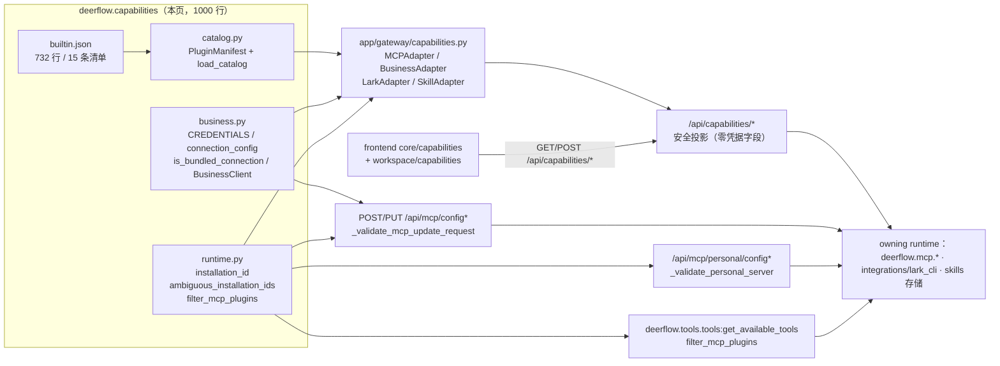

# Capabilities — 能力目录

`backend/packages/harness/deerflow/capabilities/` 在 v2.2.0 里是**全新目录**（上游 commit `42334f26d`，*feat(capabilities): unify catalog, plugin configuration and agent selection*），总计 **1000 行**：`builtin.json` 732 行 + `business.py` 178 行 + `catalog.py` 51 行 + `runtime.py` 38 行 + `__init__.py` 1 行。它在 `v2.1.0..v2.2.0` 区间里整目录新增，2.1.0 中不存在对应物。

它解决的问题只有一个：**把「能力」（插件 / MCP server / Lark CLI / skill）从三套互不相干的管理接口后面，收成一份可发现、可校验、可展示、可被 Agent 稳定引用的目录**。它**刻意不**成为第四套实现——不新增凭据库、不新增后台守护进程、不新增可执行包加载器（`docs/capability-center.md:30-32` 原文："There is no second credential database, background plugin daemon, executable package loader, or remote marketplace dependency."）。包内三个 Python 模块的 docstring 各自就是一句边界声明：

| 模块 | 行数 | docstring 原文（即边界） |
|------|------|--------------------------|
| `catalog.py` | 51 行 | "Validated manifests, independent from HTTP, account policy and UI components."（`catalog.py:1`） |
| `runtime.py` | 38 行 | "Stable installation references and agent tool selection, **not an authorization system**."（`runtime.py:1`） |
| `business.py` | 178 行 | "Bundled business tools served through the **existing stdio MCP lifecycle**."（`business.py:1`） |
| `capabilities/__init__.py` | 1 行 | "Declarative capability discovery; execution stays with the owning runtime."（该文件首行） |

→ Back to [parent README](../README.md)

## 分层与归属

三条不变量（都能在源码里点到）：

1. **目录是数据，不是代码**。`load_catalog()` 只 `json.loads` + pydantic 校验，docstring 明写 "never load executable code"（`catalog.py:45`）。
2. **目录条目不等于安装**。`builtin.json` 里 `adapter: "guide"` 的 5 条（web-search / web-fetch / exa / firecrawl / browser）在 Gateway 侧**没有注册 adapter**，安装会被 422 拒绝（`app/gateway/capabilities.py:227-231`）。
3. **选择不是授权**。`filter_mcp_plugins()` 只做工具裁剪（`runtime.py:32-38`）；`agents_config.py:222-224` 的注释同样写着 "This is tool selection, not a replacement for host authorization."

## 文件导航

| 文件 | 内容 |
|------|------|
| [01-catalog-and-adapters.md](01-catalog-and-adapters.md) | 清单 schema 与 `builtin.json` 的 15 条实际分布；`load_catalog()` 的三条失败策略；Gateway 侧 `AdapterRegistry` 的 4 个 adapter（list/install 两职责）；`/api/capabilities/*` 三个端点的权限与 scope 语义；adapter 失败隔离 |
| [02-installation-identity-and-agent-selection.md](02-installation-identity-and-agent-selection.md) | `installation_id()` 的两级身份（显式 `capability.id` vs `uuid5` 兜底）；`ambiguous_installation_ids()` 的 fail-closed 语义（含 disabled 条目）；三处写入门（部署/个人/目标编辑）与 GET 的 `ambiguous:` 投影；`mcp_plugins` 三态选择 → `filter_mcp_plugins()` → subagent metadata 传播链 |
| [03-bundled-business.md](03-bundled-business.md) | 三个内置 provider（dingtalk / wecom / hubspot）的**自带客户端**：`CREDENTIALS` 白名单、`connection_config()` 生成的固定 launcher、`is_bundled_connection()` 对 MCP 执行白名单的窄例外；HTTP 失败策略（200 也查 errcode、不跟随重定向、2 MB、20 s、错误不含 token）；凭据如何绕过 subprocess 的 env 白名单 |

## 与其它域的关系

| 相关域 | 关系 | 页面 |
|--------|------|------|
| MCP 运行时 | 本包**不含**会话池/OAuth/缓存；catalog 安装最终写进 `extensions_config.json` 或个人 `mcp.json`，由 MCP 缓存与 Session Pool 消费 | [../mcp/README.md](../mcp/README.md)、[../mcp/session-pool-oauth-cache-invalidation.md](../mcp/session-pool-oauth-cache-invalidation.md) |
| 工具装配 | `filter_mcp_plugins()` 在 `get_available_tools()` 里生效；`mcp_plugins` 三态与 skills 三态同构 | [../../concepts/builtin-tools/README.md](../../concepts/builtin-tools/README.md) |
| 子代理/批量子代理 | `mcp_plugins` 通过 agent build metadata → `task_tool` / `subagents/batch_service.py` 传给子代理装配 | [../../concepts/builtin-tools/D-task-toolsearch.md](../../concepts/builtin-tools/D-task-toolsearch.md) |
| 配置系统 | `capability` / `presentation` 是 `McpServerConfigResponse` 的 `extra="allow"` 携带字段，不是 schema 字段 | [../configuration/README.md](../configuration/README.md) |
| 安全/信任边界 | `is_bundled_connection()` 是 stdio 执行白名单里的**唯一窄例外**；目录条目从不授予执行权 | [../../enterprise-operations/security/03-guardrail.md](../../enterprise-operations/security/03-guardrail.md)、[../../enterprise-operations/security/04-trust-boundary.md](../../enterprise-operations/security/04-trust-boundary.md) |
| 前端 | `frontend/src/core/capabilities/` 消费 catalog 与安全投影；`plugin-catalog.ts` 只做本地化，禁止从显示名推断 provider | [../../frontend/04-workspace-layout.md](../../frontend/04-workspace-layout.md) |

## 权威契约文档

- `docs/capability-center.md`（257 行）——上游自带的集成契约：Ownership 表、三个内置 business 集成、API 与状态语义、兼容性/执行边界、静态 demo、Validation 章节。本目录三篇正文是它的源码级展开，**冲突时以源码为准**。

## 事实清单（编译期核对）

| 事实 | 位置 |
|------|------|
| 清单条数 15；adapter 分布 `mcp` 6 / `guide` 5 / `business` 3 / `lark` 1 | `builtin.json` |
| category 分布 `office` 3 / `knowledge` 3 / `research` 4 / `business` 2 / `development` 3（无 `custom`） | `builtin.json:14` 允许 6 类 |
| kind 分布 `mcp` 9 / `native` 5 / `cli` 1 | `builtin.json:20` 允许 3 值 |
| 全仓 `from deerflow.capabilities…` 的生产调用方 4 个文件 | `app/gateway/capabilities.py`、`app/gateway/routers/capabilities.py`、`app/gateway/routers/mcp.py`、`app/gateway/routers/personal_mcp.py`、`tools/tools.py`（共 5 个文件，含 3 处函数内延迟 import） |
| 测试 3 个文件 | `tests/test_capability_registry.py`（90 行）、`tests/test_capability_api.py`（262 行）、`tests/test_business_plugins.py`（168 行）+ `tests/blocking_io/test_capabilities_router.py`（27 行） |

> 未逐行核实：`builtin.json` 中 `setup` 字段的**全部 15 条**文案未逐条比对 provider 官方文档；本页只核实了 `id`/`category`/`kind`/`adapter`/`version`/`auth_methods`/`contributions`/`config_schema.properties` 的结构化字段。
