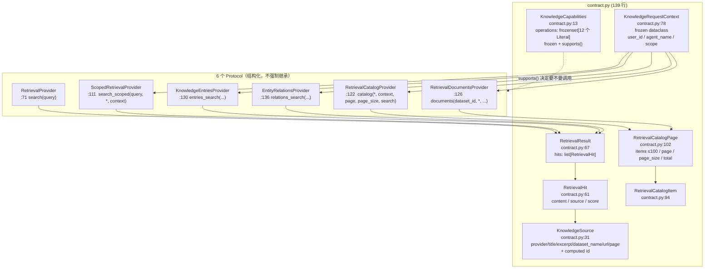
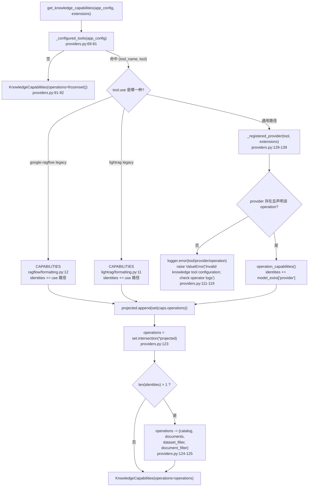
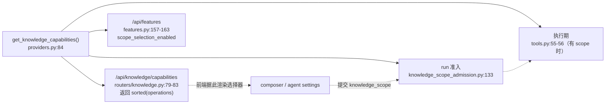

# Knowledge 契约 — 数据模型、能力位与操作投影

> 本页覆盖源码：`backend/packages/harness/deerflow/knowledge/{__init__,contract,providers}.py`、`backend/packages/harness/deerflow/knowledge_scope.py`（194 行，作用域侧契约）、`backend/packages/harness/deerflow/extensions/registry.py:154-164`（注册校验）。
>
> 与 [../../concepts/community-tools/09-knowledge-abstraction.md](../../concepts/community-tools/09-knowledge-abstraction.md) 的分工：那一篇是**概念综述**（分层图 + 每类 provider 的细节 + 四个老问题），本目录是 **internals 深度**——按「契约 / 证据 / 工具入口与失败策略」三片切开，行号全部对 `v2.2.0` 源码重新核对过，`search_provider` 等函数的位置以本页为准。
> 证据与预算见 [02-sources-and-budgets.md](02-sources-and-budgets.md)；工具入口、能力校验时序与失败分类见 [03-tool-entry-and-failure-policy.md](03-tool-entry-and-failure-policy.md)。

→ Back to [knowledge README](README.md)

## 相关文件

| 文件 | 行数（`wc -l` 实测） | 内容 |
|------|---------------------|------|
| `backend/packages/harness/deerflow/knowledge/__init__.py` | 36 | 包门面：re-export 14 个契约符号 + `format_result` / `sources_from_messages`（见该文件 `:19-36`） |
| `backend/packages/harness/deerflow/knowledge/contract.py` | 139 | `KnowledgeCapabilities` / `KnowledgeSource` / `RetrievalHit` / `RetrievalResult` / `KnowledgeRequestContext` / `RetrievalCatalogItem` / `RetrievalCatalogPage`；6 个 Protocol |
| `backend/packages/harness/deerflow/knowledge/providers.py` | 186 | 能力投影、provider 校验、配置解析、作用域能力校验、调用骨架 |
| `backend/packages/harness/deerflow/knowledge_scope.py` | 194 | 每轮作用域快照 `KnowledgeScope` + `canonicalize_knowledge_scope()` / `execution_scope()` / `strip_message_knowledge_scope()` |
| `backend/packages/harness/deerflow/extensions/registry.py` | — | `knowledge_provider(name, provider)` 注册口（`:154-164`），注册期即 `validate_provider()` |
| `backend/packages/extension-api/deerflow_extension_api/contracts.py` | — | `ExtensionRegistry.knowledge_provider` 的协议声明（`:203-211`），默认返回 `False` |
| `backend/docs/KNOWLEDGE.md` | 345 | 上游设计文档（`#6269` phases 1–3），本页的事实来源之一 |

**包边界**写在 `backend/packages/harness/deerflow/knowledge/providers.py:1-6` 的模块 docstring 里，是三行硬约束：

> "No provider configuration, HTTP calls or resource permissions live here. Legacy tool paths select compatibility adapters; new providers are installed through the operator-controlled extension registry and the generic core tool."

因此 `knowledge/` 里**没有任何** `httpx` / `requests` import，也**没有任何**资源授权判定——它只回答「这个 operation 能不能被问」和「问回来的东西能不能给模型看」。

## 1. 数据面：7 个模型 + 6 个 Protocol



### `KnowledgeCapabilities`（`contract.py:13-28`）

```python
operations: frozenset[Literal[
    "search", "sources", "catalog", "documents",
    "dataset_filter", "document_filter",
    "entries_search", "entries_dataset_filter", "entries_document_filter",
    "relations_search", "relations_dataset_filter", "relations_document_filter",
]] = frozenset({"search"})
model_config = ConfigDict(frozen=True)         # contract.py:25
```

三点设计：

1. **默认只有 `search`**（`contract.py:23`）——只实现 `async def search()` 的最小 provider 不需要 catalog/scope/管理面任何东西。
2. **`frozen=True`**（`contract.py:25`）——能力声明在注册后被 `_registered_provider()` 长期持有，冻结可以防止运行期被某个调用方「临时放大」。
3. **`supports()` 是纯集合成员判断**（`contract.py:27-28`），唯一的判据——没有「推断式」能力。

### `KnowledgeSource`（`contract.py:31-58`）

| 字段 | 行号 | 约束 | 备注 |
|------|------|------|------|
| `provider` | `:40` | 1–100 字符 | provider 自报的注册名 |
| `title` | `:41` | 1–500 | 真实文档标题，不能是推断名 |
| `excerpt` | `:42` | 1–100 000 | **实际返回的正文**，与 `RetrievalHit.content` 必须逐字一致（由 `sources.py:83` 强制） |
| `dataset_name` | `:43` | ≤500，可空 | 展示用名字，不是 ID |
| `url` | `:44` | `HttpUrl | None` | validator `reject_credentials`（`:47-52`）拒绝带 username/password 的 URL |
| `page` | `:45` | `strict=True`，`>0`，`≤9007199254740991`（2^53-1） | 2^53-1 是 JS `Number.MAX_SAFE_INTEGER`，前后端共用同一上界 |
| `id` | `:54-58` | **`@computed_field`** | `sha256(json([provider,title,excerpt,dataset_name,url,page]))[:32]` |

`model_config` 是 `frozen=True, extra="ignore", str_strip_whitespace=True`（`:38`）——**`extra="ignore"` 意味着 provider 多塞的字段会被静默丢掉**，不会因为适配器多写一个键就整条证据失效。

`id` 是**推导值而非存储值**：`sources_from_messages()`（`sources.py:133`）与前端 `readKnowledgeSources()` 都会重算并比对，塞进 artifact 的 `id` 只要和内容对不上就被丢掉。它同时是「跨调用稳定」（同一段证据永远同一个 ID）与「不暴露 provider 内部 chunk ID」两个诉求的交点。

### `RetrievalHit` / `RetrievalResult`（`contract.py:61-68`）

`score` 用 `allow_inf_nan=False`（`:64`）——`NaN`/`±inf` 不能进入证据链，因为它们在 JSON 里无法往返。`RetrievalResult.hits` 默认空列表（`:68`），所以「搜到了 0 条」与「没实现」在类型层面是同一种形状，由 capability 区分。

### `KnowledgeRequestContext`（`contract.py:77-91`）

```python
@dataclass(frozen=True)
class KnowledgeRequestContext:
    user_id: str
    agent_name: str | None = None
    scope: dict[str, Any] | None = None
```

docstring（`:79-87`）是三条硬语义：

- **"Host identity and execution constraints, never provider authorization."**——ctx 里带 user_id 不代表有权限；provider 必须**每个操作自己**判权。
- **"``scope`` is a fresh execution-only snapshot; display labels never reach providers."**——传进来的一定是 `execution_scope()` 去掉了 `display` 的结果（调用点见 [03-tool-entry-and-failure-policy.md](03-tool-entry-and-failure-policy.md)）。
- **`agent_name` 是「当前执行者」**：选中的 assistant（默认 `lead_agent`），或**正在执行的子 agent 的配置名**；不是父 assistant 名。直接调用 provider 的宿主可以省略。

### Catalog 两件套（`contract.py:94-108`）

两个模型都是 `extra="forbid"`——catalog 是**给 UI 的公开投影**，多一个字段就说明 provider 想泄漏内部结构，直接拒。`RetrievalCatalogPage.items` 上限 100、`page_size` 上限 100、`page/`total` 用 `strict=True`（`:105-108`），所以字符串 `"3"` 这种 JSON 里常见的类型漂移也会被拒。

## 2. 能力位权威表

| operation | 需要的方法 | 由谁校验 | 说明 |
|-----------|-----------|----------|------|
| `search` | `RetrievalProvider.search(query)` | `validate_provider` | 文档检索，无上下文 |
| `sources` | 无额外方法 | — | 声明「返回的证据可归因」；`search` 的伴生位 |
| `catalog` | `catalog(*, context, page, page_size, search)` | `validate_provider` | 可选；让 UI 能列 dataset |
| `documents` | `documents(dataset_id, *, ...)` | `validate_provider` | 可选；让 UI 能列文件 |
| `dataset_filter` / `document_filter` | `search_scoped(query, *, context)` | `validate_provider` | 两者共用同一方法；只声 `document_filter` 不声 `dataset_filter` 语法上可能，但 `validate_scope_capabilities` 在 `selected` 模式下先要求 `dataset_filter`（`providers.py:159-163`） |
| `entries_search` | `entries_search(...)` | `validate_provider` | 第三类检索（Wiki/条目） |
| `relations_search` | `relations_search(...)` | `validate_provider` | 第四类检索（实体关系） |
| `entries_*_filter` / `relations_*_filter` | 无独立方法 | `validate_provider:58-63` | **必须与对应检索位同时声明**，否则 `ValueError("Filter capability requires its retrieval operation")` |

## 3. 注册期校验：`validate_provider()`

位置：`providers.py:47-66`。

算子扩展在 `registry.knowledge_provider(name, provider)` 里被验，注册口本身（`backend/packages/harness/deerflow/extensions/registry.py:154-164`）先做名字校验：

```python
if not isinstance(name, str) or not re.fullmatch(r"[a-z][a-z0-9_-]{0,63}", name) or name in {"ragflow", "lightrag"}:
    raise ValueError("Invalid or reserved knowledge provider name")
validate_provider(provider)
if any(existing == name for _, (existing, _) in self._knowledge_providers):
    raise ValueError("Duplicate knowledge provider name")
```

- **名字文法** `[a-z][a-z0-9_-]{0,63}`（≤64 字符）。
- **`ragflow` / `lightrag` 保留**——它们由内置兼容适配器占用，扩展不能顶替。
- **重名拒绝**，且注册失败时参与 `discard()`（`backend/packages/harness/deerflow/extensions/registry.py:186`）/`rollback_to()` 的位置回滚。

`validate_provider()` 本身两步：

```python
capabilities = getattr(provider, "capabilities", None)
if not isinstance(capabilities, KnowledgeCapabilities) or not any(capabilities.supports(op) for op in KNOWLEDGE_TOOL_OPERATIONS.values()):
    raise ValueError("Knowledge providers require KnowledgeCapabilities with a search operation")   # :49-50
```

注意第二半的措辞：要求**至少一个检索类 operation**（`search` / `entries_search` / `relations_search` 之一，来自 `KNOWLEDGE_TOOL_OPERATIONS.values()`，`providers.py:24-28`）。所以一个「只有 `catalog` 的报告器」不是合法 provider——`entries_search`-only 或 `relations_search`-only 才是（这是 phase 2 之后放宽的）。

随后按声明的位组装待检方法集（`:51-63`），**逐个 `inspect.iscoroutinefunction`**（`:64-66`），非 async → `ValueError(f"Knowledge provider capability requires async {method}")`。同步函数在这里就被拒，不会留到运行期变成「await 了一个非 coroutine」。

```mermaid
flowchart TD
    REG["registry.knowledge_provider(name, p)"] --> N{"名字文法 + 保留名?"}
    N -->|否| E1["ValueError: Invalid or reserved knowledge provider name"]
    N -->|是| CAP{"capabilities 是 KnowledgeCapabilities<br/>且 ≥1 个检索位?"}
    CAP -->|否| E2["ValueError: requires … with a search operation"]
    CAP -->|是| SET["按位组装方法集<br/>search/catalog/documents/search_scoped/<br/>entries_search/relations_search"]
    SET --> PAIR{"filter 位无对应检索位?"}
    PAIR -->|是| E3["ValueError: Filter capability requires its retrieval operation"]
    PAIR -->|否| ASYNC{"每个方法都是 async?"}
    ASYNC -->|否| E4["ValueError: capability requires async …"]
    ASYNC -->|是| DUP{"名字已被注册?"}
    DUP -->|是| E5["ValueError: Duplicate knowledge provider name"]
    DUP -->|否| OK["追加到 _knowledge_providers<br/>install() 若后续抛错 → 位置回滚"]
```



## 4. 操作投影：`operation_capabilities()`

位置：`providers.py:32-44`。

同一个 provider，对不同工具要露出不同的能力面。这个函数把**全局能力**投影成**单工具能力**：

```python
if operation == "search":
    return KnowledgeCapabilities(operations=capabilities.operations & {"search","sources","catalog","documents","dataset_filter","document_filter"})   # :33-34
if operation not in {"entries_search", "relations_search"}:
    raise ValueError("Unknown knowledge retrieval operation")   # :35-36
prefix = operation.removesuffix("search")   # "entries_" / "relations_"   (:37)
operations = {name for name in ("sources", "catalog", "documents") if capabilities.supports(name)}   # :38
if capabilities.supports(operation):
    operations.add("search")                # :39-40
for name in ("dataset_filter", "document_filter"):
    if capabilities.supports(prefix + name):
        operations.add(name)                # :41-43
```

两个容易看漏的点：

1. **`entries_search`/`relations_search` 的投影里，`search` 位表示「这个工具能跑」而不是「provider 有文档 search」**（`:39-40`）。下游 `search_provider()` 正是靠这个位做第一道门（`providers.py:169`），所以一个 **没有** 文档 `search()` 的 entries-only provider 也能通过。
2. **投影后的能力面永远不含别的检索位**。因此 `entries_search` 这一路不可能被误判成支持 `relations_search`——三种工具在同一 provider 上可以任意组合声明。

对 `knowledge_search` 的投影是**纯交集**，不做任何补位；也就是说 provider 若声明了 `entries_search` 但没声明 `sources`，`knowledge_search` 的投影里就没有 `sources`。

## 5. 多工具合成：`get_knowledge_capabilities()`

位置：`providers.py:84-126`。

这是作用域准入（Gateway `/api/knowledge/capabilities`、run 准入、features 开关）唯一读的函数，回答的是「**这一份配置整体**能不能支持某个收窄」。



三条关键语义：

**(a) 交集，而不是并集。** 同一轮里配了 `knowledge_search` + `knowledge_entries_search`，而 entries 那一路不支持 `catalog`，那么整份配置就**没有** `catalog`——因为作用域是一个对象、必须被**每一个**已配置的检索操作同时遵守（docstring `:85-89`：「One scope must be enforceable by every configured retrieval operation.」）。

**(b) 多 provider 身份 → 自动砍掉选择类能力。** `identities` 收集的是「这条工具实际落到哪个 provider」：legacy 路径用 `use` 字符串，通用路径用 `provider:` 注册名（`:96-121`）。`len(identities) > 1` 时 `catalog`/`documents`/`dataset_filter`/`document_filter` 全部移除（`:124-125`），同一份配置只剩 all / disabled 两档。原因写在 docstring `:87-88`：

> "Different provider registrations have no shared resource-ID namespace; their combination supports all/disabled only. Never reinterpret selected IDs."

这一点在 **resume / regenerate** 时同样生效，所以「换了配置让原本选中的 ID 变得不可解释」会**降级成不可选**，而不是被某一边悄悄吞掉。

**(c) 非法配置 → error 日志 + 脱敏异常，不静默变空。** `:111-119` 只把 `tool` / `provider` / `operation` 与原因写进**算子日志**，抛给调用方的是固定串 `"Invalid knowledge tool configuration; check operator logs"`——避免把注册名之类的内部信息经 `/api/knowledge/capabilities` 或模型工具结果泄漏出去。

### `_configured_tools()` 认哪些条目（`providers.py:69-81`）

```python
for name in KNOWLEDGE_TOOL_OPERATIONS:            # knowledge_search / knowledge_entries_search / entity_relations_search
    tool = get_tool(name)                          # app_config.get_tool_config(name)
    if tool is None: continue
    expected = GENERIC_KNOWLEDGE_TOOLS[name]       # deerflow.knowledge.tools:{name}_tool
    if getattr(tool, "use", None) == expected or (name == "knowledge_search" and use in {RAGFLOW_KNOWLEDGE_TOOL, LIGHTRAG_KNOWLEDGE_TOOL}):
        result.append((name, tool))
```

- 按**配置里的 `name` 字段**取值，而 `AppConfig.get_tool_config()` 的索引是 `setdefault` 首个生效（`backend/packages/harness/deerflow/config/app_config.py:684-689`）——**同名条目只有第一条被看到**，这正是 `config.example.yaml:896-897` 那句「duplicate names keep the first entry, so configure exactly one」的机制来源。
- legacy 的两个 `use` 路径**只对 `knowledge_search` 一个名字生效**：`community/ragflow/tools.py` 与 `community/lightrag/tools.py` 里没有 `knowledge_entries_search` / `entity_relations_search`（`providers.py:79` 的 `name == "knowledge_search"` 条件即为此）。

### 三个 legacy 路径常量的分裂点

`providers.py:18-20` 与 `:29` 一共四类路径：

| 常量 | 值 | 谁产出 | 走哪条解析 |
|------|----|--------|-----------|
| `RAGFLOW_KNOWLEDGE_TOOL` | `deerflow.community.ragflow.tools:knowledge_search_tool` | legacy RAGFlow 工具 | 固定 `RAGFlowKnowledgeProvider(app_config)` |
| `LIGHTRAG_KNOWLEDGE_TOOL` | `deerflow.community.lightrag.tools:knowledge_search_tool` | legacy LightRAG 工具 | **没有** provider 类，legacy 工具自己检索，`resolve_knowledge_provider()` 找不到 |
| `GENERIC_KNOWLEDGE_TOOL` | `deerflow.knowledge.tools:knowledge_search_tool` | 本包 `tools.py` | 注册表按 `provider:` 名查找 |
| `GENERIC_KNOWLEDGE_TOOLS` | `{...:f"deerflow.knowledge.tools:{name}_tool"}` | 本包三个工具 | 同上 |

**LightRAG 的 asymmetry 值得记住**：它在 `get_knowledge_capabilities()` 里算一个合法身份（能有 `search`/`sources`），但 `resolve_knowledge_provider()` 不认它——一旦把 `knowledge_search` 指向 LightRAG legacy 路径，catalog 类端点会拿到 `LookupError("Knowledge provider is not configured")`（`providers.py:150-151`）→ Gateway 映射 503。

## 6. 作用域侧契约：knowledge_scope 的四个入口

`deerflow/knowledge_scope.py`（194 行）不属于本包，但契约的形状由它定义，三个函数被 `contract.py` 的 `scope: dict[str, Any] | None` 直接消费：

| 符号 | 行号 | 输入 | 输出 | 谁调用 |
|------|------|------|------|--------|
| `KnowledgeScope` | `:95-170` | 消息上的 `knowledge_scope` 快照 | 校验并归一化 | `canonicalize_knowledge_scope()` |
| `canonicalize_knowledge_scope(value)` | `:173-176` | 任意 | 稳定 JSON 字典（**含** `display`） | Gateway 准入、agent 配置保存 |
| `execution_scope(value)` | `:179-183` | 任意 | 同上但**剥掉 `display`** | 所有「要约束检索」的地方 |
| `strip_message_knowledge_scope(message)` | `:186-194` | LangChain message | 去掉 `knowledge_scope` 与 `__knowledge_scope_execution` 的副本 | `KnowledgeScopeMiddleware` |

上限常量（`:14-23`）：`MAX_KNOWLEDGE_SCOPE_BYTES = 64 KiB`、`MAX_DATASET_IDS = 100`、`MAX_DOCUMENT_IDS = 1000`、`MAX_ID_CODEPOINTS = 256`、`MAX_DISPLAY_DATASETS = 20`、`MAX_DISPLAY_DOCUMENTS = 50`。

**为什么 `display` 必须被剥掉**：`display` 是前端回显用的历史标签（dataset/文档的人类可读名），它是**不可信的客户端数据**。provider 若能看到它，就可能出现「用客户端编造的名字去匹配上游资源」的越权面。契约把这一点写成 `KnowledgeSource` 的镜像语句：`KnowledgeSource` 上的 `title` 必须来自 provider 证据，而 `display` 的名字永远到不了 provider 那一侧。

三方关系一句话总结：**`canonicalize_knowledge_scope` 定形状，`execution_scope` 定可见性，`validate_scope_capabilities` 定可行性**（后者在 [03-tool-entry-and-failure-policy.md](03-tool-entry-and-failure-policy.md)）。

## 7. 调用方地图（全仓 grep 结果）

`knowledge/` 被谁 import —— 分「契约消费者」「作用域消费者」「注册/装配」三组：

| 调用方 | 位置 | 用到的符号 | 用途 |
|--------|------|-----------|------|
| Gateway catalog 路由 | `app/gateway/routers/knowledge.py:18-19` | `KnowledgeRequestContext`、`RetrievalCatalogPage`、`get_knowledge_capabilities`、`resolve_knowledge_provider` | `/api/knowledge/capabilities` + 两个 catalog 端点 |
| Gateway 准入 | `app/gateway/knowledge_scope_admission.py:11` | `RAGFLOW_KNOWLEDGE_TOOL`、`get_knowledge_capabilities`、`validate_scope_capabilities` | 用户消息上的 `knowledge_scope` 合法性 |
| Gateway features | `app/gateway/routers/features.py:19,157-163` | `get_knowledge_capabilities` | `/api/features` 的 `knowledge_base.scope_selection_enabled` |
| Gateway 服务 | `app/gateway/services.py:59,514,541` | `KNOWLEDGE_SCOPE_KEY`、`KNOWLEDGE_SCOPE_RUNTIME_KEY`、`strip_source_artifact` | 不可信写入剥证据键 |
| 运行时 | `runtime/runs/worker.py:48,629,1343-1344` | `KNOWLEDGE_SCOPE_RUNTIME_KEY`、`execution_scope` | `run_agent(..., knowledge_scope=)` 注入 runtime context；该键在 server-owned 列表里 |
| 中间件 | `agents/middlewares/knowledge_scope_middleware.py:16-22` | 四个作用域函数 | 投影/遮挡/禁用 |
| 中间件 | `agents/middlewares/tool_output_budget_middleware.py:730` | `prune_sources` | 预算变换后清理悬空引用 |
| 子 agent | `subagents/executor.py:38,239-260,1890` | `sources_from_messages`、`execution_scope` | values 帧增量累计证据（≤100） |
| 委派工具 | `tools/builtins/task_tool.py:719-726`、`batch_task_tool.py:242-243` | `forward_sources`、`execution_scope` | 把子 agent 证据转发给父；批次继承作用域 |
| 扩展注册 | `backend/packages/harness/deerflow/extensions/registry.py:155` | `validate_provider` | 注册期校验 |
| 内置适配器 | `community/ragflow/{provider,formatting,tools,sources}.py`、`community/lightrag/{formatting,tools}.py` | 契约模型 + `format_result` + `validate_scope_capabilities` | 兼容路径 |
| 前端（同 schema） | `frontend/src/core/citations/sources.ts`、`frontend/src/core/knowledge/sources.ts` | — | 按同一份 artifact 契约重建证据 |

注意 `__init__.py` 是**轻量门面**：只 re-export `contract` 与 `sources` 的值，不 import `providers`/`tools`。所以 `from deerflow.knowledge import KnowledgeSource` 不会拖进 `langchain_core.tools`（那在 `tools.py:6`），模型层与子 agent 代码可以放心地从包根取类型。

## 8. 能力投影的四处消费点，为什么必须一致



四处全部调用同一个函数，所以「UI 允许选」与「执行时允许收窄」不会漂移。但**它们的失败策略并不相同**：

| 消费点 | 失败表现 | 依据 |
|--------|----------|------|
| `/capabilities` | 非法配置 → 未捕获 → 500；合法但为空 → `operations: []` | `routers/knowledge.py:79-83`（没有 try/except） |
| `/features` | 非法配置 → 500；否则 `False` | `features.py:157-163` |
| run 准入 | 非法配置 → `ValueError` → 422 | `knowledge_scope_admission.py:133-135` |
| 执行期 | `ValueError` → 模型看到通用错误串 | `tools.py:69-72` |

这条差异不是 bug 而是分层：算子会发现配置错，用户只看到「不可用」或一条通用失败。

## 9. 与 deerflow.capabilities 的关系

`deerflow/capabilities/`（[../capabilities/README.md](../capabilities/README.md)）是另一套**完全无关**的「能力」——它管的是插件/MCP/Lark CLI/skill 的清单与 installation identity，`category` 枚举里虽然有 `knowledge`（`capabilities/catalog.py:19`），但那只是画廊分组标签。两套东西的交集只有一处：**扩展清单入口**。一个包可以提供「knowledge provider」（本页）+「plugin page」（capabilities），但 provider 的执行**不经过** capabilities 目录，capabilities 也不读取 `KnowledgeCapabilities`。

→ 下一步：[02-sources-and-budgets.md](02-sources-and-budgets.md)：证据信封、引用语法与预算裁剪。
