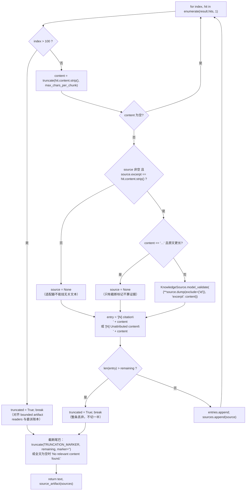

# Knowledge 证据链 — 引用语法、证据信封与预算裁剪

> 本页覆盖源码：`backend/packages/harness/deerflow/knowledge/sources.py`（155 行，全部）、`backend/packages/harness/deerflow/knowledge/contract.py:31-68`（`KnowledgeSource` / `RetrievalHit` / `RetrievalResult`）、`contracts/knowledge_sources.v1.json`（线上 schema）、`frontend/src/core/citations/sources.ts`（同契约的前端读者）、以及三处执行侧调用点：`tool_output_budget_middleware.py:720-733`、`subagents/executor.py:239-260`、`tools/builtins/task_tool.py:718-727`。
>
> 能力与操作投影见 [01-contract-and-capabilities.md](01-contract-and-capabilities.md)；工具入口与失败策略见 [03-tool-entry-and-failure-policy.md](03-tool-entry-and-failure-policy.md)。

→ Back to [knowledge README](README.md)

## 0. 这一层要解决的真问题

一次检索的结果会同时出现在**两个地方**：

1. 模型读到的**文本**（`ToolMessage.content`）；
2. 前端与后续读者读到的**结构化证据**（`ToolMessage.artifact`）。

两者必须逐字一致。一旦不一致，就会出现三种坏结局：模型引用了一段 artifact 里根本不存在的证据（幻觉被「结构化数据」背书）、artifact 里留了一条正文已经被截掉的引用（悬空链接）、或者子 agent 的证据在转发时被替换成一段无关文本。

`sources.py` 的 155 行就是为这三件事设的闸。模块 docstring 一句话概括：

> "Shared validation, evidence-preserving budgets, and delegation forwarding."

## 1. 证据信封：两个版本、三种键

```json
{
  "knowledge_sources_version": 1,
  "knowledge_sources": [
    {"id": "<32 位小写十六进制>", "provider": "weknora", "title": "...", "excerpt": "..."}
  ]
}
```

| 常量 | 值 | 位置 |
|------|----|------|
| `ARTIFACT_VERSION` | `1` | `sources.py:13` |
| `TRUNCATION_MARKER` | `"… (response truncated)"` | `sources.py:14` |

`source_artifact()`（`sources.py:57-58`）是唯一的构造器：

```python
return {"knowledge_sources_version": ARTIFACT_VERSION,
        "knowledge_sources": [s.model_dump(mode="json", exclude_none=True) for s in sources]}
```

`exclude_none=True` 是关键——`dataset_name`/`url`/`page` 缺失时**不出现在 JSON 里**，因此 `contracts/knowledge_sources.v1.json` 里 `required` 只列 `id/provider/title/excerpt` 四个键，其余是「有才算」的 locator。

### 三种键的并存

| 键 | 形状 | 来源 | 读的人 |
|----|------|------|--------|
| `knowledge_sources`（**对象** `{version, sources}`） | RAGFlow 原生 v1 | `community/ragflow/sources.py` | `frontend/src/core/knowledge/sources.ts:33`（只认 `provider == "ragflow"`） |
| `knowledge_sources`（**数组**）+ `knowledge_sources_version` | 共享契约 | `sources.py:57` | `sources.py:111`、前端 `citations/sources.ts:67` |
| `retrieval_sources`（数组）+ `knowledge_sources_version` | 混合容器的共享半 | `task_tool.py:726` | `sources_from_messages()` 的 fallback（`sources.py:126`）、前端 `citations/sources.ts:69` |

`strip_source_artifact()`（`sources.py:28-32`）通过「只要 artifact 里出现这三个键中的任意一个，就把它们全部删掉」来防伪造——注意它**不判断 `version`**，所以一个把 `knowledge_sources` 写成对象、把 `knowledge_sources_version` 写成 `"1"` 的畸形 artifact 也会被清干净。

## 2. 引用语法：`citation()`

位置：`sources.py:61-64`。

```python
title = source.title.replace("\\", "\\\\").replace("[", "\\[").replace("]", "\\]").replace("\n", " ")
return f"[citation:{title}](<fragment 前缀>+{source.id})"
```

四次替换的顺序有意义：先转义反斜杠，再转义方括号（否则 `\[` 会变成 `\\[`），最后把换行压成空格（Markdown 链接标签不能跨行）。

**为什么标题必须转义**：`title` 来自 provider，是外部系统返回的不可信字符串。如果标题是 `](javascript:alert(1))`，不转义就能构造出一个逃出链接语法的注入。上下游对这个格式有两份等价的解析器：

| 侧 | 位置 | 正则 |
|----|------|------|
| Python | `sources.py:41` | `\[citation:((?:\\.|[^\]\\])*)\]\(#knowledge-source-([a-f0-9]{32})\)` |
| TS | `frontend/src/core/citations/sources.ts:48-49` | `(?<!!)\[citation:\s*((?:\\.|[^\]\\])+?)\]\((#knowledge-source-[a-f0-9]{32})\)/gi` |

两处都接受 `\\.` 转义序列、都要求 32 位十六进制 ID。前端还多了一个**块引用排除** `(?<!!)`——`` 这种图片语法不会被当成引用，否则攻击者可以用一张图片的 alt 文本冒充引用。

另外 `frontend/src/core/citations/sources.ts:27-30` 的 `retrievalSourceId()` 同时接受 `#knowledge-source-<id>` 与 `#user-content-knowledge-source-<id>` 两种 fragment——后者是 markdown 消毒器（DOM clobbering 防护）改写后的形式，如果只认前者，消毒后的链接就全成死链了。

## 3. 两个预算器与它们的边界

`format_result()`（`backend/packages/harness/deerflow/knowledge/sources.py:67-108`）与 `truncate()`（`:48-54`）属于本模块；第三个预算器 `budget_source_artifact()` 定义在 RAGFlow 适配器里，但由同一条中间件流水线调用。

### 3.1 `format_result`：主预算器



六个不变量，逐条对应源码：

| # | 不变量 | 行号 | 反例（会被拒的写法） |
|---|--------|------|---------------------|
| 1 | **最多 100 条 hit** | `:75-77` | 第 101 条连同其证据一起消失，而不是只砍正文 |
| 2 | **证据必须属于这条 hit** | `:83-85` | adapter 把 chunk A 的文本配 chunk B 的 source |
| 3 | **只有截断标记不算证据** | `:86-87` | 原文 2000 字，截断后只剩 `"…"` |
| 4 | **artifact 里的 excerpt = 模型看到的正文** | `:88-89` | 用截断后的 `content` 重建 `KnowledgeSource`（`id` 因 `exclude={"id"}` 被重算） |
| 5 | **放不下整条丢** | `:93-97` | 把一条 entry 切两半——注释说明会破坏「稳定 source identity 与总预算无关」 |
| 6 | **无 source 也保留正文** | `:90` | 头变成 `[N] Unattributed content`，正文仍是可用文本 |

第 4 条是整条链的支点：`KnowledgeSource` 的 `computed_field id`（`contract.py:54-58`）在重建时重算，所以 artifact 里的 ID 必然对应「截断后的 excerpt」而不是「provider 原始 excerpt」。这就解释了为什么模型引用 `#knowledge-source-<id>` 时，ID 一定能在它读过的文本里被找到——`sources_from_messages()`（`:132-134`）正是拿这个交叉条件去校验的。

`truncate()` 本身处理边界（`:48-54`）：`max_chars <= len(marker)` 时直接把 marker 截断返回，所以「预算 2 字符、marker 是 `"…"`」退化成一个点，而不是负数下标崩溃。

### 3.2 RAGFlow 原生预算：`budget_source_artifact()`

它的定义在 `backend/packages/harness/deerflow/community/ragflow/sources.py:19`，调用点在 `backend/packages/harness/deerflow/agents/middlewares/tool_output_budget_middleware.py:721`：仅当 `tool_name in {"knowledge_search", "task"}` 且预算触发时执行。它与 `format_result` 的差异是**按 RAGFlow 原生 ID 格式过滤**：

- 只接受 `knowledge_sources` 是 `{version:1, sources:[...]}` 的**对象**形状（`:29-31`）；
- 只接受 `[a-f0-9]{32}-[1-9][0-9]{0,2}` 的 ID（`:38`，与共享契约的纯 32 位十六进制是**不同命名空间**）；
- 只接受 `provider == "ragflow"` 且 `text/dataset_name/document_name` 都是字符串的条目（`:42`）；
- 正文里必须真的出现 `](#knowledge-<id>)`（`:40`）。

它**不去碰** `#knowledge-source-<id>` 这个命名空间——`:52-55` 的注释明确说「flattening it here would strip a legitimate citation this budgeter never rebuilds」。这是两套 ID 格式能在一个 artifact 里并存而不互相破坏的原因。

## 4. `prune_sources()`：预算变换后的对账

位置：`sources.py:35-45`。

```python
if not isinstance(artifact, Mapping) or artifact.get("knowledge_sources_version") != ARTIFACT_VERSION:
    return content, artifact                                        # :37-38
sources = sources_from_messages([{"type": "tool", "content": content, "artifact": artifact}])  # :39
allowed = {source.id for source in sources}                         # :40
pattern = r"\[citation:((?:\\.|[^\]\\])*)\]\(<fragment>([a-f0-9]{32})\)"   # :41（原文为 #knowledge-source- 前缀）
content = re.sub(pattern, lambda m: m[0] if m[2] in allowed else m[1], content)   # :42
```

语义：**正文里仍然有证据 → 保留链接；证据已经不在 → 把整条 Markdown 链接降级成纯文本 `Title`。**

三个细节：

1. **版本不匹配直接原样返回**（`:37-38`）。RAGFlow 原生对象形状（`knowledge_sources` 是 dict，没有顶层 `knowledge_sources_version`）走不到这里——它由 `budget_source_artifact` 负责。
2. **允许的集合是从「当前 content + artifact」重新推导的**，不是从旧集合差出来的。所以「artifact 被截断、正文没截断」和「正文被截断、artifact 没截断」两种情形都会被正确对齐。
3. **输出形状跟着输入形状走**（`:43-45`）：原 artifact 有 `retrieval_sources` 就刷新它，否则重写 `knowledge_sources`。这是 `task` 工具留下的混合 artifact 能继续生效的原因。

`prune_sources()` 的调用点只有一个：`backend/packages/harness/deerflow/agents/middlewares/tool_output_budget_middleware.py:730`，在 `budget_source_artifact` / `_budget_content` 之后无条件跑一次。它的 docstring 是「Budget transformations retain only evidence still visible to the model.」

## 5. `sources_from_messages()`：只认工具证据

位置：`sources.py:111-137`。

```python
for message in messages:
    kind = message.get("type") if isinstance(message, Mapping) else getattr(message, "type", None)
    ...
    if kind != "tool" or not isinstance(content, str) or ... version != ARTIFACT_VERSION: continue   # :121-122
    raw_sources = artifact["knowledge_sources"] if isinstance(..., list) else artifact["retrieval_sources"]   # :123
    for raw in raw_sources[:100]:                     # :125
        source = KnowledgeSource.model_validate(raw)  # :126-129
        if raw.get("id") != source.id: continue       # :130-131  ← ID 必须与内容自洽
        if source.excerpt in content and f"#knowledge-source-{source.id}" in content:   # :132-133
            sources[source.id] = source
return list(sources.values())[-100:]                  # :137
```

四道门，每一道都对应一种伪造方式：

| 门 | 行号 | 挡住的伪造 |
|----|------|-----------|
| `type == "tool"` 且 `content` 是 str | `:121` | assistant 在回复里自述「来源是 X」；`AIMessage` 无论如何不被当证据 |
| `knowledge_sources_version` 必须是 `int` 且等于 1 | `:122` | `"1"` / `True`（`type(...) is not int` 专门排掉 `bool` 这个 `int` 子类） |
| artifact 里的 `id` 必须等于重算值 | `:130` | 客户端提交一个 `id` 对应不存在的 excerpt，或者篡改 excerpt 保留旧 ID |
| `excerpt in content` **且** `#knowledge-source-<id>` 在正文里 | `:132` | artifact 里凭空多出一条「证据」，正文从没出现过 |

最后 `[-100:]`（`:137`）是**保留最新的 100 条**——不是前 100 条。所以「先搜 A、后搜 B」时 B 的证据优先保留，与 `executor.py:260` 的 `list(merged.values())[-100:]` 和 `format_result` 的 100 条上限一致（三处都是「最新/前 100」这一对语义，读的时候容易混）。

`sources_from_messages()` 接受**dict 形态**（`:117`）是为了子 agent 的 `stream_mode="values"` 帧：那里拿到的是序列化后的消息 dict，不是 `ToolMessage` 对象。

## 6. 子 agent 侧：增量累计

位置：`backend/packages/harness/deerflow/subagents/executor.py:239-260`。

```python
def update_knowledge_sources(self, messages):
    with self._state_lock:
        if self.status.is_terminal or messages is None: return
        start = 0
        for previous, current in zip(self._knowledge_messages, messages):
            if previous != current: break
            start += 1
        sources = sources_from_messages(messages[start:]) if start < len(messages) else []
        self._knowledge_messages = list(messages)
        merged = {source["id"]: source for source in self.knowledge_sources}
        for source in sources:
            merged[source.id] = source.model_dump(mode="json", exclude_none=True)
        self.knowledge_sources = list(merged.values())[-100:]
```

三处工程细节：

1. **从第一个变化的 message 开始重扫**（`:251-253`）。values 流是累积的历史，但 compaction 会改写前缀——朴素的「只看新增尾部」会在压缩后漏掉证据，而「每次全量重扫」是 O(n²)。
2. **按 ID 合并**（`:257-259`），同一段证据跨多次 values 帧只留一份。
3. **100 条上限作用在合并后的全量上**（`:260`），所以长时间运行的子 agent 不会无限积累。

调用点在 `executor.py:1890`：`result.update_knowledge_sources(chunk.get("messages") or [])`，位于 `async for chunk in stream` 内部，紧跟 `final_state = chunk`。

## 7. 委派侧：`forward_sources()`

位置：`sources.py:140-155`。

```python
def forward_sources(report, raw_sources, *, max_total_chars=8000):
    hits = []
    for raw in raw_sources:
        try: source = KnowledgeSource.model_validate(raw)
        except (ValidationError, TypeError): continue                       # :146-149
        if isinstance(raw, Mapping) and raw.get("id") == source.id and f"#knowledge-source-{source.id}" in report:
            hits.append(RetrievalHit(content=source.excerpt, source=source))  # :150-151
    if not hits:
        return prune_sources(report, source_artifact([]))                    # :152-153
    evidence, artifact = format_result(RetrievalResult(hits=hits), max_chars_per_chunk=100_000, max_total_chars=max_total_chars)  # :154
    return prune_sources(f"{report}\n\nKnowledge evidence:\n{evidence}", artifact)   # :155
```

转发规则：**只有子 agent 报告正文里真正引用过的证据才会被转发**（`:150`），其余证据静默丢弃。注意它**不检查** `source.excerpt in report`——只检查引用链接存在。正文里可能只有一句「见 `<citation 链接>`」而 excerpt 原文不在报告里；这种情况下证据仍会被转发（缺失的 excerpt 由 `hit.content = source.excerpt` 补上，`:151`）。截断标记只有在输出末尾才补（`format_result` 的 `truncated` 分支），并且由于 `format_result` 里 `source.excerpt == hit.content.strip()`（两者都等于 `source.excerpt`），evidence 不会在 `format_result` 里被误判为「无关文本」。

`max_chars_per_chunk=100_000` 是刻意的：转发的目标是**保住原文**而非压缩，`KnowledgeSource.excerpt` 的上界正好是 100 000（`contract.py:42`）。

### `task` 工具如何拼接

`tools/builtins/task_tool.py`：

```python
artifact = cited_source_artifact(source_messages or [], content, include_omissions=True)   # :716（RAGFlow 原生路径）
if knowledge_sources:
    content, unified_artifact = forward_sources(content, knowledge_sources)                # :721
    if artifact is None:
        artifact = unified_artifact
    else:
        artifact = {**artifact, "retrieval_sources": unified_artifact["knowledge_sources"],
                    "knowledge_sources_version": 1}                                          # :726
```

**只有两条路径都有证据时才出现 `retrieval_sources`**——RAGFlow 原生快照继续占着 `knowledge_sources` 这个键，共享记录被挤到 `retrieval_sources`。这正是 `sources_from_messages()` 需要 fallback（`:123`）和 `prune_sources()` 需要「跟着形状走」（`:43-45`）的根源。`task_tool.py:1233` 把 `getattr(result, "knowledge_sources", None)` 传进来，即第 6 节累计的那一包。

## 8. 红线清洗：`redact_strings()`

位置：`sources.py:17-25`。

```python
def redact_strings(value, secret):
    if isinstance(value, str): return value.replace(secret, "[REDACTED]") if secret else value
    if isinstance(value, Mapping): return {k: redact_strings(v, secret) for k, v in value.items()}
    if isinstance(value, list): return [redact_strings(v, secret) for v in value]
    return value
```

docstring 是「Redact before normalization so text and artifact never expose secrets.」——**在归一化之前**做，因为归一化会产生新的拼接字符串（标题、`dataset_name`），事后替换只能命中部分位置。

三个限制值得写下来：

1. 只处理 `str` / `Mapping` / `list`，tuple 与 set 原样返回。
2. `secret` 为空串时**整体不生效**——`if secret` 判断在替换之前，所以 `replace("", ...)` 这种灾难性插值不会发生。
3. 它是**精确子串替换**，不是模式匹配。所以它不防「凭证在 URL query 里被 URL-encode 后出现」这类变形。RAGFlow 适配器在 `backend/packages/harness/deerflow/community/ragflow/provider.py:55-56` 与 `backend/packages/harness/deerflow/community/ragflow/tools.py:577` 用它擦 API key，LightRAG 在 `backend/packages/harness/deerflow/community/lightrag/tools.py:18` 也用它——**未逐行核实**这三个调用点是否覆盖了各自 provider 的所有泄漏面。

## 9. 契约形状由线上 schema 钉死

`contracts/knowledge_sources.v1.json` 与 Python/TS 两侧的关系：

| 约束 | JSON Schema | Python | TS |
|------|-------------|--------|-----|
| `knowledge_sources_version == 1` | `const: 1` | `sources.py:37` / `:122` | `citations/sources.ts:70` |
| `knowledge_sources` ≤ 100 项 | `maxItems: 100` | `format_result` `:75` / `sources_from_messages` `:125` | `sources.ts:72`（`slice(0, 100)`） |
| `id` 匹配 `^[a-f0-9]{32}$` | `pattern` | **重算**（`contract.py:54-58`） | `sources.ts:77` 正则 + `:103` 交叉校验 |
| `title` 1–500 | `minLength`/`maxLength` | `contract.py:41` | `sources.ts:88-89`（按码点计数） |
| `excerpt` 1–100 000 | 同上 | `contract.py:42` | `sources.ts:92-93` |
| `page` ≥ 1 且为安全整数 | `minimum/ maximum 9007199254740991` | `contract.py:45`（`strict=True`） | `sources.ts:100-101`（`Number.isSafeInteger`） |
| `url` 无凭据 | `pattern ^https?://` | `contract.py:47-52` | `sources.ts:100-101` 调用 `normalizeUrl()`（`sources.ts:220-227` 拒绝非 http(s) 与带 username/password 的 URL） |

三侧的上界完全一致（`provider` 1–100 / `title` 1–500 / `excerpt` 1–100 000 在 `contract.py:40-42` 与 `sources.ts:79-86` 各写一遍），`page` 的 2⁵³-1 也是三处都有。前端用**码点**计数（`exceedsTextLimit()` 里 `[...text].length`），与 Pydantic 的计数口径一致——这是 JS 与 Python 在 emoji/代理对上最容易分叉的地方。

前端多一道**无法在 schema 里表达的**校验：`message.content.includes(source.excerpt)` 且 `includes("#knowledge-source-" + id)`（`citations/sources.ts:103-106`）。这与 Python 的 `sources.py:132-133` 是同一条规则——**两侧都独立实现了一次**，所以只要有一侧改规则而另一侧没跟上，历史线程的引用就会在一边显示、另一边不显示。这是本契约最需要在 review 时盯的地方。

## 10. 与 RAGFlow 原生契约的收敛计划

`backend/docs/KNOWLEDGE.md` 给了明确的方向（原文摘录）：

> "The shared envelope is the intended default for new provider integrations. Convergence should happen at adapter output boundaries: migrate newly produced RAGFlow evidence to the shared form once native scope, budgets, delegation and durable batch forwarding have equivalent coverage. Keep native readers for persisted citations and exports; do not rewrite historical IDs or fabricate missing locators."

翻译成工程约束：

- **不重写历史 ID**——已持久化的 `#knowledge-<32hex>-<n>` 引用永远保持可读（`budget_source_artifact` 与前端 `core/knowledge/sources.ts` 都还在读 RAGFlow 原生形状）。
- **不伪造缺失 locator**——WeKnora 明确选择「拿不到可信页码就留空」（`examples/deerflow-extension-weknora/deerflow_extension_weknora/provider.py` 的注释：v0.8.3 只给 offsets/chunk index）。
- **收敛点是 adapter 输出边界**，不是读侧。

→ 下一步：[03-tool-entry-and-failure-policy.md](03-tool-entry-and-failure-policy.md)：三个工具入口、能力校验时序、失败分类与作用域生命期。
