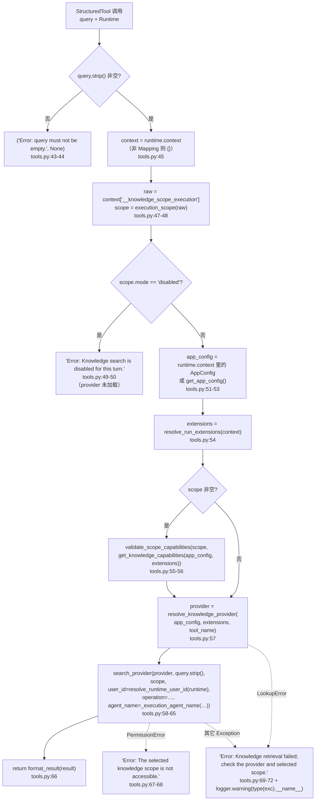
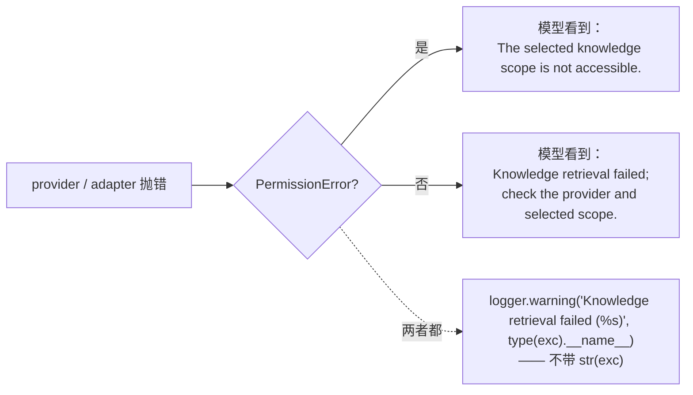
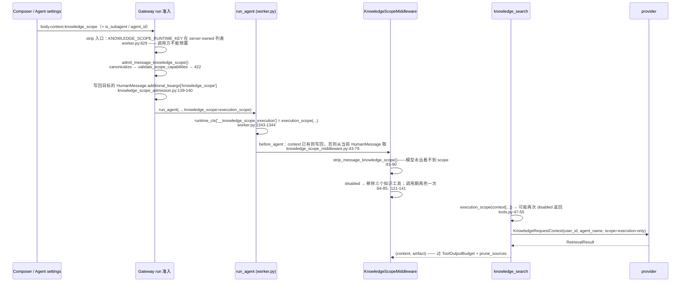

---


title: "Knowledge 工具入口 — 执行时序、能力校验与失败策略"
description: 'Knowledge 工具入口 — 执行时序、能力校验与失败策略：架构、契约与源码锚点。'
topics: [knowledge, tools, failure-policy, scope, middleware, gateway]
verified_against: v2.2.0
last_verified: 2026-11-08
---

# Knowledge 工具入口 — 执行时序、能力校验与失败策略

> 本页覆盖源码：`backend/packages/harness/deerflow/knowledge/tools.py`（98 行，全部）、`backend/packages/harness/deerflow/knowledge/providers.py:142-186`（`resolve_knowledge_provider` / `validate_scope_capabilities` / `search_provider`）、`backend/app/gateway/knowledge_scope_admission.py`（141 行）、`backend/app/gateway/routers/knowledge.py`（112 行）、`backend/packages/harness/deerflow/agents/middlewares/knowledge_scope_middleware.py`（134 行）、`backend/packages/harness/deerflow/tools/tools.py:152-157`（组开关）。
>
> 契约与能力位见 [01-contract-and-capabilities.md](01-contract-and-capabilities.md)；证据与预算见 [02-sources-and-budgets.md](02-sources-and-budgets.md)。

→ Back to [knowledge README](README.md)

## 1. 三个工具，一份实现

`tools.py:87-98` 是全部的工具定义，共 12 行：

```python
def _tool(name, coroutine, description):
    return StructuredTool.from_function(
        coroutine=coroutine, name=name,
        response_format="content_and_artifact",                   # :91
        description=description + " Within this turn's scope. Cite only supplied "
                    "[citation:Title] 加 #knowledge-source-ID 形式的链接 exactly; never invent source locators or relations.",  # :92（原文为 Markdown 链接语法）
    )

knowledge_search_tool        = _tool("knowledge_search",        _knowledge_search_entrypoint,        "Search accessible document evidence.")       # :96
knowledge_entries_search_tool = _tool("knowledge_entries_search", _entries_search_entrypoint,        "Search accessible published Wiki and knowledge entries.")   # :97
entity_relations_search_tool  = _tool("entity_relations_search",  _relations_search_entrypoint,      "Search upstream entities and relations. Returned paths may be incomplete; absence does not disprove a relation.")  # :98
```

三个 wrapper（`:75-84`）只是把 `tool_name` 钉死再调 `execute_knowledge_search()`：

| 工具名 | wrapper | `tool_name` 参数 | 映射到的 operation（`providers.py:24-28`） |
|--------|---------|-----------------|------------------------------------------|
| `knowledge_search` | `:75-76` | 默认值 `"knowledge_search"` | `search` |
| `knowledge_entries_search` | `:79-80` | `"knowledge_entries_search"` | `entries_search` |
| `entity_relations_search` | `:83-84` | `"entity_relations_search"` | `relations_search` |

三个设计决定：

- **`response_format="content_and_artifact"`**：证据必须走 artifact，而不是塞进正文让模型复述。这是 [02-sources-and-budgets.md](02-sources-and-budgets.md) 整套校验的前提。
- **引用指令写进 description**（`:92`）：`"Within this turn's scope."` 告知模型作用域存在；`"Cite only supplied ... never invent source locators or relations."` 把「只能复制给定链接」变成工具契约的一部分，而不是靠系统提示词另行叮嘱。
- **`entity_relations_search` 的 description 自带免责**（`:98`）：`"Returned paths may be incomplete; absence does not disprove a relation."`——图检索的召回天然不完整，这句话防止模型把「没搜到」当成「不存在」。

## 2. 执行时序：`execute_knowledge_search()`（`tools.py:35-72`）



### 顺序为什么是这样

**(a) `disabled` 判定在加载 provider 之前**（`:49-50`）。这一条有测试钉住（`backend/tests/test_knowledge_provider.py:299`，`test_disabled_scope_returns_specific_error_before_loading_provider`）：一个「配置坏了 / provider 连不上」的部署，在用户显式禁用知识库的那一轮**不能**因为配置错误而改报别的错。禁用是用户意图，优先于任何环境状态。

**(b) 能力校验在 provider 解析之前**（`:55-57`）。`validate_scope_capabilities` 只需要 `KnowledgeCapabilities`，`get_knowledge_capabilities()` 也是纯配置计算（不做 I/O）。所以「这个 provider 支不支持当前选择」在建立任何连接之前就判完了。

**(c) `query.strip()` 做了两次**（`:43` 判空、`:60` 传参）。传下去的是去掉首尾空白的版本，中间空白保留。

**(d) `app_config` 优先取 runtime context**（`:51-53`）。这让「run 期间的 AppConfig 快照」压过进程级 `get_app_config()`——配置热重载期间的 in-flight run 继续用自己那份配置，与 `docs/KNOWLEDGE.md` 里「The run's AppConfig and immutable extension snapshot take precedence over global configuration and the global registry」一致。

**(e) `resolve_knowledge_provider(app_config, extensions=..., tool_name=...)`** 是唯一带 `tool_name` 的地方（`providers.py:142-153`）。三个工具可以分别指向**不同的 provider**——`knowledge_search` → RagFlow，`entity_relations_search` → `lightrag-relations` 扩展。这也是 `get_knowledge_capabilities()` 要做「多身份降级」的原因（[01](01-contract-and-capabilities.md)）。

## 3. 执行器身份：`_execution_agent_name()`（`tools.py:20-32`）

```python
if context.get("is_subagent") is True:
    name = context.get("agent_id")
else:
    configurable = config.get("configurable") if isinstance(config, Mapping) else None
    legacy_name = configurable.get("agent_name") if isinstance(configurable, Mapping) else None
    name = context.get("agent_name", legacy_name)
if name is None and context.get("is_subagent") is not True:
    return "lead_agent"
if not isinstance(name, str) or not name.strip():
    raise ValueError("Invalid knowledge execution agent identity")
return name
```

四档解析，按可信度：

| 情形 | 取值 | 为什么 |
|------|------|--------|
| `is_subagent is True` | `context["agent_id"]` | 子 agent 的**配置名**由 executor 写入；不回退到父名 |
| 主 run，`context["agent_name"]` 存在 | 它 | runtime context 是 server-owned 的（`worker.py:613-630` 的 server-owned 键集合） |
| 主 run，仅 `configurable.agent_name` | legacy 回落 | 兼容没有 runtime context 的独立调用方 |
| 都没有 | `"lead_agent"` | 默认 assistant |
| 子 agent 但 `agent_id` 缺失 | **`ValueError`** | 宁可失败，也不冒充 `lead_agent` |

最后一档是关键的安全语义：`backend/tests/test_knowledge_provider.py:249`（`test_missing_subagent_identity_does_not_fall_back_to_lead_agent`）与 `:262`（`test_standalone_admission_cannot_forge_knowledge_subagent_identity`）分别钉住「子 agent 缺身份不降级」与「公开入口不能自造子 agent 身份」。`agent_name` 是 provider 侧授权判据之一（WeKnora 的 `space.agent_names` 就按它匹配，见 §7），所以身份伪造等价于越权。

`ValueError` 会被 `except Exception` 吞成通用失败文本（`:69-72`），模型看到的是「Knowledge retrieval failed; check the provider and selected scope.」——不会知道是身份问题。

## 4. 作用域能力校验：`validate_scope_capabilities()`（`providers.py:155-165`）

```python
canonical = execution_scope(scope)                                  # :156
if not capabilities.supports("search"):
    raise ValueError("Knowledge retrieval is unavailable")          # :157-158
if canonical["mode"] == "selected":
    if not capabilities.supports("dataset_filter"):
        raise ValueError("Knowledge providers that lack dataset filtering cannot enforce a selected knowledge scope")   # :159-161
    if canonical.get("document_filters") and not capabilities.supports("document_filter"):
        raise ValueError("Knowledge providers that lack document filtering cannot enforce selected documents")          # :162-163
return canonical                                                    # :165
```

三档语义：

| `mode` | 要求 | 说明 |
|--------|------|------|
| `disabled` | 只要 `search`（或任一检索位）存在 | 具体拦截在前一层做（`tools.py:49`、`providers.py:172-173`、RAGFlow `provider.py:41-42`） |
| `all` | 同上 | `all` = provider 的算子可见域，**不收窄也不放宽** |
| `selected` | 必须有 `dataset_filter` | 再加：有 `document_filters` 时必须有 `document_filter` |

**「只在真有 document_filters 时才要求 document_filter」**（`:162`）让「只支持 dataset 级收窄的 provider」不必写一个空的文档过滤实现。但它与 `validate_provider()` 的注册期规则（[01](01-contract-and-capabilities.md#2-能力位权威表)）是两条**独立的**约束——注册期拦「声明了 filter 却没声明检索位」，执行期拦「要收窄但 provider 没声明对应 filter」。两处都要读，因为一个只声明 `dataset_filter` 的 provider 在注册期完全合法，执行期只支持 dataset 级选择。

**返回值的意义**：函数返回的是 `execution_scope(scope)`（剥掉 `display` 的规范形态），所以调用方拿到的是**可以直接交给 provider** 的 dict。三个调用点都用了这个返回值而不是入参：`tools.py:56`（结果被丢弃，只用于校验）、`providers.py:170`（`scope = validate_scope_capabilities(...)`）、`community/ragflow/provider.py:40`。

## 5. 调用骨架：`search_provider()`（`providers.py:167-186`）

```python
async def search_provider(provider, query, *, scope, user_id, agent_name, operation="search"):
    scope_caps = operation_capabilities(provider.capabilities, operation)          # :168
    if not scope_caps.supports("search"):
        raise ValueError("Knowledge retrieval operation is unavailable")           # :169-170
    canonical = validate_scope_capabilities(scope, scope_caps) if scope is not None else None  # :171-172
    if canonical is not None and canonical["mode"] == "disabled":
        raise ValueError("Knowledge search is disabled for this turn")             # :172-173
    context = KnowledgeRequestContext(user_id=user_id, agent_name=agent_name, scope=canonical)  # :174
    contextual_search = getattr(provider, "search_scoped" if operation == "search" else operation, None)  # :175
    if callable(contextual_search):
        result = await contextual_search(query, context=context)                   # :176-177
    elif canonical is not None and canonical["mode"] == "selected":
        raise ValueError("Knowledge provider cannot apply the selected scope")     # :178-179
    elif operation != "search":
        raise ValueError("Knowledge retrieval operation is unavailable")           # :180-181
    else:
        result = await provider.search(query)                                      # :182-183
    payload = result.model_dump() if isinstance(result, RetrievalResult) else result  # :184-185
    return RetrievalResult.model_validate(payload)                                 # :186
```

四个决策，每个都有「不允许的替代方案」：

**(a) 方法选择表**（`:175`）：

| operation | 优先调用 | 回退 |
|-----------|----------|------|
| `search` | `search_scoped(query, context=…)` | `search(query)` |
| `entries_search` / `relations_search` | 同名方法 | **无回退**（`:180` → `ValueError`） |

`search` 的回退是有条件的：**只有 `scope` 为 `None` 或 `all` 时**才允许走到 `provider.search(query)`（`:178` 先拦 `selected`）。这就是「选择的知识库绝不被静默忽略」的实现——不是靠 provider 自觉，而是靠骨架在调用前拒绝。

**(b) 第二次能力校验**（`:168-172`）。`operation_capabilities()` 先投影，`validate_scope_capabilities()` 再按**投影后**的能力面校验。为什么不直接用 `provider.capabilities`？因为对 `entries_search`/`relations_search` 的投影里，`search` 位表示「这个工具可跑」；用原始能力会让一个 entries-only provider 被误判为不可用（[01 §4](01-contract-and-capabilities.md)）。

**(c) `frozenset({"search"})` 打底**（`contract.py:23`）。因为 `search` 位的这种双重语义，一个只声明了 `entries_search` 的 provider 在 `search_provider(operation="entries_search")` 里 `scope_caps.supports("search")` 为真——这是设计，不是漏洞。

**(d) 返回值二次校验**（`:184-186`）。注释写得很直白：`# Validate provider values before they can become model-visible evidence.`。provider 返回的不是 `RetrievalResult`（比如一个裸 dict）也能被接住；字段越界、`score=NaN`、`page` 是 `bool` 等都在这里被 Pydantic 拒掉。它抛的是 `ValidationError`，最终落到 `tools.py:69` 的通用失败文本。

## 6. 失败策略总表

### 6.1 模型可见的四类文本（`tools.py`）

| 触发 | 文本 | 出处 | provider 是否加载 |
|------|------|------|-------------------|
| 空 query | `Error: query must not be empty.` | `:44` | 否 |
| 作用域 disabled | `Error: Knowledge search is disabled for this turn.` | `:50` | 否 |
| `PermissionError` | `Error: The selected knowledge scope is not accessible.` | `:67-68` | 是（抛出方） |
| 其它任何异常 | `Error: Knowledge retrieval failed; check the provider and selected scope.` | `:72` | 视情况 |

四类文本的共同点是**没有一个字来自异常对象**。`:70-71` 的注释解释了原因：

> "Provider exceptions may contain credentials or resource identifiers."

写进日志的也只有 `type(exc).__name__`（`:71`），**连 `str(exc)` 都不写**。所以排查一个知识检索故障时，日志里能看到 `PermissionError` / `RuntimeError` / `ValidationError` 的类名，但看不到具体哪条 URL 或哪个 dataset ID 失败——这是刻意的取舍，算子需要复现就去看 provider 自己的日志。

### 6.2 `PermissionError` 为什么单独列

骨架里没有一处 raise `PermissionError`（`providers.py` 全文只 raise `ValueError` / `LookupError`），它完全来自 provider：

- WeKnora：`provider.py` 的 `_bindings()` 在没有绑定空间时 `raise PermissionError("No WeKnora space is bound to this user and executing agent")`；HTTP 401/403 也转成 `PermissionError`。
- RAGFlow 适配器：`backend/packages/harness/deerflow/community/ragflow/provider.py:47` 与 `:50` 都是 `PermissionError("Knowledge scope is unavailable")`。

所以「权限拒绝」和「其它失败」在工具层分档：



RAGFlow 适配器刻意把「不存在」和「无权限」统一成 `PermissionError`（`provider.py:46-50`），避免把「这个 dataset 存在但你不能看」与「这个 dataset 不存在」区分给模型。

### 6.3 无重试、无降级：这是契约不是疏忽

`sources.py` / `providers.py` / `tools.py` 全文**没有任何 `try/retry`**，三个工具也**没有** `retry` 或 fallback 参数。`ScopedRetrievalProvider` 的 docstring（`contract.py:112-117`）把这条写成协议义务：

> "A missing/inaccessible selection must fail as a whole. Never retry a constrained request as an unconstrained search."

对照项：`backend/tests/test_knowledge_provider.py:151`（`test_permission_denial_never_retries_unconstrained`）与 `:99`（`test_execution_rechecks_filter_capabilities_without_falling_back`）。所以「检索失败 → 去看看能不能全库搜」这种做法在本子系统里既是 bug 也是违约。

### 6.4 Gateway 侧的错误映射（`routers/knowledge.py:30-46`）

catalog 端点有一张独立的映射表，**与工具层不同**（面向 HTTP 客户端，可以更细）：

| 异常 | HTTP | detail |
|------|------|--------|
| `PermissionError` | 403 | `Knowledge resource access denied.` |
| `FileNotFoundError` | 404 | `Knowledge base not found.` |
| `pydantic.ValidationError` | 502 | `Knowledge provider returned an invalid catalog.` |
| `ValueError` | 409 | `The configured knowledge-base scope is unavailable.` |
| 其它 `Exception` | 502 | `Knowledge provider request failed.`（日志只记类名，`:44-46`） |

上游 503（`LookupError` → `Knowledge retrieval is not configured.`）在 `routers/knowledge.py:68-69` 单独处理。`test_knowledge_provider_router.py:100`（`test_catalog_errors_are_safe_and_do_not_retry`）与 `:111`（`test_malformed_catalog_cannot_expose_provider_fields`）钉住这张表。

## 7. 作用域生命期：从 Gateway 准入到 provider



### 7.1 准入：`admit_message_knowledge_scope()`（`knowledge_scope_admission.py`）

| 阶段 | 行号 | 行为 |
|------|------|------|
| 定位唯一候选 | `:75-99` | 只有 `HumanMessage` 能带 scope（否则 422）；多条带 scope → 422 `knowledge_scope is allowed on only one new HumanMessage`；带 scope 的不是最后一条 HumanMessage → 422 |
| 取原始快照 | `:100-110` | `recovery=True` 时用 `recovery_scope`；否则取消息上的值；**都没有则回落 agent 默认值**，且 recovery 路径永不读 agent 默认（`:104-109` 注释） |
| assistant 支持性 | `:118-123` | `assistant_supports_knowledge_scope()` 为假 → **422** `knowledge_scope is not supported by this assistant or knowledge provider` |
| 规范化 | `:124-129` | `canonicalize_knowledge_scope()`，`ValidationError` → **422**（只回第一条 `msg`） |
| 能力校验 | `:130-133` | `validate_scope_capabilities(canonical, get_knowledge_capabilities(...))`，`ValueError` → **422** |
| 类型兜底 | `:134-135` | 有 scope 但 `canonical` 为 `None`（非对象）→ 422 `knowledge_scope must be an object` |
| 落盘 | `:137-140` | 用 `_replace_scope()` 把规范化后的值写回目标消息的 `additional_kwargs`，返回 `execution_scope(canonical)`（**无** `display`） |

**准入的结果是「尽力原则」之上的硬门**：UI 是否显示选择器是 `/api/features` 的事，准入**不看 UI 状态**——上游文档原话是「Admission rejects unsupported dataset/document filters with 422, independently of UI availability」。

### 7.2 恢复：resume / regenerate 用**原始**快照

`_recover_run_knowledge_scope()`（`backend/app/gateway/services.py:1970-2041`）在目标消息不在当前 checkpoint 时（中断的 assistant 输出可能从未落 checkpoint）回退到「最近一条带 scope 的 HumanMessage」。找不到且指定了 `target_message_id` → **409** `Could not recover the source HumanMessage knowledge_scope`。

这带来一条容易踩的行为：**resume 不会采用 agent 的当前默认值**，它用的是那一轮用户的原始选择。改了 agent 默认知识库再 resume 旧线程，旧线程继续按旧快照跑。上游文档写作「Regeneration and resume recover the original server snapshot; they do not adopt a changed Agent default」。

### 7.3 模型侧：`KnowledgeScopeMiddleware`（134 行）

`knowledge_scope_middleware.py:40` 类定义，三个 hook：

| hook | 行号 | 行为 |
|------|------|------|
| `before_agent` | `:43-79` | runtime context 已有 scope → 写回后直接返回（`:48-51`）；否则从**本次 run 新增的** HumanMessage 里找（`:54-79`）。候选集用 `CURRENT_RUN_PRE_EXISTING_MESSAGE_IDS_KEY` 排除历史消息；没有 checkpoint 边界的独立调用方只取 `messages[-1:]`，**绝不回扫任意历史** |
| `_prepare_model_request` | `:81-90` | 每条消息过 `strip_message_knowledge_scope()`；`disabled` 时从 `request.tools` 移除三个知识工具（`:84-85`） |
| `wrap_tool_call` / `awrap_tool_call` | `:121-141` | `disabled` 时**直接返回**一条 `status="error"` 的 `ToolMessage`（`:88-101`），连 handler 都不调 |

两条硬约束在 `before_agent` 里被 raise（会中止 run）：

- scope 只能出现在 `HumanMessage` 上（`:69-70`，`ValueError("knowledge_scope is allowed only on a current HumanMessage")`）；
- 本轮最多一条 HumanMessage 带 scope（`:72-73`，`ValueError("only one current HumanMessage may carry knowledge_scope")`）。

`disabled` 被**实现了两遍**（模型请求时移除工具 + 调用时拦截结果）。原因在链序：`KnowledgeScopeMiddleware` 排在 `InputSanitizationMiddleware` 之后、`ToolOutputBudgetMiddleware` 之前（`backend/packages/harness/deerflow/agents/middlewares/tool_error_handling_middleware.py:379-383`），而工具调用可能源于更早的模型请求（上一轮模型就看到过工具列表），所以必须在调用边界再兜一次。中间件顺序见 [../middleware/03-catalog.md](../middleware/03-catalog.md)。

### 7.4 委派：作用域沿 `task` / `batch_task` 继承

| 位置 | 行为 |
|------|------|
| `backend/packages/harness/deerflow/tools/builtins/task_tool.py:1002-1003` | 父 runtime context 里有 scope 就 `execution_scope()` 后传给子 run |
| `backend/packages/harness/deerflow/tools/builtins/batch_task_tool.py:242-243` | 写进 `execution_spec["knowledge_scope"]`，持久化批次同样继承 |

两条都只搬 `execution_scope()`，`display` 不进入子 run。子 agent 的 `agent_name` 由 executor 的 `agent_id` 提供（§3），所以一个被限制到特定 assistant 的 WeKnora 空间，子 agent 也能被正确判权（或正确拒绝）。

## 8. 组开关：`knowledge_base.enabled`

工具是否被装配与工具本身无关，它在 `get_available_tools()` 里按组过滤（`backend/packages/harness/deerflow/tools/tools.py:152-157`）：

```python
knowledge_base_config = getattr(config, "knowledge_base", None)
if not getattr(knowledge_base_config, "enabled", False):
    tool_configs = [tool for tool in tool_configs if tool.group != "knowledge"]
```

配置模型只有两个字段（`backend/packages/harness/deerflow/config/knowledge_base_config.py:4-15`）：

| 字段 | 默认 | 语义 |
|------|------|------|
| `enabled` | `False` | 是否暴露 `group: knowledge` 的工具。**连接参数不在这里**，在各工具条目上 |
| `scope_selection_enabled` | `False` | 是否允许 UI 选择器；实际生效还要求能力里有 `catalog` 且 `dataset_filter`（`routers/features.py:157-163`） |

`config.example.yaml:824-828` 是模板。注意注释里那句仍然写着「Keeps the selector hidden unless the effective knowledge_search provider is the bundled RAGFlow tool」——这句在 v2.2.0 已经**过时**：`_knowledge_scope_selection_enabled()` 只按 `catalog` + `dataset_filter` 两个能力位判断，不检查 provider 是不是 RAGFlow。配置模板的注释没跟上实现，是阅读时的一个坑（未逐行核实上游是否有意的遗留）。

## 9. Provider 侧的授权：`KnowledgeRequestContext` 只是输入

契约有明确分工：**DeerFlow 不下发授权，provider 自己判**。以 WeKnora 扩展为例（`examples/deerflow-extension-weknora/deerflow_extension_weknora/provider.py`）：

| 判据 | 位置 | 失败 |
|------|------|------|
| 空间绑定 `user_ids` + 可选 `agent_names` | `_bindings()`（`:73-83`） | 全部不匹配 → `PermissionError("No WeKnora space is bound to this user and executing agent")` |
| 凭证环境变量 | 同上（`:78-80`） | 缺失/非法 → `RuntimeError` |
| 选中 dataset 必须在本空间可见 | `search_scoped()` | `PermissionError("Selected WeKnora knowledge base is unavailable")` |
| 上游返回越界的文档 | `search_scoped()` | `PermissionError("WeKnora returned evidence outside the selected documents")` |
| HTTP 401/403 / 404 | `_request()` | `PermissionError` / `FileNotFoundError` |

`search()`（无 context 版）**直接拒绝**：`raise PermissionError("WeKnora retrieval requires a trusted KnowledgeRequestContext")`。这是契约里「provider 必须自己判权」的最强形态——WeKnora **不做**无上下文的检索，所以哪怕某条路径绕过了 `search_scoped`，也拿不到数据。

对照：RAGFlow 适配器同时实现 `search` 与 `search_scoped`（`backend/packages/harness/deerflow/community/ragflow/provider.py:30-34`），`search(query)` 等价于 `_search(query, None)`——无作用域时用算子配置的可见域；它靠 `knowledge_search.datasets` 白名单和 API key 自身的租户可见性兜底。LightRAG legacy 路径不实现 `search_scoped`，只接受非收窄作用域（`backend/tests/test_knowledge_provider.py:361`，`test_lightrag_accepts_only_nonfiltering_scopes`）——它在 `get_knowledge_capabilities()` 里算是合法身份，但 `resolve_knowledge_provider()` 不认（`providers.py:150-151` → `LookupError`）。

## 10. 本子系统的边界（明确**不**做什么）

| 不做 | 证据 |
|------|------|
| 不发 HTTP | `knowledge/` 四个文件没有 `httpx`/`requests` import；连接在 adapter/extension |
| 不存凭据 | 契约无任何 secret 字段；RAGFlow 的 key 在 `knowledge_search.api_key`（`Wallet` 之外），WeKnora 在 `api_key_env` |
| 不做资源 ACL | `KnowledgeRequestContext` docstring「never provider authorization」；`backend/docs/KNOWLEDGE.md` 反复写「DeerFlow does not … create a second ACL store」 |
| 不提供管理面 | `/api/knowledge/datasets`（GET/POST）、`/api/knowledge/events` 都返回 404（`backend/tests/test_knowledge_router.py:274-286`）——只有 `capabilities` + 两个 `retrieval-catalog` 只读端点 |
| 不持久化证据 | artifact 跟着 `ToolMessage` 走 checkpoint / run event，不由本包写库 |
| 不做语义解析/重排 | 排序是 provider 的事；本包只看 `score` 的有限性（`contract.py:64`） |

## 11. 阅读顺序建议

排查一个「知识检索不工作」的问题时按这个顺序走：

1. `/api/features` 的 `knowledge_base.scope_selection_enabled` 是否为 `true` → 否则是配置或能力位问题（[01 §5](01-contract-and-capabilities.md)）。
2. 工具是否被装配 → `knowledge_base.enabled` + `group: knowledge`（§8）。
3. 日志里有没有 `Invalid knowledge tool configuration` → 工具指向未注册 provider 或未声明的 operation。
4. 日志里 `Knowledge retrieval failed (<ExcType>)` → 有到达 provider；按 `PermissionError` / `ValidationError` / `RuntimeError` 分流。
5. 拿到了结果但引用不显示 → 证据没通过 `sources_from_messages()` 的四道门（[02 §5](02-sources-and-budgets.md)）。

→ 返回 [knowledge README](README.md)。相关：[../../enterprise-operations/security/06-extension-boundary.md](../../enterprise-operations/security/06-extension-boundary.md)（扩展能拿到什么）、[../../concepts/builtin-tools/D-task-toolsearch.md](../../concepts/builtin-tools/D-task-toolsearch.md)（`task` 与工具发现）、[../../internals/runtime/README.md](../runtime/README.md)（`run_agent` 的 runtime context）。
