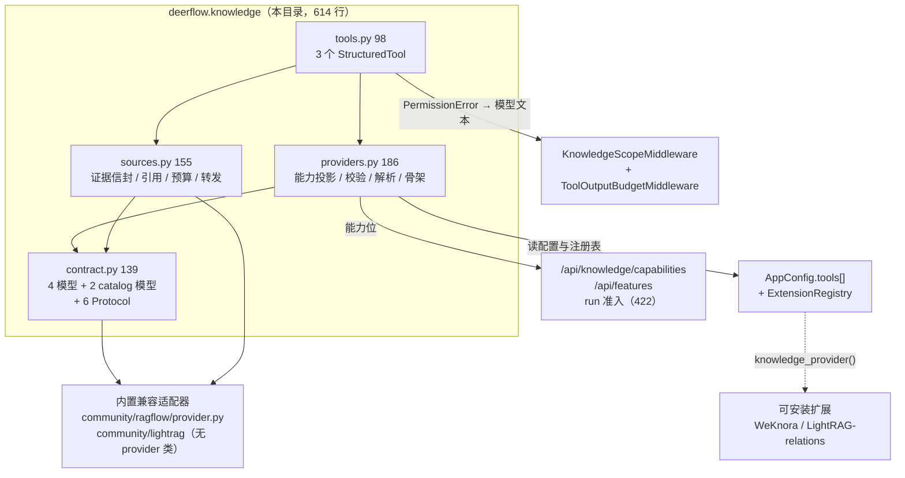
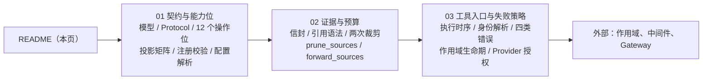

# Knowledge — 只读检索契约

`backend/packages/harness/deerflow/knowledge/` 在 `v2.2.0` 是**全新目录**（上游设计文档 `backend/docs/KNOWLEDGE.md` 按 `#6269` 的 phase 1–3 交付），总计 **614 行**：`contract.py` 139 行 + `providers.py` 186 行 + `sources.py` 155 行 + `tools.py` 98 行 + `__init__.py` 36 行。`v2.1.0` 中不存在对应物——那时的知识库只有 RAGFlow 一条内置路径。

它解决的问题只有一个：**让「检索」成为一个 provider 可以插进来、而核心不必认识具体后端的契约**。在此之前，每接一个新知识库都要在 harness 里加一套工具、一套来源格式、一套作用域语义；接第二家（LightRAG）时问题就暴露了——两家的 dataset 命名空间、引用语法、权限模型都不同，而模型只该看到**同一种**证据形状。

它刻意**不**成为第二个 ACL 存储：`providers.py:1-6` 的模块 docstring 是硬边界——"No provider configuration, HTTP calls or resource permissions live here." 凭据、HTTP 客户端、租户判定全在 provider（内置的 RAGFlow 适配器 / 可安装的 WeKnora、LightRAG 扩展）。

→ Back to [parent README](../README.md)

## 能力一览

| 能力 | 实现位置 | 说明 |
|------|----------|------|
| 12 个能力位的能力声明 | `contract.py:13-28` | `KnowledgeCapabilities`（frozen），默认只有 `search`；`supports()` 是纯集合判断 |
| 4 类检索 operation | `providers.py:24-28` | `search` / `entries_search` / `relations_search` 三种工具 + `sources` 伴生位 |
| 单工具能力投影 | `providers.py:32-44` | 全局能力 → 某个工具看到的能力面（`entries_*`/`relations_*` 的 `search` 位表示「可跑」） |
| 多工具能力交集 | `providers.py:84-126` | 已配置工具取交集；**多 provider 身份 → 只剩 all/disabled** |
| 注册期校验 | `providers.py:47-66` | 能力位 → 必需方法，且每个都必须是 `async` |
| provider 解析 | `providers.py:129-153` | 按 `tool.provider` 找注册名；找不到 → `LookupError` |
| 执行期作用域闸 | `providers.py:155-186` | `selected` 必须有 `dataset_filter`；无 `search_scoped` 时**硬失败，绝不降级成全库搜** |
| 证据信封 v1 | `sources.py:13-14,57-58` | `{knowledge_sources_version: 1, knowledge_sources: [...]}`，schema 在 `contracts/knowledge_sources.v1.json` |
| 引用语法 | `sources.py:61-64` | `[citation:Title]` + 32 位十六进制 fragment，标题四次转义防注入 |
| 预算裁剪 | `sources.py:67-108` | 整条 hit 放不下就丢，artifact 里的 `excerpt` 恒等于模型看到的正文 |
| 悬空引用对账 | `sources.py:35-45` | 预算变换后重新推导允许集，`prune_sources()` 把失效链接降级成纯文本 |
| 只认工具证据 | `sources.py:111-137` | 四道门：`type=="tool"` / 版本是 `int` 1 / ID 与内容自洽 / excerpt 与链接都在正文里 |
| 委派转发 | `sources.py:140-155` | 只转发子 agent 报告里**真正引用过**的证据 |
| 模型可见失败文本 | `tools.py:35-72` | 四类固定串，provider 异常只记 `type(exc).__name__` |

## 分层与归属

**归属一句话**：DeerFlow 拥有「契约 + 证据 + 预算 + 失败文本」；provider 拥有「凭据 + HTTP + 谁都能看什么」。

## 文件索引

| 文件 | 行数（`v2.2.0` 实测） | 职责 |
|------|----------------------|------|
| `contract.py` | 139 行 | `KnowledgeCapabilities`（`:13`）/ `KnowledgeSource`（`:31`）/ `RetrievalHit`（`:61`）/ `RetrievalResult`（`:67`）/ `KnowledgeRequestContext`（`:78`）/ `RetrievalCatalogItem`（`:94`）/ `RetrievalCatalogPage`（`:102`）；Protocol：`RetrievalProvider`（`:71`）/ `ScopedRetrievalProvider`（`:111`）/ `RetrievalCatalogProvider`（`:122`）/ `RetrievalDocumentsProvider`（`:126`）/ `KnowledgeEntriesProvider`（`:130`）/ `EntityRelationsProvider`（`:136`） |
| `providers.py` | 186 行 | 工具路径常量（`:18-20`）、`KNOWLEDGE_TOOL_OPERATIONS`（`:24`）、`operation_capabilities`（`:32`）、`validate_provider`（`:47`）、`_configured_tools`（`:69`）、`get_knowledge_capabilities`（`:84`）、`_registered_provider`（`:129`）、`resolve_knowledge_provider`（`:142`）、`validate_scope_capabilities`（`:155`）、`search_provider`（`:167`） |
| `sources.py` | 155 行 | `redact_strings`（`:17`）、`strip_source_artifact`（`:28`）、`prune_sources`（`:35`）、`truncate`（`:48`）、`source_artifact`（`:57`）、`citation`（`:61`）、`format_result`（`:67`）、`sources_from_messages`（`:111`）、`forward_sources`（`:140`） |
| `tools.py` | 98 行 | `_execution_agent_name`（`:20`）、`execute_knowledge_search`（`:35`）、三个 wrapper（`:75/79/83`）、`_tool`（`:87`）、`knowledge_search_tool` / `knowledge_entries_search_tool` / `entity_relations_search_tool`（`:96-98`） |
| `__init__.py` | 36 行 | 轻量门面：只 re-export `contract` 与 `sources` 的符号（`:19-36`），不拖入 `langchain_core.tools` |
| **合计** | **614 行** | 包内**没有** `AGENTS.md`；设计文档在 `backend/docs/KNOWLEDGE.md`（345 行） |

## 阅读路线

1. [01-contract-and-capabilities.md](01-contract-and-capabilities.md) — 数据面、12 个能力位的权威表、`operation_capabilities()` 投影矩阵、`get_knowledge_capabilities()` 的交集与多身份降级、注册期 `validate_provider()`、`knowledge_scope.py` 四个入口、全仓调用方地图。**先读这篇**：能力位是所有其它行为的开关。
2. [02-sources-and-budgets.md](02-sources-and-budgets.md) — 证据信封的三种键、`citation()` 的转义、`format_result()` 的六个不变量、RAGFlow 原生预算器的独立 ID 命名空间、`prune_sources()` 的对账、`sources_from_messages()` 的四道门、子 agent 增量累计、`forward_sources()`、以及线上 schema 与前端读者的对照。
3. [03-tool-entry-and-failure-policy.md](03-tool-entry-and-failure-policy.md) — 三个工具共用 `execute_knowledge_search()` 的 12 步时序、`_execution_agent_name()` 的四档身份、`validate_scope_capabilities()` 与 `search_provider()` 的双重闸、模型可见的四类错误文本与 Gateway 的 403/404/409/422/502/503 映射、从准入到 provider 的完整作用域生命期、以及本子系统明确**不**做的事。

## 关键设计决策

| 决策 | 理由（源码依据） |
|------|------------------|
| 能力是**声明的集合**，不是能力推断 | `KnowledgeCapabilities` 冻结 + `supports()` 纯成员判断（`contract.py:13-28`）；没有「试着调一下看看」 |
| 默认只给 `search` | 最小 provider 只写一个 `async def search()`；catalog/scope 全是可选能力（`contract.py:23`） |
| 多工具取**交集**，多身份**砍掉选择面** | 一个 scope 必须被每个已配置的检索操作同时遵守；不同 provider 的资源 ID 没有共享命名空间，绝不重新解释选中的 ID（`providers.py:85-89, 124-125`） |
| `selected` 缺 `search_scoped` → 硬失败 | 静默退化成全库搜等于越权（`providers.py:178-179`） |
| 证据 `id` 是**推导值** | `sha256(...)[:32]`（`contract.py:54-58`），内容一变 ID 就变，篡改无从隐藏 |
| artifact 里的 `excerpt` 恒等于模型看到的正文 | `format_result()` 用截断后的 `content` 重建 `KnowledgeSource`（`sources.py:88-89`） |
| 放不下的 hit **整条丢弃** | 切一半会破坏「source identity 与总预算无关」（`sources.py:93-97` 注释） |
| 预算变换后**重新对账** | `prune_sources()` 从当前 content+artifact 重新推导允许集（`sources.py:39-42`） |
| provider 异常**从不**进入模型输出 | 只写 `type(exc).__name__`（`tools.py:70-71`），因为异常里可能带凭据或资源 ID |
| 无重试、无降级 | 协议 docstring 明写 "Never retry a constrained request as an unconstrained search"（`contract.py:112-117`） |
| 子 agent 证据只转发被引用过的 | `forward_sources()` 要求报告里有对应链接（`sources.py:150`） |
| 子 agent 缺身份**不**冒充 `lead_agent` | 抛 `ValueError("Invalid knowledge execution agent identity")` 而不回退默认名（`tools.py:28-29`），因为 `agent_name` 是 provider 侧授权判据 |
| 组开关只控装配，不控行为 | `knowledge_base.enabled` 在 `get_available_tools()` 里按 `group == "knowledge"` 过滤（`backend/packages/harness/deerflow/tools/tools.py:152-157`） |

## 与其它子系统的边界

| 子系统 | 关系 | 交叉链接 |
|--------|------|----------|
| **作用域**（`deerflow/knowledge_scope.py`，194 行） | 本包消费它的三个函数；契约里的 `scope` 永远是 `execution_scope()`（剥掉 `display`）的结果 | [03 §7](03-tool-entry-and-failure-policy.md) |
| **Middleware 链** | `KnowledgeScopeMiddleware`（`:40`）排在 InputSanitization 之后、ToolOutputBudget 之前；后者调本包的 `prune_sources()` | [../middleware/03-catalog.md](../middleware/03-catalog.md) |
| **Gateway** | `/api/knowledge/capabilities` + 两个只读 `retrieval-catalog` 端点；管理面（`/api/knowledge/datasets`、`/events`）刻意 404 | [03 §6.4](03-tool-entry-and-failure-policy.md) |
| **扩展契约** | `registry.knowledge_provider(name, provider)`（`backend/packages/harness/deerflow/extensions/registry.py:154-164`），extension-api ≥0.2.7，保留名 `ragflow`/`lightrag` | [../../enterprise-operations/security/06-extension-boundary.md](../../enterprise-operations/security/06-extension-boundary.md) |
| **Capabilities 目录**（`deerflow/capabilities/`） | **无关**：那是插件/MCP/Lark/skill 的清单与 installation identity；`category: knowledge` 只是画廊分组标签 | [../capabilities/README.md](../capabilities/README.md) |
| **Builtin tools** | 知识工具**不是** builtin：完全由 `config.yaml → tools[]` 驱动，`enabled=false` 时整组消失 | [../../concepts/builtin-tools/README.md](../../concepts/builtin-tools/README.md) |
| **Typesafe risk-gate** | 同一类「fail-closed vs fail-soft」取舍：权限/作用域一律硬失败，证据清洗一律静默丢弃 | [../typesafe/README.md](../typesafe/README.md) |
| **概念综述** | 已有的横向综述（分层图 + 四个老问题），行号有小幅偏移；本目录是 internals 深度版本 | [../../concepts/community-tools/09-knowledge-abstraction.md](../../concepts/community-tools/09-knowledge-abstraction.md) |
| **Runtime** | `run_agent(..., knowledge_scope=)` 写进 server-owned 的 runtime context 键 | [../runtime/README.md](../runtime/README.md) |
| **配置参考** | `knowledge_base.enabled` / `scope_selection_enabled` + 每条工具条目上的连接参数 | [../configuration/README.md](../configuration/README.md) |

## Provider 生态（`v2.2.0` 实测）

| Provider | 落地形态 | 能力位 | 作用域 |
|----------|----------|--------|--------|
| RAGFlow | 内置适配器 `RAGFlowKnowledgeProvider`（`backend/packages/harness/deerflow/community/ragflow/provider.py`，96 行）+ legacy 工具（`backend/packages/harness/deerflow/community/ragflow/tools.py`，658 行） | 6 个（`backend/packages/harness/deerflow/community/ragflow/formatting.py:12`） | `search` 与 `search_scoped` 都有；缺绑定/不可见统一 `PermissionError("Knowledge scope is unavailable")` |
| LightRAG | legacy 工具（`backend/packages/harness/deerflow/community/lightrag/tools.py`）；另有扩展 `deerflow-extension-lightrag` | legacy `{search, sources}`（`backend/packages/harness/deerflow/community/lightrag/formatting.py:11`）；扩展加 `relations_search` | **无** `search_scoped`，只接受非收窄作用域；在 `get_knowledge_capabilities()` 里是合法身份但 `resolve_knowledge_provider()` 不认 → `LookupError` → 503 |
| WeKnora | 可安装扩展 `examples/deerflow-extension-weknora/` | `search/sources/catalog/documents/dataset_filter/document_filter/entries_search/entries_dataset_filter`（该扩展 `provider.py:69`） | `search()` 直接 `PermissionError`，**必须**走 `search_scoped()`；空间按 `user_ids` + 可选 `agent_names` 绑定 |
| `synthetic-example` | 示例扩展 `examples/deerflow-extension-knowledge/.../__init__.py:50` | 最小演示 | — |

## 相关测试

| 测试 | 行数 | 覆盖 |
|------|------|------|
| `backend/tests/test_knowledge_contract.py` | 218 | 模型字段约束、`id` 计算、能力位 |
| `backend/tests/test_knowledge_provider.py` | 417 | 能力校验、投影、作用域闸、无重试、身份不回退 |
| `backend/tests/test_knowledge_citation_budget.py` | 227 | 引用转义、预算、`prune_sources` |
| `backend/tests/test_knowledge_scope.py` | 239 | 作用域规范化与快照 |
| `backend/tests/test_knowledge_scope_middleware.py` | 181 | 投影 / 遮挡 / 禁用 |
| `backend/tests/test_knowledge_retrieval_tools.py` | 143 | 三个工具的执行时序与错误文本 |
| `backend/tests/test_knowledge_router.py` | 286 | catalog 端点、白名单、管理面 404 |
| `backend/tests/test_knowledge_provider_router.py` | 117 | 错误映射、畸形 catalog 不泄漏字段 |
| `backend/tests/test_weknora_extension.py` | 504 | WeKnora 空间绑定与越界拒绝 |
| `backend/tests/test_retrieval_plugin_artifacts.py` | 170 | 混合 artifact（`knowledge_sources` + `retrieval_sources`） |

CI 之外还有 `test_knowledge_contract_live.py`（29 行，打真实服务）与 `blocking_io/test_knowledge_router.py`（162 行，阻塞 I/O 门禁）。

## 待补的索引行

本目录在 `v2.2.0` 之前不存在，现有索引的覆盖情况：

- `_digested/internals/README.md` **已有** `knowledge/` 一行（指向这里），无需改动。
- `_digested/concepts/community-tools/README.md` 若尚未列出 `09-knowledge-abstraction.md` 与本文档的关系，可在其下补一条「深度版见 `internals/knowledge/`」——**未改动，交由维护者决定**。
- `_digested/enterprise-operations/security/04-trust-boundary.md` 的 `## 信任边界` 一节目前没有 knowledge 条目，可考虑补「知识证据只来自工具 artifact，`display` 永不到达 provider」——**未改动**。
