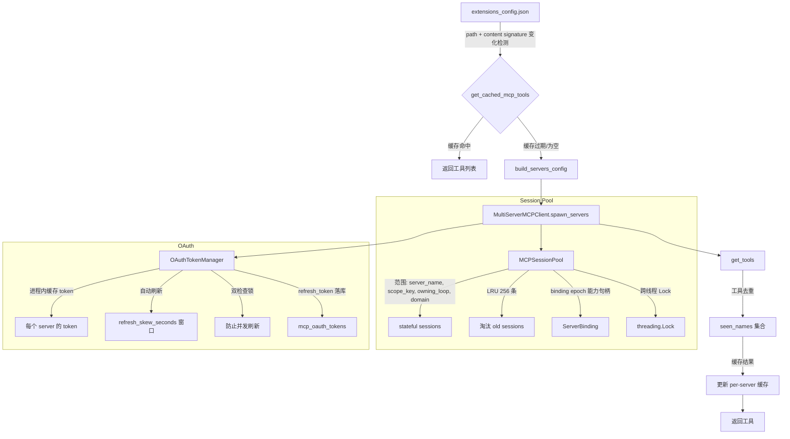
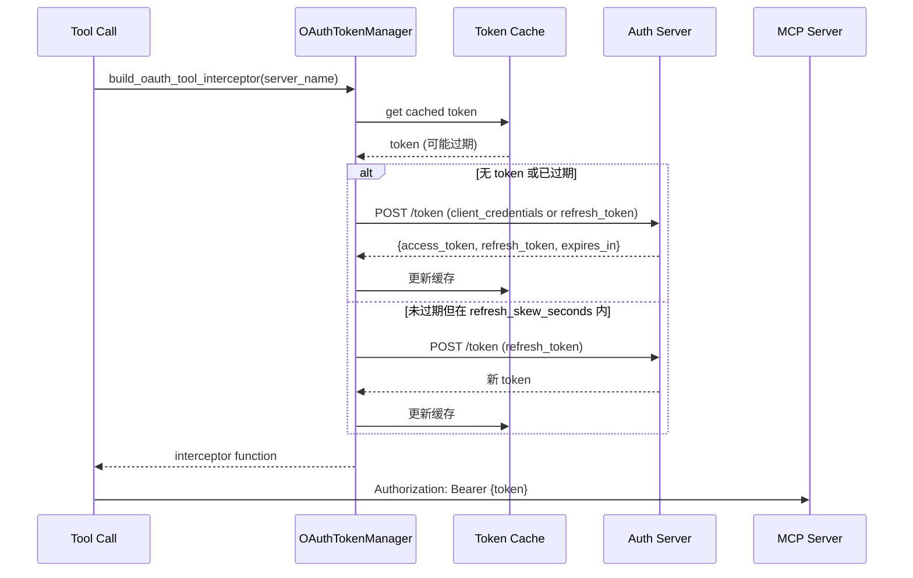

# MCP 深度解析 — Session Pool、OAuth、缓存

## 相关文件

- `deerflow/mcp/cache.py` (1407 行) — 惰性初始化、content-signature 缓存失效、跨循环初始化锁、选择性 reconciliation（2.2）
- `deerflow/mcp/oauth.py` (575 行) — OAuth TokenManager、双检查锁、header 注入 + 值合法性检查、`refresh_token` 落库（2.2）
- `deerflow/mcp/oauth_store.py` (261 行) 🆕 2.2 — refresh token 持久化读写、租约 + 版本 CAS、密钥不可用降级
- `deerflow/mcp/session_pool.py` (1062 行) — 持久会话池，按 `(server_name, scope_key, owning_loop, ownership_domain)` 键控、LRU 256 硬上限、binding epoch（2.2）
- `deerflow/mcp/lifecycle.py` (207 行) 🆕 2.2 — `mcpLifecycle` capability ledger：跨 worker 的 server 生命周期世代
- `deerflow/mcp/config_normalization.py` (46 行) 🆕 2.2 — server 配置归一化（`transport` 别名、task 配置瘦身）
- `deerflow/mcp/headers.py` (103 行) 🆕 同步#6 — 大小写不敏感 header 写入 + 非法 header 值检测（#5010、#5066）
- `deerflow/mcp/context_headers.py` (207 行) 🆕 同步#6 — `headers_from_context` 按请求凭据拦截器（#5010）
- `deerflow/mcp/client.py` (86 行) — 传输类型路由、服务器配置构建（静态 headers 同样过值检查；2.2 支持 stdio `cwd`）
- `deerflow/mcp/tools.py` (1498 行) — 通过 MultiServerMCPClient 加载工具、stdio 会话池包装、断线重连
- `deerflow/mcp_scope.py` (95 行) 🆕 2.2 — 会话作用域键 v2 编码（user/thread/incarnation），线程身份清理用
- `app/gateway/routers/mcp.py` (~1733 行) 🆕 同步#6 — MCP 管理面：Settings 页后端 API（#5022）；2.2 加 `mcpLifecycle` 提交与 drained 写
- `app/gateway/mcp_oauth_tokens.py` 🆕 2.2 — Gateway 侧安装/拆除 token store，配置写入后清理孤儿 token

## MCP 工具生命周期全景



## Session Pool (`session_pool.py`)

### 为什么需要持久会话

部分 MCP 服务器是**有状态的**：
- Playwright MCP 在工具调用之间维护浏览器状态
- 数据库 MCP 保持连接池

无会话池的情况下，每个请求都会创建/销毁 MCP 连接，丢失状态并产生不必要的开销。

### 设计

```python
class MCPSessionPool:
    MAX_SESSIONS = 256
    SESSION_CLOSE_TIMEOUT = 5.0
    # 每条目: (session, owning_loop, owner_task, close_event)，键含 ownership_domain
    _entries: dict[tuple[str, str, asyncio.AbstractEventLoop, MCPPoolDomain], ...]
    # in-flight 创建同样按 (server_name, scope_key, owning_loop, domain) 键控
```

🆕 同步#6 大改（+472 行）+ 2.2 所有权域后的键控与生命周期：

- **范围键带 owning loop 与所有权域** — registry 与 in-flight 创建都按 `(server_name, scope_key, owning_loop, ownership_domain)` 键控（2.1 只有前三元组）；`scope_key` 由 `deerflow/mcp_scope.py::mcp_session_scope_key` 生成，2.2 起通常是 `v2:[user, thread, incarnation]` 的紧凑 JSON，只有显式拿不到 incarnation 时才退回 `user_id:thread_id`。`ownership_domain` 取值 `"deployment"` / `"personal"`：**同名的部署连接与个人连接永不共享会话**，而 server/pair 级清理与断线驱逐只在自己域内生效；作用域级、线程身份级和全局清理则**故意跨域**。同循环调用者共享初始化与状态；活着的兄弟循环绝不因 server/scope 相同就取消或替换彼此的会话（#5396，把会话池按所属事件循环隔离，并移除了旧的 eviction 取消管道）。
- **LRU 256 硬上限，创建与 promotion 两次准入**（#4962）— 不同 key 可以在"看似还有余量"时并发完成初始化，所以除了创建前检查，in-flight 会话被提升（promotion）为 live 时也强制执行容量；被淘汰的 victim 由其所属 loop 上单独跟踪的 teardown task 信号并 drain，**新 owner 绝不 await victim**——victim 卡住的退出不会阻止新会话关闭或断线恢复。
- **`get_session` 取消时清理 in-flight owner**（#5008）— 调用方在驱逐/创建中途被取消时，in-flight owner 会被拆除，不留悬空的半初始化会话。
- **`close_all_sync()` / `close_scope(scope_key)` / `close_thread_scope()` / `close_session_if_current()`** — 跨循环优雅关闭、按线程清理、仅当注册表里的条目仍是那个失败的具体 `ClientSession` 时才驱逐（断线重连 #5018 的前提）。2.2 新增的 `close_thread_scope(user_id, thread_id)` 用 `mcp_scope_belongs_to_thread` 匹配该 user/thread 对的**每一个 incarnation**（线程删除方拿不到当前 incarnation，且新 incarnation 可能正在并发铸造），`close_scope` 留给已经持有精确 key 的调用者。
- **同步包装每次调用开新循环** — 并行同步调用拥有独立的子进程/server 状态；手动 loop owner 必须在 `loop.close()` 前 drain pending task（`asyncio.run()` 会自动 drain）。

### 会话作用域键（`mcp_scope.py`）🆕 2.2

```python
mcp_session_scope_key(*, user_id, thread_id, thread_incarnation=None) -> str
#  None  → 旧格式 "user_id:thread_id"（迁移前遗留，只用于显式保留的 legacy 行）
#  其它  → "v2:" + JSON 数组 [user_id, thread_id, incarnation]
```

- **三种上下文键**：`THREAD_INCARNATION_CONTEXT_KEY`（`thread_incarnation`，从 run context 读取）、`THREAD_INCARNATION_METADATA_GUARD_KEY`（`__deerflow_thread_incarnation_metadata_guard`）。
- **`is_valid_thread_incarnation()`** 做形状校验；`runtime_thread_incarnation(runtime)` 把 runtime 翻译成该 run 的 incarnation：runtime 为 `None` 时返回 `None`（走 legacy 作用域），runtime 存在但键缺失 → `RuntimeError`（fail closed），metadata guard 与当前 incarnation 不符也 → `RuntimeError`。
- **`mcp_scope_belongs_to_thread(scope_key, ...)`** 判断某个已存在的 scope 是否属于给定 user/thread；**故意不比较 incarnation**，legacy 分支按前缀比较 `user:thread`，因此在 `user:thread` 恰好是另一个 v2 键的前缀时会多关一些会话——这是有意的保守方向（关掉可重建的会话，而不是留下已删线程的会话）。
- 线程 incarnation 本身持久化在 `threads_meta.incarnation`（迁移 `0019_thread_incarnations`），MCP task 行同迁移加 `thread_incarnation` 列；细节见持久化域。

### Server binding 与选择性 reconciliation 🆕 2.2

2.1 的失效模型是"配置变了就整池退役"。2.2 把它拆成 **capability 句柄 + 世代号**，让未变化的 stdio 会话在热更新后继续服务：

- **`ServerBinding`**（`session_pool.py:78`，frozen/slots/`eq=False`）— 一次 discovery 从 `pool.ensure_binding(server_name, fingerprint, domain=...)` 拿到的不可伪造句柄，携带 `domain` / `server_name` / `epoch` / `fingerprint`（后三者 `repr=False`，不落日志）。后续每个 `get_session(..., binding=binding)` 与 `call_pooled_session_tool(..., binding=...)` 都把它交回池里比对**对象身份**，而不是比对 fingerprint。
- **`StaleMCPBindingError`**（`:106`）— 句柄已过期（池被 reset、server 被删除/改身份、或该 server 已参与 binding 生命周期但调用方没带句柄）。因为 fingerprint 相等无法区分"删除 A 再加回一模一样的 A"（ABA），一旦 server 进入 binding 生命周期，**不带句柄的旧调用者会被直接拒绝**；工具包装器把 `StaleMCPBindingError` 原样上抛，不降级重试。
- **`reconcile_bindings(active, removed, domain="deployment", retire_unlisted=..., force_rebind=...)`**（`:279`）— 只做"应用已经分类好的变更"：安装新 epoch、把变更 server 的 live 条目与 in-flight 创建从 registry 里摘下并信号关闭，全程**一个不 await 的临界区**，因此过期的创建者不可能在转换之后复活。`retire_unlisted` 让同一临界区顺带 tombstone 该域里池仍持有、但 `active` 未声明的 server（重启进程自己没有 applied baseline 时用）；`force_rebind` 处理"fingerprint 没变但共享生命周期版本变了"的 server（见下节 `mcpLifecycle`）。
- **`PreparedRetirement`**（`:88`）— 被摘下的 owner 在锁外由池的 detached-owner reaper 完成 `__aexit__`，因此配置写入路径不需要在持锁期间关闭任何阻塞资源。

### 共享生命周期账本 `mcpLifecycle` 🆕 2.2（`lifecycle.py`）

`extensions_config.json` 顶层新增 `mcpLifecycle` 块：`{"version": 1, "servers": {"<name>": "<32 位 hex token>"}}`（`LIFECYCLE_KEY` / `LIFECYCLE_VERSION`，token 形如 `_TOKEN_RE = [0-9a-f]{32}`）。

- **为什么需要**：跨 worker / 跨进程时，"删除 A、随后又加回一模一样的 A" 在最终文件上与"从未改动"逐字节无法区分，单靠 fingerprint 会让别的进程继续用旧会话、旧工具。账本把 server 的**生命周期世代**写进共享文件，任何读者都能看出发生过转换。
- **`plan_mcp_lifecycle(previous_raw, candidate_raw, *, candidate_config=None)`**（`:158`）— 只由配置写入方调用，返回要嵌入候选的完整账本；`previous_raw` 必须是**变更前**的 raw 快照且不得与候选别名。判定规则：server 的"槽位"是它的 enabled stdio fingerprint，**任何身份变化、删除、重加、全新名字都是一次生命周期转换**（换新 token）。previous 配置 schema 不可解析时按保守迁移处理（所有候选 stdio server 都拿新 token，tombstone 只沿用旧账本本身合法时的条目）；不可读 JSON 由调用方在进入本函数前中止。
- **`parse_mcp_lifecycle(raw)`**（`:95`）— 缺省返回 `None`；**存在但不合法**（`extra=forbid`，`InvalidMcpLifecycle`）抛异常。`effective_tokens(config, ledger)`（`:132`）把账本条目（含 tombstone）与该配置中尚无条目的 stdio server 的 legacy token（`sha256("mcp-lifecycle-legacy:v1:{name}:{fingerprint}")`）合并；`lifecycle_delta(previous, candidate, active_names)`（`:144`）给出必须强制重绑的 active server 名。
- **强制重绑的落点**：`cache.py::_plan_mcp_reconciliation_locked` 把 delta 作为 `force_rebind` 交给 `pool.reconcile_bindings`，只作用于 `deployment` 域——同名 personal binding 不受影响。


### Stdio 断线重连 🆕 同步#6（#5018）

普通 Agent 工具调用与 durable task 调用收到 MCP SDK 的显式 `Connection closed` 或 AnyIO closed-stream 错误时，只驱逐**注册条目仍是那个失败 `ClientSession`** 的 `(server_name, scope_key)` 会话——旧并发调用的迟到错误不能驱逐它的替代者或新的 in-flight 创建。失败的调用照常上抛原始错误、绝不自动重放；之后的重试创建全新子进程/会话。协议超时、正常 `isError=true` 工具结果、拦截器失败都**不**驱逐健康的有状态会话。

### 任务超时后保留 pooled stdio 会话 🆕 同步#6（#5027）

`McpTaskToolCaller` 的后台 stdio 路径不再"任何异常都 `close_session`"——超时的 status poll 不再把健康的持久会话（连同浏览器等服务器状态）整锅端掉。会话清理改由 `_invoke` 内部按错误类别决定：只有真正的传输断线（上面的 #5018 判定）才驱逐该 scope，普通超时/工具错误保留会话。

### 线程安全

`threading.Lock` 保护所有变更操作。此选择的原因：
1. 工具调用在 `asyncio.to_thread` 中运行（离开主事件循环）
2. MCP 客户端方法可能是同步的
3. 简单的 `asyncio.Lock` 会导致跨线程数据竞争

> 注：`threading.Lock` 守卫池内注册表；**缓存初始化的跨循环 `asyncio.Lock` 是另一个问题**，见 §缓存失效的 #5062。

## OAuth Token 管理 (`oauth.py`)

### 支持的授权类型

| 授权类型 | `grant_type` | 说明 |
|---------|-------------|------|
| `client_credentials` | `"client_credentials"` | 无需刷新 token |
| `refresh_token` | `"refresh_token"` | 初始 token + 自动刷新 |

### Token 生命周期



### 关键设计细节

- **refresh_skew_seconds** — 如果 token 在 skew 窗口内过期，主动刷新以避免竞态（`refresh_skew_seconds` 默认 60，2.2 起 `ge=0` 且拒绝布尔值）
- **进程内令牌用 `threading.Lock`** — 每个 server 一个 `_OAuthState`（`config` / `token` / `threading.Lock` / `store_key` / `fingerprint` / `request_fingerprint` / 未落库轮换状态）。**故意不是 `asyncio.Lock`**：嵌入式/TUI 的同步工具调用路径（`DeerFlowClient.stream()` → LangGraph `ToolNode._func` → `ThreadPoolExecutor` → `deerflow.tools.sync.make_sync_tool_wrapper` 的每次调用 `asyncio.run()`）会在全新事件循环、全新 OS 线程上调用 `get_authorization_header`；`asyncio.Lock` 绑定首个竞争的循环，跨循环释放/唤醒要么静默死锁要么抛 "bound to a different event loop"。锁本身在线程池里获取（`asyncio.to_thread`），避免阻塞事件循环。
- **`get_initial_oauth_headers()`** — 用于 MCP 连接设置，与 tool 调用授权分离；2.2 起接收 `token_manager=` / `server_names=`，**只为本次真正要连的 server 取 token**：被选中但配置非法的 server 不会被顺手打一次 token endpoint，单个 server 取 token 失败只记一条 warning 并跳过，不拖垮整轮 discovery。
- **值合法性检查** 🆕 同步#6（#5066）— 渲染后的 `<token_type> <access_token>` 整串过 `mcp/headers.py::illegal_header_value_reason`（这是 tool 拦截器、初始发现 headers、durable task 路径共用的唯一取值边界）；token endpoint 返回传输层会拒绝的值时 fail-closed，而不是让 h11 把完整 token 回显进模型可见的工具错误。operator 的静态 `headers` 在 `mcp/client.py::build_server_params` 做同样检查，`build_servers_config` 只丢弃该 server 并记日志。检查的是**渲染后的值**而非两个字段：`" abc"` 拼在 `Bearer ` 之后是合法 header，不该被拒。

### Token 持久化（`oauth_store.py` + `mcp_oauth_tokens`）🆕 2.2

2.1 之前 `refresh_token` 只活在进程内存里：重启即丢、多副本各自持有一条会互相作废的轮换链（多数 OAuth 服务把 refresh token 做成一次性轮换）。2.2 引入持久 store，**只持久化 `refresh_token` 授权**（`client_credentials` 从不入库，access token 每次现取）。

- **表与密钥**：`mcp_oauth_tokens`（迁移 `0047_mcp_oauth_tokens`），主键 `pk_mcp_oauth_tokens = (scope, owner_user_id, server_key)`——即 `McpOAuthTokenKey`（`scope ∈ {"deployment","personal"}`，`for_server(name, owner_user_id)` 生成）；列含 `config_fingerprint`、`access_token_enc`、`token_request_fingerprint`、`token_type`、`access_expires_at`、`refresh_token_enc`、`version`、`refresh_lease_owner`、`refresh_lease_until`、`rotated_at`、`updated_at`（时间列是 `Double` 的 epoch 秒，不是 `DateTime`）。密文用 `DEER_FLOW_CREDENTIALS_KEY` 派生的密钥；密钥不可用 → `McpOAuthTokenKeyUnavailable`（降级到进程内存），DB 不可用 → `McpOAuthTokenStoreUnavailable`（刷新失败而非静默用旧 token）。
- **两个指纹分工**：`oauth_config_fingerprint`（token_url、client_id、grant_type、scope、audience、refresh_token，**不含 client_secret**）标识"是不是同一条授权链"；`oauth_token_request_fingerprint` 标识"请求形态"，只有它相同的 peer token 才可被采纳。行上的 fingerprint 对不上 → 以配置里的种子 refresh token 为准，不沿用旧行。
- **租约 + 版本 CAS**：`REFRESH_LEASE_SECONDS = 30.0` / `REFRESH_MAX_SECONDS = 120.0` / `REFRESH_POLL_SECONDS = 0.2`。刷新前 `claim(key, expected_version=...)` 拿租约；等待方以 `REFRESH_MAX_SECONDS + REFRESH_LEASE_SECONDS` 为 deadline 轮询 `load`，行里已有未过期 access token 就直接用。拿到租约后起一个续租任务（每 `REFRESH_LEASE_SECONDS/3` 调 `renew`），HTTP 取 token 在 `asyncio.timeout(REFRESH_MAX_SECONDS)` 内完成——**任何阻塞调用都不在事件循环上、也绝不跨 HTTP 调用持行锁**。
- **轮换写回**：成功后在租约内 `save(...)`（带 `rotated=` 标记）并释放；DB 写失败则保留 `unsaved_base_version` 与 `_UNSAVED_ROTATION_RETRY_SECONDS = 5.0` 的重试窗口，本地继续用新 token，并在下次刷新前反复尝试把新 refresh token 落库——否则 peer 会用已被消费的旧 token 刷新。
- **`invalid_grant` 判定** — `_is_invalid_grant()` 要求 HTTP 400/401 **且** body 里 `error == "invalid_grant"`，抛 `McpOAuthReauthorizationRequired`（消息指向 `DEER_FLOW_CREDENTIALS_KEY` 与重新授权），这是 owner 可见的工具错误，不是重试。
- **安装与清理** — `app/gateway/mcp_oauth_tokens.py::mcp_oauth_token_persistence()` 在启动时把 store 装进 harness（`set_mcp_oauth_token_store`）并包住整个 runtime，**run drain 期间仍在位**；两个配置写入方（deployment 的 `_commit_mcp_config_write`、personal 的 `_mutate`）提交后调用 `forget_unconfigured_mcp_oauth_tokens(...)`：**被移除**的连接行删除，被**禁用**的保留（重新启用时还能用）。personal 侧同时清理 `personal_server_name_variants`（enabled True/False 两种 runtime 名）。
- **personal 连接的 manager 必须带 `owner_user_id`** — 未保存轮换、租约、行 key 全部按 owner 隔离；`from_extensions_config(..., shared_manager=...)` 只允许 durable runtime 在**验证过 deployment 快照**后使用，personal 连接永远走自己的 manager，即使 runtime 名撞车也不会共享 token。

## 缓存失效 (`cache.py`)

### 惰性初始化

`get_cached_mcp_tools()` 用**条件变量 + 世代号**而不是裸缓存变量（2.2 重写；旧的 `_cache` / `_cache_mtime` 双变量模型已删除）：

```python
_server_tool_cache: dict[str, _ServerToolCacheEntry] = {}   # per-server 已发布结果
_cache_initialized = False
_init_lock = threading.RLock()                              # 守卫所有状态转换
_init_condition = threading.Condition(_init_lock)
_initializing_generation: int | None = None                 # 谁在初始化、哪一代
_cache_generation = 0                                       # 失效即 +1
_applied_mcp_revision: _AppliedMcpRevision | None = None    # 已安装的 binding 基线
```

主循环 `while True:`：① 在 `_init_condition` 里跑一次 `_plan_mcp_reconciliation_locked()`，有 plan 就应用（**分类与应用在同一临界区**，2.1 时期的两段式已被取代）；② 已初始化则直接返回；③ 别人正在初始化则记下 `_initializing_generation` 并在锁外 `close_all_sync()` 送走退役池，再按该世代 `wait_for` 后重试；④ 否则自己做惰性初始化。

- **`get_event_loop()` 才允许回退 `asyncio.run`** — 只有"没有 loop / loop 已关闭"才 `asyncio.run(initialize_mcp_tools())`；loop 在跑但不在 async 上下文时走 `ThreadPoolExecutor` + 内层 `asyncio.run`，否则 `run_until_complete`。`initialize_mcp_tools()` **自己抛**的 `RuntimeError`（例如 `McpTaskConfigurationError`）只记一次 `logger.error("Failed to lazy-initialize MCP tools (%s)", type(exc).__name__)` 并返回空列表，绝不触发第二轮 discovery——否则会重新 spawn 所有 stdio 子进程、重新打 token endpoint。
- **错误日志只留异常类型** — 配置解析会先展开 `$VAR` 再校验，discovery 异常消息可能内嵌请求 URL/已解析凭据，所以这里（以及 `from_file()` 失败、`mcpLifecycle` 非法等分支）只记 `type(exc).__name__`，可诊断的细节由各分支自己以有界形式记录。

### 缓存失效检测 🆕 2.1 增强，2.2 扩展到 revision

`_plan_mcp_reconciliation_locked()` 比较 resolved config path、`(mtime, size, sha256)` content signature、**effective MCP 切片快照**、**已安装 revision 的 refresh 世代**和**共享 reset marker 签名**。2.1 引入的 content signature 解决了：

- 同秒编辑（same-second edits）
- mtime 不变或倒退（`git checkout`、`cp -p`、backup restore、`tar`/`rsync`、object-store/network mounts）
- 切换到不同 config file（mtime 相同或更旧）

`config/file_signature.py::get_config_signature()` 是共享 helper——`app_config.py::get_app_config()` 也用它做 runtime-editable config 的热重载检测。

### 选择性 reconciliation 🆕 2.2

每个 plan 都归为 `_RECONCILE_SELECTIVE` 或 `_RECONCILE_FULL`：

- **选择性**（`_apply_mcp_reconciliation_locked`，`cache.py:694`）— 计算 `_deployment_binding_delta(已应用 revision, 新 revision)`，把 active fingerprint 交给 `pool.reconcile_bindings(..., domain="deployment", retire_unlisted=..., force_rebind=...)` 安装新 epoch，**只摘除发生变化的 server**；然后 `_evict_server_tool_entries_locked(revision, pool)` **按新 epoch 逐个 server 判定复用**（`_binding_matches` 通过 `pool._binding_is_current` 比对句柄身份）。顺序很重要：`mcpLifecycle` 轮换保持 fingerprint 不变但替换 binding 对象，先装 epoch 再判复用才不会错留旧条目。整个过程同步完成，没有 await，最后 `_invalidate_published_tools_locked()`（清空的只是已发布的工具列表，**保留池单例与未受影响的 binding epoch**）。
- **保守全量**（`_RECONCILE_FULL`）— 无法证明差异可安全局部应用时（例如 revision 不可解释、reset marker 换代、池已被 fence），`_reset_mcp_tools_cache_state_and_retire_pool_locked()` 换池 + 清空全部缓存，调用方在锁外 `close_all_sync()`。
- **已提交转换**（`_plan_committed_mcp_reconciliation_locked`）— Gateway 写端在**已经落盘之后**用自己手里的候选调用它，因此**不再重读文件**：这正是"先删 A、再加回一模一样的 A"两个顺序写者各自安装一次转换、而不被合并成最终文件状态的原因。
- **提交后协调失败**（`fail_mcp_reconciliation`，`cache.py:859`）— 文件已提交但本地协调失败时只做保守退役并返回 `McpReconciliationPending`，调用方在释放配置锁后 `finish_mcp_reconciliation()`，并对客户端报"已保存但协调失败"的不确定结果而不是成功。
- **`retire_unlisted`** — 重启后的进程没有自己的 applied baseline，durable task 调用者的 binding 是"这个 server 存在过"的唯一记录，于是让 `reconcile_bindings` 在同一临界区按 `retained_server_names(domain=...)` 补全 removed 列表（否则单独枚举会与并发 `ensure_binding()` 竞争）。

### 跨循环初始化锁 🆕 同步#6（#5062），2.2 改为条件变量

初始化用的 `asyncio.Lock` 如果在 loop A 上创建、却在 loop B 上 await，会直接炸掉 MCP 缓存重建——这正是"Gateway API 热更新 MCP 配置后运行中 worker 重新初始化缓存"踩到的坑。2.2 把它换成**无循环亲和性**的 `threading.Condition` + `_initializing_generation`：异步路径用 `asyncio.to_thread(_wait_for_initialization, generation)` 等待，同步惰性路径直接 `wait_for`，等待者只会被"缓存已就绪"或"世代已推进"唤醒。若 `initialize_mcp_tools()` 在加载前后观察到 config-signature / reset marker 变化，丢弃分支走与会话池退役相同的路径重置工具缓存，避免被放弃连接的 `(server_name, scope_key)` 会话漏进下一次 wrapper 构建。`mcpLifecycle` **非法**时 discovery 直接中止并退役池（不是"当作没有账本继续"，否则会对无法证明身份的 server 复用会话）。

### 重置集成

- **`POST /api/mcp/cache/reset`**（`routers/mcp.py:1559`，`reset_mcp_tools_cache_endpoint`）→ `publish_mcp_tools_cache_reset()`（`cache.py:1378`）：**先**推进共享 reset marker `MCP_CACHE_RESET_MARKER = SharedResetMarker("mcp-cache-reset")`（落在 resolved config 旁，`.extensions_config.json.mcp-cache-reset.json`；marker/tracker 契约与 skills prompt-cache reset 共用 `deerflow.config.shared_reset_marker`），**再**退役本地池。返回 `generation`；`None` 表示没有可写的共享目录，响应 `scope="process"`，否则 `scope="shared_config"`。这样即使 `extensions_config.json` 逐字节未变（典型场景：远端 server 的 `tools/list` 变了），其他 worker 也会在下一次查缓存时读到 marker 换代并自行退役会话。
- **`reset_mcp_tools_cache()`** 仍用于测试与显式重载：`reset_session_pool()` 换掉单例后清空全部缓存状态；工具包装器闭包持有池单例，所以必须在 waiters 重建 wrapper 之前换单例。
- **`refresh_mcp_cache_if_active()`**（`cache.py:1268`）——工具装配在没有启用任何 MCP server 时**不会**走 `get_cached_mcp_tools()`，于是"把最后一个 server 禁掉"的变更会让旧池和持久会话活着。该入口只做失效检查、绝不惰性初始化：从未初始化过 MCP 的进程零成本直接返回；有缓存或有 in-flight discovery 的进程付一次 stat+sha256；in-flight 与观察到的 revision 不符则 bump 世代使其无法发布。
- 其他触发点：Gateway API 更新 MCP 配置、`DeerFlowClient.update_mcp_config()`、会话池关闭。

## 工具加载 (`tools.py`)

`get_mcp_tools(extensions_config=None, *, personal_user_id=None, session_pool=None)` 在 2.2 拆成明确的**准备阶段**和**发现阶段**（`_prepare_server_client` / `_discover_server_tools`，`_PreparedServerDiscovery` 打包这次 discovery 的 config、选中 server、connections、pool、bindings、ownership domain 与 connection scope）：

```
1. 归一化 server 配置（config_normalization.py）
2. 构建连接参数（client.py::build_server_params，传输类型路由 stdio/sse/http）
3. 逐 server 取 binding（pool.ensure_binding，带 domain）——句柄固定"我这一代"
4. 只为本次要连的 server 取 OAuth token（get_initial_oauth_headers(server_names=...)）
5. 构建拦截器，实例化 MultiServerMCPClient（per-server）
6. 调 load_mcp_tools（带 session=binding 派生的会话）→ 每个 server 一个 ServerDiscoveryResult
7. _flatten_server_tool_groups 按 enabled 声明顺序展平
```

- **`ServerDiscoveryResult`**（`tools.py:988`）区分"成功发现 0 个工具"（条目存在、`tools=()`）与"发现失败"（该 server 在分组映射里**缺席**），并携带产出该结果的 `pool` / `binding`——这两个字段 `repr=False`，因为它们是与凭据相邻的所有权句柄。
- **personal 连接与部署连接走同一条 discovery**，但 seq 3/4 的 domain、token manager 不同（`get_mcp_task_oauth_token_manager` 只给部署连接，personal 用带 `owner_user_id` 的独立 manager）。
- **`StaleMCPBindingError` 原样上抛**，不降级重试；配置写入路径会把它当作"这一代已经过期"处理。
- 所有 MCP 工具都包装为标准 LangChain `StructuredTool` 对象，与 DeerFlow 工具注册管道完全兼容。

## 传输类型

| 类型 | `type` 值 | 示例 |
|------|----------|------|
| **stdio** | `"stdio"` | 本地命令：`command: python`, `args: [-m, my_mcp]` |
| **SSE** | `"sse"` | 远程 SSE：`url: https://mcp.example.com/sse` |
| **HTTP** | `"http"` | 远程 HTTP：`url: https://mcp.example.com/mcp` |

- **OAuth 支持仅用于 `sse` 和 `http`**；`user_auth` 与 `headers_from_context` 同理，stdio 上声明会 warn-and-skip。
- **stdio 新增 `cwd`** 🆕 2.2（`McpServerConfig.cwd`，`client.py` 在非空时透传给 transport）——需要固定工作目录的 server（以及"把临时文件写进挂载树"的 Playwright 类场景）不必再靠外层包装脚本。
- **`personal_public_network`** 🆕 2.2 — personal 连接在 `http`/`sse` 上设为 `true` 时，`client.py` 为其装上 `personal_network.py::personal_httpx_client_factory`：解析并**钉住**已校验的公网 IP、按 origin 分池、显式 `sni_hostname`、`trust_env=False`（不让环境里的 `HTTP(S)_PROXY` 把请求改道到未校验目标）。
- **`transport` 别名的归一化** — `config_normalization.py` 丢弃历史 `transport` 字段别名，避免同一 server 出现两套传输声明；`task_runtime=True` 时还会剥掉纯展示字段（`description` / `routing` / `tools` / `tool_name_prefix`），让 durable task 侧只看到可执行配置。

---

## MCP Routing Hints 🆕

`extensions_config.json` 里的 `mcpServers.<server>.routing` 和 `tools.<name>.routing` 是软偏好元数据，不在 middleware 层硬禁用 tools：

- `routing.mode="prefer"` → 生成 `<mcp_routing_hints>` prompt 引导
- 当 tool 被 deferred 且有 routing metadata 时，`McpRoutingMiddleware` 自动提升匹配的 deferred schema（before model call）
- `tool_search.auto_promote_top_k`（默认 3，1-5）控制提升广度
- Routing hints 只在 `tool_search.enabled=true` 时生效

## Per-Server `tool_call_timeout` 🆕

每个 MCP server 独立超时配置：`mcpServers.<server>.tool_call_timeout`（秒）。覆盖全局默认值。

## Per-Server `tool_name_prefix` 🆕

**同步 #4（`feat: support per-server MCP tool name prefixes (#4624)`）**：`mcpServers.<server>.tool_name_prefix` 默认 `true`，保留碰撞安全的 `<server_name>_` 前缀。工具已自带稳定 namespace 的 server 可设 `false`；discovery 时按该 server 的 flag 调用 `load_mcp_tools`。来源路由（routing/session-pool 包装）基于生产 server 和 transport，不看可见工具名是否带 server 前缀。

## Auto-Promote Deferred MCP Tools 🆕

`McpRoutingMiddleware` 在每次 model call 前：
1. 匹配 latest `HumanMessage` 与 deferred MCP tool 的 routing keywords
2. 最多提升 `auto_promote_top_k` 个 matching schema
3. 写入 `ThreadState.promoted`（hash-scoped，per-run）
4. 永远不执行 tool，只做 schema promotion

---

## 请求级凭据映射为 MCP HTTP/SSE headers 🆕 同步#6（#5010）

`user_auth` 把凭据绑到**已配置**的 DeerFlow 用户；当凭据由调用方在请求时才决定（多租户网关、每次 run 换 API key）时，就得一个凭据一条 server 配置。新模块补上这个缺口：

### 配置（`McpContextHeadersConfig`）

```yaml
mcpServers:
  my_server:
    headers_from_context:
      enabled: true
      headers:
        Authorization: api_key        # header 名 → config.context.secrets 里的 key
      on_missing: deny                # deny（默认）| passthrough
```

配置里只存**名字**，不存凭据——凭据随 run request 的 `config.context.secrets` 带外到达，绝不进 prompt、工具参数或 trace。Gateway GET 不掩码这个块（没有敏感值），PUT 原样替换；块内 `extra="allow"` 的敏感 key 照常掩码并从存量恢复。

### 拦截器（`context_headers.py::build_context_headers_interceptor`）

- 只对 `sse`/`http` 生效；stdio 声明会 warn-and-skip（与 `user_auth` 一致——stdio 池把重写 header 当 call meta 转发，凭据无处可去）。
- 每次调用从 `request.runtime`（LangGraph 工具节点注入到名为 `runtime` 的参数）→ ambient `get_runtime()` 解析 run context，读 `config.context.secrets`。**不要**用 `langgraph.config.get_config()["context"]`：run context 挂在 runtime 上、不随 `RunnableConfig` 传给子 runnable，工具调用里那个 key 是 `None`。
- **fail-closed**：映射 key 缺失或解析为空 → `ToolException`，只暴露 key 名不暴露值；`on_missing: "passthrough"` 才回退。
- **凭据不能作为 HTTP header value 传输时一律拒绝** 🆕（#5066）：换行/首尾空白/非 ASCII（`headers.py::illegal_header_value_reason`）→ 无论 `on_missing` 都拒绝。原因：h11 拒绝换行/首尾空白时会把**完整值**放进异常消息，`ToolErrorHandlingMiddleware` 会把它复制进模型可见 ToolMessage——凭据就进了 prompt、checkpoint 和 trace；非 ASCII 在 httpx 里报 `UnicodeEncodeError`（只点名字符），提前拒绝买到的是可操作错误。
- **声明了 `task_toolsets` 的 server 会收到启动警告**：durable task 的 status/cancel poll 跑在 Agent run 结束之后、没有请求 secrets，走 server 自己的静态/OAuth 凭据；只有 submit（在 Agent run 内）带映射 headers。详见 [durable-tasks.md](durable-tasks.md) §4.2。

### 大小写不敏感 header 写入（`headers.py`）

HTTP 字段名大小写不敏感（RFC 9110 §5.1），但从配置到传输的每个字典都是大小写**敏感**的：`langchain_mcp_adapters` 用 `{**static, **override}` 平铺合并，静态 `authorization` 和注入的 `Authorization` 会共存上线，单值读取的 server 拿到**第一个**——恰好是本该被替换的静态条目，静默反转上面的优先级。所有凭据拦截器（OAuth、user_auth、context_headers）因此统一走 `apply_header_overrides`：按 `header_spellings` 钉住连接已有的拼写、删掉仅大小写不同的 key，`headers_from_context.headers` 在配置加载时还拒绝同一 header 的两种拼写。

### 拦截器优先级（`interceptors.py`）

注册顺序 **OAuth → user_auth → headers_from_context → 自定义 `mcpInterceptors`**，onion 组合下后注册者更靠近 transport，所以最终 header 优先级：静态 `headers` < `oauth` < `user_auth` < `headers_from_context`。

🆕 2.2：`mcpInterceptors` 的取值解释与 server 配置归一化都收进 `config_normalization.py`——`normalize_mcp_interceptor_paths(raw)`（裸字符串=一条路径、列表原样保序保重复、其它值=不选任何自定义拦截器）与 `normalize_mcp_server_config(server, *, task_runtime=False)`（丢 `transport` 别名；task 侧再丢 `description`/`routing`/`tools`/`tool_name_prefix` 四个纯展示字段）。原因是"工具缓存、自定义拦截器构建、durable-task 配置快照"三处必须对**何时两个配置等价**达成一致，规则只能有一份；`mcpInterceptors` 类型不是 str/list 时记一条 warning 并跳过。

---

## Settings 页管理 MCP servers 🆕 同步#6（#5022，`routers/mcp.py`）

MCP server 管理从"整包替换 config"升级为 Settings 页的逐 server CRUD。`app/gateway/routers/mcp.py`（prefix `/api`；本文件 v2.2.0 共 1733 行）提供（行号按 v2.2.0 实测，指向装饰器/函数 def）：

| 端点 | 源码 | 行为 |
|------|------|------|
| `GET /api/mcp/config` | `:1147` / `:1153` | 读配置，敏感值掩码后返回 |
| `POST /api/mcp/cache/reset` | `:1559` / `:1565` | 发布共享 reset marker + 退役本地缓存；响应 `scope: "shared_config" \| "process"` |
| `PUT /api/mcp/config` | `:1588` / `:1594` | 整包替换 server 配置（`McpConfigUpdateRequest`） |
| `POST /api/mcp/config/servers` | `:1647` / `:1653` | 批量新增 server，已存在同名则拒绝 |
| `PUT /api/mcp/config/server` | `:1669` / `:1675` | 更新单个 server 的完整配置 |
| `DELETE /api/mcp/config/servers/{server_name:path}` | `:1694` / `:1700` | 删除单个 server |
| `PATCH /api/mcp/config` | `:1715` / `:1721` | 只翻一个 server 的 `enabled` 位 |

要点：

- **写入走 raw read-modify-write**（与 skills toggle 共享 `read_raw_extensions_config` / `validate_raw_extensions_config` helper）：候选先按运行时加载方式校验，再原子写盘——`$ENV_VAR` 引用绝不会被解析值覆盖回文件（#5357 把这条规则收拢到一处，并删掉了不安全的 `to_file_dict()`）。
- **提交即安装 binding fence** 🆕 2.2（`_commit_mcp_config_write`，`:1228`）— 在**已持有 extensions-config 写锁与文件锁**的临界区内完成：校验候选 → `plan_mcp_lifecycle(previous_raw, raw_data, candidate_config=候选)` 写入账本 → **重新解析**（让 fence 看到刚写下的账本）→ `atomic_write_extensions_config` → `forget_unconfigured_mcp_oauth_tokens(None, candidate.mcp_servers.keys())` → `reload_extensions_config()` → `prepare_mcp_reconciliation(候选, config_path=...)`。`previous_raw` 是**必填**参数：受控写端不允许通过省略它来静默跳过世代推进。
- **每类拒绝都有自己的状态码** — 候选校验（`_validate_extensions_config_candidate`，`:1203`）同时做三件事：schema 校验（→ 400）、`ambiguous_installation_ids` 检查（重复 installation ID → 400）、`validate_mcp_task_config_snapshot`（会劈开工具发现与后台调用的热变更 → **409**）。
- **drained 写 + 不确定结果**（`_run_drained_mcp_apply`，`:1265`）— 走 `run_drained_write` / `await_drained`，客户端断开也不中断；协调失败（`_McpCommittedReconciliationError`，`:1222`）在释放配置锁后 `finish_mcp_reconciliation()`，然后返回 **500**（"已保存，但本地缓存协调失败，重试或重启后再依赖该 server"），绝不假装成功。
- **GET 掩码 / PUT 回程保真**：`user_auth.users` 的值、`env` 里的敏感变量等被 `_mask_server_config` 掩码；PUT 回来的掩码值通过 `_merge_preserving_secrets` 还原为存量凭据，而不是把 `***` 写进文件。**`capability` 块不可经编辑丢失**（`:1139`）— installation identity 属于 registry 而非可编辑的传输设置，老客户端省略它时一律从存量原样保留，否则会静默摘掉 Agent 的 capability 选择。
- **stdio 启动策略（HTTP 边界）**：API 注册的 stdio server 必须 (a) command 是裸允许名单可执行文件（`{npx, uvx}` + `DEER_FLOW_MCP_STDIO_COMMAND_ALLOWLIST`，拒路径分隔符/空白/shell 元字符）；(b) 无任意 exec 类 `args` flag（按 launcher 各自的 option grammar 精确界定，npx/uvx 只扫自己的 option 区）；(c) 不设置无条件执行代码的 `env` 名（`PYTHONPATH` 等；`LD_LIBRARY_PATH` 类条件搜索路径是声明接受的残余）。PUT 与 PATCH 的启用分支共用 `_validate_mcp_update_request`。这是纵深防御而非信任边界——`npx`/`uvx` 本来就会拉取执行远端包，边界仍是 admin 认证 + 网络可达性。
- **bundled 连接豁免** 🆕 2.2（`:800`）— 由内置 adapter 生成的 `is_bundled_connection(command, args, env)` 精确三元组直接跳过允许名单；但若 command 是**本进程的 `sys.executable` 而三元组不匹配**（升级换了解释器路径），返回 **400** 并给出应填的 `command` 原文，提示"保留 capability 元数据与凭据，不要删除重装"——否则用户会以"删了重装"的方式丢掉 Agent 选择。
- **缓存重置按 worker 收敛** 🆕 2.2 — 端点不再假定只有自己这一个 worker：reset 走 `publish_mcp_tools_cache_reset()`，其他 worker 在下次查缓存时通过 reset marker 换代（以及 content-signature）自行失效（见 §缓存失效）。

### 个人 MCP 连接 🆕 2.2（`mcp/user_config.py`、`user_tools.py`、`personal_access.py`、`personal_network.py`、`routers/personal_mcp.py`）

2.1 的 MCP 只有**部署级** `extensions_config.json`。2.2 允许每个用户在 Settings 里挂自己的连接，与部署连接共用同一套 discovery / 会话池 / 缓存纪律，但存储、作用域、网络策略分开。

- **存储**：`user_mcp_config_path(user_id)` = 用户根目录下的 integrations 子目录里的 `mcp.json`，schema 与 `mcpServers` 同形但**值按字面量使用**（`load_user_mcp_config`，不做 `$ENV` 展开），并强制 `tool_name_prefix: True`。
- **runtime 名**：`personal_server_name(user_id, name, configuration)` = `"personal_" + sha256([user_id, name, configuration])[:32]`，即名字编码了"谁、原叫什么、什么配置"——**改配置就换 runtime 名**，旧名字自然失效，不会与部署连接撞名。`personal_server_name_variants()` 给出 enabled True/False 两种变体，供吊销 token 时匹配。`PERSONAL_SERVER_PREFIX` 是识别前缀。
- **工具守卫**：`user_tools.py::get_user_mcp_tools()` 在**部署单例缓存之外**单独加载（personal 配置与部署配置永不同池同缓存），返回的每个工具都被 `_guard` 包一层：每次调用先用 `resolve_runtime_user_id` 确认仍是 owner（否则 `ToolException` "This MCP connection belongs to another user"），再按 (dev, ino, size, mtime_ns, ctime_ns) 签名重读该用户文件确认连接仍在且 enabled（否则 "was changed, disabled or removed; start a new run"），最后过 `require_personal_mcp_access`。加载失败只记 `type(exc).__name__`——personal 配置里可能有凭据。
- **与部署同名冲突**：Agent 装配时若部署名与 personal runtime 名相撞，**丢掉 personal 工具**并记 warning，不允许同名双工具；已提交的 durable personal task 仍按提交时记录的 personal scope 继续执行。
- **权限准入**：不带 `personal_public_network: true` 的连接属于特权连接，**每次** discovery 与每次工具/durable 调用都要现场管理员判定（`personal_access.py::require_personal_mcp_access`；Gateway 用 `app/gateway/personal_mcp_access.py` 把判定绑到数据库所在 loop，**从不缓存角色**）。判定缺失/失败一律拒绝；这是准入控制而非撤销已准入的操作。
- **网络策略**：非管理员（`personal_public_network` 标记被设为 `True`，即"普通用户保存的连接"）只允许 `http`/`sse`，或**不带 `cwd` 的内置 bundled stdio**，并且禁止 `oauth`——三条违规分别是 403 "Only an administrator may configure host commands or OAuth token endpoints" 与 400 "Personal MCP connections require a public HTTP(S) endpoint"（URL 必须过 `validate_public_http_url`）。管理员保存的连接带 `personal_public_network=True` 时，启动时走 `personal_network.py` 的钉 IP 客户端（见 §传输类型）：解析出的每个地址都过公网校验，TCP 钉到已校验 IP，并按**原始 origin** 分池（同名不同址不能复用到为别人认证过的连接），`follow_redirects=False` + `trust_env=False`。`requires_admin()` 只认显式 `personal_public_network is True`，缺省/旧文件一律按特权处理。
- **路由**：`app/gateway/routers/personal_mcp.py`（prefix `/api/mcp/personal/config`，`:28`）提供 `GET ""`（`:113`）、`POST /servers`（`:133`）、`PUT /server`（`:138`）、`PATCH ""`（`:143`）、`DELETE /servers/{server_name:path}`（`:148`），全部按当前登录用户操作自己的文件；`_mutate` 在 extensions-config 写锁 + 文件锁下原子写入并 `chmod 0o600`：create 时为新连接生成 `capability.id`（uuid4）并写 `personal_public_network = not admin`，update/启用时重算该标记，写盘后 `forget_unconfigured_mcp_oauth_tokens(user_id, personal_server_name_variants(...))` 清掉已移除连接的 token 行。**personal 文件不做 `$ENV` 展开**——里面都是调用者自己的字面量值。

---

## Parallel Search server（可选集成）🆕 同步#6（#5028、#5501）

`extensions_config.example.json` 新增默认关闭的 `parallel-search` 条目：`https://search.parallel.ai/mcp`（HTTP 传输），带前缀后模型可见 `parallel-search_web_search` / `parallel-search_web_fetch`。启用方式：复制条目到本地 `extensions_config.json` 的 `mcpServers` 并置 `"enabled": true`，重启生效。

- **匿名访问**：默认无需 API key；搜索调用会把 objectives/查询、fetch 会把 URL 与抽取目标发给 Parallel.ai（可能含会话内容），文档明确要求知情启用。
- **UA 标识**（#5501）：条目 `headers` 携带 `"User-Agent": "deer-flow"`——稳定的**项目级**身份，供 Parallel 度量聚合采用情况，不标识个人用户或安装；传输方式变化时应保留。可选的 `Authorization: $PARALLEL_AUTHORIZATION`（环境变量需含完整 `Bearer <key>`，DeerFlow 只展开整串 `$ENV_VAR`）用于更高限额，去掉它即回到匿名。
