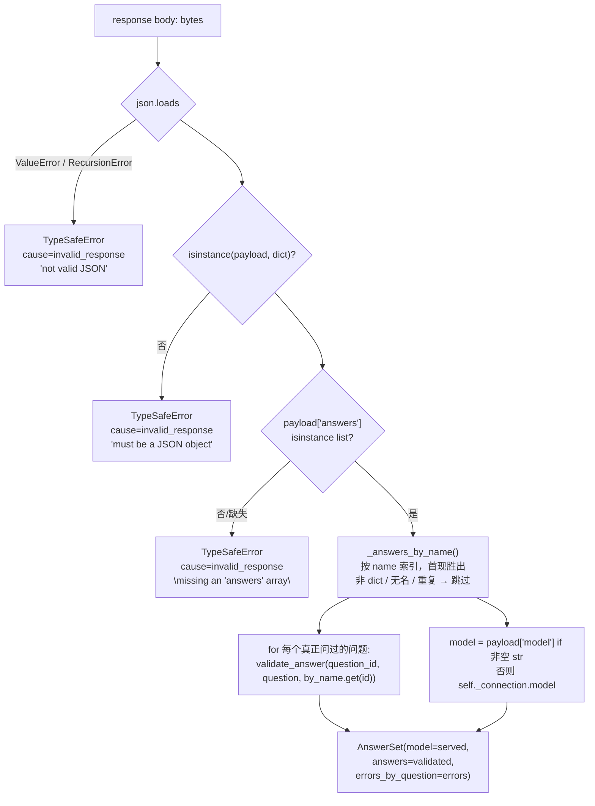
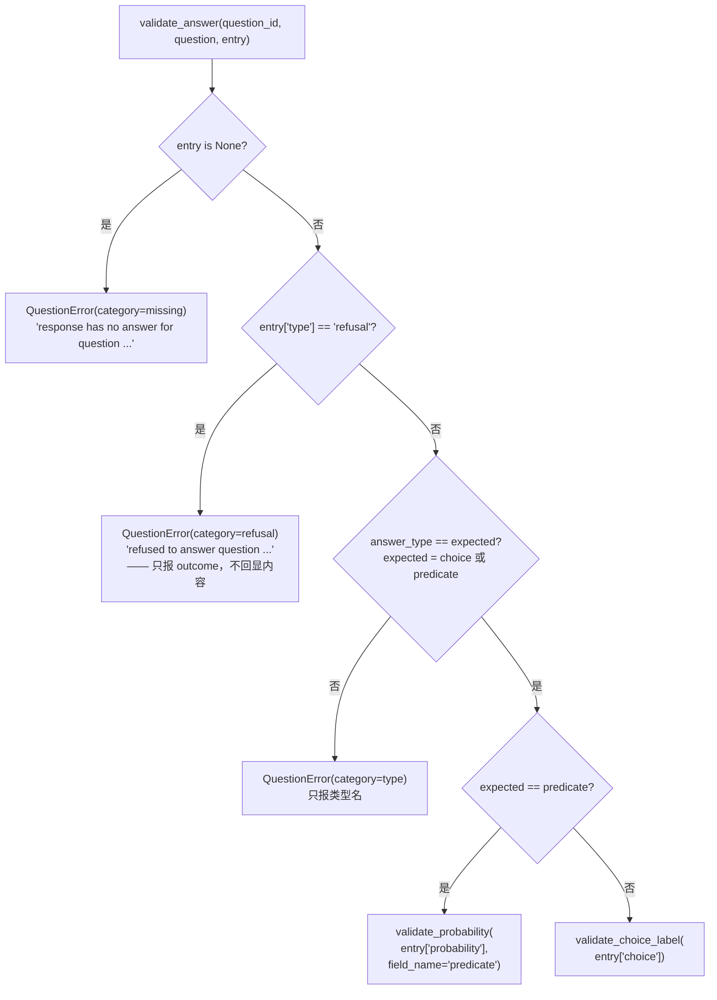
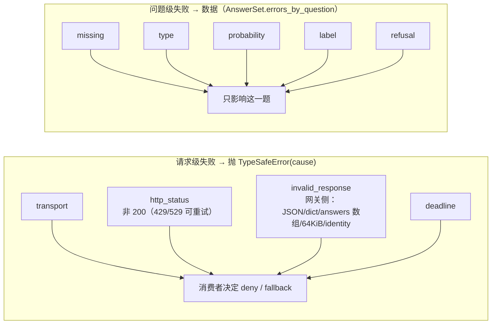

---


title: "OpenAI Decisions 线上契约 — 请求 envelope、问题编码与答案解析"
description: 'OpenAI Decisions 线上契约 — 请求 envelope、问题编码与答案解析：架构、契约与源码锚点。'
topics: [openai-decisions, typesafe, dialect, wire-protocol, decision-provider]
verified_against: v2.2.0
last_verified: 2026-11-08
---

# OpenAI Decisions 线上契约 — 请求 envelope、问题编码与答案解析

本页覆盖「**线上那一半**」：DeerFlow 发出去什么、怎么把类型化服务端的回复变成 `AnswerSet`。连接怎么解析、三个消费者各自怎么用答案，见 [02-connection-config.md](02-connection-config.md) 与 [03-three-consumers.md](03-three-consumers.md)。

→ Back to [索引](README.md)

## 相关文件

- `deerflow/openai_decisions/client.py`（222 行）— 本页唯一主角
- `deerflow/typesafe/client.py`（580 行）— 被继承的传输骨架（`ask` `:257-281`、`aask` `:283-307`、`_attempt_sync` `:321-362`、`_read_bounded` `:429-448`）与共享校验器（`validate_probability` `:499-520`、`validate_choice_label` `:526-538`）
- `deerflow/typesafe/errors.py`（58 行）— 四个 `cause`：`transport` / `http_status` / `invalid_response` / `deadline`
- `backend/tests/test_openai_decisions.py`（552 行）— 本页每条断言的离线证据；`TestRequestMapping` `:111-174`、`TestResponseMapping` `:214-309`、`TestEnvelopeFailures` `:311-349`

---

## 1. 请求 envelope：`_payload()`（`client.py:107-112`）

```python
# openai_decisions/client.py:107-112
def _payload(self, state: object, questions: Mapping[str, Question]) -> dict[str, object]:
    return {
        "model": self._connection.model,
        "input": state,
        "questions": [encode_question(question_id, question) for question_id, question in questions.items()],
    }
```

对照被覆写的父类骨架 `TypeSafeClient._payload`（`typesafe/client.py:309-314`）：

```python
# typesafe/client.py:309-314（Jev 侧，未改动）
return {
    "state": state,
    "model": self._connection.model,
    "questions": {question_id: {"type": ..., "instructions": ..., **({"criteria": ...} if question.criteria else {})}
                  for question_id, question in questions.items()},
}
```

四处结构性差异，每一处都在源码里有理由：

| # | 差异 | Jev (`/v1/systemone`) | Decisions (`/v1/decisions`) | 为什么这么设计 |
|---|------|------------------------|------------------------------|----------------|
| 1 | 被判定的值 | `state`：形状由消费者自定的映射 | `input`：**文本** | `client.py:20-23`："``input`` is the judged text, not a state object … nothing in this module knows what a tool call or a conversation batch is." 消费者用自己的 `_judge_state` 钩子决定同一件事 |
| 2 | 问题容器 | `dict`，键即问题 id | **`list`**，id 变成每个元素的 `name` 字段 | Decisions 的 question 对象自带 `name`（`client.py:153-159`），所以键必须搬进对象 |
| 3 | 问题顺序 | dict 插入序 | list 的**请求序** | `encode_question` 在列表推导里逐项调用，父类 `questions.items()` 的序被保留；`test_openai_decisions.py:168` 钉住 |
| 4 | criteria | 顶层 `criteria` 字段 | `choice` → `choices` 数组；`predicate` → **无字段，折进 `instructions`** | 见 §2 |

`model` 来自 `self._connection.model`，即 `resolve_decisions_connection` 解析出来的有效值——本 backend 没有默认值，所以这个键**永远是部署显式命名的模型**（见 [02 页](02-connection-config.md) §1）。

### 1.1 被判定的字节 = 审计摘要标识的字节

门的 dialect 把 `_state()` 从字典换成 `probe.state_text`（`guardrails/openai_decisions.py:67-68`），而 `state_text` 就是 `TypeSafeGuardrailProvider._prepare()` 里 `json.dumps(..., sort_keys=True, separators=(",", ":"))` 产出的那份 canonical JSON、也是被 `sha256` 摘要（`state_digest`）的那份（`guardrails/typesafe.py:324-330`）。

`test_openai_decisions.py:378-385` 用**手写的期望字符串**钉死这一点，而不是用被测代码再序列化一遍：

```python
# 测试里的期望值（test_openai_decisions.py:69）
_EXPECTED_GATE_INPUT = '{"tool_call":{"arguments":"{\\"command\\":\\"ls\\"}","name":"bash"}}'
# 断言（:378-385）：server.body["input"] == _EXPECTED_GATE_INPUT
#                   decision.metadata["state_digest"] == sha256(sent)[:16]
```

**为什么重要**：如果 dialect 在发出去之前重新序列化一次（换个 key 序、换个分隔符），判定覆盖的字节就和审计里记的摘要对不上了——两种不同的调用可以共享同一个 `state_digest`，或者反过来。这是"同一份字节，不是第二次序列化"（`guardrails/openai_decisions.py:12-13`）。

## 2. 问题编码：`encode_question()` 与 `predicate_instructions()`（`client.py:148-167`）

### 2.1 `choice` 问题：直接映射到 `choices`

```python
# openai_decisions/client.py:150-158
if question.type == QUESTION_CHOICE:
    return {
        "type": QUESTION_CHOICE,
        "name": question_id,
        "instructions": question.instructions,
        "choices": [{"value": label, "description": description}
                    for label, description in (question.criteria or {}).items()],
    }
```

`Question.criteria` 对 `choice` 问题是**必填且非空**的（`typesafe/client.py:143-151` 的 `__post_init__`），所以 `question.criteria or {}` 里的 `or {}` 在这里不可达——它只是让类型检查器安静。语义上这是唯一一处 `criteria` **原样**上了线：标签集合是"什么答案才算数"的定义，`instructions` 保持不动（`client.py:151-152` 注释："silently narrowing it would change what is judged"）。

> 未逐行核实：仓库内**没有任何生产代码构造 `choice` 问题**——三个适配器都只问 `noul`（guardrails / prescreen / signals 各自 `_questions`）。`choice` 分支目前只由 `test_openai_decisions.py:133-144` 覆盖。这一点在 [../typesafe/README.md](../typesafe/README.md) 的事实清单里也有记录。

### 2.2 `noul` 问题 → `predicate`：criteria 必须折进 instructions

```python
# openai_decisions/client.py:159
return {"type": QUESTION_PREDICATE, "name": question_id, "instructions": predicate_instructions(question)}

# openai_decisions/client.py:162-167
def predicate_instructions(question: Question) -> str:
    if not question.criteria:
        return question.instructions
    rubric = "".join(f"\nAnswer {label} when: {description}" for label, description in question.criteria.items())
    return f"{question.instructions}{rubric}"
```

`noul` 问题的 `criteria` 是一张 `{"true": ..., "false": ...}` 映射，说的是"什么时候该答 true、什么时候该答 false"。Decisions 的 `predicate` 问题**没有对应字段**。三种可能：

| 选项 | 后果 | 采了吗 |
|------|------|--------|
| 丢掉 criteria | 判定边界移动了，但 adapter 还在 `release_policy_parameters()` 里报告同一份 `criteria` → 策略身份欺骗 | ❌ |
| 报错拒绝这种 dialect | 三个适配器全部不可用（它们都带 criteria） | ❌ |
| **折进 `instructions` 文本** | 一个 predicate 问题保留一份完整 rubric | ✅ |

`client.py:24-28` 原文："Folding them into the instruction text keeps one rubric per question instead of silently dropping half of it, which would move the decision boundary while the adapter went on reporting the same `criteria` in its policy identity."

拼装格式是 `"\nAnswer {label} when: {description}"` 逐个追加——注意 `label` 取自 `criteria` 的键（生产里就是 `"true"` / `"false"`，见 `guardrails/typesafe.py:231-234` 的 `criteria = {"true": ...}`）。`test_openai_decisions.py:121-131` 钉住"细则确实随 `instructions` 出发"。

**为什么 `key` 不在 predicate 里**：predicate 的答案是一个概率，不是标签映射；把 `true`/`false` 的语义留在文本里、把数值判断留在共享的 `validate_probability` 里，两侧才有同一套数值规则（§3.3）。

## 3. 响应解析：`_parse()`（`client.py:114-145`）

### 3.1 三段结构：JSON → dict → `answers` 数组



三处细节都是有意为之：

1. **`RecursionError` 也在 `except` 里**（`client.py:119-122`）。深嵌套的 JSON 在 `json.loads` 里抛的是 `RecursionError` 而不是 `ValueError`；如果它逃出这套 taxonomy，消费者会以一个不相干的异常丢掉整轮的记录。注释原文："a hostile or broken endpoint must not escape as an unrelated exception, which the consumer would lose the round's record over."（这条规则由共享层先提出，`typesafe/AGENTS.md:32-33`；本 dialect 在自己的 `_parse` 里**又写了一遍**，因为 `_parse` 被覆写了。）
2. **`answers` 必须是数组**（`client.py:125-127`）。`test_openai_decisions.py:321-327` 用 `{"answers": {"q": {...}}}`（合法 JSON、合法映射）验证它被拒绝——不会因为"看起来像"就被当成裁决。
3. **`body` 的大小与编码不由本模块管**。`_parse` 收到的 `bytes` 已经过共享层的 `_read_bounded()`：`Accept-Encoding: identity`（`typesafe/client.py:82`）、拒绝非 identity `Content-Encoding`（`typesafe/client.py:456-462`）、超过 `MAX_RESPONSE_BYTES = 64 * 1024`（`typesafe/client.py:76`）就抛。`test_openai_decisions.py:329-349` 在**这个 dialect** 上重新验了这两条——因为"一份被复制的传输层得把这些性质重新挣一遍"（测试文件 docstring `:12-14`）。

### 3.2 `_answers_by_name()`：数组没有唯一键（`client.py:170-185`）

```python
# openai_decisions/client.py:170-185
by_name: dict[str, dict[object, object]] = {}
for entry in raw_answers:
    if not isinstance(entry, dict):
        continue
    name = entry.get("name")
    if isinstance(name, str) and name not in by_name:
        by_name[name] = entry
return by_name
```

三条规则，对应三种"数组才有、映射不可能有"的情况：

| 情况 | 处理 | 理由（源码） | 测试 |
|------|------|--------------|------|
| 同名答案出现两次 | **先出现的胜出** | "which of two conflicting answers a consumer would act on must not depend on how a server orders them"（`client.py:172-174`） | `test_openai_decisions.py:286-293`（0.2 与 0.9，取 0.2） |
| 答案没有可用 `name` | 静默跳过 | "Answers without a usable name … are ignored rather than reported"（`client.py:174-176`） | 未单独覆盖 |
| 答案的 `name` 没人问过 | 静默跳过 | 同上；共享契约是"只有真正问过的问题出现在结果里" | `test_openai_decisions.py:295-301` |

第三条与 Jev 侧完全同构：`AnswerSet` 的 docstring 写着 "Only the questions actually asked appear in either — an answer for a question this request never asked is ignored, not reported."（`typesafe/client.py:186-196`）。这一点在**混合 backend 共用一个 gateway** 时尤其重要：同一台网关可能回给你没问的问题，不能被当成裁决。

### 3.3 `validate_answer()`：复用共享校验器（`client.py:188-206`）



关键点：

- **`refusal` 是答案，不是 HTTP 失败**。`client.py:30-33` 原文："A refusal is an *answer* on this endpoint (`{"type": "refusal"}`), not an HTTP failure. It therefore becomes a question-level `QuestionError` — the same channel a malformed answer uses — so the gate denies for want of a verdict while the memory paths carry on, which is each consumer's existing policy rather than a new branch." `CATEGORY_REFUSAL` 定义在 `client.py:65`，并**直接传进** `QuestionError(category=...)`——共享层的 `QuestionError` docstring 列出的合法 category 是 `missing` / `type` / `probability` / `label` / `refusal`（`typesafe/client.py:172-184`），即共享层已经为 dialect 预留了这个值。
- **refusal 的内容一个字都不回显**（`client.py:194-196`）。一个 refusal 对象是**响应内容**，端点可以让它携带任意文本；`message` 只写 outcome。这和共享层"错误消息不含响应体"的纪律一致（`typesafe/errors.py:33-47`）。
- **数值规则只有一份**：`validate_probability()`（`typesafe/client.py:499-520`）拒绝 `bool`（`bool` 是 `int` 子类，`True` 会被当成 1.0）、JSON 字符串（`"0.9"`）、`NaN` / `Infinity`、超出 `[0, 1]`、以及大到 `float()` 溢出的整数（`OverflowError` 被换算成问题级错误，不让它丢掉同一响应里的其他答案）。`test_openai_decisions.py:253-269` 用五种字面量逐条钉住："这个 dialect 也吃同一套数值规则"。
- **`field_name="predicate"`** 只影响错误消息里的名词（"returned a non-numeric predicate probability"），不改变规则。

### 3.4 `model`：回声优先，缺省用请求里命名的那个（`client.py:130-135`）

```python
# openai_decisions/client.py:130-135
model = payload.get("model")
served = model if isinstance(model, str) and model else self._connection.model
```

| 服务端 | 记录的值 | 理由 |
|--------|----------|------|
| 回显了非空字符串 | 回声值 | 那是真正服务的版本，审计要记它（`test_openai_decisions.py:361` 断言 `model=served-1.2` 出现在拒绝理由里） |
| 没回显 / 回显空串 / 回显非字符串 | `self._connection.model`（本次请求**自己**命名的模型） | "provenance is still needed for the audit trail, and unlike a value the endpoint returned it cannot have been chosen to be echoed into a log."（`client.py:131-133`） |

这条与 Jev 侧相反：`typesafe/client.py` 的 `_parse` 要求 `model` **必填且非空**（digest 的记忆里记为 `:389-391`，`AnswerSet.model` 为必填），缺了就是 `invalid_response`。`test_openai_decisions.py:223-230` 钉住 Decisions 这里的放宽是有意的。

后续消费方还会再过一道 `recordable_model()`（`typesafe/client.py:112`）：符合 `[A-Za-z0-9][A-Za-z0-9._:+-]{0,63}` 的原样保留，否则换成 `unrecorded:sha256:<前16位>`——这是"服务端可控的短字符串进入日志"的统一策略。

## 4. 信封级 vs 问题级：两层失败的分界线



| 失败 | 谁的代码 | 后果 | 证据 |
|------|----------|------|------|
| JSON 不可解析 / 深嵌套 | `OpenAIDecisionsClient._parse`（`client.py:116-122`） | 请求级 `invalid_response` | `test_openai_decisions.py` 的 `TestEnvelopeFailures` |
| 顶层不是对象 | 同上（`client.py:123-124`） | 请求级 | — |
| 没有 `answers` 数组 | 同上（`client.py:125-127`） | 请求级 | `:321-327` |
| body 超 64 KiB / 非 identity 编码 | 共享层 `_read_bounded`（`typesafe/client.py:429-483`） | 请求级 | `:329-349` |
| 非 200 | 共享层 `_status_error`（`typesafe/client.py:364-375`） | 请求级；429/529 进重试 | `:312-319` |
| 某一题缺答案 | `validate_answer`（`client.py:190-191`） | 问题级 `missing` | `:303-309` |
| 某一题答案类型不对 | `client.py:198-203` | 问题级 `type` | `:272-277` |
| 某一题概率非法 | 共享 `validate_probability` | 问题级 `probability` | `:242-258` |
| 某一题 refusal | `client.py:193-196` | 问题级 `refusal` | `:232-240` |

`client.py:114-145` 的 `_parse` **从不**为某一题抛异常：循环里 `error is not None` 就塞进 `errors_by_question`，否则塞进 `answers`，最后统一构造 `AnswerSet`（`client.py:137-145`）。`test_openai_decisions.py:242-258` 用"一好一坏"两个答案验证好的那个仍然存活——这是 `typesafe/AGENTS.md:22-27` 那条"问题级失败是**数据**，不是异常"在第二 dialect 上的复核。

> 未逐行核实：服务端是否会在响应里给出 `type` 以外的形状（例如 `{"probability": ...}` 但没有 `type`）——`validate_answer` 会把缺失的 `type`（`None`）判为 `type` 不匹配并报错，但这只是 DeerFlow 的防御，不代表服务端的真实行为。仓库内没有服务端协议文档或真实响应样本。

## 5. 读这一页最容易搞错的四件事

1. **`questions` 是数组，`answers` 也是数组**。Jev 两侧都是映射；把 Decisions 的响应按 `dict[name]` 取答案会直接拿到 `list` 的索引语义。
2. **`input` 不是 `state`**。任何想"给 Decisions 也传结构化 state"的改动都必须先回答：审计摘要还对不对得上（§1.1）。
3. **`refusal` 不是错误**。它走 `errors_by_question`，所以 memory 侧把它当"这一题没意见"，门把它当"没有裁决"——同一个值，相反后果（见 [03 页](03-three-consumers.md) §2）。
4. **`_parse` 覆写了 `except (ValueError, RecursionError)`**。共享层自己有一份同样的处理，但 `_parse` 是**被替换的**方法——覆写者必须自己重新接住，否则深嵌套响应会以 `RecursionError` 逃出 taxonomy。

## 6. 事实清单（编译期核对）

| 事实 | 位置 |
|------|------|
| 常量 `QUESTION_PREDICATE = "predicate"` / `QUESTION_CHOICE = "choice"` | `client.py:60-61` |
| 常量 `ANSWER_TYPE_REFUSAL = "refusal"` / `CATEGORY_REFUSAL = "refusal"` | `client.py:64-65` |
| `encode_question` 对 `choice` 输出 `choices[].value/.description` | `client.py:157` |
| rubric 拼接串 `"\nAnswer {label} when: {description}"` | `client.py:166` |
| `_answers_by_name` 只需一次遍历，复杂度 O(n)，无重复键检查的二次断言 | `client.py:178-185` |
| `_parse` 对每个问过的问题**恒定调用一次** `validate_answer`（即使 `by_name` 里没有） | `client.py:139-144` |
| `AnswerSet` 由共享 dataclass 构造，字段名 `model` / `answers` / `errors_by_question` | `typesafe/client.py:186-196` |
| 测试里手写的期望 `input` 字符串 | `test_openai_decisions.py:69` |
| 测试套件全程 `httpx.MockTransport`，无网络 | `test_openai_decisions.py:18`、`:83-85` |
