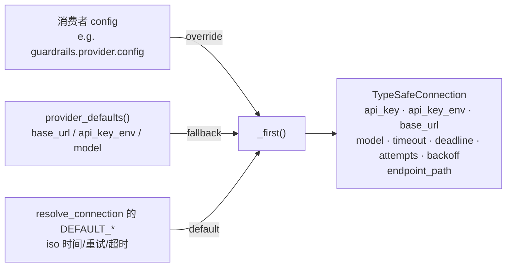

# OpenAI Decisions 连接解析与配置键

本页覆盖「**连接与服务身份**」：去哪儿、用什么模型、哪个环境变量拿 key、三层配置怎么叠。线上报文见 [01-wire-contract.md](01-wire-contract.md)；三个消费者怎么用这个连接见 [03-three-consumers.md](03-three-consumers.md)。

→ Back to [索引](README.md)

## 相关文件

- `deerflow/openai_decisions/client.py:55-93` — 常量 + `provider_defaults()` + `resolve_decisions_connection()`
- `deerflow/typesafe/connection.py`（294 行）— `TypeSafeConnection`（`:73-108`）、`resolve_connection()`（`:111-170`）、`_resolve_credential()`（`:230-249`）、`_validated_base_url()`（`:252-`）
- `deerflow/config/typesafe_config.py`（67 行）— 顶层 `typesafe:` 块的 pydantic 模型（`TypeSafeConfig`，`model_config = ConfigDict(strict=True)`）
- `config.example.yaml:3328-3344`（Option 4b 注释）、`2379-2413`（memory 两个槽位注释）、`3372-3380`（顶层 `typesafe:` 注释）

---

## 1. `provider_defaults()`：为什么 `model` 是空字符串（`client.py:68-76`）

```python
# openai_decisions/client.py:55-57
DEFAULT_BASE_URL = "https://api.openai.com"
DEFAULT_API_KEY_ENV = "OPENAI_API_KEY"
ENDPOINT_PATH = "/v1/decisions"

# openai_decisions/client.py:68-76
def provider_defaults() -> dict[str, object]:
    return {"base_url": DEFAULT_BASE_URL, "api_key_env": DEFAULT_API_KEY_ENV, "model": ""}
```

对照 Jev 侧 `typesafe/connection.py:43-49` 的默认值：`https://api.typesafe.ai` / `TYPESAFE_API_KEY` / `jev-latest` / timeout 5.0 / deadline 10.0 / attempts 2 / backoff 0.5。本 backend **只替换前三个里的两个**：

| 键 | Jev 内置默认 | Decisions 内置默认 | 说明 |
|----|--------------|--------------------|------|
| `base_url` | `https://api.typesafe.ai` | `https://api.openai.com` | 换服务 |
| `api_key_env` | `TYPESAFE_API_KEY` | `OPENAI_API_KEY` | 换服务；**复用模型 key 的同一个变量**（[../../getting-started/05-environment.md](../../getting-started/05-environment.md) 有记录） |
| `model` | `jev-latest` | **`""`（空）** | 故意不可用 |
| `timeout` / `deadline_seconds` / `max_attempts` / `retry_backoff` | 5.0 / 10.0 / 2 / 0.5 | **同一个值** | 因为它们不是 `provider_defaults()` 的键，而由 `resolve_connection` 自己的 `DEFAULT_*` 兜底 |

`model` 留空的理由写在 `client.py:71-75`：

> "Which decision model answers is an operator choice with a cost and a data-handling implication, and a checked-in default would send conversation and tool text to a model nobody selected. The resolver rejects a blank model at construction, so a deployment naming this backend has to name a model too."

两段机制叠起来才成立：

1. 空串**不**被 `_configured()` 当作"未配置"丢掉——`_configured` 只过滤 `value is not None`（`typesafe/connection.py:196-201`），所以 `""` 会作为一层真实的 `model` 值进入 `_first()`。
2. `resolve_connection` 拒绝空白 model：`if not isinstance(model, str) or not model.strip(): raise ValueError(f"{provider_label} model must be a non-empty string")`。

所以 **`model: ""` 是一个"必须被覆盖的默认值"**，不是"回落到别处"。`test_openai_decisions.py:198-201` 钉住：只给 `api_key` 不给 `model` → `ValueError: model must be a non-empty string`。

### 1.1 一个与原意不完全一致的后果（operator override 的优先级）

`resolve_decisions_connection` 把 `provider_defaults()` 合进的是 `defaults` 层，而不是 `settings` 层：

```python
# openai_decisions/client.py:87-93
return resolve_connection(
    settings=settings,
    defaults={**provider_defaults(), **(defaults or {})},
    configuration_source=configuration_source,
    endpoint_path=ENDPOINT_PATH,
    provider_label="OpenAI Decisions",
)
```

`defaults` 参数在调用链里来自各适配器的 `self.configuration_source` / `CONFIGURATION_SOURCE`——但**三个适配器都没有显式传 `defaults`**（`guardrails/openai_decisions.py:61-62`、`prescreen/openai_decisions.py:42-43`、`signals/openai_decisions.py:36-37`），所以线上 `defaults` 就是 `provider_defaults()` 本身，`**(defaults or {})` 为空。`test_openai_decisions.py:203-211` 用 `model="local-decisions"` 走的是 `settings` 层，覆盖成立。

真正的优先级由 `resolve_connection` 决定（`typesafe/connection.py:216-224` 的 `_first`）：

```text
_first(override, fallback, key, default):
    key in override   → override[key]      # 消费者 config
    key in fallback   → fallback[key]      # defaults 层 = provider_defaults()
    否则               → default            # resolve_connection 自己的 DEFAULT_*
```

> 未逐行核实（重要）：如果**将来**有人给 `resolve_decisions_connection(defaults=...)` 传入非空的 `defaults`（例如各 adapter 改成传 `typesafe_defaults()` 的顶层块），那么 `defaults` 会与 `provider_defaults()` 做**字典合并**，而按 Python 语义、按 docstring 字面（`client.py:84-85` "``defaults`` is layered *over* the provider's own defaults"）是**传入的 defaults 覆盖 provider 默认值**——也就是说一个在顶层 `typesafe:` 块里写了 `model: jev-latest` 的部署，会让 Decisions 侧的"必须显式命名模型"约束被顶层块的值填上。目前没有任何适配器走这条路径，所以这只是潜在的边界，不是当前行为。

## 2. `endpoint_path`：一个 owner 同时管端点和服务名（`client.py:79-93`）

```python
# openai_decisions/client.py:79-93
def resolve_decisions_connection(*, settings=None, defaults=None, configuration_source) -> TypeSafeConnection:
    """Resolve a connection that speaks this endpoint, or raise at construction."""
    return resolve_connection(
        settings=settings,
        defaults={**provider_defaults(), **(defaults or {})},
        configuration_source=configuration_source,
        endpoint_path=ENDPOINT_PATH,
        provider_label="OpenAI Decisions",
    )
```

docstring 里那句是这套设计的核心（`client.py:82-85`）：

> "One owner pairs the provider's defaults with its request path: a "Decisions" connection resolved without `ENDPOINT_PATH` would post to the other service's URL, and nothing but a live request would say so."

机制链：

1. `TypeSafeConnection.endpoint_path: str = ENDPOINT_PATH` 是 dataclass 字段（`typesafe/connection.py:73-88`），注释写着 "It belongs to the *dialect*, not the operator"。
2. `url` 是计算属性：`f"{self.base_url.rstrip('/')}{self.endpoint_path}"`（`typesafe/connection.py:90-92`）。
3. `resolve_connection` 在**构造期**校验 `endpoint_path` 必须以 `/` 开头（`typesafe/connection.py:135-136`），避免变成一个每次请求才冒出来的 URL 错误。
4. `public_parameters()` 把 `endpoint_path` 也放进去（`typesafe/connection.py:98-108`），于是它同时进入 `sharing_key()`（`typesafe/client.py:234-254`）与每个消费者的 `release_policy_parameters()`。
5. `provider_label` 进 `resolve_connection`，用于**构造期**诊断：缺凭据的报错就是 `f"{provider_label} requires an API key: pass 'api_key' in {configuration_source} or set the {api_key_env} environment variable"`（`typesafe/connection.py:143-145`）。

`test_openai_decisions.py:179-187` 的参数化用例确认构造错误里出现的是**被配置的那个服务名**，`:189-196` 确认 `client.connection.url == f"{DEFAULT_BASE_URL}{ENDPOINT_PATH}"`。

**为什么端点必须由解析方绑死**：`base_url` 是运维可配的，而 `endpoint_path` 不是。一个 operator 能把 `base_url` 指向自建网关（`test_openai_decisions.py:203-211` 就是这么干的：`http://127.0.0.1:8000` + `/v1/decisions`），但永远无法让一个 Decisions 连接悄悄走 `/v1/systemone`。

## 3. 凭据：三层、按层解析、一个待核实的兜底

### 3.1 三层数据源



`_configured()`（`typesafe/connection.py:196-201`）只保留 `CONNECTION_FIELDS` 里的键（`:56-66`）且丢弃 `None`：其他键（例如适配器自己的 `threshold`、`mode`）在这一层就被过滤掉，永远不会进连接。**显式的空串不会被丢弃**——这正是 §1 那个"必须被覆盖的默认"能生效的原因。

### 3.2 `api_key_env` 的三层优先级与一个环境变量兜底

```python
# typesafe/connection.py:138-145（节选，按行号顺序整理）
api_key_env = _first(override, fallback, "api_key_env", DEFAULT_API_KEY_ENV)
api_key = _resolve_credential(override, fallback, api_key_env)
```

`_resolve_credential`（`typesafe/connection.py:230-249`）的规则是**按层**的：第一个设置了 `api_key` 或 `api_key_env` 的层决定凭据；层内 literal `api_key` 赢过该层的 `api_key_env`。

对 Decisions 来说 `override` 是消费者 config、`fallback` 是 `provider_defaults()`，而后者**总是**带 `api_key_env: "OPENAI_API_KEY"`。于是：

| 消费者 config | 实际查的环境变量 | 依据 |
|---------------|------------------|------|
| `api_key: "sk-..."` | 不查，直接用 literal | `_resolve_credential` 层内 `api_key` 优先 |
| `api_key_env: MY_KEY` | `MY_KEY` | override 层命中 |
| 什么都没写 | `OPENAI_API_KEY` | fallback 层命中（`provider_defaults()`） |

**待核实的一处**：`_resolve_credential` 的最后一行为 `return os.environ.get(default_env)`，而 `default_env` 是 `_first(override, fallback, "api_key_env", DEFAULT_API_KEY_ENV)` 的返回值。按代码字面，在"两层都没设凭据键"时它读的是**解析出来的 `api_key_env`**，而不是 `typesafe/connection.py:44` 那个模块常量 `DEFAULT_API_KEY_ENV`。对 Decisions 而言两者恰好相同（fallback 层总带 `OPENAI_API_KEY`），但 `_resolve_credential` 的 docstring（`:236-247`）描述的是"built-in `TYPESAFE_API_KEY` is consulted only when no layer names a credential"。**本页不下结论说实现有 bug**——只标注：这行的 `default_env` 由调用方传 `api_key_env` 进来（`connection.py:141`），与 docstring 的措辞可能存在偏差，未逐行核实其意图。

### 3.3 构造期校验清单

`resolve_connection` 在**构造时**就失败，而不是在第一次请求时（`typesafe/connection.py:111-170`）：

| 检查 | 失败形态 |
|------|----------|
| `endpoint_path` 必须以 `/` 开头 | `ValueError` |
| `api_key_env` 必须非空串 | `ValueError` |
| 凭据必须非空 | `ValueError`，消息里点名 `provider_label` 与 `configuration_source` |
| 凭据 shape（`credential_text`，`typesafe/validation.py:56-72`）——不能带首尾空白，每个字符必须在可打印 ASCII `0x20..0x7E` 内（内部空格是合法 header 值，放行，见其 docstring） | `ValueError`（消息里不含凭据值） |
| `base_url` 必须 `http(s)`、无 query / fragment / 内嵌凭据 | `ValueError`（`_validated_base_url`，`typesafe/connection.py:252-`） |
| `model` 必须非空 | `ValueError: OpenAI Decisions model must be a non-empty string` |
| `timeout` / `deadline_seconds` > 0 的有限值 | `ValueError`（`finite_float`） |
| `max_attempts` ≥ 1 的整数（`true` 不算 1） | `ValueError`（`whole_number`） |
| `retry_backoff` ≥ 0 的有限值 | `ValueError` |

顶层 `typesafe:` 块用 `ConfigDict(strict=True)`（`config/typesafe_config.py:33`）再加一层：`max_attempts: true` 在 strict 模式下直接被拒，不会像 lax 模式那样静默变成 `1`——这正是 `TypeSafeConfig` docstring 里解释的动机（让两种拼写对同一个值达成一致）。

## 4. `__init__.py` 的导出缺口

```python
# openai_decisions/__init__.py:19-31
from deerflow.openai_decisions.client import (
    ANSWER_TYPE_REFUSAL, CATEGORY_REFUSAL, DEFAULT_API_KEY_ENV, DEFAULT_BASE_URL,
    ENDPOINT_PATH, QUESTION_CHOICE, QUESTION_PREDICATE,
    OpenAIDecisionsClient, encode_question, predicate_instructions, provider_defaults,
)

# openai_decisions/__init__.py:33-45
__all__ = [..., "resolve_decisions_connection"]
```

`resolve_decisions_connection` 与 `validate_answer` / `_answers_by_name` 一样**没有**进入 re-export 的 import 列表：

| 名字 | 在 `client.py` 的 `__all__`（`client.py:209-222`） | 在 `__init__.py` 的 import | 在 `__init__.py` 的 `__all__` | 因此能否直接从包里 import |
|------|--------------------------------------------------|---------------------------|-------------------------------|------------------------------------------------|
| `resolve_decisions_connection` | ✅ | ❌ | ✅ | **导入失败**（`__all__` 里列了一个不在命名空间的名字） |
| `validate_answer` | ❌ | ❌ | ❌ | 只能从 `client` 子模块取 |
| `OpenAIDecisionsClient` 等其余 10 个 | ✅ | ✅ | ✅ | 正常 |

实际影响**为零**：全仓的生产代码一律从 `deerflow.openai_decisions.client` 直接 import 这两个符号（三个适配器都是 `from deerflow.openai_decisions.client import OpenAIDecisionsClient, resolve_decisions_connection`），测试也一样（`test_openai_decisions.py:38-50`）。但 `from deerflow.openai_decisions import *` 或包级 `getattr(__init__, name)` 会因为 `__all__` 里这个名字而报 `AttributeError`。**记录为已知导出缺口，不改源码。**

## 5. 配置键在哪：没有 `openai_decisions:` section

| 要配的东西 | 写在哪 | 谁读 |
|------------|--------|------|
| guardrail 用 Decisions | `guardrails.provider.use: deerflow.guardrails.openai_decisions:OpenAIDecisionsGuardrailProvider` | `ToolErrorHandlingMiddleware` 的 `resolve_variable(use)` → `cls(**config)`（`tool_error_handling_middleware.py:474-489`） |
| memory pre-screen 用 Decisions | `memory.prescreen.use: deerflow.agents.memory.prescreen.openai_decisions:OpenAIDecisionsMemoryPrescreen` | `resolve_memory_prescreen()`（`prescreen/contract.py:97-125`） |
| signal classification 用 Decisions | `memory.signal_classification.use: deerflow.agents.memory.signals.openai_decisions:OpenAIDecisionsSignalClassifier` | 对应的 `resolve_memory_signal_classifier()` |
| 连接字段（`api_key` / `api_key_env` / `base_url` / `model` / `timeout` / `deadline_seconds` / `max_attempts` / `retry_backoff`） | 消费者自己的 `config:` 块 | `_configured()` 过滤后交给 `resolve_connection` |
| 共享兜底 | 顶层 `typesafe:` | ⚠️ **Decisions 目前不读这个块**——三个适配器都没把 `typesafe_defaults()` 当 `defaults` 传进去（§1.1） |

`config.example.yaml` 里**只有 guardrail** 一个槽位写了 Decisions 变体（`3328-3344`，注释标题 "Option 4b"）：

```yaml
# config.example.yaml:3334-3344
# guardrails:
#   enabled: true
#   fail_closed: true
#   provider:
#     use: deerflow.guardrails.openai_decisions:OpenAIDecisionsGuardrailProvider
#     config:
#       model: <name the decision model this deployment uses>   # required: this
#           # backend ships no default model, so batches cannot go to a model nobody chose
#       api_key_env: OPENAI_API_KEY        # default; base_url defaults to https://api.openai.com
#       threshold: 0.5
#       tools: ["bash"]
```

memory 两个槽位的注释块（`2379-2413`）**只写了 `typesafe:` 变体**的 `use` 路径；要换 Decisions 就按 `prescreen/openai_decisions.py:14-24` 与 `signals/openai_decisions.py:8-18` 的 docstring 示例改 `use:` 并加 `config.model`。这是**文档缺口**，不是行为缺口。

### 5.1 三个 `configuration_source` 字符串

缺凭据的报错会点名"该改哪个块"，靠的是这个字符串：

| 调用方 | 值 | 位置 |
|--------|-----|------|
| guardrail dialect | `guardrails.provider.config` | `guardrails/typesafe.py:77` 的 `_CONFIGURATION_SOURCE`，经 `guardrails/openai_decisions.py:62` 传入 |
| pre-screen dialect | `memory.prescreen.config` | `prescreen/contract.py:37` |
| signal dialect | `memory.signal_classification.config` | `signals/contract.py:43` |

## 6. 热重载边界：endpoint 不在判定的签名里

memory 两个槽位是**热重载**的：`get_memory_manager()` 在配置变化时重建并重新注入 judge（`manager.py:1065-1099`，docstring 见 `manager.py:555-562`）。它的变化检测签名来自 `_judging_config_signature()`：

```python
# manager.py:1049-1062（节选）
connection = resolve_connection_for_mode(mode=slot.mode, settings=slot.config, defaults=defaults, configuration_source=source)
signature[name] = None if connection is None else {**connection.public_parameters(), "credential": connection.credential_fingerprint()}
```

它调用的是**共享层**的 `resolve_connection_for_mode`，而不是 `resolve_decisions_connection`。`public_parameters()` 里因此是**默认的** `/v1/systemone`，而不是 `/v1/decisions`。

实际后果：

| 场景 | 结果 |
|------|------|
| 改 `memory.prescreen.config` 的 `model` / `base_url` / 凭据 | 签名变 → judge 重建 ✅ |
| 只把 `use:` 从 `...prescreen.typesafe:...` 换成 `...prescreen.openai_decisions:...`，连接字段一字不改 | 签名**不变** → judge **不**重建（沿用旧 judge） ⚠️ |

⚠️ 那一行是**从代码推出来的**：`_judging_config_signature` 的两个输入 `(mode, slot.config)` 里没有 `use`，也没有 `endpoint_path`。**未逐行核实**重启后的行为差异与是否需要重启才能生效——保守做法是改 `use:` 之后重启 Gateway。这一点与 [../typesafe/README.md](../typesafe/README.md) 记录的"invalidating signature 覆盖每个 enabled side 的已解析连接身份"存在张力：那个"身份"取自共享层解析，不含 dialect 的端点。

## 7. 事实清单（编译期核对）

| 事实 | 位置 |
|------|------|
| `DEFAULT_BASE_URL` / `DEFAULT_API_KEY_ENV` / `ENDPOINT_PATH` | `client.py:55-57` |
| `provider_defaults()` 只返回三个键，`model` 为 `""` | `client.py:76` |
| `resolve_decisions_connection` 共 15 行（含签名、docstring、return） | `client.py:79-93` |
| Jev 侧 `CONNECTION_FIELDS` 共 8 个 | `typesafe/connection.py:56-66` |
| 顶层 `typesafe:` 只在这些字段上生效，且 strict 校验 | `config/typesafe_config.py:33-42` |
| 生产代码里 `resolve_decisions_connection` 的 3 个调用点 | `guardrails/openai_decisions.py:62`、`prescreen/openai_decisions.py:43`、`signals/openai_decisions.py:37` |
| 三个调用点都**没有**传 `defaults=` | 同上，全部只有 `settings=` 与 `configuration_source=` |
| `tools` / `allowed_tools` 等不是连接字段，止步于 `_configured()` | `typesafe/connection.py:196-201` |
