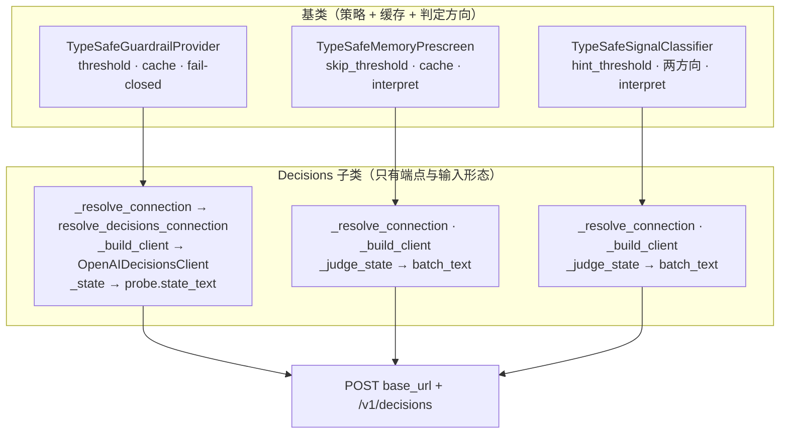
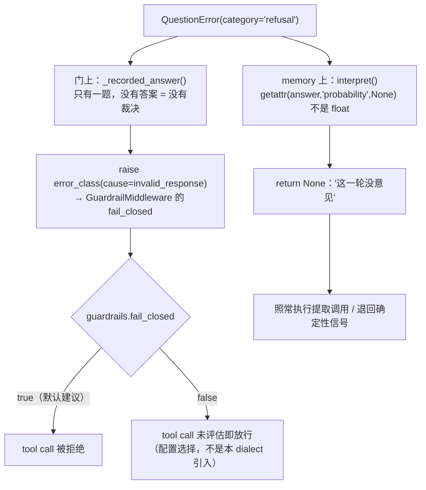
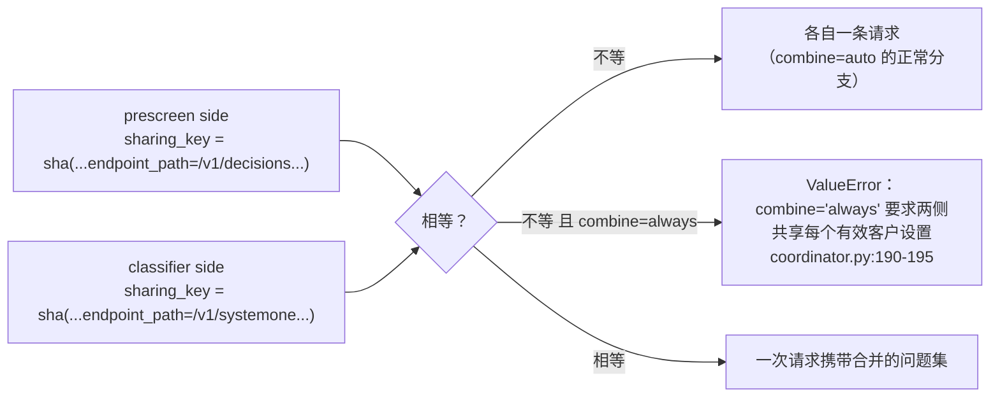

# OpenAI Decisions 的三个消费者与失败策略

本页覆盖「**谁在用、失败往哪走**」。线上报文见 [01-wire-contract.md](01-wire-contract.md)；连接与配置见 [02-connection-config.md](02-connection-config.md)。

→ Back to [索引](README.md)

## 相关文件

| 文件 | 行数 | 角色 |
|------|------|------|
| `deerflow/guardrails/openai_decisions.py` | 71 | `OpenAIDecisionsGuardrailProvider`（`:46`）+ `OpenAIDecisionsGuardrailError`（`:38`） |
| `deerflow/agents/memory/prescreen/openai_decisions.py` | 58 | `OpenAIDecisionsMemoryPrescreen`（`:35`） |
| `deerflow/agents/memory/signals/openai_decisions.py` | 47 | `OpenAIDecisionsSignalClassifier`（`:29`） |
| `deerflow/guardrails/typesafe.py` | 464 | 门基类：`evaluate` `:243-249`、`_prepare` `:295-339`、`_recorded_answer` `:275-288`、`_cache_get` `:380`、`release_policy_parameters` `:218-241` |
| `deerflow/agents/memory/prescreen/typesafe.py` | 195 | 预筛基类：`decide` `:173`、`interpret` `:143-155`、`sharing_key` `:138-140` |
| `deerflow/agents/memory/signals/typesafe.py` | 258 | 信号基类：`decide` `:184`、`sharing_key` `:140-142` |
| `deerflow/agents/memory/signals/coordinator.py` | — | 合并请求的编排：`_configuration_matches` `:212-216`、`_judge_combined` `:297-340`、`_decide_prescreen` `:279-288` |
| `deerflow/typesafe/client.py` | 580 | `sharing_key` `:234-254` |

---

## 1. 三个适配器并排：同一个 dialect，三种业务

| 维度 | 工具风险门 | memory 预筛 | memory 信号 |
|------|-----------|------------|------------|
| 类（Decisions 版） | `OpenAIDecisionsGuardrailProvider`（`guardrails/openai_decisions.py:46`） | `OpenAIDecisionsMemoryPrescreen`（`prescreen/openai_decisions.py:35`） | `OpenAIDecisionsSignalClassifier`（`signals/openai_decisions.py:29`） |
| 基类 | `TypeSafeGuardrailProvider` | `TypeSafeMemoryPrescreen` | `TypeSafeSignalClassifier` |
| `name` | `"openai_decisions"`（`:54`） | `"openai_decisions"`（`:38`） | `"openai_decisions"`（`:32`） |
| `policy_id` | `deerflow.guardrails.openai_decisions`（`:55`） | `deerflow.memory.prescreen.openai_decisions`（`:39`） | `deerflow.memory.signals.openai_decisions`（`:33`） |
| `policy_version` | `1.0.0`（`:56`） | `1.0.0`（`:40`） | `1.0.0`（`:34`） |
| 问题数量 | 1（`risky_tool_call`） | 1（`memory_worth_keeping`） | 2（`memory_affirmation` / `memory_negation`） |
| 判定的输入 | `probe.state_text`（canonical JSON） | 批次文本原样 | 批次文本原样 |
| 一次网络往返 | 每次未被缓存的门评估 | 每批（可能与环境侧合并） | 每批（可能合并） |
| 失败方向 | **fail-closed**：异常 / refusal → 拒绝 | **fail-soft**：照常提取 | **fail-soft**：退回确定性信号 |

### 1.1 覆写的 seam



三个文件的方法体几乎一模一样，唯一实质差异在门的 `_state()`：

```python
# guardrails/openai_decisions.py:67-68 —— 返回文本
def _state(self, probe: _Probe) -> str:
    return probe.state_text
```

```python
# guardrails/typesafe.py:290-291 —— Jev 侧返回映射
def _state(self, probe: _Probe) -> dict[str, object]:
    return {"tool_call": {"name": probe.tool_name, "arguments": probe.arguments_text}}
```

`_Probe.state_text` 就是那份被 `state_digest` 摘要的 canonical JSON（`guardrails/typesafe.py:324-330`）。门的 docstring 解释了为什么是"同一份字节"而不是"重新序列化一遍"（`guardrails/openai_decisions.py:12-13`）："the judged bytes are the canonical JSON the state digest already identifies — the same bytes, not a second serialisation of them." [01 页](01-wire-contract.md) §1.1 有测试证据。

memory 两边的 `_judge_state()` 都只是 `return batch_text`（`prescreen/openai_decisions.py:48-55`、`signals/openai_decisions.py:42-44`），而 Jev 侧返回 `conversation_tail_state(batch_text)`（`prescreen/typesafe.py:124-126`）。但**被判定的文本相同**：两边都拿到 `format_conversation_for_update` 的输出、都被同一个 `max_state_chars` 字符数约束（`prescreen/openai_decisions.py:49-54` 的 docstring）。

## 2. 同一个 refusal，相反的后果



| | 工具门 | memory 预筛 | memory 信号 |
|---|---|---|---|
| 代码 | `guardrails/typesafe.py:275-288` | `prescreen/typesafe.py:143-155` | `signals/typesafe.py` 的 `interpret` |
| refusal 之后 | `raise self.error_class` | `return None` | `return None`（该方向缺席，另一方向继续） |
| 测试 | `test_openai_decisions.py:387-396`（断言 `cause == invalid_response`、消息含 "refused to answer"） | `test_openai_decisions.py:432-435`（`decide(...) is None`） | `test_openai_decisions.py:437-450`（两个方向同一响应，只拒答一个，另一个仍产出标签） |

**这就是 `client.py:30-33` 说的"不是新分支"**：dialect 只把 refusal 塞进已经存在的 `errors_by_question` 通道，两侧的后果由**既有**的失败策略决定。

> 注意：门的 `_recorded_answer` 抛的是 `self.error_class`，对本 dialect 就是 `OpenAIDecisionsGuardrailError`（`guardrails/openai_decisions.py:38-43`）。它是 `TypeSafeGuardrailError` 的子类，因此中间件那套 `guardrails.fail_closed` 映射一字不动地适用——只换名字，让日志/拒绝理由不会把裁决归给错的服务。`test_openai_decisions.py:398-402` 用 503 验证这条族关系。

### 2.1 门的本地预检仍先于网络

`TypeSafeGuardrailProvider._prepare()`（`guardrails/typesafe.py:295-339`）在**任何请求之前**决定三件事：`allowed_tools` 权限表、`tools` 探测范围、strict-JSON 序列化 + `max_state_chars` 字符上限。Decisions 子类没有覆写它，所以：

- 超限调用被**本地**拒绝，`server.requests == []`（`test_openai_decisions.py:404-414`，错误码 `openai_decisions.state_unusable`）。
- `allowed_tools` 表外工具同样在本地拒，不发请求（逻辑在基类，本 dialect 不另测）。
- 拒绝理由的 code 前缀来自 `code_prefix = "openai_decisions"`（`guardrails/openai_decisions.py:57`），基类 `_code()` 拼成 `openai_decisions.<suffix>`（`guardrails/typesafe.py:208-209`）：测试里出现 `openai_decisions.tool_call_risky` / `.allowed` / `.state_unusable`（`test_openai_decisions.py:367,376,410`）。

## 3. `sharing_key`：Decisions 与 Jev 永远不会合并成一个请求

### 3.1 机制：endpoint_path 进了公开参数

```text
TypeSafeClient.sharing_key(**dimensions)          # typesafe/client.py:234-254
  ← connection.public_parameters()                # 含 endpoint_path，typesafe/connection.py:98-108
  ← credential_fingerprint()                      # sha256 前 16 位，永不含明文
  ← dimension 参数（消费者补的 max_state_chars / cache_size / cache_ttl_seconds）
```

`typesafe/AGENTS.md:59-63` 的成文理由："The endpoint path is included in `public_parameters()` and therefore in both the sharing key and public policy identity: different dialects behind one gateway cannot share a combined memory request. Matching endpoints may still combine when the other settings match."

### 3.2 编排侧怎么用这个 key

`MemorySignalCoordinator`（`signals/coordinator.py`）有两套路径：

| 路径 | 触发 | 行为 | 代码 |
|------|------|------|------|
| 单侧 | 只有一侧 enabled，或两侧不可合并 | 各自 `side.decide(request)`，各自一条请求 | `:279-295` |
| 合并 | `_both_combinable()` 且 `combine != never` 且 `_configuration_matches()` | 一次请求携带双方的问题，答案按 digest 分桶 | `:297-340` |

`_configuration_matches()`（`coordinator.py:212-216`）比较的正是两侧的 `_sharing_key()`，而 `_sharing_key()` 把连接参数（含 `endpoint_path`）都算进去（`coordinator.py:207-209`）。



`combine: always` + 混合 backend 是**部署错误**，会在构造时报错而不是静默降级（`coordinator.py:190-195` 的错误消息列了要一致的全部维度）。

### 3.3 测试钉住的四条

| 断言 | 测试 | 含义 |
|------|------|------|
| 两个 backend 永不共享合并请求 | `test_openai_decisions.py:452-461` | 混合 `use:` 时 `_configuration_matches()` 为假 |
| 混合 backend 各自保留请求与裁决（参数化 `combine` × 两侧类型 × 路径） | `:500-530` | 每个 backend 的请求打到各自的 path |
| 同一 backend 仍然合并 | `:532-541` | 两个 Decisions 侧（或两个 Jev 侧）路径相同时，一次请求里出现 3 个问题名 |
| 从槽位 `use:` 解析无需 schema 变更 | `:463-471` | `resolve_memory_prescreen(use="deerflow.agents.memory.prescreen.openai_decisions:OpenAIDecisionsMemoryPrescreen", ...)` 得到 `provider.name == "openai_decisions"`、`policy_id == "deerflow.memory.prescreen.openai_decisions"` |

第三条的细节值得注意：合并请求里问题名的读取方式**因 dialect 而异**——Jev 侧是 `set(questions)`（dict 的键），Decisions 侧是 `{question["name"] for question in questions}`（list 元素的字段）。`test_openai_decisions.py:536-540` 自己在测试代码里做了这个分支，印证了 [01 页](01-wire-contract.md) §1 的容器差异。

## 4. 缓存与策略身份：谁拥有什么

| 项 | 归属 | Decisions 侧表现 |
|----|------|------------------|
| 工具门的答案缓存 | `TypeSafeGuardrailProvider`（`cache_size` 256 / `cache_ttl` 300 默认） | 继承；缓存键只看 `probe.state_digest`，不看 dialect |
| memory 合并请求的答案桶 | `MemorySignalCoordinator`（`combine` 生效时） | 继承；桶键含 `sharing_key` |
| memory 单侧缓存 | 各侧基类（`AnswerCache`） | 继承 |
| 公开策略身份 `release_policy_parameters()` | 各基类；内容 = `public_parameters()` + 消费者自己的阈值/评分/上限/缓存参数 | 继承；因此 `policy_id` 里既有 `openai_decisions` 字样，也有 `endpoint_path: "/v1/decisions"` |
| 审计记录 | 门的 `_model_decision` / 预筛的 `MemoryPrescreenDecision` | 继承；`model` 经 `recordable_model()` 归一（[01 页](01-wire-contract.md) §3.4） |

**dialect 不新增任何一项**：`typesafe/AGENTS.md:67-68` 原文 "A dialect adds no threshold, no rubric and no failure policy: the three adapters override their connection resolution, their client and the value the endpoint judges (`input` text instead of a `state` object), and inherit the rest."

## 5. 边界：这个子系统**不**做什么

| 不做 | 证据 |
|------|------|
| 不新增配置 schema / YAML section | 新增 commit 的 16 个文件里没有 schema 文件；配置只走 `use:` + 既有 `config:` |
| 不做预筛的"值不值得提取"判断 | 那是 `prescreen/typesafe.py` 的 `interpret`（`:143-155`） |
| 不做 hint 标签映射 | 那是 `signals/typesafe.py` 的 `interpret` |
| 不做权限判定（`allowed_tools`） | `guardrails/typesafe.py:295-339` 的 `_prepare` |
| 不做重试 / 超时 / body 限流 | `typesafe/client.py` 的 `ask` `:257-281` / `aask` `:283-307` |
| 不碰 Gateway HTTP 面 | `backend/app/` 全仓零引用 `deerflow.openai_decisions` |
| 不参与能力目录 | Decisions 不在 `builtin.json`，不是可安装能力（[../capabilities/README.md](../capabilities/README.md)） |
| 不与 capabilities / 插件系统交互 | 无交叉 import |

## 6. 事实清单（编译期核对）

| 事实 | 位置 |
|------|------|
| 三个 Decisions 适配器合计 176 行（71 + 58 + 47） | `wc -l` |
| 三个子类都**没有**覆写 `decide` / `evaluate` / `interpret` / `release_policy_parameters` / `sharing_key` | 各文件全文 |
| 预筛默认 `skip_threshold = 0.2`、`max_state_chars = 6000` | `prescreen/typesafe.py:47-48` |
| 信号默认 `hint_threshold = 0.5` | `signals/typesafe.py:43` |
| 门默认 `threshold = 0.5`、`max_state_chars = 4000`、`cache_size = 256`、`cache_ttl_seconds = 300` | `guardrails/typesafe.py:161,170-172` |
| 门上 `probability >= threshold` 才拒（`allow = probability < threshold`） | `guardrails/typesafe.py:351-353` |
| 预筛 `p < skip_threshold` 跳过 | `prescreen/typesafe.py:143-155` |
| `TypeSafeError` 在 coordinator 里被捕获并记成 `request_failed`，从不写桶 | `coordinator.py:283-288`、`:333-337` |
| Decisions 相对 `base_attrs` 仅覆盖：`name` / `policy_id` / `policy_version`（memory 两侧）、另加 `code_prefix` / `provider_name` / `error_class`（门） | `guardrails/openai_decisions.py:54-59`、`prescreen/openai_decisions.py:38-40`、`signals/openai_decisions.py:32-34` |

> 未逐行核实：`signals/typesafe.py` 的 `interpret` 与 `decide` 在"部分答案到达"时的完整合并逻辑本页未逐行追踪（只引用了 `decide` 的签名与 `test_openai_decisions.py:437-450` 的行为断言）；`coordinator.py` 中 `combine=auto` 的完整判定条件（除 `_configuration_matches` 外是否还有别的门槛）未逐行核对。
