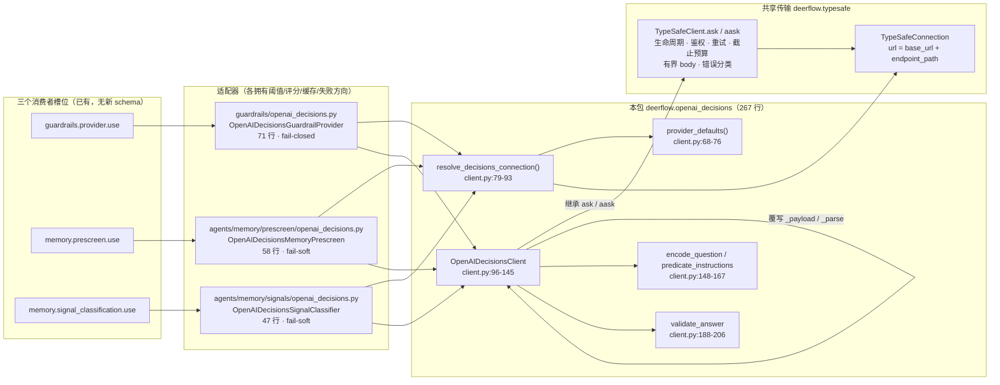

# OpenAI Decisions — 决策传输（#7005）

`backend/packages/harness/deerflow/openai_decisions/` 在 v2.2.0 里是**全新目录**，总计 **267 行**：`client.py`（222 行）+ `__init__.py`（45 行）。上游 commit `1fd266e0c`，*feat(decisions): add an OpenAI Decisions backend for the decision slots (#7127)*，issue **#7005**。全目录**没有 `AGENTS.md`**（只有两个 `.py`）——这套 dialect 的成文契约在别处：`typesafe/AGENTS.md` 的 **Dialects** 段（54-70 行）与 `backend/docs/GUARDRAILS.md` 的 Option 4b 节——紧接「The same gate over another endpoint」的那段运维对照文字，含 2.2.0 的 endpoint/refusal/`model` 对照表）。本目录三篇正文是这两段文档的**源码级展开**，冲突时以源码为准。

它解决的问题只有一个：**issue #7005 要的是既有接口后面的第二个决策后端，不是一个新决策系统**（`client.py:3-4` 原文 "a second decision backend behind the interfaces the TypeSafe (Jev) integration already uses, not a new decision system"）。所以它不新增配置 schema、不新增阈值、不新增缓存、不新增失败方向：`guardrails.provider.use` / `memory.prescreen.use` / `memory.signal_classification.use` 这三个槽位本来就会把 `use` 解析成类路径再 `cls(**config)`（`guardrails/provider.py:62`、`prescreen/contract.py:119-125`），换一个类路径就是换后端。

- `__init__.py`（45 行）只做转发：从 `client` 导入 11 个符号再列进 `__all__`（`openai_decisions/__init__.py:19-45`）。注意 `resolve_decisions_connection` **没有**被这个 re-export 覆盖（见 [02 页](02-connection-config.md) §3）。
- `client.py`（222 行）里，`OpenAIDecisionsClient` 只覆写**两个方法**（`_payload` `client.py:107-112` / `_parse` `client.py:114-145`）和**一个类属性**（`provider_label` `client.py:105`），其余全部继承自 `TypeSafeClient`。

→ Back to [parent README](../README.md)

## 分层与归属

三条不变量（都能在源码里点到）：

1. **这个包拥有线协议，且只拥有线协议**。`client.py:9-12` 原文："this module owns the wire — endpoint, envelope, how a question is encoded, how an answer is validated, and the error taxonomy — and nothing else. Thresholds, rubrics, caches and the direction a failure takes stay in each adapter."
2. **传输层只有一个 owner**。`client.py:13-16` 原文："Transport itself (authentication, retry, backoff, the deadline budget, the bounded and never-decoded body read) is inherited unchanged from `TypeSafeClient`; re-declaring it in a second module would put those security properties where they can drift." 代码层面可核对：本包**没有** import `httpx`，没有任何 retry / timeout / body-size 常量。
3. **dialect 只有两个缝**：`TypeSafeClient.provider_label`（`client.py:105`）与 `TypeSafeConnection.endpoint_path`（`resolve_decisions_connection` 在 `client.py:91` 传入）。`typesafe/AGENTS.md:56-57` 原文 "Two seams carry a dialect, and they are the only two"。

## 文件导航

| 文件 | 内容 |
|------|------|
| [01-wire-contract.md](01-wire-contract.md) | 线上契约：请求 envelope（`input` 而非 `state`、`questions` 是**数组**）、`noul → predicate` 的映射与 criteria 折叠、答案数组解析（首现胜出 / 未问忽略 / refusal 是答案）、信封级与问题级失败的分界、`model` 的回声与缺省 |
| [02-connection-config.md](02-connection-config.md) | 连接解析：`provider_defaults()` 为什么把 `model` 留空、`base_url` 默认值落在哪一层、`api_key_env` 的三层优先级与一个待核实的环境变量兜底、`resolve_decisions_connection` 的导出缺口、只有 `use:` 一行的配置写法与热重载边界 |
| [03-three-consumers.md](03-three-consumers.md) | 三个消费者：各自覆写的 seam、同一个 refusal 在 fail-closed 与 fail-soft 两侧的相反后果、`sharing_key` 为什么必然不同（`endpoint_path` 进了公开参数）、coordinator 的 combine 决策与离线测试钉住的行为 |

## 与其它域的关系

| 相关域 | 关系 | 页面 |
|--------|------|------|
| TypeSafe 共享传输 | 本包是它的**第二个 dialect**；传输、鉴权、重试、截止预算、64 KiB 有界读取、四类错误原因全部继承，不复制 | [../typesafe/01-client-and-connection.md](../typesafe/01-client-and-connection.md) §一/§二、[../typesafe/02-adapters-failure-policy.md](../typesafe/02-adapters-failure-policy.md) §五 dialect |
| Guardrail 风险门 | `OpenAIDecisionsGuardrailProvider` 是 `TypeSafeGuardrailProvider` 的子类，只换线协议；`guardrails.fail_closed: true` 时 refusal 也是拒绝 | [../../enterprise-operations/security/03-guardrail.md](../../enterprise-operations/security/03-guardrail.md)、[../../enterprise-operations/security/04-trust-boundary.md](../../enterprise-operations/security/04-trust-boundary.md) |
| Memory 判定 hook | pre-screen（省一次提取调用）与 signal classification（追加提示）各有一个 Decisions 兄弟类，失败方向仍是"照常提取" | [../../concepts/memory/manager-contract-and-backend-clients.md](../../concepts/memory/manager-contract-and-backend-clients.md) |
| 配置系统 | **没有** `openai_decisions:` YAML section；配置全部写在三个消费者槽位的 `config` 里（+ 顶层 `typesafe:` 作为共享兜底层） | [../configuration/01-config-yaml.md](../configuration/01-config-yaml.md) |
| 环境变量 | 默认 `api_key_env` 复用 `OPENAI_API_KEY` | [../../getting-started/05-environment.md](../../getting-started/05-environment.md) |
| 工具装配 | guardrail provider 由 `ToolErrorHandlingMiddleware` 组装：`resolve_variable(use)` → `cls(**config)`（`tool_error_handling_middleware.py:474-489`） | [../../concepts/builtin-tools/README.md](../../concepts/builtin-tools/README.md) |
| 能力目录 | 与 capabilities **无关系**：Decisions 不在 `builtin.json` 里，不是可安装能力 | [../capabilities/README.md](../capabilities/README.md) |

## 权威契约文档（上游自带）

| 文档 | 位置 | 内容 |
|------|------|------|
| `typesafe/AGENTS.md` **Dialects** 段 | 54-70 行 | 最完整的成文边界：为什么复用而非复制、两个缝、`endpoint_path` 进 sharing key |
| `backend/docs/GUARDRAILS.md` Option 4b 段（全文 748 行） | 547-560 行 | 面向运维的对照表（Endpoint / Judged value / Question / Refusal / `model`） |
| `config.example.yaml` Option 4b 注释 | 3328-3344 行 | 可直接抄的 YAML；只覆盖 **guardrail** 一个槽位 |
| `backend/tests/test_openai_decisions.py` | 552 行 | 离线 suite（`httpx.MockTransport`），钉住线映射、共享传输规则在第二 dialect 上仍成立、gate 方向未移动 |

## 事实清单（编译期核对）

| 事实 | 位置 |
|------|------|
| 包总行数 267（`client.py` 222 + `__init__.py` 45）；无 `AGENTS.md` | `wc -l` |
| 默认 base_url `https://api.openai.com` + endpoint 路径 `/v1/decisions` | `client.py:55,57` |
| 默认 key 环境变量 `OPENAI_API_KEY` | `client.py:56` |
| **默认 model 是空字符串**：构造即失败，除非部署自己命名 | `client.py:76` |
| 本包从共享层 import 的全部符号（11 个） | `client.py:41-53` |
| 生产调用方 3 个文件（全仓 grep `deerflow.openai_decisions`） | `guardrails/openai_decisions.py:33`、`agents/memory/prescreen/openai_decisions.py:30`、`agents/memory/signals/openai_decisions.py:24` |
| 测试调用方 1 个文件 | `backend/tests/test_openai_decisions.py:38-50`（直接 import client 的 9 个符号） |
| 新增 commit 改了 16 个文件，其中**不含**任何配置 schema 文件 | `git show --stat 1fd266e0c` |

> 未逐行核实：`POST /v1/decisions` 的**服务端语义**（`predicate` 的字段名、`refusal` 对象的结构、`answers` 数组的排序保证）在仓库内没有 fixture 之外的证据——digest 只能证明 DeerFlow 这一侧的编码与解析，服务端是否按同样约定回答无法在仓库内验证。相关断言在各页就地标注。
