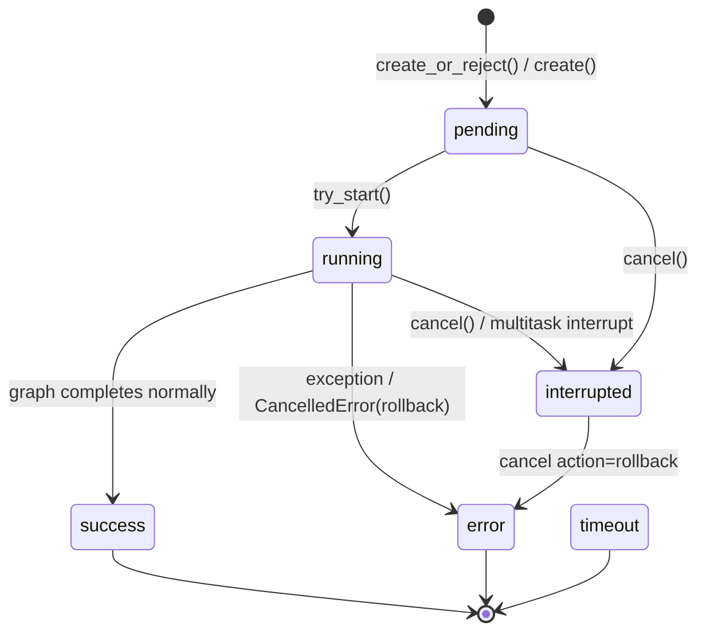

---


title: "RunManager — 运行生命周期管理"
description: 'RunManager — 运行生命周期管理：架构、契约与源码锚点。'
topics: [runtime, streaming, checkpointer]
verified_against: v2.2.0
last_verified: 2026-11-08
---

# RunManager — 运行生命周期管理

## 文件

`backend/packages/harness/deerflow/runtime/runs/manager.py` (3150 行，v2.2.0 实测)

## 功能概述

`RunManager` 是 DeerFlow 的"运行注册表"。它是一个内存注册表（支持可选持久化 RunStore 后盾），管理每次 agent 运行的完整生命周期。1,239 个 commit 后它承担的不只是内存注册：**跨进程准入（durable admission）、租约所有权（lease ownership）、终态 ACK 协议（terminal-ack）、证据封存（evidence seal）** 都落在这一层。

## 运行状态机



**状态定义** (`runs/schemas.py`):

| 状态 | 含义 |
|------|------|
| `pending` | 创建后等待执行 |
| `running` | 正在执行 |
| `success` | 正常完成 |
| `error` | 异常失败 |
| `timeout` | 超时 |
| `interrupted` | 用户取消/多任务中断 |

同一文件的 `ThreadOperationKind`（`run` / `checkpoint_write` / `artifact_write` / `artifact_archive` / `branch` / `delete`）与 `EVIDENCE_ORIGINS`（`interactive` / `scheduled` / `extension_evaluation` / `unknown`）也在 `runs/schemas.py`，前者决定准入行占用的操作种类，后者是**宿主自证**的证据来源词表（值保持 wire 字符串，Gateway 与 RunManager 共用）。

## RunRecord 数据结构

每个运行的核心数据结构（`manager.py:250-313`，`@dataclass`，可变）：

```
RunRecord:
  - run_id, thread_id, assistant_id  # 标识
  - status: RunStatus                 # 当前状态
  - on_disconnect: DisconnectMode     # cancel | continue
  - operation_kind: ThreadOperationKind, multitask_strategy: str
  - start_lock: asyncio.Lock          # pending→running 启动栅栏
  - task: asyncio.Task, abort_event, abort_action
  - store_only: bool                  # 是否仅持久化（无活跃任务）
  # Token/消息统计
  - total_input_tokens, total_output_tokens, total_tokens
  - llm_call_count, message_count
  - lead_agent_tokens, subagent_tokens, middleware_tokens
  - token_usage_by_model: dict[str, dict[str, int]]
  - last_ai_message, first_human_message
  # 所有权 / 租约
  - owner_worker_id, lease_expires_at, ownership_lost
  # 终态协议（🆕 2.2.0）
  - terminal_status_persisted, terminal_commit_pending
  - rollback_finalization_pending, scheduled_goal_cleanup_pending
  - terminal_commit_proof: TerminalCommitProof | None
  - terminal_status_revision: int
  # 幂等与证据（🆕 2.2.0）
  - idempotency_key, idempotency_request, idempotency_reused
  - goal_verdict, human_input_request
  - evidence_origin: str, evidence_agent_id: str | None
```

## 多任务策略

`create_or_reject()` (`manager.py:1931`) 原子性地检查活跃运行并创建新的运行：

| 策略 | 行为 |
|------|------|
| `reject` | 如果线程已有运行，抛出 `ConflictError` |
| `interrupt` | 取消现有运行，保留 checkpoint |
| `rollback` | 取消现有运行，回滚到运行前 checkpoint |

关键设计：**持有锁期间完成检查和插入**，消除 check-then-act 的 TOCTOU 竞态条件；跨进程一侧由 SQLite/Postgres 的 `(thread_id) WHERE status IN ('pending','running')` 部分唯一索引裁决。

2.2.0 该签名新增 6 个关键字（`manager.py:1931-1946`）：`idempotency_key` / `idempotency_request` / `evidence_origin` / `evidence_agent_id` / `execution_fence` / `run_id`——前两组是幂等与证据，`run_id` 让调用方自带 id（scheduler / extension 需要预分配），`execution_fence` 见下文「🆕 2.2.0」。

## 取消机制

`cancel()` (`manager.py:1716`) 支持两条路径：

1. **本 worker 持有**：设置 `abort_event` + 取消 `asyncio.Task`（双信号模型）。若 `action="rollback"`，记录 `rollback_finalization_pending=True`，让中断 ACK 不足以授权一次未完成的回滚。
2. **非持有 worker（multi-worker + heartbeat）**：`_request_durable_cancel()` 把取消动作写进 run 行；租约已过宽限期 → 抢占并标记 `error`（`taken_over`），租约仍有效 → 只落 durable 请求，由持有者在下一个心跳周期观察并走同一条本地 abort/finalization 路径（`requested`）。

返回值是 `CancelOutcome`（`manager.py:3133`）：`cancelled` / `requested` / `taken_over` / `lease_valid_elsewhere` / `not_cancellable` / `not_active_locally` / `unknown`。幂等取消（已 interrupted 再取消）仍返回 `cancelled`；`scheduled_goal_cleanup_pending` 时取消也要等到 scheduled goal 清理完才落终态。

## 持久化与重试

### RunStore 可选后盾

当配置了 `RunStore`（如 SQLite/PG），RunManager 将元数据同步持久化：
- `_persist_new_run_to_store()` (`manager.py:497`) — 新运行时强制写入（失败则回滚内存记录）
- `_persist_status()` (`manager.py:638`) — 状态转换时 best-effort 写入；`ownership_lost` 后**直接跳过**并打 warning（fenced worker 不得再写终态）
- `_persist_model_name()` (`manager.py:1574`) — 模型名称更新时 best-effort 写入

### SQLite 锁保护

`_is_retryable_persistence_error()` (`manager.py:148`) 检测可重试的 SQLite 错误（`SQLITE_BUSY`、`SQLITE_LOCKED`、"database is locked"）。

`_call_store_with_retry()` (`manager.py:452`) 实现指数退避重试（`max_attempts=5`、`initial_delay=0.05s`、`max_delay=1.0s`、`backoff_factor=2.0`）。

## 存储回退

`get()` (`manager.py:1019`) 的三层查找策略：
1. 内存哈希表 `_runs[run_id]`
2. 持久化 `RunStore`（如果配置）
3. 双重检查：store await 期间可能并发 `create()` 插入了记录

存储回退的记录标记为 `store_only=True` — 没有活跃的 `asyncio.Task` 或控制状态，只能读取历史。

## 孤儿协调

`reconcile_orphaned_inflight_runs()` (`manager.py:2363`)：

重启后，Store 中可能遗留 `pending`/`running` 状态的记录（没有活跃 task）。此方法：
1. 从 `RunStore.list_inflight_with_expired_lease(before=, grace_seconds=)` (`manager.py:2407`) 获取**租约已过期**的活跃行
2. 过滤掉内存中确实有活跃记录的
3. 将剩余的标记为 `error` 状态

心跳循环每 3 个周期（= 每 `lease_seconds`）触发一次该清扫，所以崩溃的对端不必等进程重启就被回收。上游的 `claim_for_takeover()` 原子提交 `status=error`，这条已提交结果正是恢复终态的授权来源（见「🆕 恢复终态」）。

## 进度更新

`update_run_progress()` (`manager.py:889`) 和 `update_run_completion()` (`manager.py:792`)：

- **进度**：运行中定期快照（token/消息计数），仅当 `status == running` 时持久化
- **完成**：运行结束后一次性写入 token 统计 + 便利字段（`last_ai_message`、`first_human_message`）+ `goal_verdict`
- 完成持久化失败时会尝试通过 `put` 重建行记录，然后重试 `update`
- 🆕 `update_finalizing_progress()` (`manager.py:907`)：**本地状态已是终态、但 durable 行故意保持 running** 的窗口里写终态字段——这是终态 ACK 协议能在 checkpoint 收尾期间保住租约的原因（行仍 active，租约继续续期）

## 🆕 2.2.0：终态 ACK 协议（terminal-ack）

2.1.0 的终态是"写一次行、失败了就重试"。2.2.0 把终态拆成**提交 → 确认 → 证明**三段，核心问题是"哪个 worker 有权说这次 run 结束了"：

| 构件 | 位置 | 语义 |
|------|------|------|
| `TerminalCommitProof` | `manager.py:241` | 进程内已确认终态的不可变证明：`status` / `error` / `stop_reason` / `goal_verdict` |
| `terminal_status_persisted` | `RunRecord` 字段 | 本进程**是否已拿到终态提交 ACK**；`False` 时不得发布终态流帧 |
| `terminal_commit_pending` | `RunRecord` 字段 | 本地栅栏：终态已在内存暂存、只在收尾末尾提交，durable 行仍 active，租约必须继续续期 |
| `_begin_terminal_attempt` / `_end_terminal_attempt` | `manager.py:546` / `:552` | 每次终态写都注册一个 `Future[bool]`，收尾等的是这些**本地**尝试而不是读行推断 |
| `_acknowledge_terminal` | `manager.py:559` | 无 await 地发布已确认结果：**带上 store 时，旧的 interrupted ACK 不能压过新的 error**；`error` ACK 才清 `rollback_finalization_pending` |
| `_has_final_terminal_ack` | `manager.py:533` | `not rollback_finalization_pending and _has_terminal_ack(record)`——回滚未完成时中断 ACK 不算终态 |
| `_store_supports_terminal_completion` | `manager.py:217` | 严格完成写入的能力探测：`update_run_completion` 必须显式声明 `require_terminal` + `owner_worker_id` 关键字，或在**字面定义该方法的类**上标 `supports_terminal_completion_kwargs = True`；只吃 `**kwargs` 不算承诺 |
| `_fence_unconfirmed_terminal` | `manager.py:635` | 释放确认栅栏超时后 `_mark_ownership_lost(..., require_active=False)`：写被拒或确认不了 → 本地执行被 fence |
| `terminal_event_status()` | `manager.py:537` | 只对"本 worker 是 owner、非 store_only、状态已终态、且有最终 ACK"的记录返回状态字符串，否则 `None`——这是终态事件**可归因性**的唯一判据 |
| `can_release_terminal_barrier()` | `manager.py:543` | 有 heartbeat + store 时，栅栏必须留到最终 ACK（回滚的最终 error ACK 也算）才放 |

配套的 store 侧契约（`runs/store/base.py`）：

- `update_status(..., owner_worker_id=)`：带 owner 时**原子**要求 owner + 未过期租约；legacy store 返回 `None` 在 heartbeat 模式下视为"未确认"（不是"成功"）。
- `update_run_completion(..., require_terminal=True, owner_worker_id=)`：要求**精确**的请求终态 + owner 原子成立；metadata 不得把 active 行迁到终态、不得改 `error`/`goal_verdict`；不支持严格调用的实现必须 fail closed。
- `finalize_status(..., owner_worker_id=)`：legacy 默认实现对带 owner 的调用直接 `raise NotImplementedError("Store must implement owner/lease-fenced finalization")`；默认返回值也从 `updated is not False` 收紧为 `updated is True`（**未确认 = 未提交**）。
- `supports_terminal_completion_kwargs` / `supports_idempotency_request_kwargs` 两个类级 opt-in 标志（见 `runs/store/base.py` 注释）：字段能力必须声明在**字面定义方法**的类上，flag-only 子类或 mixin 不能替别的类背书，override 后必须重新 opt-in。

## 🆕 2.2.0：租约检查是 per-run 任务

2.1.0 的心跳是"一个循环里挨个续租"。2.2.0 改成**每 run 一个独立决策 + 本地截止守卫**：

- `_renew_leases()` (`manager.py:2786`) 只对 `owner_worker_id == self._worker_id` 且（状态 pending/running **或** `_awaits_terminal_commit(record)`）的记录各起一个 `run-lease-check:{run_id}` 任务；已经有一个在飞就不重起。`wait=False`（心跳）不 join，`wait=True`（显式调用）join 一次快照。
- `_awaits_terminal_commit()` (`manager.py:2724`) = `scheduled_goal_cleanup_pending or terminal_commit_pending or rollback_finalization_pending`——**终态已定但还没提交完的行仍然要续租**，否则对端会在中间态把它当孤儿。
- `_renew_one_lease()` (`manager.py:2843`) 的判定顺序：先按"已确认租约截止"算 deadline → 起 `run-lease-io:{run_id}` 子任务 → 超 deadline 未完成就 `fence("Lease renewal exceeded the last confirmed lease deadline.")`，**不 join 抗拒取消的 I/O**（其迟到结果由 supervisor 观察，无法改本地权威）。任何一条 fence 理由都先 `_release_confirmed_terminal_barrier(timeout=remaining)`，只有栅栏释放不掉才 `_mark_ownership_lost`。
- `_arm_lease_deadline()` (`manager.py:2752`) 是**纯本地** `loop.call_later` 守卫：即使心跳 I/O 停了/挂了，最后一次确认租约到期也会 fence 本记录。shutdown 不是"可以越过最后确认租约继续跑"的授权。
- `_supervise_lease_task()` (`manager.py:2769`) 给每个租约任务挂 done-callback：异常只记 warning（不让一个 run 的失败拖垮心跳），并在注册表里清理自己。
- `stop_heartbeat(timeout=5.0)` (`manager.py:2651`) / `shutdown(timeout=5.0)` (`manager.py:3008`) 有界排空 `_lease_checks` + `_lease_operations` + 心跳任务；超时只 `cancel()` 加一个调度轮，不 await 抗拒取消的 Store。
- `renew_lease(..., allow_interrupted=True)`（`runs/store/base.py`）：允许续租**interrupted** 行，唯一用途是 owner 还在跑回滚收尾；`success`/`error` 永不可续租。`_renew_one_lease` 里若首次续租被拒，会先看 `_rollback_retry_authorized()` 再重试一次（原子回滚准入与续租的竞争），并且 `_atomic_replacement()` 在一个 `Finally` 块里回滚未提交的 claimed 记录及其 `terminal_commit_pending`。

## 🆕 2.2.0：pending→running 启动栅栏

`try_start(run_id) -> RunStartOutcome` (`manager.py:1250`) 把"启动"从裸 `set_status` 变成可判定的屏障：

- 先 `async with record.start_lock`（防止同一 pending run 被两条 worker 路径同时启动），再在 `self._lock` 里查 `abort_event` / 状态。
- 有 store 时先 `store.start_run(run_id)`：返回 `False` 说明**取消先赢**，本地标 `interrupted` + `terminal_status_persisted=False` + 置 abort，返回 `RunStartOutcome.cancelled`。
- 启动后再查一次状态；若期间被取消，回写 `restore_status` 并返回 `cancelled`（不是把 running 写成 pending）。
- `fail_start_if_pending()` (`manager.py:1296`)：worker 任务挂不上时把 pending 直接标 `error` 并持久化——否则该行会永远 pending 直到孤儿协调。
- `RunStartOutcome` 只有 `started` / `cancelled` 两值（`manager.py:316`）；`RunStartupError`（`manager.py:323`）表示 durable 启动无法安全解析。

## 🆕 2.2.0：幂等准入与 execution fence

| 构件 | 位置 | 语义 |
|------|------|------|
| `RunIdempotencyUnsupported` | `manager.py:188` | 配置的 Store 无法安全持久化请求的幂等字段 |
| `RunIdempotencyKeyMismatch` | `manager.py:192` | 幂等键解析到了**另一个 thread 或 user**——是不同的请求，不是重放 |
| `_store_accepts_idempotency_parameter()` | `manager.py:196` | 探测 `create_thread_operation_atomic` 是否显式接受某个关键字（`execution_fence` 等）；`**kwargs` + 类级 opt-in 才算 |
| `idempotency_request` | `create_or_reject` 关键字 | 重放时用来比对"这是不是同一个请求"的持久化快照（与裸 key 分开存） |
| `idempotency_reused` | `RunRecord` 字段 | 只有**回收既有幂等准入**的那个调用方为 `True`；它不得再挂第二个 worker |
| `execution_fence` | `create_or_reject` 关键字 | runs 之外的执行方（workflow/extension 的 `ExecutionFence`）用来声明"这个 run 属于我这次执行"；要求 store 支持该参数且 `multitask_strategy == "reject"`，否则 `RunIdempotencyUnsupported` |
| `request_fenced_cancel()` | `manager.py:1705` | 按 `execution_fence` 发起取消（`store.request_cancel(..., execution_fence=, user_id=)`）；store 无此参数时不可用 |

本地幂等快路径在 `self._lock` 内完成（`manager.py:2097`）：同 key 但 thread/user 不同 → `RunIdempotencyKeyMismatch`；同 key 同 thread/user → 标记 `idempotency_reused=True` 并**原样返回既有记录**。跨进程一侧由 store 的唯一约束裁决，冲突行通过 `reuse_idempotent_run()` 变成 store-only 句柄（不注册进 `_runs`，因此不会被本 worker 终态化或清理）。

## 🆕 2.2.0：非 run 的线程操作预留

`reserve_thread_operation(thread_id, *, kind, user_id)` (`manager.py:2305`) 是一个 **async context manager**，为 `checkpoint_write` / `artifact_write` / `artifact_archive` / `branch` / `delete` 这类非 run 操作拿排他准入：

- `kind=run` 直接 `ValueError`（普通 run 必须走 `create_or_reject()`）。
- 底层是同一套 durable 唯一性：`_admit_thread_operation()` 写一条**短命 pending 行**，于是"另一个 run 正在跑"和"另一个 worker 正在 branch/delete"在 SQL 层面互相看得见。
- 租约丢失 → `asyncio.CancelledError`；若 `abort_event` 已置则改抛 `ConflictError("Thread {thread_id} reservation lease was lost")`，调用方能区分"我主动放弃"和"我被抢走"。
- `finally` 里 `store.delete_thread_operation()` 释放；释放失败只 warning——留给孤儿协调，不假装成功。

## 🆕 2.2.0：证据来源与 journal seal

- `evidence_origin` / `evidence_agent_id` 随 `create_or_reject()` / `create()` 写入 run 行；`_validate_evidence_origin()` (`manager.py:928`) 对不在 `EVIDENCE_ORIGINS` 的值 `raise ValueError("invalid evidence origin")`。
- `seal_completed_evidence(run_id, receipt)` (`manager.py:932`)：owner worker 把 journal 的 `JournalSealReceipt`（`runtime/events/evidence.py`：`run_id` / `thread_id` / `upper_event_seq` / `event_count` / `retention_revision` / `session_factory`）在一个 fenced 事务里封存。SQL 实现 `RunRepository.seal_evidence()`（`persistence/run/sql.py:202`）要求 owner + 未过期租约 + `evidence_seal_state == "pending"` + 终态状态 + retention revision 一致，成功才把 `sealed` / `evidence_revision` / `evidence_upper_seq` / `evidence_event_count` 一次写入。
- `mark_evidence_partial(run_id, error=)` (`manager.py:944`)：封存失败时把状态改 `partial`——让失败**可被发现**而不改业务终态。
- 两列底座来自 migration `0045_completed_run_evidence`（`evidence_seal_state` / `evidence_retention_revision` 等）。Runtime 侧只做"可归因的封存"，证据读取契约在 extension-api 的 `run_evidence.py`（harness-hooks digest）。

## 🆕 2.2.0：恢复终态（RecoveryTerminalPublisher）

`runtime/events/terminal.py`（316 行）承载两件事：

1. **worker 的正常终态确认**：`confirm_terminal_event(store, thread_id, run_id, status, user_id, authorized, recovered=False, lifecycle_guard=None)` —— 只写一条 `run.terminal` 事件（`content == {"status": status}`、`metadata["protocol_version"] == TERMINAL_PROTOCOL_VERSION == 1`），**不重放任何 journal 批次**；最多 2 次尝试用 store 的原子 check/insert 解掉丢失的 ACK，两次都要求同一份最终提交权威（`authorized()` 每次写前后各查一次）。返回值是 `TerminalEventConfirmation`：`CONFIRMED_NEW` / `CONFIRMED_EXISTING` / `CONFLICT` / `UNKNOWN`。`TERMINAL_STATUSES = {success, error, interrupted, timeout}`。
2. **抢占后的恢复终态**：`RecoveryTerminalPublisher.publish(target)` 消费一次性 `RecoveryTerminalTarget`（`_RecoveryTargetClaimState.consume()`，二次消费抛 `RecoveryTerminalTargetConsumed`）。因为 `RunStore.claim_for_takeover()` 已经原子提交了 `status=error`，target **钉住这个已知结果**，而不是从之后读到的 RunRow 反推权威；发布前先 best-effort 补一条零投递 `run.delivery` receipt（`{"presented": 0, "paths": [], "by_tool": {}}`），发布失败只 warning 并**保留已提交的 RunRow**。生命周期守卫 `_RecoveryRunLifecycleGuard` 在 `RunRepository` 上走 `get_in_session()`（与发布同一事务），其他 store 退化为普通 `get()`，判据是 `run_id` + `thread_id` + `operation_kind == "run"` + `status == "error"`。

worker 侧调用顺序（`runs/worker.py:2151-2201`）：`journal.finish_evidence(before_receipt=confirm_terminal)` → 拿到 `JournalSealReceipt` → `run_manager.seal_completed_evidence()` → 任一步失败则 `mark_evidence_partial()`；随后 `terminal_stream_authorized = not ownership_lost and status 非 active and terminal_status_persisted` 才发终态流帧。`run.terminal` 属于 `WORKER_RUN_EVENT_DEFINITIONS`（`events/catalog.py`），被并入 `FIXED_RUN_EVENT_DEFINITIONS` 参与固定事件集校验。

## 🆕 运行来源（run origin）与证据隔绝

`runtime/run_origin.py`（80 行）定义**服务端自有**的 run/thread 来源标记 `metadata["deerflow_origin"]`：

| 构件 | 值 |
|------|-----|
| `DEERFLOW_ORIGIN_KEY` | `"deerflow_origin"` |
| `ORIGIN_KINDS` | `schedule` / `im_channel` / `github` / `extension` / `mcp_notification` |
| 形状约束 | 只允许 `kind` / `provider` / `namespace` 三个键；`provider` ≤32 字符 `[a-z0-9_-]`；`namespace` 1–96 字符且不含 `:`；**任何多余键整体拒绝**（不部分保留） |
| `admit_origin(value)` | 合法则返回干净副本，否则 `None` |
| `make_origin(kind, *, provider=None, namespace=None)` | 服务端启动器构造用，非法 `ValueError` |
| `origin_kind_of(metadata)` | 良构则返回 kind，否则 `None`（交互式或 legacy） |

值**永不接受浏览器/PAT/API 客户端提供**：Gateway 丢弃客户端副本，只盖服务端启动器设置的（`app/gateway/run_origin.py`）。它与消息级 `deerflow_scheduled_origin` 是**不同的键**，代码不得互读。契约钉在 `contracts/thread_origin_contract.json`。`RunManager` 只消费它（`runs.origin_kind` 驱动 activity feed 与 per-user 未读），不接受它进来。

## 🆕 稳定分页游标：run change_seq（sync #6）

`GET /api/threads/{thread_id}/runs` 仍是裸数组（最新 100 条，LangGraph SDK 兼容，#5283）；翻页走
`GET /runs/page`，游标基于 `(created_at, run_id)` keyset。仅给一边（只有 before 没有after 或反之）会 400。

更深层的变化是 **每行一个单调 `change_seq`**（migration `0023_run_change_seq`）：
`runs.change_seq BIGINT NOT NULL DEFAULT 0`，由单例行 `run_change_clock` 表在 SQL 内全局串行分配位置。
这给了"变更 run 发现"一个稳定位置：重启/翻页期间 run 行被更新时游标不会漂移（时间戳相同或乱序更新不再漏行/重放）。
`RunRepository`（`persistence/run/sql.py`）写入时递增，`RunStore` 接口与内存实现（`runs/store/base.py` / `memory.py`）同步暴露。
测试锚点：`backend/tests/test_migration_0023_run_change_seq.py`。

> 🆕 sync #7 补充两条：**线程删除走的是不 bump clock 的批量删**（`RunRepository.delete_by_thread()`，见
> [05-run-ownership-and-rollback.md](05-run-ownership-and-rollback.md)）；另外 0023 曾因被插到已发布的
> `0023_user_preferences` 之前而产生"永不执行"的空洞，由 `0025_repair_run_change_seq` 幂等重放修复
> （upstream #5517 / #5516，详见 persistence digest 的迁移一节）。

## 🆕 Thread incarnation（expand-phase，sync #6）

migration `0019_thread_incarnations`（#5216）给 `threads_meta.incarnation` 与 `mcp_tasks.thread_incarnation`
加**可空** `VARCHAR(32)` 列：新 thread 创建时获得稳定 incarnation id，新 task 行复制其归属（或共享）thread 的
incarnation。这是 expand-only 一步——列值只被**写入/复制**（新 MCP task 行插入时读取归属 thread 的 incarnation，`persistence/mcp_tasks/sql.py:157-169`），本阶段**没有任何 fencing/claim/session/删除逻辑读这两列做判断**，混合版本写入保持兼容。
注意该 revision id 曾被早期 rollout 以不同父版本占用过，迁移链里它挂在 `0021_batch_acceptance` 之后幂等重放（见
persistence digest 的 forward revision 一节）。测试锚点：`backend/tests/test_migration_0019_thread_incarnations.py`。

> 2.2.0 复核：**本页没有找到新的 incarnation 消费点**——2.2.0 新增的 fencing 全部走 `owner_worker_id` + `lease_expires_at` + `terminal_commit_proof`，以及 runs 之外的 `ExecutionFence`。沿用"值只写不读"的结论。

## 🆕 终态后的 Gateway 内存回收（#5112）

run 到达终态后，worker/manager 现在主动释放闭环引用：清理终态 run 记录、丢弃 fenced journal 缓冲、
`publish_end` 失败也会走清理路径；清理本身对 cancellation 加了防护（不能被半途取消留下悬挂状态）。
长时间运行的 Gateway 不再随 run 数量累积内存。

2.2.0 在此之上补了两个**短命机制**，不要和回收混淆：

- `_defer_finalization_interrupt()`（`runs/worker.py:930`）：收尾期间收到的取消被**延后**到收尾完成后重放，避免收尾半途被打断留下悬挂状态。
- `runtime/cancellation.py`（63 行）：`drained_async_context(manager)` + `_drain_context_exit()` 让 `__aexit__` 在反复到来的取消中**跑完**；只有 exit 成功才重新抛调用方取消，exit 自身失败则替换/链上失败（与普通 context manager 语义一致）。`wait_for_task_until(task, deadline=)` 是同一思路的等待原语。async checkpointer 的 Postgres 连接池就用它退出（`checkpointer/async_provider.py`）。

## 🆕 Worker trace binding（一句）

trace id 无条件下发（#5119，详见 observability digest）的 runtime 侧落点是
`runs/worker.py` 的 `_bind_trace_id()`（`runs/worker.py:904`）：ContextVar 是唯一来源，调用方塞进 metadata 的
`deerflow_trace_id` 不再被信任，运行结束后 run 行仍可凭 trace id 追溯。
