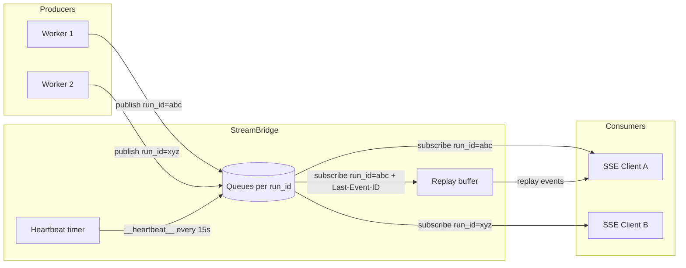

# StreamBridge — 流发布/订阅协议

## 文件

行数全为 v2.2.0 实测（括号内是 v2.1.0 对照）：

| 文件 | 行数 | 职责 |
|------|------|------|
| `runtime/stream_bridge/base.py` | 163（115） | 抽象协议 + `StreamEvent` / `StreamGap` / `StreamProducerLeaseState` / 两个哨兵 / `ping()` / 生产者租约存根 |
| `runtime/stream_bridge/memory.py` | 218（192） | 内存实现（generation 退休、被驱逐 id 记录） |
| `runtime/stream_bridge/redis.py` | 1068（384） | Redis Streams 跨进程实现（`supports_cross_process = True`）+ 生产者租约 |
| `runtime/stream_bridge/async_provider.py` | 108（101） | 后端工厂（`await_drained(bridge.close())`） |
| `runtime/stream_modes.py` | 47 | 对外 stream mode 词表与 `messages-tuple → messages` 映射 |
| `config/stream_bridge_config.py` | — | 配置形状：`legacy_end_scan_enabled` / `producer_lease_recovery_enabled` / `recovered_stream_cleanup_delay_seconds`（≤86400） |

## 协议设计

`StreamBridge` 是一个抽象类，解耦 **生产者**（agent worker）和 **消费者**（SSE 端点）。



### StreamEvent 数据结构

```python
@dataclass(frozen=True)
class StreamEvent:
    id: str      # 单调递增事件 ID（用于 SSE id: 字段，支持 Last-Event-ID 重连）
    event: str   # SSE 事件名：metadata, updates, values, messages, error, end
    data: Any    # JSON 可序列化的负载
```

### 两个哨兵事件

- `HEARTBEAT_SENTINEL` — `event="__heartbeat__"`，当无事件时每 15 秒发送
- `END_SENTINEL` — `event="__end__"`，生产者完成时发送

### 核心接口

| 方法 | 角色 | 说明 |
|------|------|------|
| `publish(run_id, event, data)` | 生产者 | 入队一个事件 |
| `publish_end(run_id)` | 生产者 | 标记流结束 |
| `subscribe(run_id, last_event_id, heartbeat)` | 消费者 | 返回 `AsyncIterator[StreamItem]`（`StreamEvent | StreamGap`） |
| `cleanup(run_id, delay=0)` | 双方 | 释放资源，delay>0 给迟到的订阅者排空事件的机会 |
| `ping()` | 运维 | 🆕 后端可达性探测（Gateway readiness）。默认 `True`（memory 无可探），跨进程后端应覆写成有界往返、后端不可用时返回 `False` 而不是抛 |
| `start/finish/abort_producer_lease(run_id)` · `transfer_producer_lease(run_id, owner_task)` · `producer_lease_state(run_id)` · `cleanup_expired_producer(run_id)` | 生产者/网关 | 🆕 生产者存活租约的 6 个存根（默认 no-op / `untracked`），只有 Redis 实现 |

## MemoryStreamBridge

基于 `asyncio.Queue` 的内存实现，是默认选择（用于本地开发和 SQLite 后盾部署）：

每个 run 一个 `_RunStream`：`events` 列表就是保留缓冲区（上限 `queue_maxsize`，默认 256），`condition` 是 `asyncio.Condition`（发布 `notify_all`、订阅者等待），`ended` 标记 `publish_end`，`start_offset` 是已驱逐水位。

事件 id 形如 `"{seq}-{seq}"`，`seq` 等于事件的**绝对偏移**，所以 `_resolve_start_offset()` 用算术 O(1) 定位重连游标，而不是扫缓冲区：

- 游标命中所保留位置 → 从该偏移续读；
- 🆕 `last_evicted_event_id`（`memory.py:26`）：**恰好等于刚被驱逐的那一个 id** 时视为已知前驱，从新的 `start_offset` 续读——这是 2.2.0 新增的一次宽恕，避免"只掉一个事件"被误判成 gap；
- 其他低于水位的 id 无法验证 → 保守 `StreamGap`（宁可让调用方重载持久状态，也不假装完整重放）；
- 高于水位但语法合法的陌生 id → 沿用 legacy 的"从最早重放"。

2.2.0 的两处硬化：

- **id 解析防溢出**（`_parse_event_seq`，`memory.py:57`）：正则从 `\d+-` 改成 `[0-9]+-`，并把 `int()` 包在 `try/except ValueError` 里——数值看着合法但超出 Python 整数位数上限的重连 id 返回 `None`，走保守路径而不是抛 `ValueError`。
- **generation 退休**（`retired` 字段，`memory.py:27`）：`cleanup()` 不再 `pop` 了事。它先在 `condition` 里把该 generation 标 `retired`、`start_offset += len(events)`、`events.clear()`、`notify_all()`，再（仅当注册表里还是自己）摘掉 id/counters。仍然挂着旧 generator 的订阅者会拿到 `END_SENTINEL`（若已 ended 且已读完）或 `StreamGap(cursor, None, None)` 并结束，而不是在一个已被摘掉的孤儿对象上永久等待。`close()` 也从"清空两张字典"改成逐个 `await self.cleanup(run_id)`。

## SSE 事件名称映射

Worker 中 `_lg_mode_to_sse_event()` (`runtime/runs/worker.py:3549-3560`) 将 LangGraph 流模式映射到 SSE 事件名——函数体只有一行 `return mode`（全部 1:1），所以下表其实就是 LangGraph 自己的名字：

| LangGraph 模式 | SSE 事件名 |
|---------------|-----------|
| `values` | `values` |
| `updates` | `updates` |
| `messages` | `messages` |
| `custom` | `custom` |
| `tasks` | `tasks` |

注意：`events` 模式不支持（需要 LangGraph Platform 闭源组件）。

## Worker ↔ StreamBridge 交互

Worker (`run_agent()`) 是生产者：

```python
# 0. 🆕 建立生产者存活租约（仅支持的后端；失败可继续，沿用保守恢复）
started = await bridge.start_producer_lease(run_id)
# 1. 发布元数据（useStream 需要 run_id 和 thread_id）
await bridge.publish(run_id, "metadata", {"run_id": run_id, "thread_id": thread_id})

# 2. 流式循环
async for chunk in agent.astream(graph_input, ...):
    sse_event = _lg_mode_to_sse_event(mode)
    await bridge.publish(run_id, sse_event, serialize(chunk, mode=mode))

# 3. 结束时发布 end 哨兵
await bridge.publish_end(run_id)

# 4. 60 秒后清理（给迟到订阅者机会）
asyncio.create_task(bridge.cleanup(run_id, delay=60))
```

2.2.0 的实际调用顺序（`runs/worker.py`）：

| 时机 | 调用 | 位置 |
|------|------|------|
| 首次 publish 之前（惰性、幂等） | `_ensure_stream_producer_lease()` → `bridge.start_producer_lease(run_id)`，`False` 时**不**置 started 标志（沿用"没有租约"的保守恢复行为） | `:1087-1105` |
| run 终态、收尾 task 创建后 | `bridge.transfer_producer_lease(run_id, finalizer)` —— 把租约的取消归属交给 `run-finalization-{run_id}` | `:2290-2297` |
| 收尾 `finally` | `bridge.finish_producer_lease(run_id)`（失败只 warning） | `:2219-2227` |

三个调用都先过 `_declared_bridge_method(bridge, name)`（`worker.py:121`）：只调用**类上真正声明过**的方法，不会因为 `__getattr__` 冒出一个同名方法就误调。memory bridge 全部是 `base.py` 的 no-op 存根，所以逻辑不变。

> `worker.py` 本身有 3864 行（v2.1.0 为 3061 行），且 2.2.0 重写了整个执行/收尾路径；本页只写与 StreamBridge 交界的那几个调用点，worker 内部的 loop/middleware 语义不在此页。

## 后端选择

`stream_bridge/async_provider.py` 根据 `config.yaml` 自动选择 —— **只有两个后端**（此表在 v2.1.0 前写的 "SQLite-backed / PostgreSQL-backed" 是错的，代码里不存在这两种 bridge）：

| 后端 | 实现（2.2.0 行数） | 适用场景 |
|------|------|---------|
| `memory`（默认） | `MemoryStreamBridge`（218 行） | 本地开发、**单进程** Gateway |
| `redis` | `RedisStreamBridge`（1068 行） | 多 worker / 多进程 Gateway（`supports_cross_process = True`） |

工厂退出时统一 `await await_drained(bridge.close())`（`async_provider.py`）：关闭本身不能被调用方取消打断，否则 Redis 连接/租约任务会残留。

选择顺序：`app_config.stream_bridge`（或全局 `get_stream_bridge_config()`）→ 若配置为 `None` 再看环境变量 `DEER_FLOW_STREAM_BRIDGE_REDIS_URL`（有值就合成一个 `type="redis"` 的配置）→ 都没有则 memory。未知 `type` 抛 `ValueError`。

## 🆕 订阅游标落后：`StreamGap`

`subscribe()` 的产出类型是 `StreamItem = StreamEvent | StreamGap`（`base.py:55`）。`StreamGap` 是 v2.1.0 新增的**第三个**哨兵形态（除 heartbeat/end 之外），表示"订阅者游标已无法完整重放"：

```python
@dataclass(frozen=True)
class StreamGap:
    requested_event_id: str | None        # 重连游标，或"活着但落后"的订阅者最后收到的事件 id
    earliest_available_event_id: str | None  # 保留缓冲区的最早边界；缓冲为空则 None
    latest_available_event_id: str | None
```

契约要点：抛出 `StreamGap` **同时终止迭代**（`return`）；调用方据此**重载持久状态**并从当前尾部续订，而不会把"部分重放"误当"完整重放"。`StreamBridge` 还有两个类级能力位：`supports_cross_process: bool = False`（memory 保持 False）与 🆕 `producer_lease_recovery_enabled: bool = False`（由配置置位，见下节），供上层判断"订阅是否可能跨进程"和"是否允许从过期生产者租约恢复 END"。

### 🆕 2.2.0：Redis 侧 gap 的三种新来源

2.1.0 只检测"游标早于保留水位"。2.2.0 的 `subscribe()`（`redis.py:834`）补了三类本来会退化成"永久心跳"的情形，全部以 `StreamGap` + `return` 收尾：

| 触发 | 判据（`redis.py`） | 为什么必须 gap |
|------|--------------------|----------------|
| **未来游标** | `gap_detection_enabled` 且 `latest_entries[0] < stream_id`（`:931-948`） | 语法合法但指向本保留流之外的 id 无法重放。尤其是**已结束的 run**：其 end 标记在当前游标之前，`XREAD` 永远看不到，订阅者会一直收心跳。gap 让调用方去读 durable 状态 |
| **流已消失** | `earliest_entries` 为空，但 `stream_observed` 为真或正处于 `pending_initial_response`（`:899-908`） | cleanup/TTL 把一个**曾经观测到**的流删了 = 历史丢失，不是"生产者还在但空闲"。`requested_event_id` 在 pending 基线情形下置 `None`（那是暂存尾部，不是客户端游标） |
| **被驱逐但仍落后** | 首次唤醒的暂存响应（无游标订阅者）与下一次原子边界检查交叉比较（`:912-929`） | 让无游标订阅者也拿到与 memory 等价的 fell-behind 信号，而不是只靠 `last_event_id` |

`_resolve_start_stream_id()`（`redis.py:799`）处理**畸形**游标：不是合法 stream id 时看 `XREVRANGE(count=1)`，若尾部已是 end 则从 `0-0` 开始（让订阅者立刻看到 end 结束），否则跟随当前尾部 live tailing——不回放整个保留缓冲区。

## 🆕 `RedisStreamBridge`（`stream_bridge/redis.py`，1068 行）

每个 run 一个 Redis Stream，订阅者直接 `XREAD`。这让 SSE bridge 在多 worker 下可用，同时保住 `Last-Event-ID` 重放语义。

| 机制 | 实现 |
|------|------|
| Stream 键 | `f"{key_prefix}:{run_id}"`，`key_prefix` 默认 `deerflow:stream_bridge`（`rstrip(":")`） |
| 保留上限 | `queue_maxsize`（默认 256）作为 `XADD ... MAXLEN`（`approximate=False`，精确裁剪）；`publish_end` 用 `maxlen + 1` 保住"配置数量的数据事件 + 一个内部 end 标记" |
| 过期 | `stream_ttl_seconds`（默认 86400）与 `XADD` 同一条 **事务 pipeline** 里 `EXPIRE`；`None`/`<=0` 关闭过期 |
| 记录格式 | `{kind: "event"\|"end", event: <name>, data: <json>}`；end 记录只带 `kind`，读出即 `END_SENTINEL` |
| 连接池 | `max_connections` 限制池大小——**每个活跃 SSE 订阅者占一条连接**阻塞在 `XREAD ... BLOCK` 上；`None` 保持 redis-py 的（实际上无界）默认 |
| 缺包 | `redis` 是可选 extra，模块级 import 失败时抛带安装命令的 `ImportError`（`stream_bridge.type: redis` 时才惰性 import） |

订阅循环里几个刻意的设计（都是正确性问题）：

1. **阻塞 `XREAD` 不能参与 Redis 事务**，所以正确性靠**非阻塞原子快照**：`_read_retained_snapshot()` 在一条 `pipeline(transaction=True)` 里同时做 `XRANGE(count=1)`（最早边界）、`XREVRANGE(count=1)`（最新边界）、`XREAD`（`stream_id` 之后的数据）。代价是每次轮询三条命令（空闲时还要第二条往返），换来"保留边界检查不可能与读取竞态"。
2. **gap 检测只在游标是合法 Redis stream id 时启用**（`gap_detection_enabled = last_event_id is not None and _parse_stream_id(...) is not None`）。快照的 `earliest` 比当前游标更新 → 抛 `StreamGap(requested_event_id=..., earliest_available_event_id, latest_available_event_id)` 并结束。恶意/畸形游标退回 live tailing 而不是重放整个缓冲区。
3. **`ResponseError` 与其它 `RedisError` 分道**：Redis 拒绝客户端可控的 stream id（`ResponseError`）→ 记 warning 后**直接 raise**——绝不能重置到 `0-0`，否则重连会重放整个保留缓冲区。暂态 `RedisError` → 指数退避重试，上限 `_MAX_SUBSCRIBE_RETRIES = 3` 次后上抛；退避封顶 `heartbeat_interval`。
4. **"空快照"不重置错误计数**：只有非空响应（前向进展）才把 `consecutive_errors` 清零；否则一个永久失败的阻塞读会因为中间的非阻塞事务成功而无限重试。
5. **首次唤醒不丢**：对"已被证明为空"的 stream，第一个阻塞 `XREAD` 的响应先作为 `pending_initial_response` 暂存，与下一次原子边界检查一起校验，让**无游标**订阅者也拿到与 memory 相同的 fell-behind 信号。
6. **end 标记的两条判定路径**：已无新数据时若最新条目正是 end → 发 `END_SENTINEL`；否则阻塞读（`block_ms = max(1, int(heartbeat_interval*1000))`）超时后发 `HEARTBEAT_SENTINEL`，有数据则继续。

7. **END 发布顺序由 Lua 保证**（`_COMPARE_XADD_SCRIPT`，`redis.py:106`）：在**同一次原子调用**里做「校验活动租约 token → 查 end 标记 → `XADD ... MAXLEN =` → 可选 `EXPIRE`」。于是"数据事件写在 end 之后"或"重复 end"在服务端就不可能发生；`RedisStreamBridge.publish()` 在返回 `_XADD_BLOCKED` 时 `_cancel_lost_producer` + `RuntimeError`，返回 `_XADD_ALREADY_ENDED` 时 end 幂等返回、数据事件抛错。
8. **END 检测的 tail 快路径**（`_END_MARKER_CHECK_LUA`，`redis.py:78`）：`has_end_marker()` 先 `XREVRANGE COUNT 1` 看尾条目，**只有尾部不是 END 且 `legacy_end_scan_enabled` 为真**才做全量 `XRANGE` 扫描。这个扫描是为"旧 buggy writer 把 END 写在了中间"的历史缓冲区留的兼容路径；`legacy_end_scan_enabled` **默认 True**，只有在所有老 writer 停掉、所有 legacy 缓冲区过期或删掉之后才可以关（关掉后 END 检测退化为 tail-only，改完要重启每个 Gateway）。注意正常流的第一个 END 也会走到这次扫描——这是'scan on first publication'的语义。

其它 API：`cleanup(run_id, delay=0)` 延迟后 `DEL` 整个 stream（有租约时走 `_CLEANUP_IF_TOKEN_SCRIPT`，只在 token 未被别人取代时删；无租约走 `_CLEANUP_IF_NO_ACTIVE_PRODUCER_SCRIPT`，只在没有活动生产者时删）；`stream_exists(run_id)`（`EXISTS`）供"该 run 是否还有保留数据"判断；`close()` 只在**自己创建** client 时关闭（`client=` 注入的由调用方负责，用 `aclose()` 优先、回退 `close()`，并兼容非 awaitable 返回）。

## 🆕 2.2.0：Redis 生产者存活租约

2.1.0 只能从"流里有没有 END"推断生产者是否还活着——END 丢了（进程被 kill、`publish_end` 失败）就永远看不出区别。2.2.0 在 Redis 里加了一对**普通 key** 上的显式租约：

| 构件 | 值 / 位置 |
|------|-----------|
| 活动键 / 追踪键 | `_producer_active_key(run_id)`（`SET NX EX 30`，租约本体）/ `_producer_tracking_key(run_id)`（存活标记，TTL ≥ `_PRODUCER_TRACKING_MIN_TTL_SECONDS = 120`） |
| 常量 | `_PRODUCER_LEASE_SECONDS = 30`、`_PRODUCER_LEASE_RENEW_INTERVAL_SECONDS = 10`（`redis.py:59-64`） |
| token | 每次 `start_producer_lease()` 生成的新 `uuid4().hex`，续租/写入/清理都用 `_COMPARE_*_SCRIPT` **比对 token**，所以老生产者复活后写不进别人的流 |
| 状态 | `StreamProducerLeaseState`（`base.py:58`）：`untracked`（没有追踪键）/ `active`（活动键 == 追踪键 token）/ `expired`（追踪键在、活动键不在或不匹配）——**不靠流内容推断** |
| 生产者侧 | `start_producer_lease()`（`redis.py:380`）返回 `bool` 表示"已建立租约"。失败时先 `_rollback_producer_lease()` 再返回 `False`（表示已在服务端确认回滚、可以沿用保守恢复路径），回滚确认不了则 `RuntimeError("Could not safely establish stream producer lease...")` |
| 续租 | `_renew_producer_lease()`（`redis.py:349`）每 10s 一次、以 30s 为确认截止；过期仍未续上 → `_cancel_lost_producer()`，之后任何 `publish()` 都抛 `RuntimeError("Redis stream producer lease was lost for run ...")` |
| 正常收尾 | `finish_producer_lease()`（`:611`）停续租任务但**保留追踪键**（供终态消费者判断"生产者确实结束过"）；`abort_producer_lease()`（`:617`）额外 `discard_tracking_requested=True`，用于"run 根本没被准入"的生产者 |
| 转移 | `transfer_producer_lease(run_id, owner_task)`（`:626`）把租约的**取消归属**换到发布尾部的任务上 |

**为什么需要 `transfer_producer_lease`**：worker 会把收尾（终态确认、`publish_end`、evidence seal）放进一个独立的 `run-finalization-{run_id}` task（`runs/worker.py:2290-2297`），而租约原本归 `run_agent` 的 task。不转移的话，`run_agent` 返回后 `_watch_producer_owner` 会认为 owner 已退出并释放租约，尾部写入就会撞 `_XADD_BLOCKED`。

**配置与开关**（`config/stream_bridge_config.py`）：

- `producer_lease_recovery_enabled`（默认 **False**）：允许终态 Redis 消费者在**生产者租约已过期**时恢复一个缺失的 END。只能在每个 Gateway writer 都升级完、且升级前的 run 都已排空之后才打开——否则老 writer 没有租约，会被判成"已过期"。它同时通过 `StreamBridge.producer_lease_recovery_enabled` 暴露给上层。
- `recovered_stream_cleanup_delay_seconds`：恢复出 END 之后等多久再删 stream key，上限 86400（`MAX_RECOVERED_STREAM_CLEANUP_DELAY_SECONDS`），`allow_inf_nan=False`。
- 两个"秒"配置（`heartbeat_interval_seconds`、`recovered_stream_cleanup_delay_seconds`）的 before-validator 现在共用 `deerflow.config._boolean_guards.reject_boolean`：**布尔值直接拒**，不让 Pydantic 把 `true` 强制成 `1.0`。

**跨域**：`producer_lease_state()` / `cleanup_expired_producer()` 的消费方在 Gateway（`app/gateway/services.py` 的 `_stream_producer_lease_state` / `_cleanup_expired_stream_producer`、`sse_consumer` 的 `producer_expired` 终态帧），SSE 终态恢复（`recovered` vs `producer_expired`）属于 app-layer digest 的范围；runtime 只提供判定原语。

## 🆕 2.2.0：`ping()` —— readiness 探测的后端口

`StreamBridge.ping()`（`base.py:124`）默认返回 `True`：memory bridge 没有外部后端可探。`RedisStreamBridge.ping()`（`redis.py:786`）做一次真实的 `PING` 往返——**这是唯一会验证"Redis 其实连不上"的调用**，因为 redis-py 的客户端是惰性连接的，在没有任何发布之前连接错误不会被发现。Redis 侧失败返回 `False` 而不是抛（探针要的是判定，不是客户端内部堆栈）；等待上限由调用方自己设。

Gateway 的 `/health/ready` 用它把"Redis stream bridge 不可达"变成 readiness 失败而不是首次 publish 时的 500——见 app-layer digest。

## 🆕 公开 stream mode 词表（`runtime/stream_modes.py`）

LangGraph 兼容边界的**对外** stream mode 是独立词表，不等于 `graph.astream` 的 mode：

```python
RunStreamMode = Literal["values","messages-tuple","updates","debug","tasks","checkpoints","custom"]
SUPPORTED_RUN_STREAM_MODES = frozenset(...)
```

- `normalize_stream_modes(raw)`：`None` → `["values"]`，`str` → 单元素列表，列表原样；出现不支持的值（含非字符串，报类型名）→ `UnsupportedStreamModeError`（`ValueError` 子类，保留去重后的 `modes` 元组）。
- `to_langgraph_stream_modes(raw)`：唯一的映射是 **`messages-tuple` → `messages`**，结果去重，**没有静默 fallback**——不支持的模式在归一化阶段已经报错。

这解释了为什么 worker 里 `_lg_mode_to_sse_event()` 的输入含 `messages` 而对外 API 接受 `messages-tuple`。

## 心跳间隔校验（`base.py`）

`heartbeat_interval` 由 `StreamBridge._validate_heartbeat_interval()` 统一校验：必须是**非 bool** 的有限数值、`> 0` 且 `<= MAX_HEARTBEAT_INTERVAL_SECONDS`（`config/stream_bridge_config.py`，即 86400），否则 `ValueError`。构造期（`__init__`）与每次订阅覆盖（`_resolve_heartbeat_interval`）都过同一校验，所以**单次订阅可以覆盖** bridge 默认值，但覆盖值同样受限。

## 设计对齐

`StreamBridge` 的设计对齐了 LangGraph Platform 的 Queue + StreamManager 架构，但不直接依赖其闭源实现。

## 🆕 心跳间隔可配（#5017，sync #6）

心跳不再硬编码 15s：`heartbeat_interval_seconds` 配置项（最大 86400）经 `stream_bridge/async_provider.py`
传入 bridge 构造函数（memory/redis 实现均支持），`subscribe()` 也可按订阅覆盖。默认仍是
`DEFAULT_HEARTBEAT_INTERVAL_SECONDS = 15`。
