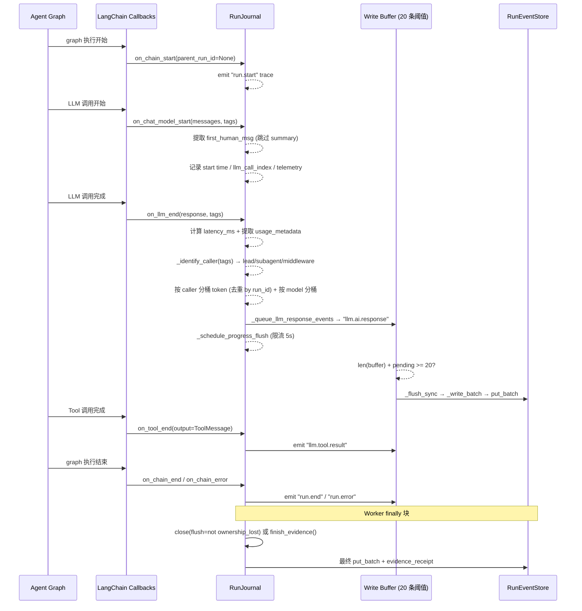

# RunJournal — LLM 调用日志与 Token 统计

## 文件

`runtime/journal.py` (1977 行，v2.2.0 实测；v2.1.0 为 1300 行，净增 677 行)

## 功能概述

`RunJournal` 是一个 **LangChain CallbackHandler**，位于 LangChain 回调机制和 `RunEventStore` 之间。它：
1. 将回调数据标准化为 `RunEvent` 记录
2. 累计 token 用量（按 caller 分桶 + 按 model 分桶）
3. 管理写入缓冲区、进度刷盘，并在写入结果**未知**时隔离（quarantine）批次
4. 🆕 2.2.0：为终态 run 捕获 **evidence 证据边界**（`finish_evidence`）

### 回调触发流程



## 设计决策

### on_llm_new_token 不写事件

DeerFlow 选择**不在** `on_llm_new_token` 中写入事件。只在 `on_llm_end` 写入完整消息。这避免了部分数据污染事件存储。

### on_chat_model_start 优先于 on_llm_start

`on_chat_model_start` (`journal.py:518`) 是捕获结构化 prompt 的标准位置：
- 消息在此处已完全结构化
- 它只在真实 LLM 调用时触发（不是每个图节点）
- 内容不受 checkpoint 压缩影响

同一处还做三件簿记：`_llm_start_times[rid] = monotonic()`、`_llm_call_index += 1`、`_capture_start_telemetry(...)`（2.2.0 新增，供 `_end_telemetry()` 在 `on_llm_end` 时补齐调用元数据）。

### 第一条人类消息提取

在 `on_chat_model_start` 中只对 `caller == "lead_agent"` 提取 `first_human_msg`：倒序扫最后一个 batch，用 `_should_persist_human_input_message()` 过滤掉名为 `"summary"` 的人类消息（`_LEGACY_SUMMARY_MESSAGE_NAME`，summarization 中间件的产物）、system/remove 类 artifact，再用 `restore_original_human_message()` 还原原文后落 `llm.human.input` 事件。

同一个 `caller == "lead_agent"` 分支还调用 `_reconcile_consumed_tool_messages(batch)`——把"即将被模型消费的 tool 结果"与已持久化的 tool 消息身份对账，补发漏记的 `llm.tool.result`。

## Token 累计

### 按调用者分桶

Token 被分配到三个桶中（`journal.py:664-676`，`on_llm_end` 内；汇总计数在 `:664-670`，三分桶在 `:671-676`）：

```python
if caller.startswith("subagent:"):
    self._subagent_tokens += total_tk
elif caller.startswith("middleware:"):
    self._middleware_tokens += total_tk
else:
    self._lead_agent_tokens += total_tk
```

调用者识别通过 `_identify_caller()` (`journal.py:1396`)：

1. 扫 tags，`subagent:*` / `middleware:*` 前缀或 `lead_agent` 全等命中即返回该 tag
2. 默认为 `"lead_agent"`（主 agent 图不注入回调标签）

注意 `on_llm_end` 用的是 `self._llm_response_callers.get(rid, callback_caller)`：**以 `on_chat_model_start` 记下的 caller 为准**，回调 tags 只在没有 start 记录时兜底（`:591-592`）。

### 🆕 按 model 分桶（`token_usage_by_model`）

同一段 token 记账里还取 `message.response_metadata["model_name"]`（回退 `"model"`）并调用 `_record_model_usage(...)`，把 `input/output/total` 与 `_extract_cache_read(usage_dict)`（缓存命中读）累进 `self._tokens_by_model`（`:690-694`）。这样一家 provider 的多模型（lead 用一个、middleware/goal evaluator 用另一个）在用量统计里是可分的，而不是只知道总数。

### 去重

四种去重保护：

- `_counted_llm_run_ids` — 防止同一 langchain run_id 的 token 双重计数（`:664`）
- `_counted_external_source_ids` — 防止子 agent 使用报告（external source）的双重计数（`:1474,1491`）
- `_counted_message_llm_run_ids` — 防止 `llm.ai.response` 事件重复产出（`:590,1093,1108`）
- 🆕 `_persisted_ai_message_identities` / `_persisted_tool_message_identities` — 按**消息身份**（而非 run_id）去重，跨"回调路径"与"worker 补记路径"共享，见下节

## 🆕 2.2.0：pending LLM response 的 canonical-callback 合并

2.1.0 是"`on_llm_end` 到了就立刻 `_put`"。问题：部分 provider 会对同一次调用**连发两次 `on_llm_end`**——第一次没有 usage，第二次才填上。旧行为会写出两条 `llm.ai.response`，其中一条 usage 为空。

2.2.0 引入 `_pending_llm_response: _PendingLlmResponse | None`（`journal.py:347`）与 `_queue_llm_response_events()`（`:1070`）：

| 情形 | 行为 |
|------|------|
| 没有 pending，本次有 usage | 立即提交（`:1111-1112`） |
| 没有 pending，本次**没有** usage | 暂存为 pending，**推迟到下一个事件或 flush**——给它一次被充实的机会 |
| pending 的 `llm_run_id` 与本次相同且有 usage | `_merge_response_event_usage()` 把 usage 字段并进 pending 的**canonical** 事件，然后提交（`:1085-1092`） |
| pending 的 `llm_run_id` 相同但没有 usage | 直接返回（重复回调，丢弃） |
| 来了一个**不同**的 llm_run_id | 先 `_commit_pending_llm_response()`（顺序边界），再处理新的 |

canonical 规则写得很明确：**第一次回调的 generation 集合、message summary、caller、非-usage 载荷是不可变的**；后续"provider 即时重放"只允许补 usage 相关字段（`usage` / `usage_metadata` / `input_tokens` / `output_tokens` / `total_tokens`，`:1047-1063`）。

`_flush_threshold` 判定也把 pending 算在内：`len(self._buffer) + len(pending.events) >= threshold` 才 flush（`_flush_if_threshold_reached`，`:1065-1068`）——否则"暂存的响应"会绕过缓冲区阈值无限积压。所有真正写缓冲区的入口（`_put`、`_flush_sync`、`_flush_async`、`flush`）开头都是 `_commit_pending_llm_response()`。

**summary 快照**：`_snapshot_message_summary()`（`:1023`）在**接受响应时**冻结 `message_count` / `last_ai_message`，而不是在提交时再算——因为 provider 可能原地改写重放消息，事后算会读到被改过的内容。

### 🆕 `record_interrupted_ai_responses()`（`:898`）

run 解析为 `interrupted` 时，把"流里已经显示给用户、但从未走到 `on_llm_end`"的部分文本补记成事件：

- 只在 worker 确认 agent stream 已关闭、且 run 已定为 `interrupted` 后调用；
- 按消息身份跳过已被完成回调记过的；`additional_kwargs["hide_from_ui"] is True` 的跳过；文本为空/全空白的跳过；
- 写出的事件 `metadata` 固定为 `{"caller": "lead_agent", "interrupted": True, "partial": True, "latency_ms": None, "llm_call_index": max(1, _llm_call_index), "usage": {}}`；
- **这些事件刻意不进 checkpoint state**——它们只补 UI/事件流，不会污染下一次 run 的模型输入；
- 重复调用是 no-op（身份集合已含即跳过），返回实际记录条数。

## 写入缓冲区

### 缓冲策略（`_put`，`journal.py:1117`）

事件不是即写即存的：

```python
def _put(self, *, event_type, category, content="", metadata=None, _admitted=False):
    if self._closed or (not self._accepting_evidence and not _admitted):
        return                       # 证据冻结后不再接受新事件
    self._commit_pending_llm_response()
    self._buffer.append(self._make_event(...))
    if len(self._buffer) >= self._flush_threshold:   # 默认 20
        self._flush_sync()
```

### 同步→异步桥接（`_flush_sync`，`journal.py:1125`）

LangChain 回调是同步的，而 store 是异步的：

```python
def _flush_sync(self):
    self._commit_pending_llm_response()
    if not self._buffer:
        return
    # 有在飞写入 / 别的操作持锁 / 有隔离批次 / 已被强制关闭 → 保持缓冲区，不并发起写
    if self._owned_writes or self._operation_lock.locked() or self._quarantined_batches or self._abandoned:
        return
    batch = self._buffer.copy()
    self._buffer.clear()
    task = self._start_write(batch)      # 无事件循环 → None
    if task is None:
        self._buffer = batch + self._buffer
```

关键变化（2.2.0 重写）：**每次写都是一个 journal 拥有的 task**，登记在 `self._owned_writes: dict[Task, batch]` 里，并挂 `_reap_settled_write` 回调。这解决了 2.1.0 的"fire-and-forget `create_task` + 无人取回异常"。

### 🆕 写入失败的四种结局（不再只有"放回缓冲区重试"）

2.1.0 的"刷新失败就把 `batch + self._buffer` 放回去重试"在 2.2.0 被拆成按**结果是否已知**分流（`_drain_pending_writes`，`:1289`；`_reap_settled_write`，`:1343`）：

| 结局 | 判据 | 处理 |
|------|------|------|
| **成功** | 任务正常返回 | `_feed_generation += 1`（feed 里真的多了行） |
| **明确未提交** | `RunEventStoreNotCommittedError` | `batch + self._buffer` 放回缓冲区，等下一次 flush 重试；`flush()` 最终以它 raise |
| **结果未知** | 其它任何异常，或任务被取消 | 进 `_quarantined_batches`（批次 + 原因），**不重试**；之后 `flush()` 直接拒绝并 `raise RuntimeError("... have an unknown durable outcome")`（`:1694`） |
| **已被放弃** | `_abandoned`（force close） | 不重放、不隔离、不计数；只报"非成功"的 `RuntimeError` |

这条分流是整个页最该记住的语义：**未知结果不能被"再写一次"掩盖**。重写可能产生重复行，而"当作成功"会给出假的耐久性证明。因此隔离批次是一条**终止性**判定：只要存在隔离批次，`_flush_sync` 就不再起新写、`flush()` 就拒绝成功，直到 journal 被关闭。

`_write_batch()`（`:1164`）用**双层任务**隔离调用方取消：内层 `asyncio.ensure_future(store.put_batch(batch))` 是真正的写，外层只做簿记并 `asyncio.shield(store_task)`。调用方被取消时，内层写**不会被取消**；若必须放弃，则 `store_task.cancel()` 后最多再等 `_WRITE_SETTLE_TIMEOUT_SECONDS`（`journal.py:62`，**5.0 秒**），超时就交给 `_supervise_abandoned_store_task()` 强引用持有并在落地时只记 warning。

> 有界等待**不等于**"底层 I/O 已停止"：`Task.cancelled()` 只反映 Python 任务，后端可能吞掉取消。所以代码注释明确写了"我们从不声称 I/O 被强制终止"。晚到的**成功**也只记 warning，**不清除隔离、不重放事件、不放行后继写、不改变 `close(flush=False)` 的可报告性**——`put_batch()` 返回 ≠ 独立提交证明。

### 最终刷新（`flush()`，`journal.py:1658`）

worker 的 `finally` 调用 `close(flush=...)`（见下），`flush()` 本身：

1. `_abandoned` → 直接 raise（force-close 后不能报告成功）
2. 拿 `_operation_lock`（串行化 flush 与 `close(flush=True)`）
3. `_flush_locked()`：`await asyncio.sleep(0)` 让 `call_soon_threadsafe` 派发的线程回调落地 → 检查隔离批次 → `_commit_pending_llm_response()` → `_drain_pending_writes()` → 循环到静止

那个 `asyncio.sleep(0)` 是 2.2.0 的细节修正：Python 3.13 起，`run_in_executor()`/`to_thread()` 在 worker 线程先完成时可能**不 yield 回事件循环**，于是 `record_middleware()` 的 `call_soon_threadsafe` 回调还排在队列里；不 yield 一次就会在 detach 之后丢掉这些事件。放在 `_flush_locked()` 里（而不是 `flush()` 里）是为了让 `close(flush=True)` 直接调用时也得到同一保证。

## 进度报告

`_schedule_progress_flush()` (`journal.py:1892`) 实现限流进度快照：

- `progress_flush_interval` 默认 5 秒
- 通过 `_progress_reporter` 回调（worker 接 `RunManager.update_run_progress()`）写入进度
- 防抖：间隔内多次触发 → 置 `_progress_dirty`，安排一次 `delay = interval - elapsed` 的延迟刷新
- 脏标记：延迟任务写完后若期间又有新数据，**再排一次**（`_flush_progress_async`，`:1923`）
- 快照在**调度时**取（`snapshot=self.get_completion_data()`），避免延迟期间数字漂移
- 进度任务失败只 warning（`_observe_progress_task_failure`）；force-close 时进度任务的取消同样受 `_WRITE_SETTLE_TIMEOUT_SECONDS` 约束（`_settle_cancelled_progress_task`，`:1271`）

## 完整数据快照

`get_completion_data()` (`journal.py:1943`) 返回运行完成时的完整数据：

```python
{
    "total_input_tokens": ..., "total_output_tokens": ..., "total_tokens": ...,
    "llm_call_count": ...,
    "lead_agent_tokens": ..., "subagent_tokens": ..., "middleware_tokens": ...,
    "token_usage_by_model": {model: {"input_tokens":…, "output_tokens":…, "total_tokens":…, ["cache_read_tokens":…]}},  # 🆕
    "message_count": ..., "last_ai_message": ..., "first_human_message": ...,
}
```

这会被 worker 的 `finally` 块写入 `RunManager.update_run_completion()`。

## 🆕 `feed_generation`（`journal.py:1960`）

一个**单调递增的成功写计数**，语义是"thread feed 真的多了行"：

- 缓冲里的事件还没进 feed，所以"查刚落库的消息查不到"是**合法**的中间态；
- 这个计数器用来告诉读者"你那次 miss 值得再问一次"——它**只在 feed 增长时**变化，缓冲区仅仅在填充时不变；
- **写失败不改变它**（什么都没变得可读）。

调用方（history/attribution 回查）据此决定是否重试缓存查询，而不是用"看到事件就以为能查到"。

## 🆕 技能使用快照（`record_skill_usage`，`journal.py:819`）

`record_skill_usage(usage: Mapping[str, Any])` 捕获"首次加载展示证据"，供 slash 技能菜单在翻页/checkpoint 压缩后仍然可复原：

- 由**成功的 lead producer** 在模型处理器被调用之前登记（tool wrapper 在 `on_tool_end` 序列化原始响应之后运行）；
- 后续的**终态 lead 响应**把这些快照带进 history feed；
- 生产路径上**不做**任何绑定事件循环的工作（只有 `_skill_usage_lock` 保护的内存写入），可以在同步/线程上下文里调用；
- `_detach_runtime_dependencies()` 会清空它。

## 中间件审计事件

`record_middleware()` (`journal.py:1520`) 允许中间件记录状态变更事件：

```python
journal.record_middleware(
    tag="title",
    name="TitleMiddleware",
    hook="after_model",
    action="generate_title",
    changes={"title": "..."}
)
```

事件类型格式为 `middleware:{tag}`，类别为 `"middleware"`。`tag` 会进入持久化事件类型列，受列宽限制；纯观察型中间件不应调用它（只有真实状态变更才算）。

## last_ai_message 保护

`_message_summary_text()` (`journal.py:445`) + `_record_message_summary()` (`:453`) 的保护逻辑：

- **仅 lead_agent 调用者**可以覆盖 `last_ai_message`（`caller is not None and caller != "lead_agent"` 直接返回 `None`）
- **非 AI 消息**不参与（`isinstance(message, AIMessage)` 或 `type == "ai"`）
- `strip_leading_think_blocks()` 先剥掉开头的 think 块，所以"只有思考块"的消息剥完就是空文本 → 不覆盖
- 内容截断到 **2000** 字符

这确保 UI 显示的"最后一条 AI 消息"是主 agent 对用户说的最后一句话。

## 🆕 2.2.0：`close(flush=)` 与证据冻结

2.1.0 只有 `flush()`。2.2.0 把收尾拆成两个可组合的动作：

### `close(*, flush: bool = True)`（`journal.py:1834`）

| 形态 | 是否取 `_operation_lock` | 行为 |
|------|--------------------------|------|
| `close(flush=True)`（正常收尾） | 取 | `_stop_evidence_producers()` → `_flush_locked()` → `_detach_runtime_dependencies()`。**整段是一个不可分割的受保护操作**——排队在后面的正常 close 只能看到"已彻底落盘后才 detach"的状态，不会观察到 settled-but-detached，也不会有无人排空的后继批次 |
| `close(flush=False)`（force / 租约丢失） | **不取** | 在**第一次 await 之前**置 `_abandoned = True`，然后取消并回收所有 owned write 与进度任务（有界 + 晚到结果监督），最后 detach。不排队在可能卡住的正常操作之后 |

两条不变量：

- **`_abandoned` 先于 `_closed` 检查**：force close 会同时置两个位，所以排在锁后面的正常 close 必须**失败**而不是看到 `_closed` 就报假成功。
- **终态单调**：已经耐久关闭的 journal 不会被再标 ABORT（那会把 `flush()` 从 no-op 变成 error）；但 force close 仍可抢占一个在飞的正常 close（此时 `_closed` 尚未置位）。

worker 的调用点是 `await journal.close(flush=not record.ownership_lost)`（`runs/worker.py:2219`）：**只有在还持有所有权时才承诺落盘**，被 fence 的 worker 不能声称自己提交了证据。

### `finish_evidence(*, before_receipt=None)`（`journal.py:1772`）

与业务终态无关、**不 detach** 的证据结算：

1. 取 `_operation_lock`（与 flush / 正常 close 同一把）
2. `_drain_evidence()`：停掉已声明的生产者（`_stop_evidence_producers`）+ `_flush_locked()`
3. `before_receipt()`：worker 的终态确认钩子——**在 drain 之后、取边界之前**执行，处于同一把锁内
4. 若 store 是 `DbRunEventStore`：`await self._store.evidence_receipt(thread_id, run_id)` → 返回 `JournalSealReceipt`（`runtime/events/evidence.py`，13 行）；否则返回 `None`（"不支持的 store 没有耐久回执"）

语义边界写得很清楚：**已证明未提交的写仍然可以显式重试**；**未知结果保持隔离且永不产生耐久回执**。`_abandoned` 在三个检查点都会 raise（进入时、`before_receipt` 之后、取边界之后），因为 force close 可能在任意 await 点插进来。

worker 侧对应 `seal_completed_evidence()` / `mark_evidence_partial()`（`runs/manager.py:932` / `:944`）：拿到 receipt 就写 `evidence_state=complete`，拿不到（或检出残缺）就写 `partial`。

## 交付回执（delivery receipt）→ 见 05

`RunJournal` 为终态 `run.delivery` 事件记录非空 artifact 更新（每个工具 `Command` 一次，`run_inline=True` 只做内存簿记/调度异步写）。完整语义（`produced_paths` / `presented_paths` / `matched_paths` / 验证降级）在 [05-run-ownership-and-rollback.md](05-run-ownership-and-rollback.md)。

## 🆕 分支/迁移历史种子事件（`journal.py:259` / `:278`）

`build_branch_history_seed_events(messages, thread_id=, run_id_prefix=, parent_thread_id=)` 与 `build_checkpoint_history_seed_events(messages, thread_id=, run_id_prefix=)` 把继承来的历史序列化成"本分支/本线程空 feed 的种子行"，共用同一套消息归一化与按轮次分组逻辑，只在 metadata 上区分：

- 分支：`{"branch_seed": True, "branch_parent_thread_id": parent_thread_id}`
- 迁移：`{"checkpoint_history_seed": True}` —— 刻意**不带** `branch_seed`，这些行不是"从别的线程继承来的"，不能被认成分支种子。

---

> **See also:** [01-run-manager.md](01-run-manager.md)（`update_run_progress` / evidence seal）· [05-run-ownership-and-rollback.md](05-run-ownership-and-rollback.md)（ownership 与交付回执）· [03-serialization.md](03-serialization.md)
