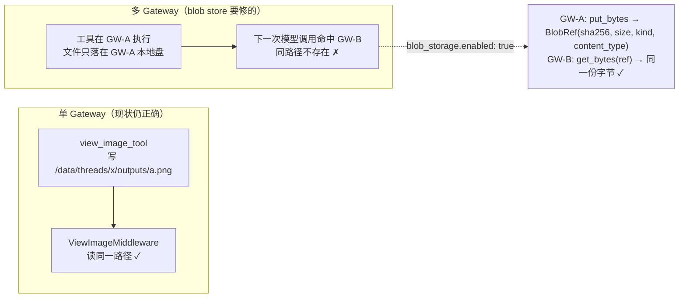
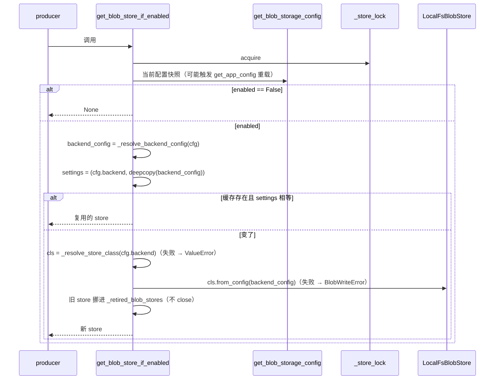

# Blob 契约与工厂 — `contract.py` + `manager.py`

`deerflow/storage/` 在 v2.2.0 是**全新子包**（issue [#4189](https://github.com/bytedance/deer-flow/issues/4189) item 2 的存储抽象那一半）。它在 CHANGELOG 里的落地顺序是：契约与 local_fs 后端（[#5361]，`CHANGELOG.md:1605-1613`）→ tool-output producer（[#6159]，`:1614-1620`）→ viewed-image producer（[#6160]，`:1622-1628`）→ artifact 路由的 blob 回退（`:1815-1825`）。本页只讲**接口与装配**：`BlobRef` 的校验、`BlobStore` 的抽象/默认划分、错误家族的分级语义，以及 `manager.py` 怎么把一个配置键变成一个进程级单例。

后端的具体布局与 I/O 路径见 [02-local-fs.md](02-local-fs.md)；谁在调用、失败怎么降级见 [03-producers.md](03-producers.md)；配置键的完整字段见 [04-config-reference.md](../configuration/04-config-reference.md) 的「🆕 blob_storage（内容寻址对象存储）」小节（该文件 `:833`）。

→ Back to [storage README](README.md)

## 相关文件

- `deerflow/storage/contract.py`（198 行）— `_KIND_PATTERN` / `_KIND_GRAMMAR` / `is_valid_blob_kind()` / `validate_blob_kind()` / 错误家族 / `BlobRef` / `BlobStore`
- `deerflow/storage/manager.py`（224 行）— 后端解析（`_resolve_store_class`）、文件夹扫描（`_scan_backends`）、配置归一（`_resolve_backend_config`）、两个访问器、`reset_blob_store()`
- `storage/__init__.py`（34 行）— 包级 re-export（12 个名字），`from deerflow.storage import ...` 是唯一推荐入口
- `deerflow/config/blob_storage_config.py`（121 行）— `BlobStorageConfig`（`enabled` / `backend` / `backend_config` 三个 host 共享字段）
- `backend/tests/test_blob_store.py`（485 行）— 契约 + local_fs + 工厂全部不在 producer 里跑的用例
- 上游文档：`backend/docs/blob-storage.md`（138 行，运维面 + producer 迁移状态 + GC 规则）、`packages/harness/deerflow/storage/AGENTS.md`（109 行，新后端作者须知）

---

## 1. 它解决的问题：把「路径」换成「内容」

`contract.py:1-17` 的 docstring 把动机写得很直白：多 Gateway 部署下，**服务器本地文件路径只在写它的那个实例上有意义**；摘要值在哪里都有意义。



`BlobRef` 的四元组里，**只有 `sha256` 是地址**；`size` 让读者不信任后端也能自检，`kind` 让保留期清理能按内容类别推理而不去解析路径（`contract.py:79-85`）。三段式（写入幂等 / 去重免费 / 读时校验）全部由这一点推出来。

---

## 2. `BlobRef`（`contract.py:76-111`）

`model_config = ConfigDict(frozen=True)`（`contract.py:87`）——不可变，可以直接当 dict key、可以在 checkpoint 里长期保存。

| 字段 | 行号 | 约束 |
|------|------|------|
| `sha256` | `contract.py:89` | 小写 hex，**正好 64 位**；`_sha256_is_hex64`（`contract.py:94-100`）先 `strip().lower()` 再 `fullmatch(r"[0-9a-f]{64}")`，所以大写或带空白的输入会被**规范化**而不是拒绝 |
| `size` | `contract.py:90` | `Field(ge=0)`；0 字节 blob 合法 |
| `kind` | `contract.py:91` | 过 `validate_blob_kind`（`contract.py:102-105`） |
| `content_type` | `contract.py:92` | `str \| None`，默认 `None`；**契约不校验 MIME 合法性**（见 §3.4） |

`BlobRef.matches(data)`（`contract.py:107-111`）是读者侧的免费自检：先比 `len(data)` 再比 hash。JSON 安全的 checkpoint 形态是 `agents/thread_state.py:53-59` 的 `BlobRefData`（TypedDict，`content_type: NotRequired[str | None]`），producer 用 `model_dump(mode="json", exclude_none=True)` 落盘，读回时 `BlobRef.model_validate(...)`。

---

## 3. `kind` 语法：一次性把病态输入挡在契约层

`_KIND_PATTERN`（`contract.py:32`）= 前瞻 `(?=.{1,64}$)` 加"一个字母或数字、尾部 0 个或多个「字母数字或连字符」、末尾必须仍是字母或数字"，即 **1–64 字符、全小写、只用 `a-z0-9-`、首尾必须是字母或数字**，配套的**面向调用方的同一份文本** `_KIND_GRAMMAR` 在 `contract.py:36`。

为什么这么窄，注释写明了（`contract.py:27-31`）：`kind` 在 `local_fs` 后端里**同时是路径段**。所以：

| 病态输入 | 被挡在 | 挡住的机制 |
|----------|--------|------------|
| `"../etc"` | 契约层 | `/` 与 `.` 不在字符集 |
| `"a/b"` | 契约层 | `/` 不在字符集 |
| `"Aupper"` | 契约层 | 禁止大写（NTFS/APFS 大小写不敏感，避免同一 kind 落进两个目录） |
| `"-lead"` / `"trailing-"` / `"a--"` | 契约层 | 首尾字符必须是 `[a-z0-9]`；`a--` 因末字符是 `-` 被拒 |
| `""` / 65 字符 | 契约层 | 前瞻 `(?=.{1,64}$)` |
| `"has space"` | 契约层 | 空格不在字符集 |

`validate_blob_kind()`（`contract.py:44-53`）是唯一实现，报错信息直接引用 `_KIND_GRAMMAR`——`contract.py:33-35` 的注释清楚记录了动机：曾经 `local_fs` 后端自己也有一份 pattern，**两份会漂移**，于是"契约接受的 kind 在一个后端可寻址、在另一个后端不可寻址"。`backend/tests/test_blob_store.py:133` 专门钉住这条（断言报错文本里含 pattern、`1-64 chars`、`no leading or trailing hyphen` 三段）。

`is_valid_blob_kind()`（`contract.py:39-41`）额外做了 `isinstance(kind, str)` 守卫，非字符串直接 `False` 而不是抛 `TypeError`。

---

## 4. `BlobStore`（`contract.py:114-198`）：一串 ABC，不是 pydantic 模型

docstring 明说"像 `MemoryStorage` 而不是 pydantic 的 `MemoryManager`"（`contract.py:117-120`）：契约不带配置字段，没有可校验的东西，也就没有 `PrivateAttr` 那套仪式。后端由工厂通过 `from_config` 构造。

**可移植性规则**（`contract.py:122-125`）：后端只通过两个通道接触宿主——**方法参数**和 **`backend_config` dict**。因此一个后端包唯一需要 import 的 deerflow 符号就是契约里的 `BlobStore`（`local_fs_store.py:44-52` 的 import 列表里其余名字全是异常类型与 `BlobRef`，同属契约模块）——第三方后端可以整个活在这个仓库之外，用导入路径选择。**这是 `AGENTS.md:73-77` 的设计约束，不是 import 钩子强制的规则**（未逐行核实：仓库里没有任何检查器会拦截后端目录里的其它 deerflow import）。

| 成员 | 行号 | 层级 | 语义要点 |
|------|------|------|----------|
| `STORE_CLASS_ATTR = "STORE_CLASS"` | `contract.py:130` | 类常量 | 与 memory 的 `MANAGER_CLASS` 同构，工厂用它找到类 |
| `from_config(cls, backend_config)` | `contract.py:132-141` | **abstract classmethod** | 必须对不可用配置**抛错**；"悄悄在错误的 root 上启动"比"拒绝启动"更糟 |
| `put_bytes(data, *, kind, content_type=None, thread_id=None) -> BlobRef` | `contract.py:143-166` | **abstract** | 幂等：相同字节两次 put 返回同一 ref、不得复制存储 |
| `get_bytes(ref) -> bytes` | `contract.py:168-177` | **abstract** | 缺失 → `BlobNotFoundError`；存在但读不了 → `BlobReadError`；**SHOULD** 读时校验 digest |
| `exists(ref) -> bool` | `contract.py:179-185` | 默认 | 通过 `get_bytes` 探测，只吞 `BlobNotFoundError` |
| `delete(ref) -> None` | `contract.py:187-195` | 默认 | 默认 `raise NotImplementedError`，让"不支持删除"的后端**说出来**；删除不存在的 blob 不是错误 |
| `close() -> None` | `contract.py:197-198` | 默认 | 空操作 |

`thread_id` 是**咨询性来源（advisory provenance），永远不是引用计数**（`contract.py:157-166`）。理由链：内容寻址意味着相同字节塌缩成一个对象，两个线程外置同样的内容会共享；后端只能记录**先到的那个 writer**；多实例下两个 Gateway 追加同一个 sidecar 本来就是丢更新的 read-modify-write 竞态。所以 GC 的存活判定必须来自**持久引用**（checkpoint 行），不能来自这个字段——规则全文在 `backend/docs/blob-storage.md:89-125`，本页不重复。

---

## 5. 错误家族与失败分级（`contract.py:56-73`）

```
BlobStoreError(RuntimeError)          "backend-neutral base error"
├── BlobNotConfiguredError            "caller required a store but enabled is False"
├── BlobWriteError                    "write failed after retries; content was NOT persisted"
└── BlobReadError                     "read failed for a reason OTHER than absent"
    └── BlobNotFoundError             "the referenced content is not present"
```

四条**契约级**策略（每一条都有对应回归用例，所以在 digest 里值得当事实记）：

| # | 策略 | 证据 |
|---|------|------|
| 1 | **删除失败抛中性的基类 `BlobStoreError`，不是 `BlobReadError`**。理由写在 `local_fs_store.py:178-182` 的注释里：错误家族从第一天就是公共 API，按读失败匹配的调用方不该收到一个它读不懂的 unlink 失败 | `local_fs_store.py:184-191`、`test_blob_store.py:196-213`（`assert not isinstance(caught.value, BlobReadError)`） |
| 2 | **`BlobNotFoundError` 是 `BlobReadError` 的子类**，所以"缺失"与"读坏"能一起捕、也能分开捕；`exists()` 的默认实现因此只需吞最窄的那个 | `contract.py:72`、`contract.py:179-185` |

另外三条同样值得当事实记：

| 行为 | 代码 | 用例 |
|------|------|------|
| 包级 re-export 是**同一类对象**且齐全 | `storage/__init__.py:8-33` | `test_blob_store.py:341-354` |
| 契约层**不**校验 `content_type`（只校验 sha256 / size / kind） | `contract.py:89-105` | `test_blob_store.py:92-98`（roundtrip 才断言 content_type） |
| 同内容不同 kind **合法共存**（分层目录属于 local_fs） | 见 [02-local-fs.md](02-local-fs.md#1-磁盘布局) | `test_blob_store.py:147-153` |
| 只读探测用 `is_file()`，不读全文 | `local_fs_store.py:165-167` | `test_blob_store.py:155-160` |

`BlobNotConfiguredError` 的触发点只有一个：`get_blob_store()` 在 `enabled=False` 时抛（`manager.py:168-177`），文案直接建议可选调用点改用 `get_blob_store_if_enabled()`。

---

## 6. 工厂 `manager.py`

### 6.1 后端解析：两种形态（`_resolve_store_class`，`manager.py:59-90`）

```
blob_storage.backend
  ├── 不含 "." 也不含 ":"  → 注册名 → _scan_backends() 的 {folder_name: class}
  └── 含 "." 或 ":"        → 导入路径
        ├── "pkg.mod:Class"  → partition(":")
        └── "pkg.mod.Class"  → rpartition(".")
```

- **注册名**走文件夹扫描：`_scan_backends()`（`manager.py:93-127`）遍历 `storage/backends/`，跳过 `_` 开头的目录，用 `_import_backend_module()` 判"是不是后端包"，再取 `STORE_CLASS` 并 `issubclass(cls, BlobStore)` 确认；不满足就 `logger.warning` 后跳过。
- **导入路径**分支要求模块能 import、属性是 `BlobStore` 的子类，否则 `ValueError`（`manager.py:83-90`）。`test_blob_store.py:453` 用参数化 `[".", ":"]` 钉住两种分隔符，并且**用一个临时写出的单文件模块**证明"单文件部署本地后端"这条路径真的能跑通。
- **失败策略是 fail-fast**：`_resolve_store_class` 抛，而不是回退到 `local_fs`（`manager.py:17-19` 的模块 docstring：「悄悄换了后端会遗弃已经写下的内容，比拒绝启动更糟」）。`test_blob_store.py:434` / `:401` 分别钉"未知后端名"与"缓存旧 store 之后改成非法后端名不会复用旧实例"。

`_scan_backends()` 里有一个容易忽略的**容错细节**：`except ValueError`（不是后端包，静默 debug 跳过）与 `except Exception`（导入失败，`logger.exception` 后跳过）**分开**处理（`manager.py:106-117`）——一个坏掉的可选后端（比如缺 boto3）不能把整个 store 拖下水，工厂还要能解析默认后端。

### 6.2 配置归一：`root` 的三条来源（`_resolve_backend_config`，`manager.py:143-155`）

| `backend_config.root` 的形态 | 结果 | 代码 |
|------------------------------|------|------|
| 缺省 / 空 | `{runtime_home}/blobs`，**绝对路径** | `manager.py:146-147` → `_default_backend_config()`（`:130-140`） |
| 相对路径 | 相对 `runtime_home()` 解析后绝对化 | `manager.py:148-154` |
| 绝对路径 | 原样透传 | `manager.py:144-145` |

`runtime_home()` 的规则：`DEER_FLOW_HOME` 优先（绝对化），否则 `project_root()/.deer-flow`（`config/runtime_paths.py:19-23`）。之所以在**宿主侧**做解析、后端只收最终字符串，是为了让后端不依赖 `runtime_home`（与 memory 工厂同一理由，`manager.py:149-152`）。`test_blob_store.py:478` 钉住"相对 root 出来的是绝对路径"。

### 6.3 单例与「有效配置判等」（`_get_blob_store_if_enabled`，`manager.py:180-201`）



四个状态变量都在 `manager.py:44-48`：`_blob_store`、`_blob_store_settings: tuple[str, dict]`、`_retired_blob_stores: list`、`_backends_cache`，锁是 `threading.Lock()`。

**关键行为**（都在 `test_blob_store.py` 有钉）：

| 行为 | 代码 | 用例 |
|------|------|------|
| `enabled=False` 直接返回 `None`，**不构造任何 store** | `manager.py:186-187` | `test_blob_store.py:356` |
| 同一配置第二次调用返回同一实例 | `manager.py:191-192` | `test_blob_store.py:364` |
| `backend_config.root` 变了 → 建新 store，新的 blob 落在新 root、**不会**回填旧 root | `manager.py:194-199` | `test_blob_store.py:373` |
| 被替换的 store **保持打开**，直到 `reset_blob_store()` 才 `close()`（在途调用方还能把它用完） | `manager.py:196-197`、`:204-216` | `test_blob_store.py:410` |
| 关掉开关后，缓存的 store **不会被继续交出** | `manager.py:186` | `test_blob_store.py:391` |

`reset_blob_store()`（`manager.py:204-216`）关闭所有 retired + 当前 store，清空单例、settings 和**后端扫描缓存**（`_backends_cache = None`），单个 `close()` 抛异常只 `warning` 不中断其它 close。

### 6.4 两条访问器的分工

| 访问器 | 行号 | 何时用 | 关闭时的行为 |
|--------|------|--------|--------------|
| `get_blob_store_if_enabled()` | `manager.py:158-165` | **producer 应该用这个**。`None` 是一个显式、可检查的信号，producer 于是继续走原来的本地路径 | 返回 `None` |
| `get_blob_store()` | `manager.py:168-177` | 真的**需要** store 的调用方 | 抛 `BlobNotConfiguredError` |

⚠️ 全仓 grep 的结论：**v2.2.0 的生产代码里没有任何地方调用 `get_blob_store()`**——只有 `test_blob_store.py` 和 `test_app_config_reload.py` 用。它是对外承诺的 API，不是当下的内部路径。

### 6.5 热重载链路

`blob_storage` **不在** `STARTUP_ONLY_FIELDS` 里（`config/reload_boundary.py:45-`，对照 `database` / `checkpointer` / `sandbox` / `plugins` 等条目），所以它是热加载字段：

1. `AppConfig.from_file()` → `_apply_singleton_configs()`（`config/app_config.py:548`）→ `load_blob_storage_config_from_dict(config.blob_storage.model_dump())`（`app_config.py:556`）刷新模块级 `_blob_storage_config`。
2. `get_blob_storage_config()`（`blob_storage_config.py:61-94`）**自愈**：只要 `_app_config is not None`，先调一次 `get_app_config()` 让签名校验触发重载；重载抛错（YAML 坏了）则保留上一份好配置并 `warning`，让在途 turn 正常完成。若 `get_app_config()` 从未被调用过，则不主动读文件——避免"第一次访问 blob 配置就顺手把 config.yaml 读进来"破坏单测对模块默认值的预期（`blob_storage_config.py:73-78`）。
3. 工厂在**每次访问**时都重算 `settings` 并比较（`manager.py:189-192`），所以改完 YAML **不需要重启**，下一次 `get_blob_store_if_enabled()` 就换 store。
4. `load_blob_storage_config_from_dict()` 对**未知顶层键**打 warning 后丢弃（`blob_storage_config.py:113-120`）——`blob_storage:` 下只认 `enabled` / `backend` / `backend_config`（`_SHARED_FIELDS`，`blob_storage_config.py:21`）。

端到端用例：`test_app_config_reload.py:879`（`test_blob_store_follows_config_file_reload`）改文件 → 换 root → 拿到新 store → 关开关 → `None` + `BlobNotConfiguredError`。

⚠️ **未逐行核实**：上述"每一次访问都重算"意味着每个 producer 热点路径（例如每次 `view_image`、每次 `wrap_model_call` 的 blob 分支）都会走一次 `get_blob_storage_config()`，在有 `_app_config` 的情况下那是一次 `get_app_config()` 调用（带签名检查）。该检查的开销本身本页未测量；如果将来有性能问题，这里是最可能的收费点。

---

## 7. 给新后端作者的核对清单（`AGENTS.md:63-98` 的事实化）

文件夹名 == 后端名 == `blob_storage.backend` 的取值，工厂靠扫目录发现，**不需要改任何注册表**：

1. `storage/backends/<name>/__init__.py` 暴露 `STORE_CLASS = <YourStore>`（示例：`backends/local_fs/__init__.py:13`）。
2. 子类实现 `from_config` / `put_bytes` / `get_bytes`；`exists` / `delete` / `close` 有可用默认值。
3. **读时校验 digest**——静默返回错字节的 store 与损坏的 checkpoint 无法区分。
4. 只通过方法参数与 `backend_config` 接触宿主；唯一允许的 deerflow import 是契约里的 `BlobStore`。
5. 配置不可用就**抛**，不要静默换 root / 换后端。
6. 后端语义用例加进 `backend/tests/test_blob_store.py`（该套件对每个后端跑同一批不依赖后端的场景，root 用临时目录）。

外部依赖（boto3 / minio）必须写进 `packages/harness/pyproject.toml` 并配 `[tool.uv.sources]`，否则 `uv sync` 会把它们清掉（`backend/docs/blob-storage.md:138`）。

---

## 8. 边界：这个模块**不**做什么

| 不做 | 归属 |
|------|------|
| 垃圾回收 | **不是本模块的职责**（`AGENTS.md:100-105`）：一个 blob 可能被多个线程引用，清理必须从持久引用（checkpoint 行）判定存活，规则在 `backend/docs/blob-storage.md`，并与 checkpoint 保留契约 #5255、线程级清扫 #5188 的组合边界一起定义 |
| `kind` → MIME 的一致性 | producer 侧校验（见 §5 表第 4 条） |
| 单次 put 的大小上限 | local_fs 的 `_MAX_BLOB_BYTES`（64 MiB）是**后端级 defense-in-depth**，不在契约里；别家后端自定策略 |
| 重启要求 | `blob_storage` 是热加载字段（§6.5）；但**换 root 需要运维协调**：旧 blob 必须先迁移或保留可读，否则仍指向旧 digest 的 checkpoint ref 会变成永远 404 |
| checkpoint 里的 blob 语义 | `checkpoint_blobs` 表（LangGraph 自己的 channel 存储）是**另一件事**，与这里的 `BlobRef` 无关；见 [../persistence/checkpoint-dual-mode-and-history-cache.md](../persistence/checkpoint-dual-mode-and-history-cache.md) |

→ 继续读：[02-local-fs.md](02-local-fs.md)（后端 I/O 路径）· [03-producers.md](03-producers.md)（谁在调用、失败怎么降级）
