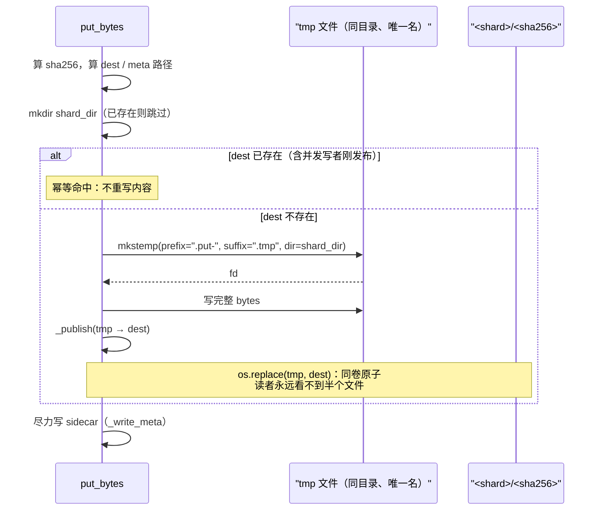

# local_fs 后端 — `backends/local_fs/`

`local_fs` 是 blob store 的**默认后端**，也是 `AGENTS.md:63-64` 所说的"迁移桥"：当 `root` 指向共享卷（NFS / EFS / `ReadWriteMany` PVC）时，它已经给出多实例解析，不需要对象存储依赖；S3 后端被明确定位为"后来的可选额外项，实现同一契约"（`local_fs_store.py:66-69` 原文）。

→ Back to [storage README](README.md) · 上游一页：`contract.py` / `manager.py` 见 [01-contract-and-factory.md](01-contract-and-factory.md)

## 相关文件

- `deerflow/storage/backends/local_fs/local_fs_store.py`（260 行）— `LocalFsBlobStore` 全部实现
- `deerflow/storage/backends/local_fs/__init__.py`（13 行）— `STORE_CLASS = LocalFsBlobStore`（工厂扫描入口）
- `deerflow/storage/backends/__init__.py`（13 行）— 后端目录约定："文件夹名 == 后端名 == `BlobStorageConfig.backend`"
- `backend/tests/test_blob_store.py:92-339` — local_fs 语义全部用例（后端无关场景，每个后端都要跑）
- `backend/docs/blob-storage.md`（138 行）— 运维面布局 + GC 规则

---

## 1. 磁盘布局

```
<root>/<kind>/<sha256[:2]>/<sha256>          the bytes
<root>/<kind>/<sha256[:2]>/<sha256>.json     sidecar metadata
```

- `_paths_for(ref)`（`local_fs_store.py:90-92`）是**唯一**的位置计算：`shard_dir = root / kind / sha256[:2]`，再拼 `sha256` 与 `sha256 + ".json"`（`_META_SUFFIX`，`:56`）。
- 两级分片：`kind` 先分（同内容不同 kind 落在不同目录——`test_blob_store.py:147` 钉住），`sha256[:2]` 再分（256 个子目录摊平单目录条目数）。
- `sha256` 小写 hex 由契约保证（`contract.py:94-100`），所以路径大小写不敏感的文件系统上也不会有"同一 blob 两个文件"。

**磁盘带电状态的六种组合**（实现只依赖其中前两列）：

| 内容文件 | sidecar | 读 | 写 | 谁制造 |
|----------|---------|----|----|--------|
| ✓ | ✓ | 正常 | 幂等命中 | 正常 put |
| ✓ | ✗ | **正常**（读不依赖 sidecar，`:105-114` 从不打开 `.json`） | 幂等命中，并**补齐** sidecar（`:196-206`） | sidecar 丢失、或被运维手工清掉 |
| ✗ | ✓ | `BlobNotFoundError` | 写入内容 + 覆盖 sidecar | 内容被外部删除、GC 只删了内容 |
| ✗ | ✗ | `BlobNotFoundError`（GC 之后正常状态） | 新建 | 正常 GC |

---

## 2. `put_bytes`（`local_fs_store.py:95-141`）

### 2.1 前置校验顺序（决定了错误的优先级）

| 序 | 行号 | 校验 | 失败 |
|----|------|------|------|
| 1 | `:104` | `validate_blob_kind(kind)` | `ValueError`——**在触碰磁盘之前**（`test_blob_store.py:231` 断言 root 下没有任何新建文件） |
| 2 | `:105` | `len(data) > _MAX_BLOB_BYTES`（64 MiB） | `BlobWriteError` |
| 3 | `:107` | 计算 `sha256`（地址就是内容） | — |
| 4 | `:109-113` | shard 目录 `mkdir(parents=True)` | 包装成 `BlobWriteError` |

### 2.2 内容发布（`_atomic_write`，`:216-226`）



精确实现细节（`:116-139`）：

- 临时文件用 `tempfile.mkstemp(prefix=".put-", suffix=".tmp", dir=shard_dir)`（`:118`）——**建在目标目录内**，因为 `os.replace` 只在同卷上原子（`:28-30` 的注释解释了为什么不用全局临时目录）。
- 写入走 `os.fdopen(fd, "wb")`，写完 `handle.flush()` + **`os.fsync(fileno)`**（`:124-127`）；任何 `BaseException`（含 `KeyboardInterrupt`）都会先 best-effort `os.unlink(tmp_name)` 再原样抛出（`:128-133`），避免残留临时文件累积。
- 内容已存在时**跳过写入**（`:111-115`）——这就是"写幂等、去重免费"的落点；顺带补齐可能缺失的 sidecar。
- 文件内容 `fsync` 了（`:127`），但**临时文件的目录项与 rename 之后的父目录都没有 `fsync`**。因此断电后的持久性不在承诺里（`docs/blob-storage.md` 也未声称）。进程崩溃是安全的（`os.replace` 原子），掉电不是——**未逐行核实**这是刻意取舍还是遗漏。

### 2.3 并发写者：`_publish` 与 `WinError 5`（`:192-226`）

```python
def _publish(self, tmp_path, data_path, data):
    for attempt in range(_REPLACE_ATTEMPTS):            # 3
        try:
            os.replace(tmp_path, data_path)
            return
        except PermissionError:
            if self._content_matches(data_path, data):  # 逐字节比对
                self._discard(tmp_path)
                return
            if attempt + 1 == _REPLACE_ATTEMPTS:
                raise
            time.sleep(_REPLACE_BACKOFF_SECONDS * (attempt + 1))   # 0.02, 0.04
```

- 两个 Gateway 同时 put 同一内容时，两者各写各的临时文件、都 `os.replace` 到同一目标。**最后一个写者赢，且内容完全相同**；读者任何时刻看到的都是完整的旧文件或完整的新文件。
- Windows 上目标正被读者打开时 `os.replace` 抛 `PermissionError`（`WinError 5`）——正是"两个 Gateway put 同一 blob、而读者已经在服务它"的场景。实现的处理是**确认目标里已有这份字节**（`_content_matches`，`:215-220`，逐字节 `read_bytes() == data`；读失败返回 `False`）才算目的达成，否则按 `0.02 × (attempt+1)` 退避重试，3 次后抛出。
- `_REPLACE_ATTEMPTS = 3`（`:59`）、`_REPLACE_BACKOFF_SECONDS = 0.02`（`:60`）。
- `test_blob_store.py:243` 用多线程同时 put 同一内容钉住收敛。

⚠️ 注意 `_content_matches` 是**逐字节比较而不是 digest 比较**——这里没有"目标内容可疑"的余地（同名必同 hash），逐字节比在 64 MiB 上限内是可接受的最坏代价，但比 hash 慢。**未逐行核实**是否有意为之。

### 2.4 sidecar 三条规则

sidecar 内容（`:229-241`）：

```json
{"sha256": "...", "size": N, "kind": "...", "content_type": "..." | null,
 "writer_thread_id": "..." | null, "created_at": <float>}
```

写 sidecar 本身也是原子发布：`mkstemp(prefix=".meta-", ...)` → `json.dump` → `os.replace`（`:243-247`），全程在一层 `try` 里。

| 规则 | 含义 | 代码 |
|------|------|------|
| **不是读依赖** | 丢失或截断的 sidecar 不能让内容不可读；`get_bytes` 从不打开 `.json` | `:143-163`、`:111-115`（只有"内容已存在但 sidecar 缺失"才补写） |
| **不是引用计数** | `writer_thread_id` 只记录**先到的写者**；相同字节塌缩成一个文件；清理必须确认没有存活引用后再 unlink | `:20-23`、`test_blob_store.py:112` |
| **失败不毁 put** | 内容发布成功后，sidecar 的任何 `OSError` 只 `logger.warning(..., exc_info=True)`，put 仍然成功 | `:248-257` |

第三条有一个**已知历史坑**：`CHANGELOG.md:4859-4864` 记录——`mkstemp` 原本在 `try` 之外，"sidecar 临时文件分配失败会在内容已经原子发布之后报告 put 失败"。现在 `mkstemp` 与 `json.dump` 都在 `try` 内部（`:243-247`），而**内容分配失败仍然让 put 失败**（那是真的没写成，`test_blob_store.py:324`）。测试矩阵：`:270`（sidecar 丢失）、`:280`（分配失败 × 存在/不存在两种前态）、`:303`（发布失败 × 两种前态）、`:324`（内容分配失败仍失败）。

---

## 3. `get_bytes`（`local_fs_store.py:143-163`）

三层失败分得很细，**每一层对应契约里的不同错误**：

| 层 | 行号 | 条件 | 异常 |
|----|------|------|------|
| 1 | `:145-148` | `FileNotFoundError` | `BlobNotFoundError`（消息带 `ref.sha256[:12]` 与 `kind`） |
| 2 | `:149-150` | 其它 `OSError` | `BlobReadError` |
| 3 | `:156-158` | `len(data) != ref.size` | `BlobReadError`（"may be truncated"） |
| 4 | `:159-162` | `sha256(data) != ref.sha256` | `BlobReadError`（"store may be corrupted"） |

第 3/4 层是"读者不信任后端"的落点：`test_blob_store.py:162`（尺寸不符）与 `:173`（**同尺寸但 digest 不符**——专门防"大小对、内容错"的静默损坏）。

顺序值得注意：**先比尺寸再比 digest**。尺寸不符时连 hash 都不算，省一次全量读哈希。

---

## 4. `exists` / `delete` / `close`

| 方法 | 行号 | 行为 |
|------|------|------|
| `exists(ref)` | `:165-167` | `data_path.is_file()`——只探测，不读全文 |
| `delete(ref)` | `:169-185` | 删内容 + sidecar；**缺任一文件都不算错**（幂等）；其余 `OSError` 包成 **`BlobStoreError`（中性基类）**，不是 `BlobReadError` |
| `close()` | `:187-189` | 空实现（`# noqa: B027`）：root 之外无状态，没有句柄要释放 |

`delete` 的注释（`:178-182`）是这条错误分级的出处：错误家族自第一天就是公共 API，一个按读失败匹配的调用方不该收到它读不懂的 unlink 失败。

---

## 5. 构造：`__init__` / `from_config`（`:72-86`）

| 步骤 | 行号 | 失败 |
|------|------|------|
| `Path(root).expanduser()` | `:73` | — |
| `mkdir(parents=True, exist_ok=True)` | `:74-77` | `BlobWriteError`（"Cannot create blob store root"） |
| `os.access(root, os.W_OK)` 可写性探测 | `:78-79` | `BlobWriteError`（"not writable"） |
| `from_config` 缺 `root` | `:83-85` | `ValueError`——注释明确指出"工厂会注入默认值"，所以正常路径不会走到这里 |

这里有**两处刻意地"不 fail-fast"**：不在构造时探测 root 是否位于共享卷（那是运维承诺，不是代码可验证的事实）；`os.access` 探测在 root 本身可写但不可写子目录的情况下会通过（未逐行核实的边界：ACL 只给 root 读权限而 denying 子目录创建的部署）。

---

## 6. 64 MiB 上限：为什么不在契约里

`_MAX_BLOB_BYTES = 64 * 1024 * 1024`（`:57`）。它是 **backend 级 defense-in-depth**，不是 `BlobStore` 契约的一部分（`AGENTS.md:94-98`、`docs/blob-storage.md:36`）。三条后果：

1. **别家后端自定策略**——契约里没有 `max_size`，一个 S3 后端可以允许更大。
2. **producer 必须自己守**。`ToolOutputBudgetMiddleware` 的 `_MAX_TOOL_OUTPUT_BLOB_BYTES`（64 MiB，`tool_output_budget_middleware.py:79`）是**同值重复**：超过就内联回退，不写 blob（见 [03-producers.md](03-producers.md)）。
3. **一个部分写入的临时文件不会因为超限而留下**：超限判断在写任何字节之前（`:105`）。

---

## 7. 与 S3 后端的距离（读完源码后的判断）

代码与文档只说清了三件事：S3 是"后来的可选额外项"（`local_fs_store.py:67-69`）；它实现同一契约；它的外部依赖（boto3 / minio）必须写进 `packages/harness/pyproject.toml` 并配 `[tool.uv.sources]`，否则 `uv sync` 会清掉（`docs/blob-storage.md:138`）。**v2.2.0 源码树里 `storage/backends/` 下只有 `local_fs/` 一个后端**——本页不推测 S3 的字段名、bucket 布局或一致性语义。

---

## 8. 测试补丁点（给新后端复用）

`test_blob_store.py` 的结构就是"后端无关场景"的清单，新后端接入时要全部跑一遍：

| 场景 | 用例 |
|------|------|
| roundtrip（含 UTF-8/emoji 多字节内容） | `:92` |
| 幂等 + 去重（第二次 put 不新增文件） | `:101` |
| 去重只把**先到的 writer** 记为 advisory provenance | `:112` |
| kind 拒绝信息引用真实语法 | `:133` |
| 同内容不同 kind 分开存 | `:147` |
| 缺失 / 尺寸不符 / 同尺寸 digest 不符 | `:155`、`:162`、`:173` |
| 删除幂等 / 删除失败抛中性基类 / 默认 delete 抛 NotImplemented | `:187`、`:196`、`:215` |
| 非法 kind 在触盘前被拒 / 超限 put 被拒 | `:231`、`:237` |
| 并发 put 同内容收敛 | `:243` |
| sidecar 丢失 / 分配失败 / 发布失败 / 内容分配失败 | `:270`、`:280`、`:303`、`:324` |

→ 继续读：[03-producers.md](03-producers.md) — 谁在调用这个后端、失败怎么降级
