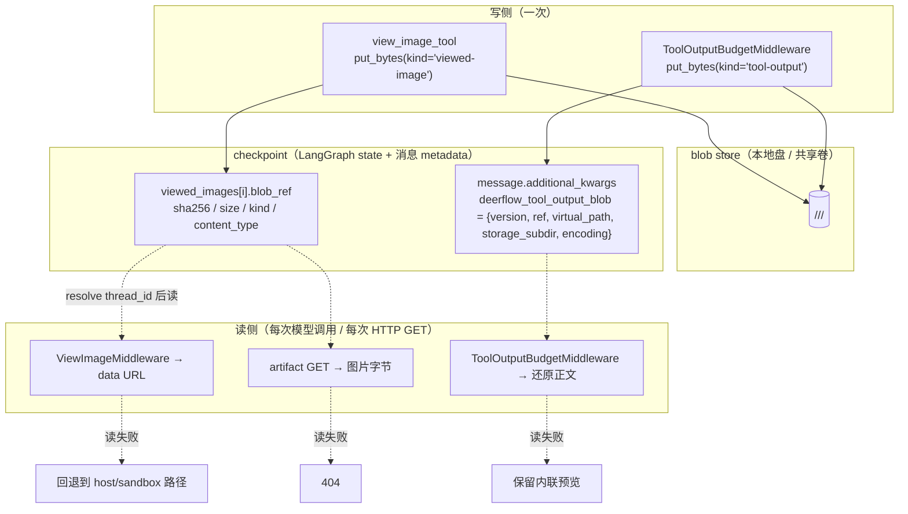
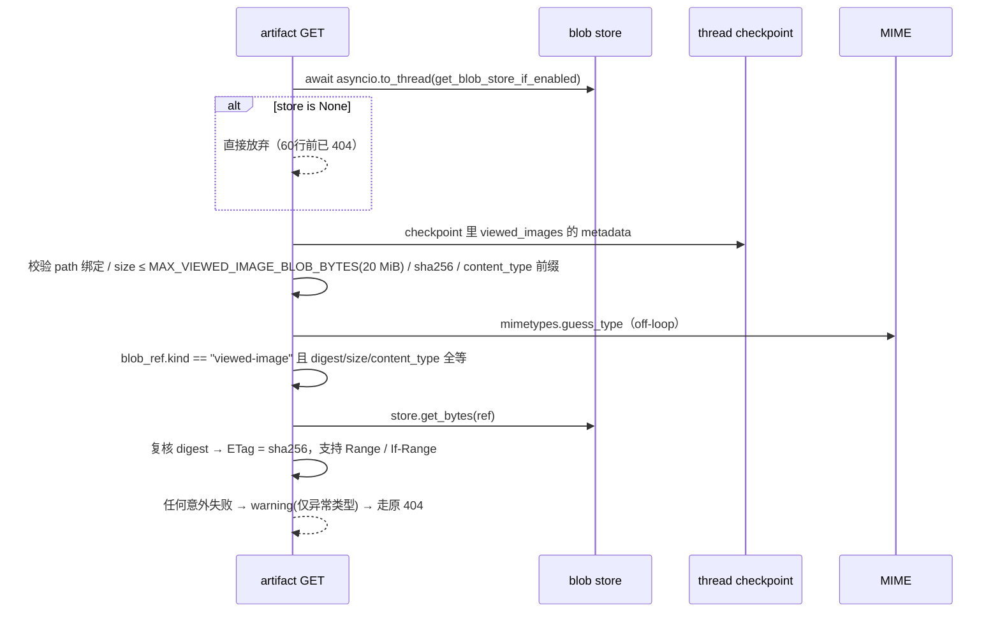

# Producers 与消费者 — 引用怎么跨进程，失败怎么降级

白名单式迁移是这套设计的核心约束：`storage/__init__.py:1-6` 的 docstring 写明「Nothing in deer-flow writes here until `blob_storage.enabled` is True **and a producer has been migrated**」。v2.2.0 的 `backend/docs/blob-storage.md:5-8` 只列了两个已迁移 producer，源码 grep 也确认**只有这两个**：

| producer | `kind` | 写点 | consumer |
|----------|--------|------|----------|
| `view_image_tool` | `viewed-image` | `tools/builtins/view_image_tool.py:296-330` | `ViewImageMiddleware`（模型上下文）+ artifact GET 路由（UI 取图） |
| `ToolOutputBudgetMiddleware` | `tool-output` | `agents/middlewares/tool_output_budget_middleware.py:590-660` | `ToolOutputBudgetMiddleware` 自己的还原路径 |

→ Back to [storage README](README.md) · 契约与工厂见 [01-contract-and-factory.md](01-contract-and-factory.md) · 后端布局见 [02-local-fs.md](02-local-fs.md)

## 相关文件

- `deerflow/tools/builtins/view_image_tool.py`（356 行）— 写 `viewed-image`，失败**让工具调用失败**
- `deerflow/agents/middlewares/tool_output_budget_middleware.py`（1281 行）— 写 + 读 `tool-output`，失败**内联回退**
- `deerflow/agents/middlewares/view_image_middleware.py`（622 行）— blob 优先、host 文件回退的图注入
- `app/gateway/routers/artifacts.py`（717 行）— artifact GET 的 404 兜底
- `deerflow/agents/thread_state.py`（571 行）— `BlobRefData`（`:53-59`）与 `ViewedImageData`（`:61-76`）的 checkpoint 形态
- `app/gateway/services.py` — `TOOL_OUTPUT_BLOB_KEY` 列入服务端持有键（`:187`），客户端伪造的同名键被剥离

---

## 1. 共同骨架：引用进 checkpoint，字节永不进 checkpoint



**checkpoint 里只有引用**——这是整个方案能在多实例下成立的前提：一个 `BlobRef` 是 4 个 JSON 字段，而 base64 图片与 100 KB 工具输出会让每个 checkpoint 变重。`BlobRefData`（`agents/thread_state.py:53-59`）的字段全是 `NotRequired`，所以旧 checkpoint（没有 `blob_ref`）和新 checkpoint 能被同一次读取。

---

## 2. Producer A：`view_image_tool`（`view_image_tool.py:296-330`）

```python
store = get_blob_store_if_enabled()          # :303
if store is not None:
    try:
        blob_ref = store.put_bytes(
            image_bytes, kind="viewed-image", content_type=mime_type,
            thread_id=_get_thread_id(runtime),
        )
        image_metadata["blob_ref"] = blob_ref.model_dump(mode="json", exclude_none=True)
    except Exception:
        logger.warning(...)                  # 只记，不抛给模型
        return Command(update={"messages": [ToolMessage(
            "Error: Failed to persist image in shared blob storage", ...)]})
```

三条与契约直接相关的点：

1. **`enabled=false` 时这一整段被跳过**。`get_blob_store_if_enabled()` 返回 `None`，工具继续走原来的"写本地文件 + 返回路径"，行为与 v2.1 完全一致（`test_blob_store.py:356` 钉住 disabled 不构造任何 store）。
2. **写失败 = 工具调用失败，而且是"说清楚"的失败**。`AGENTS.md:44-47` 的原文规则是「a durable-write failure must not be reported as success」——如果 put 失败却仍返回成功，模型会以为有一条跨实例可用的 durable 路径，而实际只有本机存在的文件。`mime_type` 只取内联 data URL 前缀里的形态（`AGENTS.md:46`）。
3. **错误文体是固定的通用文本**，不泄漏后端细节（路径、`OSError` 原文）。`test_view_image_tool.py:123-147` 断言"配置好的 blob 写入失败"与"工厂本身抛异常"（`:148-170`）都返回同一条通用错误。

`blob_ref` 与 `image_metadata` 一起进 `viewed_images` 列表，随后被 checkpoint 持久化（`ViewedImageData.blob_ref`，`thread_state.py:76`）。

---

## 3. Producer B：`ToolOutputBudgetMiddleware`（`:590-660`）

工具输出超预算时，中间件把正文外置成虚拟 `read_file` 路径。blob 只是**同一份正文的第二份副本**，所以失败策略与 A 相反——**静默降级**。

常量（`:73-82`）：

| 名字 | 值 | 作用 |
|------|-----|------|
| `TOOL_OUTPUT_BLOB_KEY` | `"deerflow_tool_output_blob"` | 消息 metadata 键 |
| `_TOOL_OUTPUT_BLOB_VERSION` | `1` | payload 版本，读者据此拒绝不认识的形态 |
| `_TOOL_OUTPUT_BLOB_KIND` | `"tool-output"` | blob `kind` |
| `_TOOL_OUTPUT_CONTENT_TYPE` | `"text/plain; charset=utf-8"` | blob `content_type` |
| `_MAX_TOOL_OUTPUT_BLOB_BYTES` | 64 MiB | 与 local_fs 的 `_MAX_BLOB_BYTES` **同值重复**；超限就不写 |
| `_DURABLE_FAILURE_FALLBACK_MAX_CHARS` | `30000` | 退化路径的内联上限 |

决策链（`:590-660`）：

| 情形 | 结果 | 行号 |
|------|------|------|
| UTF-8 编码失败 | `durable_fallback_required`（不再宣称有 durable 路径） | `:595-600` |
| 正文 > 64 MiB | 内联回退，**不调用 put** | `:601-608` |
| put 成功 | payload `{version, ref, virtual_path, storage_subdir, encoding: "utf-8"}` 写进 metadata | `:614`、`:632-637` |
| put 抛 `BlobStoreError` | 内联回退，`virtual_path = None`，**不 unlink 可能被并发发布者写的文件** | `:612-630` |
| 回退内联 | `min(configured_fallback, 30000)` 字符 | `:659-660` |

「`virtual_path = None` 且不动文件」是**并发安全**的必然结果（`:620-630` 注释）：同一内容可能已被另一个进程成功发布，删掉它会把别人的成功写毁掉。`test_tool_output_budget_middleware.py:1121`（配置好 blob 但写入失败 → 内联）、`:1146`（禁用常规回退时依然有界）、`:1171`（超 64 MiB 从不写）、`:1196`（上限仍然有界）覆盖这条链。

---

## 4. Consumer 1：`ViewImageMiddleware`（`view_image_middleware.py:194-231`）

`_read_blob_image_as_data_url(blob_ref_data, mime_type, expected_size, expected_sha256)`（`:194-231`）：**五道关卡**，每道失败都返回 `None`，由调用方回退：

| # | 校验 | 行号 |
|---|------|------|
| 1 | ref 或 `expected_sha256` 缺失 → 视为没有（没有 digest 就无从校验） | `:204-205` |
| 2 | `BlobRef.model_validate(...)` 必须通过（`TypeError` / `ValueError` 都吞掉） | `:209-213` |
| 3 | 一行四连等：`ref.kind == "viewed-image"` 且 `ref.sha256 == expected_sha256` 且 `ref.size == expected_size` 且 `ref.content_type == mime_type` | `:214-215` |
| 4 | `get_blob_store_if_enabled()` 必须是 store（`None` 直接返回） | `:217-220` |
| 5 | `store.get_bytes(ref)` 成功；**任何 `Exception`** 只 `warning` 后返回 `None` | `:221-228` |

第 3 关是**溯源校验**：一个 blob ref 只有在与 checkpoint 里记录的 sha256/size/content_type 四项全等时才被信任，否则一个被篡改或错配的 checkpoint 条目就能让模型看到任意字节。解析出的字节最后再过 `_encode_image_bytes(..., expected_size, expected_sha256)` 复核一次尺寸与 digest（`:229-234`）。

`_read_image_as_data_url`（`:236-` 起）是 blob 优先的编排器：先试 blob，`None` 再回退到 sandbox 路径（`_read_sandbox_image_as_data_url`）与 host 镜像（`_read_host_image_as_data_url`，`:160-191`，尺寸上限 `_MAX_IMAGE_BYTES` + 可选的 sha256 复核；`OSError` 返回 `None`）。**回退是兼容性设计，不是降级承诺**——本机执行和旧 checkpoint 只有 host 路径。

注入循环在 `:375-405` 一带：`blob_ref = image_data.get("blob_ref")`（`:380`）后连同 `path` / `sha256` / `size` / `mime_type` 一起传给读取器（`:403`）。

测试矩阵：`test_view_image_middleware.py:448`（writer 的 host 副本不在时用 blob 解析）、`:483`（工厂失败回退 host 副本）、`:519`（raw 读失败回退）、`:556`（畸形 ref 回退）、`:579`（ref 必须与 checkpoint metadata 一致才读）。

---

## 5. Consumer 2：artifact GET 路由（`artifacts.py:504`、`:537-`）

```
GET /api/threads/{id}/artifacts/{path}
  → _read_artifact_payload 抛 HTTPException(404)（本地文件缺失）
  → _get_viewed_image_blob_response(thread_id, path, request, download)   # :504
       → 读到就返回字节流；否则重新 raise 那个 404
```

`_get_viewed_image_blob_response` 的顺序（`AGENTS.md:49-52`）：



要点：

- **开关关闭时完全不碰 checkpoint**（`AGENTS.md:51`）：`test_artifacts_router.py:276` 钉住"disabled 时跳过 checkpoint 读取"。这既省掉一次读，也保证 disabled 部署的 404 语义与 v2.1 一致。
- **权限在前**：函数带 `@require_permission(..., require_existing=True)`（`AGENTS.md:50`、`test_artifacts_router.py:196` 钉住"需要现存线程的访问权"），所以 blob 兜底不会变成一个绕过 owner 校验的读通道。
- **失败只记异常类型**（`type(exc).__name__`，`AGENTS.md:52`、`test_artifacts_router.py:291`），因为异常文本可能带宿主路径。
- **冷 MIME 查询不阻塞事件循环**（`tests/blocking_io/test_artifacts_router.py:161`）。
- 20 MiB 上限 `MAX_VIEWED_IMAGE_BLOB_BYTES`（`artifacts.py:42`）与写入侧无强绑定：`view_image` 写的是工具自己读到的图片字节，这个上限是**读侧**的额外收紧。

历史：`CHANGELOG.md:1815-1825` 记录这个兜底是后来加的（"Behind a load balancer the reading Gateway previously had no local copy"）；`:9316-9320` 记录它又被要求补上 `require_existing=True` 权限校验。

---

## 6. Consumer 3：tool-output 还原（`tool_output_budget_middleware.py:966-`）

`_restore_tool_output_blobs` 在每次模型请求前把外置正文补回来。它比前两条读路径**更保守**，因为要处理的输入是"可能来自另一个进程的 checkpoint"：

| 步骤 | 行为 | 行号 |
|------|------|------|
| 快路径 | 本地文件存在且 digest 匹配 → **完全不动 blob store**（省一次网络读，也保留文件权限） | `:1681` 段的 `test_digest_matching_local_file_avoids_blob_store`（`:1737`） |
| 尺寸不符 | 跳过读，直接走还原 | `test_wrong_size_local_file_skips_read_before_restore`（`:1755`） |
| payload 版本/编码 | 不是 `version == 1` + `encoding == "utf-8"` → 忽略 | `:981-990` |
| ref 形状 | `kind` / `content_type` 必须对得上 | `:992-1000` |
| 宿主路径 | `virtual_path` 必须能被 `_host_path_for_externalized_output` 约束到合法位置，否则**忽略且不读 blob** | `test_invalid_virtual_path_is_ignored_without_blob_read`（`:1781`） |
| store | 每次还原只解析一次 | `:1017` |
| 读 | `get_bytes(ref)` + `ref.matches(data)` 复核 | `:1024-1030` |
| 读失败 | `warning` 后**继续模型调用**（保留内联预览） | `test_blob_read_failure_does_not_block_model_call`（`:1800`） |

另有一个异步版本的入口：`awrap_model_call`（`:1249-1252`）在消息里存在 blob ref 时（`_has_tool_output_blob_refs`，`:921-923`）走 `run_sync_lifecycle_operation`；`_budget_model_request`（`:1263-1264`）里调还原。

写入磁盘时的权限策略：`CHANGELOG.md:2326-2331` 记录 `_write_restored_output` 改用独占 `open(..., "xb")` 而不是 `mkstemp`，让还原出来的文件走 `0o666 & ~umask`，与初次发布的文件一致（`0600` 会被不同 UID 的挂载型沙箱读不到）。**digest 匹配的本地文件仍然原样复用**，不改权限。

---

## 7. 一张失败策略总表

| 侧 | 场景 | 策略 | 用户可见后果 |
|----|------|------|--------------|
| 写 | `view_image` put 失败 | **fail-loud**：工具调用返回固定通用错误 | 模型看到"图片没能持久化"，这一轮没有图片上下文 |
| 写 | tool-output put 失败 / 超限 / 编码失败 | **fail-soft**：内联回退（≤30,000 字符） | 模型看到截断预览，但没有可复原的 durable 路径 |
| 读 | `ViewImageMiddleware` blob 失败 | fail-soft：回退 sandbox/host 路径 | 本机部署无感；跨实例时若 host 也没有 → 图注入失败 |
| 读 | artifact GET blob 失败 | fail-soft：原样 404 | 浏览器拿不到图，前端显示缺失 |
| 读 | tool-output 还原失败 | fail-soft：保留内联预览 | 模型看到的是截断内容，不报错 |
| 全部 | 意外异常日志 | **只记异常类型**，不记文本 | 宿主路径不进日志聚合 |

这条不对称是刻意的：**写入是唯一的"承诺点"**——一旦对外宣称成功，就必须真的跨实例可读；读取则永远有"本地也有一份"这条后路。

---

## 8. 边界：与哪些子系统**无关**

| 相邻子系统 | 关系 |
|------------|------|
| `tool_artifacts`（`config.yaml` 的服务端 artifact 存储） | 另一条"内容外置"线：它搬的是**文件产物**、读者是工具；blob store 搬的是**模型上下文里的字节**。两者都热加载、都默认关，但存储位置与生命周期不同（`04-config-reference.md:930` 有对照） |
| 沙箱/宿主路径（`resolve_thread_virtual_path`、`_host_path_for_externalized_output`） | blob 是**兼容层之上的追加**：`AGENTS.md:40-42` 要求 host 路径仍然是本机执行与旧 checkpoint 的兼容路径。非挂载型沙箱写出的产物**不进** blob 流（它们没有 host 镜像） |
| checkpoint 存储（`checkpoint_blobs` 表 / Delta 模式） | 无关。LangGraph 自己的 channel blob 是 checkpoint 后端的事，见 [../persistence/checkpoint-dual-mode-and-history-cache.md](../persistence/checkpoint-dual-mode-and-history-cache.md) |
| 线程删除 / 保留策略 | blob 的 GC **不属于 storage 模块**（`AGENTS.md:100-105`）：存活必须从持久引用（checkpoint 行）判定，规则在 `backend/docs/blob-storage.md`，并与 checkpoint 保留约束 #5255、线程级清扫 #5188 的组合边界一起定义。**未逐行核实**：v2.2.0 源码树里是否已有执行该清扫的实现——本页只记录"规则存在、执行不在本模块" |
| 多实例部署 | `scripts/dev_multi_instance.py:191-194` 在多实例脚本里**丢弃** `blob_storage.backend_config.root`，让所有 harness 进程共用同一个 home 下的 blob 目录（`backend/docs/CONFIGURATION.md:807`、`test_dev_multi_instance_script.py:250-259`）。这意味着本地多实例调试默认就能命中共享 blob |

---

## 9. 迁移第三个 producer 的检查单（从上面两个归纳的硬要求）

1. **选择 fail 方向**：内容**只能**来自 blob（没有本地副本）→ fail-loud；blob 只是本地副本的镜像 → fail-soft。
2. **`kind` 用小写带连字符的名字**，并把 `kind` → 内容类别的语义写进 `docs/blob-storage.md` 的 producer 表（GC 按 `kind` 推理，不解析路径）。
3. **读者必须复核 ref ↔ checkpoint 记录**（digest/size/content_type），不能只看 `kind`。
4. **checkpoint 里放 `model_dump(mode="json", exclude_none=True)` 的结果**，别放 `BlobRef` 实例。
5. **大对象上限自己守一份**（local_fs 的 64 MiB 是 defense-in-depth，不是契约）。
6. **不要为 GC 记引用计数**：需要清理时从持久引用反推。
7. **给 disabled 路径补一条用例**（`get_blob_store_if_enabled()` 返回 `None` 时行为与迁移前逐字节一致）。
