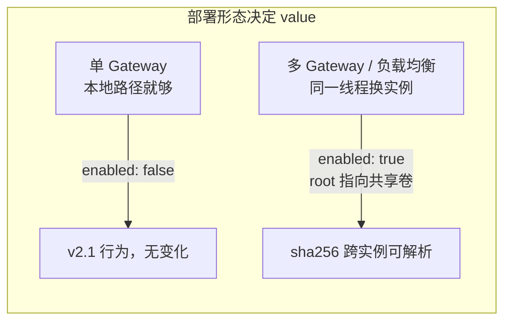
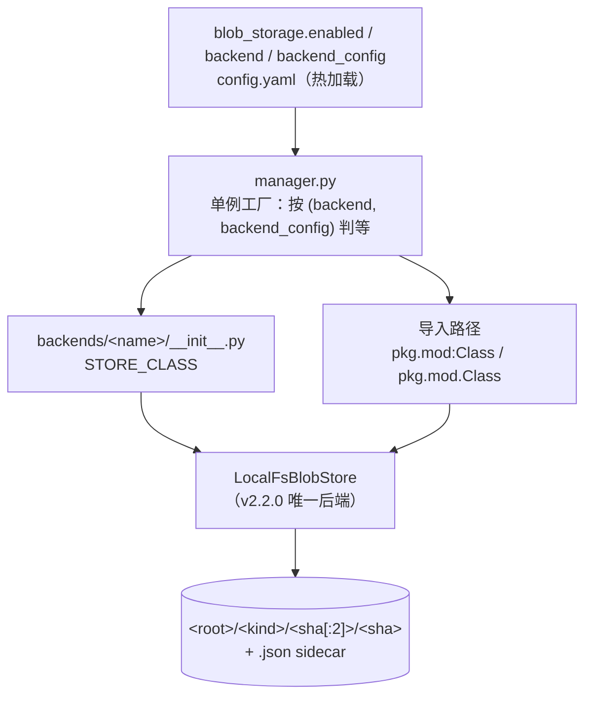
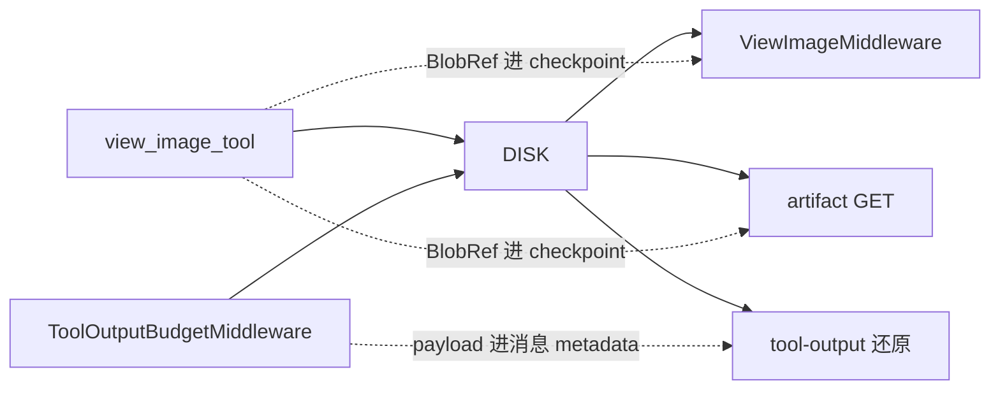

# storage —— 内容寻址 blob 存储

**一句话定位**：把"文件在哪台机器的哪个路径"换成"这份字节的 sha256 是什么"。多 Gateway 部署下本地路径只在写它的那个实例上有意义，而摘要值到处都有意义。

**规模**：`backend/packages/harness/deerflow/storage/` 共 **851 行**（7 个文件）——`.py` 742 行 + `AGENTS.md` 109 行：

| 文件 | 行数 | 内容 |
|------|------|------|
| `contract.py` | 198 | `BlobRef` / `BlobStore` / 错误家族 / `kind` 语法 |
| `manager.py` | 224 | 后端发现 + 导入路径 + 配置归一 + 进程单例 |
| `backends/local_fs/local_fs_store.py` | 260 | 默认后端：分片布局、原子发布、sidecar |
| `AGENTS.md` | 109 | 新后端 / 新 producer 的硬要求 |
| `__init__.py` | 34 | 包级 re-export（12 个名字） |
| `storage/backends/__init__.py` | 13 | 后端目录约定 |
| `backends/local_fs/__init__.py` | 13 | `STORE_CLASS = LocalFsBlobStore` |

**默认行为**：`blob_storage.enabled: false`（`config.example.yaml:2564`）。关闭时 `get_blob_store_if_enabled()` 返回 `None`，**没有任何 producer 写入**（`storage/__init__.py:1-6` 明写「Nothing in deer-flow writes here until `blob_storage.enabled` is True and a producer has been migrated」）。这不是"半成品"，是**先落地契约、再逐个 producer 迁移**的白名单式设计——`backend/docs/blob-storage.md:5-8` 的 producer 表就是这份白名单。

→ Back to [internals README](../README.md) · 配置字段见 [configuration/04-config-reference.md](../configuration/04-config-reference.md)（`:833` 起）

## 三篇正文

| 页面 | 覆盖 | 关键事实 |
|------|------|----------|
| [01-contract-and-factory.md](01-contract-and-factory.md) | `BlobRef` 四元组与校验、`kind` 语法为何这么窄、`BlobStore` 的 abstract/默认划分、6 条契约级失败策略、`manager.py` 的后端解析与热重载单例、新后端检查单 | `BlobNotFoundError` 是 `BlobReadError` 的子类；删除失败抛**中性基类**；未知后端 fail-fast 而不回退；被替换的 store 保持打开直到 `reset_blob_store()` |
| [02-local-fs.md](02-local-fs.md) | `<root>/<kind>/<sha[:2]>/<sha>` 布局、临时文件 + `os.replace` 原子发布、并发写者与 Windows `WinError 5`、sidecar 的三条"不是"、64 MiB 上限的归属、state × outcome 决策表 | sidecar **不是读依赖、不是引用计数、失败不毁 put**；内容 `fsync` 但目录项没有 |
| [03-producers.md](03-producers.md) | 两个写入点（`viewed-image`、`tool-output`）、三个消费点（中间件注入 / artifact GET / tool-output 还原）、一张失败策略总表、与 `tool_artifacts` / 沙箱路径 / checkpoint blob / GC 的边界 | 写 `view_image` 失败 = **fail-loud**（工具调用失败）；其余全部 fail-soft；checkpoint 里只有引用 |

## 心智模型（三张图）

## 读这个子系统时的四个反直觉点

1. **"关闭 = 无人写入"是设计，不是缺陷。** 契约、后端、工厂、测试都可以先落地；每个 producer 是独立的一次 PR（`CHANGELOG.md:1605`、`:1614`、`:1622`）。
2. **sidecar 不是引用计数。** 内容寻址会把相同字节塌缩成一个文件，多实例追加同一 sidecar 是丢更新竞态，所以 `writer_thread_id` 只能记录**先到的写者**，GC 必须从持久引用反推（`AGENTS.md:100-105`）。
3. **失败方向不对称。** 写 `view_image` 失败要**说出来**（否则 checkpoint 会谎称有跨实例 durable 路径）；一切读取都**静默降级**（本地还有一份，或退回 404）。
4. **`get_blob_store()` 目前没有生产调用方。** 全仓 grep 只有测试在用；producer 一律走 `get_blob_store_if_enabled()`（`manager.py:158-177`）。

## 与其它子系统

| 相邻页面 | 关系 |
|----------|------|
| [configuration/04-config-reference.md](../configuration/04-config-reference.md) | `blob_storage` 段：三个字段、默认值、热加载与自愈（`:833-848`） |
| [configuration/01-config-yaml.md](../configuration/01-config-yaml.md) | `config.example.yaml:2563` 处的注释段 |
| [../concepts/builtin-tools/A-runtime-control.md](../../concepts/builtin-tools/A-runtime-control.md) | `view_image` 的参数/校验链（⚠️ 该页「注入链路」一节仍是 v2.1 的 base64-in-state 描述，v2.2 已改为 metadata + 按需读取；以本目录 03 页为准） |
| [../middleware/03-catalog.md](../middleware/03-catalog.md) | `ToolOutputBudgetMiddleware` 中间件条目 |
| [../persistence/checkpoint-dual-mode-and-history-cache.md](../persistence/checkpoint-dual-mode-and-history-cache.md) | checkpoint 自己的 channel blob（`checkpoint_blobs` 表）——**与本文的 `BlobRef` 无关**，别混 |
| [../../operations/security/04-trust-boundary.md](../../operations/security/04-trust-boundary.md) | artifact GET 的权限要求（`require_existing=True`）与"意外失败只记异常类型"的日志规则 |

## 上游文档与测试

- `backend/docs/blob-storage.md`（138 行）— 运维面：布局、producer 表、GC 规则、加后端的依赖声明
- `backend/packages/harness/deerflow/storage/AGENTS.md`（109 行）— 开发者须知：为什么关、怎么加后端、durability 规则
- `backend/tests/test_blob_store.py`（485 行）— 契约 + local_fs + 工厂的全部后端无关场景
- producer 侧：`test_view_image_tool.py`（`:81`、`:123`、`:148`）、`test_view_image_middleware.py`（`:448`、`:483`、`:519`、`:556`、`:579`）、`test_tool_output_budget_middleware.py`（`TestToolOutputBlobPersistence` `:1046`、`TestToolOutputBlobRestore` `:1681`）、`test_artifacts_router.py`（`:68`、`:132`、`:196`、`:276`、`:291`）
- `backend/tests/test_app_config_reload.py:879` — 改文件即换 store 的端到端热加载用例
