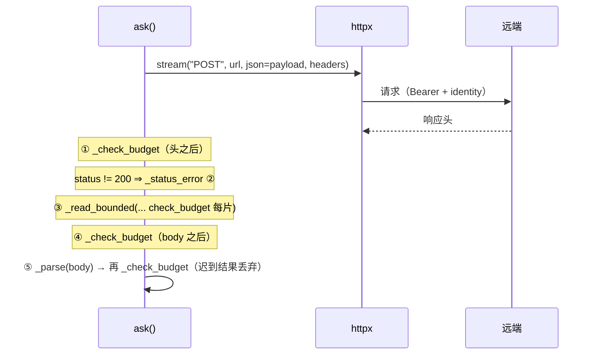
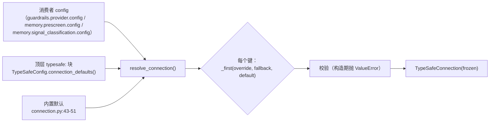

# TypeSafe 契约面：客户端、连接、错误分类

本页只讲**共享面**：谁能调用什么、参数从哪来、失败长什么样。业务语义（阈值、失败方向、缓存、审计）见 [02-adapters-failure-policy.md](02-adapters-failure-policy.md)。

→ Back to [TypeSafe 索引](README.md)

## 一、TypeSafeClient：一次评估一个客户端（`backend/packages/harness/deerflow/typesafe/client.py:212-426`）

```python
class TypeSafeClient:
    """One consumer's TypeSafe client, built from its effective connection.

    Holds no cache: cache ownership stays with each adapter, so a shared client
    never decides that two consumers' results are interchangeable (design §1.2, §3.1).
    """
```

| 事实 | 位置 |
|------|------|
| 无缓存、无连接池：每次 `ask`/`aask` 现建一个 `httpx.Client` / `httpx.AsyncClient`，`with` 退出即关 | `backend/packages/harness/deerflow/typesafe/client.py:273`、`backend/packages/harness/deerflow/typesafe/client.py:293` |
| `transport_factory` 必须是**工厂**（`Callable[[], BaseTransport]`），因为"httpx 关闭客户端时会关掉被注入的 transport" | `backend/packages/harness/deerflow/typesafe/client.py:84-86`、`backend/packages/harness/deerflow/typesafe/client.py:272` |
| `provider_label = "TypeSafe"` 是类属性：dialect 覆写它，使请求级消息不再指向错误的运营方 | `backend/packages/harness/deerflow/typesafe/client.py:220-223` |
| 两条公开入口：同步 `ask`（禁在事件循环里调用）与异步 `aask` | `backend/packages/harness/deerflow/typesafe/client.py:257-268`、`backend/packages/harness/deerflow/typesafe/client.py:283-305` |

### 1.1 请求骨架（两行）

```python
# client.py:309-317
def _payload(self, state, questions):
    return {
        "state": state,
        "model": self._connection.model,
        "questions": {qid: {"type": q.type, "instructions": q.instructions,
                            **({"criteria": dict(q.criteria)} if q.criteria else {})} ...},
    }

def _headers(self):
    return {"Authorization": f"Bearer {self._connection.api_key}",
            "Accept": "application/json", "Accept-Encoding": _ACCEPT_ENCODING}  # "identity"
```

三件事值得记住：

1. **`state` 原样透传**。client 不检查它能否序列化——"a consumer whose policy is 'never send an unserialisable state' validates it first, as the tool gate does, and answers locally instead"（`backend/packages/harness/deerflow/typesafe/client.py:260-262`）。风险门确实这样做了（`guardrails/typesafe.py:318-332`）。
2. **`Accept-Encoding: identity`**（`_ACCEPT_ENCODING`，`backend/packages/harness/deerflow/typesafe/client.py:82`）。这不是微优化，是 `MAX_RESPONSE_BYTES` 能成立的前提：若 body 被压缩，"大小"就变成解压后的数字，客户端数的是错的东西（同一理由见 `tests/test_openai_decisions.py:161-165` 的注释）。
3. `criteria` 只在非空时出现；`choice` 问题的 `criteria` 是**合法性来源**（见 §1.4）。

### 1.2 一次尝试的五个切点（`_attempt_sync`，`backend/packages/harness/deerflow/typesafe/client.py:321-343`）



第 ⑤ 步后的那次检查是**故意丢弃成功**：`_check_budget` 的 docstring 就是 "Reject a result when the evaluation budget is spent, **even on success**"（`backend/packages/harness/deerflow/typesafe/client.py:408-411`）。一个已经超过 `deadline_seconds` 的答案对门来说等同于没有答案。

同一个函数里的异常配对是安全键：

```python
except httpx.TransportError as exc:   # 连接重置值得再试一次
    raise _RetryableAttempt(f"{label} request failed: {type(exc).__name__}", cause=CAUSE_TRANSPORT) from None
except httpx.HTTPError as exc:        # 构造请求失败（如非法 header）不值得
    raise TypeSafeError(f"{label} request failed: {type(exc).__name__}", cause=CAUSE_TRANSPORT) from None
```

`from None` 不是风格问题：注释说原始异常的消息可能包含**它没能构造出的那个请求**，"for a rejected header that is the whole `Bearer <key>` value"，而门的 `logger.exception` 会打印整条 cause 链（`backend/packages/harness/deerflow/typesafe/client.py:333-343`）。`tests/test_typesafe_client.py:258-265`（同步）/ `:265` 起（异步）钉住"凭据不进入异常链"。

### 1.3 重试与截止预算

| 机制 | 同步 | 异步 |
|------|------|------|
| 预算起点 | `deadline_at = time.monotonic() + deadline_seconds`（`backend/packages/harness/deerflow/typesafe/client.py:269`） | 在 `asyncio.timeout(...)` 内同样计算（`backend/packages/harness/deerflow/typesafe/client.py:290-291`） |
| 硬取消 | 无——sync 无法抢占已经阻塞的读 | `asyncio.timeout` 取消在途请求与 body 读取（`backend/packages/harness/deerflow/typesafe/client.py:287-290`） |
| 迟到的 `TimeoutError` | — | 转成 `_deadline_error()`；外层的 `CancelledError` 仍照常传播（`backend/packages/harness/deerflow/typesafe/client.py:302-305`） |
| 退避 | `min(retry_backoff * 2**(attempt-1), _remaining(deadline_at))`（`backend/packages/harness/deerflow/typesafe/client.py:422-423`） | 同公式，`asyncio.sleep`（`backend/packages/harness/deerflow/typesafe/client.py:425-426`） |
| 重试触发 | 仅 `_RetryableAttempt`：`429`/`529`（`_RETRYABLE_STATUS_CODES`，`backend/packages/harness/deerflow/typesafe/client.py:70`）与 `httpx.TransportError` | 同 |
| 次数耗尽 | `raise TypeSafeError(str(exc), cause=exc.cause)` 去掉内部类型（`backend/packages/harness/deerflow/typesafe/client.py:278-281`） | 同（`backend/packages/harness/deerflow/typesafe/client.py:298-301`） |

`_RetryableAttempt(TypeSafeError)` 是**内部**类型："Caught inside the retry loop and re-raised as a plain `TypeSafeError` when the attempt budget is exhausted, so it never escapes this module"（`backend/packages/harness/deerflow/typesafe/client.py:204-209`）。

同步路径如何让"滴水式 body"不超期：`_read_bounded` 的 `check_budget` "runs before every piece"，而且刻意不做 re-chunking——"the pieces are the transport's own reads"，所以调用方**最多超一次读**，而不是每 64 KiB 超一次（`backend/packages/harness/deerflow/typesafe/client.py:439-444`）。`tests/test_typesafe_client.py:426` 的 `test_a_dripping_body_stops_at_the_deadline` 钉住它。

### 1.4 有界、不解码的响应（`backend/packages/harness/deerflow/typesafe/client.py:429-482`）

```python
# client.py:456-462
encoding = (response.headers.get("content-encoding") or "identity").strip().lower()
if encoding != "identity":
    raise TypeSafeError(f"TypeSafe response carried a non-identity Content-Encoding "
                        f"({recordable_model(encoding)})", cause=CAUSE_INVALID_RESPONSE)
```

| 规则 | 实现 | 后果 |
|------|------|------|
| 先查编码再看内容 | `_reject_content_encoding` 在 `_accumulate` 之前（`backend/packages/harness/deerflow/typesafe/client.py:446-447`） | 压缩炸弹**没有机会被展开**；`tests/test_typesafe_client.py:341` |
| 边读边计数 | `if len(body) > MAX_RESPONSE_BYTES: raise ...`（`backend/packages/harness/deerflow/typesafe/client.py:470-471`、`:480-481`） | 不缓冲整个 body 再判断 |
| 上限等于 64 KiB | `MAX_RESPONSE_BYTES = 64 * 1024`（`backend/packages/harness/deerflow/typesafe/client.py:76`） | 正好等于上限仍被接受（`tests/test_typesafe_client.py:350`） |
| 报错里的编码名也被当成响应内容 | 经 `recordable_model` 处理（`backend/packages/harness/deerflow/typesafe/client.py:460-462`） | 恶意 header 不会原样进日志 |

`_parse` 的 `RecursionError` 同样留在分类法内（`backend/packages/harness/deerflow/typesafe/client.py:377-388`）：深嵌套是 `json.loads` 的 `RecursionError` 而不是 `ValueError`，逃出去就变成一个消费者无法记录成"本轮失败"的异类异常（同一处理的 dialect 版本见 `openai_decisions/client.py:114-121`）。

### 1.5 两层结果：`AnswerSet` / `QuestionError`

```python
# client.py:185-196
class AnswerSet:
    model: str
    answers: Mapping[str, Answer]
    errors_by_question: Mapping[str, QuestionError]
```

| 层 | 形状 | 谁决定 |
|----|------|--------|
| **信封级**（`model` + `answers` 对象）缺失/类型不对/不是 JSON 对象 | 抛 `TypeSafeError(cause=invalid_response)` | 请求失败 |
| **问题级**（某题的 `type` 不符、`noul` 不是数字、`choice` 标签不在 `criteria` 里、题没答） | 存进 `errors_by_question`，`answers` 里没有它 | 数据，不抛 |
| 回答了**没问**的问题 | 直接忽略，不记入 errors（`backend/packages/harness/deerflow/typesafe/client.py:189-192`） | 静默 |

`QuestionError.category` 的五个取值：`missing` / `type` / `probability` / `label` / `refusal`（`backend/packages/harness/deerflow/typesafe/client.py:175`，常量在 `backend/packages/harness/deerflow/typesafe/client.py:63-66`；`refusal` 由 dialect 产出）。

数值规则集中在 `validate_probability`（`backend/packages/harness/deerflow/typesafe/client.py:499-519`），两条容易漏判的：

```python
if isinstance(raw_probability, bool) or not isinstance(raw_probability, (int, float)):   # bool 是 int 的子类
    ...
try:
    probability = float(raw_probability)
except OverflowError:   # 10**400：仍是"问题级"错误，不能丢掉同一响应里的其它答案
    ...
if not math.isfinite(probability) or not 0.0 <= probability <= 1.0:   # json.loads 接受 NaN/Infinity
    ...
```

标签规则集中在 `validate_choice_label`（`backend/packages/harness/deerflow/typesafe/client.py:526-537`）：合法集合**就是**这一题的 `criteria` keys，"a consumer maps labels to behaviour and an unrecognised one has no mapping to apply"。

错误消息里只放类型名与题目 id，从不回显答案内容——因为答案可能把 state 原样带回日志（`backend/packages/harness/deerflow/typesafe/client.py:475-477`、`backend/packages/harness/deerflow/typesafe/client.py:491-493`）。

### 1.6 错误分类（`backend/packages/harness/deerflow/typesafe/errors.py`，58 行）

| `cause` | 常量 | 产出点 | 典型含义 |
|---------|------|--------|----------|
| `transport` | `CAUSE_TRANSPORT` | `backend/packages/harness/deerflow/typesafe/client.py:341,343,360,362` | 连不上 / 重置（可重试的那类）或请求无法构造 |
| `http_status` | `CAUSE_HTTP_STATUS` | `backend/packages/harness/deerflow/typesafe/client.py:371-373` | 非 200；`429`/`529` 走内部可重试类，401 额外附"检查 API key"提示（`backend/packages/harness/deerflow/typesafe/client.py:369`） |
| `invalid_response` | `CAUSE_INVALID_RESPONSE` | `backend/packages/harness/deerflow/typesafe/client.py:388,391,394,462,471,481`；适配器 `guardrails/typesafe.py:287` | 信封不可用、编码不为 identity、超 64 KiB、深嵌套、该题没有可用答案 |
| `deadline` | `CAUSE_DEADLINE` | `backend/packages/harness/deerflow/typesafe/client.py:413-414`（`_deadline_error`，被 `_check_budget`/`_remaining`/`aask` 复用） | 预算耗尽，**包括成功但迟到** |

`CAUSES`（`backend/packages/harness/deerflow/typesafe/errors.py:30`）是这四个值的封闭集合；`TypeSafeError.__init__(self, message, *, cause)` 必须关键字传 `cause`（`backend/packages/harness/deerflow/typesafe/errors.py:46-48`）。**这一层不定义任何策略**：同一组 cause，门映射成拒绝、memory 映射成照常（见 [02](02-adapters-failure-policy.md#二fail-closed-vs-fail-soft同一组异常两条路径)）。

## 二、TypeSafeConnection：一次解析，三层来源（`backend/packages/harness/deerflow/typesafe/connection.py:111-193`）



| 规则 | 实现 |
|------|------|
| 只认自己的 8 个键 | `CONNECTION_FIELDS`（`backend/packages/harness/deerflow/typesafe/connection.py:56-65`）：`api_key` / `api_key_env` / `base_url` / `model` / `timeout` / `deadline_seconds` / `max_attempts` / `retry_backoff` |
| 缺键与显式 `None` 都算"未配置" | `_configured()` 同时过滤 `None` 与非本层键（`backend/packages/harness/deerflow/typesafe/connection.py:196-200`） |
| **显式空值不算未配置** | "an explicitly blank value does not, so a blank `api_key` is reported rather than silently bypassed by the environment"（`backend/packages/harness/deerflow/typesafe/connection.py:122-125`）；`None` 从环境变量读出仍是缺失（`backend/packages/harness/deerflow/typesafe/connection.py:238-241`） |
| 内置默认 | `https://api.typesafe.ai` / `TYPESAFE_API_KEY` / `jev-latest` / timeout 5 / deadline 10 / attempts 2 / backoff 0.5（`backend/packages/harness/deerflow/typesafe/connection.py:43-49`） |
| 端点路径不可由消费者配置 | `endpoint_path` 是 `resolve_connection` 的参数、由调用方 backend 给定并在此校验必须以 `/` 开头（`backend/packages/harness/deerflow/typesafe/connection.py:133-138`） |
| 失败在**构造期** | 缺凭据、model 空串、非法 base_url、非正数超时等都是 `ValueError`，不是每次调用的协议错误（`backend/packages/harness/deerflow/typesafe/connection.py:143-158`） |

### 2.1 凭据按**层**解析（`_resolve_credential`，`backend/packages/harness/deerflow/typesafe/connection.py:230-249`）

```python
for layer in (override, fallback):
    if "api_key" in layer:                     # 同一层里：字面 key 优先
        return layer["api_key"]
    name = layer.get("api_key_env")
    if isinstance(name, str) and name:         # 同一层里：命名了环境变量
        return os.environ.get(name)
return os.environ.get(default_env)             # 没有任何层指定时才查 TYPESAFE_API_KEY
```

"One credential source per layer"：一个用 `api_key_env` 配置的消费者，**不会**被共享 `typesafe:` 块里的字面 `api_key` 顶掉——因为它的 endpoint 可能根本不接受那把 key（`backend/packages/harness/deerflow/typesafe/connection.py:231-242`）。这是少见的、把"更具体的层赢"实现得更细的地方：粒度不是键，是**凭据对**。

### 2.2 三种身份，别混用

| 身份 | 方法 | 内容 | 用途 | 可见性 |
|------|------|------|------|--------|
| 凭据指纹 | `credential_fingerprint()`（`backend/packages/harness/deerflow/typesafe/connection.py:94-96`） | `sha256(api_key)[:16]` | 比较两个消费者是否同一把钥匙，而不记录任何一把 | 内部 |
| 公开参数 | `public_parameters()`（`backend/packages/harness/deerflow/typesafe/connection.py:98-108`） | `model`/`base_url`/`endpoint_path`/`timeout`/`deadline_seconds`/`max_attempts`/`retry_backoff`——**无凭据** | 进入每个消费者的公开策略身份 `release_policy_parameters()` | 公开 |
| 共享键 | `sharing_key(**dimensions)`（`backend/packages/harness/deerflow/typesafe/client.py:234-255`） | 公开参数 + 凭据指纹 + `transport_factory` 身份 + 消费者附加维度，取 `canonical_hash` | 判断"两个消费者能否共用一次请求" | 内部 |

`sharing_key` 的 docstring 是最重要的一句边界："Questions, criteria and thresholds are deliberately absent: sides with different behaviour parameters can still share one request"（`backend/packages/harness/deerflow/typesafe/client.py:242-245`）。阈值不同的两方可以共用请求，因为阈值在各自 `interpret` 里生效；但**凭据不同绝不能共用**，否则一个答案会被喂给另一个服务（`tests/test_openai_decisions.py:452-461`）。

`_factory_identity`（`backend/packages/harness/deerflow/typesafe/client.py:544-557`）用 `id()` 是刻意的：共享是进程内决定，而"两个不同的 transport 被合并"是绝不能发生的失败方向，所以两个等价但不同的工厂按保守方向**分开**。

### 2.3 `mode: off` 短路（`resolve_connection_for_mode`，`backend/packages/harness/deerflow/typesafe/connection.py:173-193`）

```python
if mode == MODE_OFF:      # MODE_OFF = "off"，connection.py:69
    return None
return resolve_connection(...)
```

"off 短路先于一切：没有凭据查找、没有校验、没有错误。因此没有可选厂商配置的部署仍然能构建"（`backend/packages/harness/deerflow/typesafe/connection.py:181-190`）。同样的短路在消费者的解析器里各有一份：`resolve_memory_prescreen` 在 `off` 时**不解析类路径**（`agents/memory/prescreen/contract.py:107-114`）；非 off 时"fails **loudly**…never a silent fallback"（同文件 `:110-112`）。

### 2.4 base_url 为什么要在构造期挑刺（`_validated_base_url`，`backend/packages/harness/deerflow/typesafe/connection.py:252-276`）

| 拒绝 | 理由（源码原话摘要） |
|------|---------------------|
| 非 `http`/`https` | httpx 每请求 `UnsupportedProtocol` |
| 无 netloc | 不是绝对 URL |
| 带 query / fragment | query 会被静默吞进本层追加的端点路径 |
| netloc 里有 `@`（内嵌凭据） | base_url 会进入**每个消费者的公开策略身份**与 reason 消息 |
| 空白/控制字符、坏端口 | `parts.port` 提前触发，而不是每次请求 `InvalidURL` |

`http` 对任意主机是**允许**的："an internal http endpoint is a legitimate deployment, and TLS policy is the operator's"（`backend/packages/harness/deerflow/typesafe/connection.py:224-227`）。

## 三、validation.py：让坏部署在构造期失败（91 行）

| 函数 | 行 | 规则 | 谁用 |
|------|----|------|------|
| `finite_float(name, value, *, minimum, maximum=None, exclusive=False)` | `backend/packages/harness/deerflow/typesafe/validation.py:17` | 非 bool、有限、区间（可开可闭） | `timeout`、`deadline_seconds`、`retry_backoff`、`threshold`、`skip_threshold`、`hint_threshold`、`cache_ttl_seconds` |
| `whole_number(name, value, *, minimum)` | `backend/packages/harness/deerflow/typesafe/validation.py:38` | 整数（bool 不是）、下界 | `max_attempts`、`max_state_chars`、`cache_size` |
| `defaulted_text(name, value, fallback)` | `backend/packages/harness/deerflow/typesafe/validation.py:47` | `None` ⇒ 默认；否则必须非空文本 | `instructions`、`criteria.true/false` |
| `credential_text(name, value)` | `backend/packages/harness/deerflow/typesafe/validation.py:56-72` | 可打印 ASCII、无首尾空白；错误消息**从不回显值** | `resolve_connection`（`backend/packages/harness/deerflow/typesafe/connection.py:152`） |
| `criteria_entry(criteria, True/False)` | `backend/packages/harness/deerflow/typesafe/validation.py:75` | 接受布尔键与 `"true"`/`"false"` 字符串键 | 三个适配器 |

两个值得注意的细节：

- `credential_text` 只在 `__all__`（`backend/packages/harness/deerflow/typesafe/validation.py:91`）里，**不在** `typesafe/__init__.py` 的导出列表中——包外只能 `from deerflow.typesafe.validation import credential_text`。判定件（`finite_float` / `whole_number` / `defaulted_text` / `criteria_entry`）是公开导出的（`backend/packages/harness/deerflow/typesafe/__init__.py:33-75`）。
- `criteria_entry` 同时接受 `True` 与 `"true"`：YAML 里写 `criteria: {true: ..., false: ...}` 得到的是布尔键，写 `"true"` 得到字符串键，两种都必须落到同一分支（`config.example.yaml` 的 Option 4 注释块即用未加引号的写法）。

## 四、读这一层时最容易搞错的四件事

1. **`wire_size` 不是上限**。"A counting capability, not a limit"（`backend/packages/harness/deerflow/typesafe/client.py:92`）：一个 CJK 字符 3 字节，把消费者的字符上限换成它就会搬动自己的回退边界。三个适配器与 coordinator 都坚持 `len(str)`（`guardrails/typesafe.py:333-338`、`agents/memory/signals/coordinator.py:414-424`）。
2. **`AnswerSet.model` 必填**。缺 `model` 是信封级失败（`backend/packages/harness/deerflow/typesafe/client.py:389-391`）；拿到的 model 还要过 `recordable_model` 才能进消息（`backend/packages/harness/deerflow/typesafe/client.py:112-127`），因为它是响应内容。
3. **问题级失败 ≠ 请求级失败**。前者是数据，靠 `errors_by_question` 传给消费者逐题降级；只有一个问题的消费者（门）会把它**再提升**成异常（`guardrails/typesafe.py:275-288`）。
4. **client 里没有缓存也没有池**。缓存属于适配器（门自己 `OrderedDict`，`guardrails/typesafe.py:380-408`；memory 用 `judging.py` 的 `AnswerCache`），所以"共用客户端"永远不会顺带共用结论（`backend/packages/harness/deerflow/typesafe/client.py:215-217`）。

## 五、事实清单（编译期核对）

| 事实 | 位置 |
|------|------|
| `backend/packages/harness/deerflow/typesafe/client.py` 580 行 / `backend/packages/harness/deerflow/typesafe/connection.py` 294 行 / `backend/packages/harness/deerflow/typesafe/errors.py` 58 行 / `backend/packages/harness/deerflow/typesafe/validation.py` 91 行 / `backend/packages/harness/deerflow/typesafe/__init__.py` 118 行 | `wc -l` 实测 |
| `__all__` 导出 **40** 个名字；**不含** `credential_text`、`validate_probability`、`validate_choice_label`、`_RetryableAttempt` | `backend/packages/harness/deerflow/typesafe/__init__.py:77-118`（AST 点数） |
| `_OK_STATUS = 200`（只接受 200，不接受 2xx 其它码） | `backend/packages/harness/deerflow/typesafe/client.py:68` |
| `_UNAUTHORIZED_STATUS = 401`，只有它附 API key 提示 | `backend/packages/harness/deerflow/typesafe/client.py:69,369` |
| `type Answer = NoulAnswer \| ChoiceAnswer`（PEP 695 类型别名） | `backend/packages/harness/deerflow/typesafe/client.py:168` |
| `Question` 校验：type 在白名单、instructions 非空、`choice` 必须有 criteria | `backend/packages/harness/deerflow/typesafe/client.py:143-151` |
| 生产代码**没有**构造 `choice` 问题（三个适配器全用 `noul`） | `guardrails/typesafe.py:198-202`、`deerflow/agents/memory/prescreen/typesafe.py:106-112`、`deerflow/agents/memory/signals/typesafe.py:111-114` |
| `TypeSafeConnection` 是 frozen dataclass，`api_key`/`api_key_env` 标了 `field(repr=False)` | `backend/packages/harness/deerflow/typesafe/connection.py:72-87` |
| `url` = `base_url.rstrip('/') + endpoint_path` | `backend/packages/harness/deerflow/typesafe/connection.py:89-92` |
| `typesafe_defaults()` 延迟 import 配置包，避免传输层拖进 `deerflow.config` | `backend/packages/harness/deerflow/typesafe/connection.py:203-213` |

> 未逐行核实：`backend/packages/harness/deerflow/typesafe/client.py` 中 `_validate_answer` 的完整段落（`backend/packages/harness/deerflow/typesafe/client.py:485-496`）只按节选核对过；`__all__` 的 40 项是用 `ast` 点数得到的，未逐项与源码行为对照。
