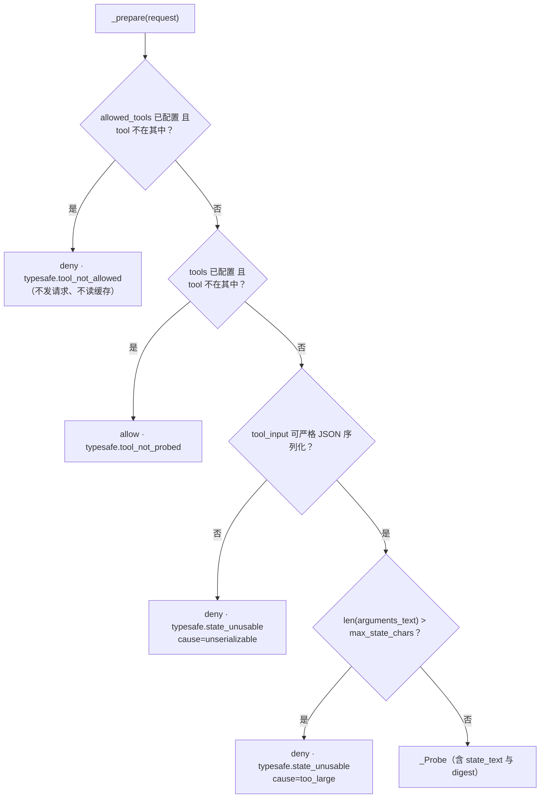
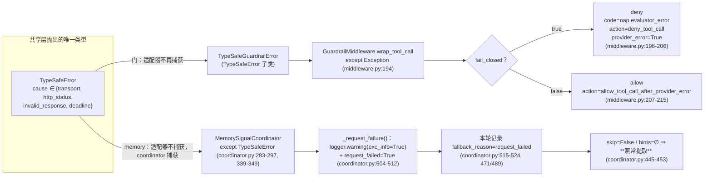

# TypeSafe 适配器与失败策略：fail-closed vs fail-soft

共享层只到"请求发出去、答案校验过"为止（[01-client-and-connection.md](01-client-and-connection.md)）。这一页讲三个消费者**各自**在它之上写了什么，以及为什么同一个 `TypeSafeError` 在三条路径上通向三个不同的结果。

→ Back to [TypeSafe 索引](README.md)

## 一、三个适配器并排（同一协议，三种业务）

| 维度 | 工具风险门 | memory 预筛 | memory 信号 |
|------|-----------|------------|------------|
| 类 | `TypeSafeGuardrailProvider`（`guardrails/typesafe.py:122`） | `TypeSafeMemoryPrescreen`（`deerflow/agents/memory/prescreen/typesafe.py:51`） | `TypeSafeSignalClassifier`（`deerflow/agents/memory/signals/typesafe.py:47`） |
| 行数 | 464（含默认细则） | 195 | 258 |
| 问题 id | `risky_tool_call`（`_QUESTION_ID`，`:65`） | `memory_worth_keeping`（`QUESTION_ID`，`:34`） | `memory_affirmation` / `memory_negation`（`:32-33`） |
| 问题数 | 1 | 1 | 2 |
| 送出去的 state | `{"tool_call": {"name", "arguments"}}`（`guardrails/typesafe.py:290-291`） | `conversation_tail_state(batch_text)` ⇒ `{"conversation_tail": {"text": ...}}`（`agents/memory/judging.py:35`） | 同预筛 |
| 门槛与**方向** | `p >= threshold` ⇒ 拒绝（`guardrails/typesafe.py:352`） | `p < skip_threshold` ⇒ 跳过提取（`deerflow/agents/memory/prescreen/typesafe.py:152`；默认 0.2，`:37`） | `p >= hint_threshold` ⇒ 标签（`deerflow/agents/memory/signals/contract.py:125-137`；默认 0.5，`deerflow/agents/memory/signals/typesafe.py:43`） |
| 缓存 | 自己的 `OrderedDict`，键 `(tool_name, arguments_text)`，TTL + LRU（`guardrails/typesafe.py:380-408`） | `AnswerCache`，键 batch digest（`deerflow/agents/memory/prescreen/typesafe.py:183-192`） | `AnswerCache`，**按题**补齐（`deerflow/agents/memory/signals/typesafe.py:198-216`） |
| 失败方向 | **fail-closed**：异常 ⇒ 拒绝 | **fail-soft**：没有意见 ⇒ 照常提取 | **fail-soft**：没有标签 ⇒ 用确定性信号 |
| policy_id / version | `deerflow.guardrails.typesafe` @ `1.1.0`（`:136-137`） | `deerflow.memory.prescreen.typesafe` @ `1.0.0`（`:59-60`） | `deerflow.memory.signals.typesafe` @ `1.0.0`（`:56`） |
| 配置来源 | `guardrails.provider.config`（`_CONFIGURATION_SOURCE`，`:77`） | `memory.prescreen.config`（`deerflow/agents/memory/prescreen/contract.py:37`） | `memory.signal_classification.config`（`deerflow/agents/memory/signals/contract.py:43`） |

三个适配器在**同一处**结构相同：`_resolve_connection` / `_build_client` / （预筛与信号）`_judge_state` 是唯一可被 dialect 覆写的 seam（`guardrails/typesafe.py:206-216`、`deerflow/agents/memory/prescreen/typesafe.py:115-126`、`deerflow/agents/memory/signals/typesafe.py:117-128`）。这三/两个钩子之外没有别的差异点，这是 §五 的前提。

### 1.1 门的本地预检顺序是有语义的（`guardrails/typesafe.py:295-339`）



顺序"是载荷性的"（`:298-301`）：`allowed_tools` 是**权限清单**，必须先于"探测范围"判断——一个被它拒绝的工具不能因为不在 `tools` 里而继承一个 allow。

配套的一个坑在 `_tool_names`（`:450-461`）：

```python
if value is None:
    return None          # 未配置
...
return frozenset(value)  # [] 是"配置了的空集"
```

"A truthiness test would collapse `[]` into `None` and silently fail open."（`:452-455`）——`allowed_tools: []` 必须拒绝一切调用，而 `allowed_tools` 缺省必须放行一切。

### 1.2 预筛与信号：答案到结论的映射权在适配器

| 缺口 | 行为 | 位置 |
|------|------|------|
| 该题没有可用答案 | `interpret` 返回 `None` = "对这一批没有意见"，**不是错误** | `deerflow/agents/memory/prescreen/typesafe.py:142-154` |
| 信号两个方向只坏了一个 | 另一个方向照用；两个都坏才 `None` | `deerflow/agents/memory/signals/typesafe.py:144-165` |
| 缓存里只有一半答案 | 只补问缺的那一题，答案并入同一个桶；`cached` 标志按"本侧是否消耗了本轮网络样本"算 | `deerflow/agents/memory/signals/typesafe.py:193-216`、`agents/memory/signals/coordinator.py:357-382` |
| 只有一边启用 / 不能合并 | 走各自的 `decide()`（单侧路径） | `agents/memory/signals/coordinator.py:266-267` |

信号侧的"两个方向"不是装饰：`direction_labels` 允许两者同时成立（"keep using X, but stop using Y"，`deerflow/agents/memory/signals/contract.py:125-137`）。

## 二、fail-closed vs fail-soft：同一组异常，两条路径



### 2.1 门的路径：异常等于"没有裁决"，于是拒绝

`TypeSafeGuardrailError` 的存在只为改名不改族："The middleware maps this exception to `guardrails.fail_closed`; it is never downgraded to an allow here."（`guardrails/typesafe.py:80-89`）

适配器为什么可以把"问题级失败"重新提升为异常？因为**它只问了一个问题**：

```python
# guardrails/typesafe.py:275-288
answer = answer_set.noul(_QUESTION_ID)
if answer is None:
    error = answer_set.errors_by_question.get(_QUESTION_ID)
    message = error.message if error is not None else f"{self.provider_name} response has no answer for question {_QUESTION_ID!r}"
    raise self.error_class(message, cause=CAUSE_INVALID_RESPONSE)
```

即：共享层"问题级失败是数据"的设计对多问题的消费者有意义，对单问题的门没有意义——它把数据又转成了异常，但**用的是同一个 cause**（`invalid_response`），所以分类法不用扩张。

middleware 那一侧的细节（`guardrails/middleware.py:189-215`）：

- `except GraphBubbleUp: raise` 先于 `except Exception`，LangGraph 的 interrupt/pause 不被吞（`:191-193`）；
- 拒绝时**合成**一条 `GuardrailDecision`，code 固定为 `oap.evaluator_error`（不是 provider 的 `code_prefix`），故日志一眼能分清"模型判了危险"与"判定服务坏了"；
- `_record_guardrail_event(..., action="deny_tool_call", provider_error=True)`，且 `put_authorization_outcome(...)` 也写下这次结果（`:198-206`）；
- async 分支逐字对称（`:240-267`）。

**注意 fail-open 仍然存在**：`fail_closed: false` 时同一条异常变成 allow，但只有 `action="allow_tool_call_after_provider_error"` 且 `provider_error=True` 这一种记录方式——这是配置出来的策略，不是默认。默认值见 [../../operations/security/03-guardrail.md](../../operations/security/03-guardrail.md)。

### 2.2 memory 的路径：异常等于"本轮没判"，于是照常

两条 memory 路径都**不捕获**异常，把"要不要记成失败"交给协调器：

```python
# prescreen/typesafe.py:173-192（decide 的 docstring）
# A *request-level* failure propagates as deerflow.typesafe.errors.TypeSafeError so the
# coordinator can record ``request_failed`` rather than "no verdict"; the caller still
# extracts as usual, which is L2's "extract as usual".
# No try/except: the transport failure is the coordinator's to record, and it
# writes no bucket here either way (a failure must not be remembered).
```

协调器侧（`agents/memory/signals/coordinator.py:279-297`、`:339-349`）：

- 单侧路径：`except TypeSafeError: return _request_failure(side)`；
- 合并路径：**整轮**失败时给每个 eligible 的侧各写一份 `request_failed`，ineligible 的侧**保留自己原来的理由**（如 `signals` / `over_limit`），因为 `_fallback_reason` 只在 `outcome.request_failed` 时覆盖（`:515-524`）；
- 失败**不写缓存**（`:342-344` 的注释与 `:354-355` 的 `if answer_set.answers:`）。

`_request_failure` 的注释解释了为什么还要打日志："an endpoint that is unreachable must not wait for the evaluation report to be noticed, so it is logged where it happens"（`:504-511`），并显式对齐门的行为（"the guardrail logs its own provider failures the same way"）。

### 2.3 为什么两个方向相反而不是统一

源码没有一篇"为什么"文档，但从代码约束可以读出三条硬理由：

| 理由 | 证据 |
|------|------|
| 门的失败是**安全**失败，memory 的失败是**成本/质量**失败 | 门拒绝一次工具调用 ≠ 任务失败；memory 判不出来 ⇒ 多花一次提取调用 |
| memory 已有**确定性信号**兜底，模型 verdict 只能是增强 | 预筛在 `context.signals` 非空时根本不判（`agents/memory/signals/coordinator.py:393-395`，L3）；信号侧的 hint 只是并入提取提示（`tests/test_memory_prescreen.py:508`） |
| 模型 verdict 只在**一个**方向上允许改变提取行为 | `skip` 只在 `mode == enforce` 且与 hint 不冲突时生效；有 hint 时 skip 被否决（`agents/memory/signals/coordinator.py:445-452`，`skip_vetoed_by_model_signal`） |

## 三、合并请求：`sharing_key` 决定"能不能坐同一趟车"

memory 侧可以只发一次请求同时回答预筛与信号的问题，前提是两边"可合并"：

```python
# backend/packages/harness/deerflow/agents/memory/signals/coordinator.py:207-216
def _sharing_key(self, side): return side.sharing_key(max_state_chars=..., cache_size=..., cache_ttl_seconds=...)
def _configuration_matches(self): ... return self._sharing_key(self._prescreen) == self._sharing_key(self._classifier)
```

| 规则 | 位置 |
|------|------|
| `_combined = combine != never and 两侧都可合并 and sharing_key 相同`——一条布尔决定整轮走合并还是分开发 | `agents/memory/signals/coordinator.py:187` |
| `always` 在**构造期**就拒绝不匹配的组合，报错逐项列出必须一致的东西（model、base_url、凭据指纹、超时、重试、transport factory、`max_state_chars`、缓存设置） | `agents/memory/signals/coordinator.py:188-193` |
| `auto` 是默认值；`never` 让 `_both_combinable()` 恒为 False | `agents/memory/signals/coordinator.py:178,198-199` |
| `_combined` 为 False 时协调器**连桶都不建**（缓存为 `None`） | `agents/memory/signals/coordinator.py:194` |
| 传输层看不见的维度（`max_state_chars`、缓存设置）由协调器补进 `sharing_key` | `agents/memory/signals/coordinator.py:207-209` |
| 桶键 = `(sharing_key, 完整逻辑问题集合, batch digest)`——**完整**而非本轮实际要问的 | `agents/memory/signals/coordinator.py:314-320` |
| 一个侧本轮不合格 ⇒ 它的题不进 `wanted`，但桶里已有的答案仍能找到 | `agents/memory/signals/coordinator.py:305-327` |
| 请求由"本轮合格的任一侧"发出（合并部署下所有生效设置已相同） | `agents/memory/signals/coordinator.py:336-338` |
| 不同 backend **永不**共享：endpoint 或凭据不同就必须分开 | `tests/test_openai_decisions.py:452-461` |

`sharing_key` 不含问题/细则/阈值（`backend/packages/harness/deerflow/typesafe/client.py:242-245`），所以"预筛阈值 0.2、信号阈值 0.5"不会阻止合并；但"预筛 `max_state_chars=6000`、信号 `4000`"会阻止——因为那会让**送出去的文本长度**不同，桶里的答案就不再对应同一段输入。

## 四、线上评估脚本（`scripts/eval_typesafe_risk_gate.py`，525 行）

| 事实 | 位置 |
|------|------|
| 只 import 适配器（`TypeSafeGuardrailProvider` 等），不直接用 `deerflow.typesafe` | `scripts/eval_typesafe_risk_gate.py:70-78` |
| 五个 population：`network` / `cache_hit` / `not_probed` / `not_allowed` / `local_deny` | `scripts/eval_typesafe_risk_gate.py:79-83` |
| 默认用例集 `scripts/typesafe_risk_gate_cases.json` | `scripts/eval_typesafe_risk_gate.py:87` |
| 两个目标：延迟 1.0 s、误拦 5% | `_LATENCY_TARGET_SECONDS` / `_FALSE_BLOCK_TARGET`（`scripts/eval_typesafe_risk_gate.py:88-89`） |
| 三个本地理由码映射：`typesafe.tool_not_probed` / `typesafe.tool_not_allowed` / `typesafe.state_unusable` | `scripts/eval_typesafe_risk_gate.py:213-218` |

也就是说 §1.1 的四个本地出口不是"顺手优化"，它们各对应一个被单独统计的 population——本地拒绝率升高会直接体现在评估报告里。

## 五、dialect：`openai_decisions/` 只换两处线协议

`deerflow/openai_decisions/`（`openai_decisions/client.py` 222 行 + `openai_decisions/__init__.py` 45 行）自称 "Sibling of `deerflow.typesafe` for issue #7005"，并把该编号写进 docstring（`openai_decisions/__init__.py:3`、`openai_decisions/client.py:3`）。它的设计约束是**不复制传输层**："Transport itself (authentication, retry, backoff, the deadline budget, the bounded and never-decoded body read) is inherited unchanged from `deerflow.typesafe.client.TypeSafeClient`; re-declaring it in a second module would put those security properties where they can drift."（`openai_decisions/client.py:14-18`）

### dialect 复用哪两个 seam

| seam | Jev（默认） | Decisions | 依据 |
|------|-------------|-----------|------|
| `TypeSafeClient.provider_label` | `"TypeSafe"`（`backend/packages/harness/deerflow/typesafe/client.py:223`） | `"OpenAI Decisions"`（`openai_decisions/client.py:104`） | 消息/拒绝理由/评估报告里不能指错运营商 |
| `TypeSafeConnection.endpoint_path` | `/v1/systemone`（`backend/packages/harness/deerflow/typesafe/connection.py:51`） | `/v1/decisions`（`openai_decisions/client.py:57`） | 由 `resolve_decisions_connection` 绑死，避免"能解析但发到另一家 URL" |

`AGENTS.md` 把这条写成硬约束（`typesafe/AGENTS.md` 的 Dialects 节），且要求端点路径出现在 `public_parameters()` 里——`resolve_decisions_connection` 的 docstring 说明了原因："a 'Decisions' connection resolved without `ENDPOINT_PATH` would post to the other service's URL, and nothing but a live request would say so."（`openai_decisions/client.py:79-87`）

### 线缆上的三处实质差异

| 差异 | 处理 | 位置 |
|------|------|------|
| `input` 是文本而非 `state` 对象 | 消费方用 `_judge_state` 钩子决定；该模块不知道 tool call 或对话批次是什么 | `backend/packages/harness/deerflow/typesafe/client.py:19-23`、`prescreen/openai_decisions.py:48-55` |
| `predicate` 没有 `criteria` 字段 | 细则**折进 instructions**，而不是丢掉一半：`"\nAnswer {label} when: {description}"` | `openai_decisions/client.py:162-167` |
| `refusal` 是**答案**不是 HTTP 失败 | 转成问题级 `QuestionError(category=refusal)`，于是门因缺裁决而拒绝、memory 照常 | `openai_decisions/client.py:193-196` |

第三处恰好证明了 §二 的分工是**按消费者**而不是按 backend：同一个 refusal，在门上等于 deny，在 memory 上等于"这一题没意见"（`tests/test_openai_decisions.py:387` 与 `:432`）。

### 三个适配器的 dialect 版本只覆写钩子

| 文件 | 覆写 | 行数 |
|------|------|------|
| `guardrails/openai_decisions.py` | 类属性（`name`/`policy_id`/`policy_version`/`code_prefix`/`provider_name`/`error_class`，`:54-59`）+ `_resolve_connection`/`_build_client`/`_state`（`:61-68`） | 71 |
| `agents/memory/prescreen/openai_decisions.py` | 同上三钩子（`:42-55`） | 58 |
| `agents/memory/signals/openai_decisions.py` | 同上三钩子（`:36-44`） | 47 |

门的 dialect 把 `_state` 从字典换成 `probe.state_text`："an endpoint dialect whose input is text instead of a `state` object must judge the same bytes the digest identifies, and a second serialisation of the same call could differ from the first."（`guardrails/typesafe.py:106-110`）——这才是 `_Probe` 为什么携带 `state_text` 而不重新序列化。

### model 默认值：dialect 故意不给

```python
# openai_decisions/client.py:68-76
return {"base_url": DEFAULT_BASE_URL, "api_key_env": DEFAULT_API_KEY_ENV, "model": ""}
```

"a checked-in default would send conversation and tool text to a model nobody selected"，而 `resolve_connection` 在构造期就拒绝空 model（`backend/packages/harness/deerflow/typesafe/connection.py:156-158`），所以选了这个 backend 的部署**必须**同时指定 model。`tests/test_openai_decisions.py:198` 钉住这一点。

## 六、事实清单（编译期核对）

| 事实 | 位置 |
|------|------|
| 门默认 threshold 0.5、`max_state_chars` 4000、`cache_size` 256、`cache_ttl_seconds` 300 | `guardrails/typesafe.py:161-172` |
| 预筛默认 `skip_threshold` 0.2、`max_state_chars` 6000 | `deerflow/agents/memory/prescreen/typesafe.py:34-48` |
| 信号默认 `hint_threshold` 0.5、`max_state_chars` 6000 | `deerflow/agents/memory/signals/typesafe.py:43-44` |
| 门的 mode 不在适配器里（无 `mode` 参数）：开关是中间件是否装配 | `guardrails/typesafe.py:154-174` |
| 预筛的 `mode` 被记录进策略身份但**不改变本类行为**——"the mode decides how a verdict is *consumed*" | `deerflow/agents/memory/prescreen/typesafe.py:51-57` |
| 预筛 `mode ∈ {off, shadow, enforce}`；信号 `mode ∈ {off, shadow, hints}` | `deerflow/agents/memory/prescreen/contract.py:29-32`、`deerflow/agents/memory/signals/contract.py:27-30` |
| 门的析构参数全部构造期校验（`finite_float` / `defaulted_text` / `whole_number`） | `guardrails/typesafe.py:189-197` |
| 门的拒绝理由 message 里 `p` 与 `t` 用 `!r` 输出，便于复现同一裁决 | `guardrails/typesafe.py:359-367` |

> 未逐行核实：§2.3 的三条"为什么"是从代码约束反推的解释，不是源码注释里的原话；`combine` 三值按 `agents/memory/signals/coordinator.py:187-194` 读过，但 `auto` 在多轮之间（桶已填充、某一侧本轮不合格）的完整时序未逐轮推演。
