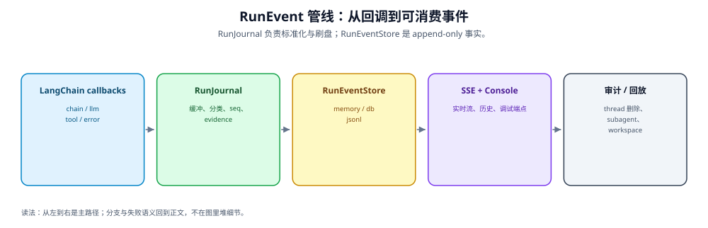

---

title: "结构化事件流：RunEventStore 与 RunJournal"
description: 'DeerFlow 有一个 append-only 的 run 事件流：RunJournal 把 LangChain 回调标准化成 RunEvent，写入 RunEventStore。它是审计、回放、调试端点、subtask 卡片、workspace 审查的共同数据源。v2.2.0 起多了 run.terminal 权威终态事件、per-call LLM 遥测、证据封印链，以及跨删除不复用的 seq 水位。'
topics: [observability, run-events, journal, audit, terminal-events]
verified_against: v2.2.0
last_verified: 2026-11-08
---

# 结构化事件流：RunEventStore 与 RunJournal

> **图读法**：RunJournal 负责标准化与刷盘；RunEventStore 是 append-only 事实。

日志是给人 `grep` 的，事件流是给**程序**读的。DeerFlow 的 `RunEventStore` 是一份 append-only 的 run 记录，`RunJournal` 把 LangChain 回调标准化成 `RunEvent` 写进去。历史、调试、subtask、memory 审计、workspace 审查读的是同一批行的不同投影。

> RunJournal 的缓冲/刷盘/token 分桶细节 → [internals/runtime/04-journal.md](../internals/runtime/04-journal.md)。这里聚焦事件流的**契约和消费方式**。
> v2.2.0 的权威规范文档是 `backend/docs/RUN_EVENT_STREAM.md`（v2.2.0 新增「Authoritative Run Outcome」+「Publication Authority」+「Evidence Ordering」+「Idempotence」+「Compatibility and Storage Guarantees」五节，158 行增量），本页是它的中文摘要 + 消费指引。

## 事件目录（`deerflow/runtime/events/catalog.py`）

固定事件（`RunJournal` 产出的那批 = `JOURNAL_RUN_EVENT_DEFINITIONS`，`catalog.py:100-110`）：

| event_type | category | 来源回调 |
|-----------|----------|---------|
| `run.start` | `trace` | 根 `on_chain_start()` |
| `run.end` | `outputs` | 根 `on_chain_end()` |
| `run.error` | `error` | `on_chain_error()` |
| `llm.human.input` | `message` | 首条 lead-agent 人类输入 |
| `llm.ai.response` | `message` | `on_llm_end()`，或 `record_interrupted_ai_responses()`（🆕 v2.2.0） |
| `llm.tool.result` | `message` | `on_tool_end()` / `on_chat_model_start()` 的 tool-result 对账（🆕 v2.2.0） |
| `llm.error` | `trace` | `on_llm_error()` |
| `context:memory` | `context` | `record_memory_context()` |
| `middleware:{tag}` | `middleware` | `record_middleware()` |

**🆕 v2.2.0 新增固定事件**：`run.terminal` / `trace`（`catalog.py:61`），由 **worker 终局化**产出，不是 Journal，所以单独成组 `WORKER_RUN_EVENT_DEFINITIONS`（`catalog.py:117`）。详见下面「`run.terminal`：权威终态」一节。

动态模式：`middleware:{tag}`（tag 限 1–21 字符 = `RUN_EVENT_TYPE_MAX_LENGTH`(32) − `"middleware:"`(11)，`constants.py:75`）。v2.2.0 注册的 tag 全集 = **8 个**：`guardrail`、`loop_detection`、`safety_termination`、`skill_activation`、`skill_secrets`、`tool_promotion`、`tool_progress`、`summarize`（🆕 v2.2.0，`catalog.py:87` `MIDDLEWARE_SUMMARIZE_TAG`，元组在 `catalog.py:88-97`）。

`middleware:summarize` 的 payload：`action="summary_result"`、`hook="before_model"`，`changes` 带 `noop` / `llm_call_skipped` / `summary_chars` / `previous_summary_chars` / `summarized_message_count` / `noop_count` / `call_count` / `skip_count`（`agents/middlewares/summarization_middleware.py:840-854`）。**摘要正文与消息内容永不进事件**，只记长度和计数。无变更的 cache 复用也会发（`noop=true`）。

其它生产者：`subagent.start` / `subagent.step` / `subagent.end`（`subagents/step_events.py`，批量 `put_batch`）；`workspace_changes`（`workspace_changes.record_workspace_changes()`）；`run.delivery`（Journal 在 run 末尾 buffer，`journal.py:1647-1653`——**这个类型不在冻结契约里**，见下方「已知缺口」）。

## 信封与顺序保证

| 字段 | 含义 |
|------|------|
| `thread_id` / `run_id` | 归属 |
| `seq` | **thread 全局**严格递增（不是 run 局部），🆕 v2.2.0 起跨删除不复用（见下） |
| `event_type` / `category` | 固定名或文档化动态模式（type ≤32 字符，category ≤16） |
| `content` | 字符串或 JSON（`run.end.content` 故意 opaque，跨后端不保证嵌套一致） |
| `metadata` | 可过滤/审计元数据 |
| `created_at` | 带时区 ISO-8601 |
| `user_id` | 🆕 仅 DB 后端：owner stamp，由 Journal 在 `_make_event()` 里写入（`journal.py` 的 `_make_event`），供 owner-scoped 读/删 |

后端差异：memory 保留 Python 值；JSONL/DB 经 `json.dumps(default=str)`，非 JSON 嵌套值读回为字符串。**多进程/多 worker 部署必须 `run_events.backend: db`**（JSONL 只在单进程内保证 seq）。`run_events.max_trace_content`（默认 10240 字节，🆕 v2.2.0 加了 `ge=1` 与「拒绝布尔」校验，`config/run_events_config.py`）只对 **db** 后端生效——memory / JSONL 不截断 trace content。

### 🆕 v2.2.0 变更：seq 水位（跨删除不复用）

v2.1.0 的语义是「删除后 seq 从 1 重新开始」。v2.2.0 改成**每个 thread 一份持久水位**，删除 run 不再拉低下一个分配值：

| 后端 | 水位载体 | 删除时的行为 |
|------|---------|-------------|
| DB | 新表 `run_event_thread_seq`（`RunEventThreadSeqRow`，`persistence/models/run_event.py:42-48`；migration `0034_run_event_seq_watermark.py`） | `_max_seq_for_thread()` 取 `max(row_max, watermark)`（`db.py:180-201`）；`delete_by_run()` 删完把删前 max 抬进水位（`db.py:652`）；`delete_by_thread()` 只在**全表已无本线程任何事件**时才删水位行 |
| JSONL | `<thread_dir>/.seq-watermark` 文件 | `_save_seq_watermark()`（`jsonl.py:156-176`）在删 run 文件**之前**原子发布（temp + `chmod` 沿用 run 文件权限 + `replace`）；`delete_by_thread()` 删光 run 文件后才 unlink 水位 |
| memory | 无持久水位 | 仍是进程内 `_seq_counters`，`delete_by_thread()` pop 掉 → **删除后重新从 1 开始**（memory 本来就不跨重启） |

为什么要这个：消费者用 `after_seq` 做前向游标，如果删除把 seq 拉回 1，一个游标已经越过被删 run 的读者会**永久漏掉**之后的事件。所以「值在 thread 内不复用」是 v2.2.0 的兼容承诺（`backend/docs/RUN_EVENT_STREAM.md` 的 sequence 一节）。

## 冻结契约（`contracts/run_event_stream_contract.json`，v1）

上面这些名字不是"当前实现的快照"，而是一份**跨组件冻结契约**（JSON Schema 2020-12 方言，`version: 1`）。它冻结现有 event type 与 category、描述各生产者 payload、并写明兼容规则——改运行时之前先看它。

**兼容规则**：

| 类别 | 内容 |
|------|------|
| 消费方义务 | 必须忽略未知 event type、未知信封字段、未知的可选 payload/metadata 字段（前向兼容的前提） |
| 允许的**增量**变更 | `add_event_type` / `add_optional_payload_field` / `add_optional_metadata_field` / `add_envelope_field` |
| **破坏性**变更 | 删除或改名 event type、改 category、删必填字段、改必填字段类型 |

**信封必填字段**：`thread_id` / `run_id` / `seq` / `event_type` / `category` / `content` / `metadata` / `created_at`（`record_schema.required`）。`user_id` 是 v2.2.0 实际在 DB 后端带上、但**未进 required** 的可选信封字段。

**序列**：`scope = thread_id`、`guarantee = strictly increasing within a thread`；`jsonl_multi_process_limit` 明确写着 `JsonlRunEventStore` 只保证**单进程内**单调分配，跨进程共享写入必须用 `DbRunEventStore`。

**8 个 category**：`trace` / `message` / `outputs` / `error` / `middleware` / `context` / `subagent` / `workspace`。

**13 个冻结事件与生产者**（`events[]`，v2.1.0 是 12 个，🆕 v2.2.0 加了 `run.terminal`）：

| event_type | category | 生产者 |
|-----------|----------|--------|
| `run.start` | trace | `RunJournal.on_chain_start(parent_run_id=None)` |
| `run.end` | outputs | `RunJournal.on_chain_end(parent_run_id=None)` |
| `run.terminal` | trace | 🆕 worker `run_agent()` 终局化（最终提交 ACK + Journal drain 之后、证据收据之前），或 `RecoveryTerminalPublisher` 在 takeover claim 成功后 |
| `run.error` | error | `RunJournal.on_chain_error()` |
| `llm.human.input` | message | `on_chat_model_start()`，仅首条被持久化的 lead-agent `HumanMessage` |
| `llm.ai.response` | message | `on_llm_end()` **或** 🆕 `RunJournal.record_interrupted_ai_responses()`（中断兜底） |
| `llm.tool.result` | message | `on_tool_end()`，对 `ToolMessage` 或 `Command(update.messages[])`；🆕 另有 `on_chat_model_start()` 的「已消费 tool result」对账 |
| `llm.error` | trace | `on_llm_error()` |
| `context:memory` | context | `record_memory_context()`（由 DynamicContextMiddleware 触发） |
| `subagent.start` | subagent | `subagent_run_event(task_started)` |
| `subagent.step` | subagent | `subagent_run_event(task_running)` |
| `subagent.end` | subagent | `subagent_run_event(task_completed\|task_failed\|task_cancelled\|task_timed_out)` |
| `workspace_changes` | workspace | `workspace_changes.record_workspace_changes()` |

**动态模式**：只有 `middleware:{tag}` 一个，`event_type` 长度 12–32（`^middleware:` 前缀 + tag），`tag` 长度 1–21；**8 个已知 tag** = `guardrail` / `loop_detection` / `safety_termination` / `skill_activation` / `skill_secrets` / `tool_promotion` / `tool_progress` / `summarize`（与 `catalog.py` 的 `MIDDLEWARE_EVENT_TAGS` 一一对应）。`content` 必填 `name` / `hook` / `action` / `changes`。

**legacy 别名**：`ai_message` → 规范化名 `llm.ai.response`，状态是 `read-only compatibility`（当前 runtime **不**再产出），按 category 的消息投影与 last-visible-AI 查询（含 `/messages/page`）仍识别这个历史名——所以判"最后一条 AI 消息"时两种写法都要覆盖。已知限制：legacy `/messages` 端点返回 category=message 行，但只给 `llm.ai.response` 补 feedback。

## 🆕 `run.terminal`：权威终态（v2.2.0，#6873 系列）

v2.1.0 的缺口「`run.end` 恒 success、`RunRow.status` 才是权威」在 v2.2.0 被**部分**补上：新增一个**单例**事件记录 run 最终业务结局。

| 维度 | 规格 |
|------|------|
| 身份 | `(thread_id, run_id, event_type)` 三元组，经 `put_if_absent()` 保证幂等单例（`events/store/base.py` 的 `put_if_absent`） |
| content | **只有** `{"status": ...}`，枚举 `success` / `error` / `interrupted` / `timeout`（`terminal.py:16` `TERMINAL_STATUSES`）；不含 graph 输出、不含错误详情 |
| metadata | 必填 `protocol_version: 1` + 布尔 `recovered`（`terminal.py:15` `TERMINAL_PROTOCOL_VERSION`） |
| `recovered` 语义 | owner worker 发 `false`；只有「takeover claim 成功**且**确实新建了缺失的终态事件」才是 `true`。已有匹配事件保留它原本的标记。这个标记只描述证据来源，**不授予发布权** |

**为什么不能拿 `run.end` 当终态**：一次 run 可以在业务结局变 `error` **之前**先产出多个 `success` 元数据的 `run.end`（每个根图完成一次）。要判 run 到底成没成，看 `run.terminal`（或 `RunRow.status`）。

**发布权（Publication Authority）**是这块的核心不变式：只有**当前本地 owner worker 的、可归因的最终 Terminal Commit ACK**，且 ACK 里的结局与当前一致，才能授权发布。以下**都不能**替代那个证明：graph 完成、同状态的 RunRow 读、store-only hydrate 的记录、legacy `None` 写入结果、以及 store 返回的任意 truthy 值。没有 RunStore 支撑时，本地 Manager 的状态迁移只在该进程生命周期内算数。

**确认结果四态**（`TerminalEventConfirmation`，`terminal.py:229-236`）：

| 值 | 含义与处理 |
|----|-----------|
| `CONFIRMED_NEW` | 插入已确认且返回事件匹配 → 可以继续做收据捕获 |
| `CONFIRMED_EXISTING` | 已有事件本身匹配 → 幂等接受，保留它的 seq 和原始来源标记 |
| `CONFLICT` | 身份/协议字段矛盾或畸形，**或** lifecycle guard 判定 run 已不再允许发布 → 记冲突、不覆盖、不封为 complete |
| `UNKNOWN` | 结果不可判定 → 保留不确定性，不封为 complete |

`created=False` 单独**既不能证明成功也不能证明冲突**。至多做 **2 次**原子单例尝试来消解丢失的 ACK（`terminal.py:286` 的 `for attempt in range(2)`），且两次都要求相同的最终提交权；这个有界确认**永不重放**被隔离的 Journal 批次。

**恢复路径**：`RecoveryTerminalPublisher`（`terminal.py:136`，由 `app/gateway/deps.py:903` 构造、`runs/manager.py:1882` 与 `2458` 在 takeover claim 后调 `authorize_takeover()`）发放**一次性** `RecoveryTerminalTarget`（不可变、只能 consume 一次，重复发布抛 `RecoveryTerminalTargetConsumed`）。发布前先补一条零投递的 `run.delivery` 收据（`{"presented": 0, "paths": [], "by_tool": {}}`，`terminal.py:217`），再做终态确认——顺序与正常路径的 delivery-before-terminal 一致；收据失败非致命。

**lifecycle guard**：`put_if_absent(..., lifecycle_guard=...)` 让存储在**与删除同一把 mutation fence** 内评估「run 还活着吗」（`base.py:48` 的 `SessionAwareRunEventLifecycleGuard`）。guard 返回 False → 抛 `RunEventLifecycleRejected`（`base.py:44`）而不写。DB store 用 `check_in_session()` 复用写事务的 session，避免同池再借一条连接（`db.py` 的 `put_if_absent` 里 `isinstance(lifecycle_guard, SessionAwareRunEventLifecycleGuard)` 分支）。**fence 不可重入**：guard 不能回调事件存储、也不能按可能反转锁序的方式取锁，否则死锁。内置恢复 guard 只读 RunStore。

**仍然存在、明确写进契约的缺口**：单例插入与 RunRow 终态提交是**两个事务**。正常终态提交之后、事件确认之前崩溃，且之后没有 takeover claim，就会留下「有终态 RunRow、没有 `run.terminal`」的 run。要彻底闭合需要 durable outbox / 对账，**不在本次实现范围内**；历史迁移也不在。

## 读取契约与分页边界（`events/store/base.py`）

所有读取方法都按 `seq` **升序**返回；下面的默认值即抽象签名默认值。🆕 v2.2.0 给接口加了第 7 条不变式：**可变入参与返回记录都与存储内部状态隔离（含嵌套 content/metadata）**——改写入入参、收据、或返回的 list 里的 dict，都不能改变已存记录或后续读（memory 后端逐处 `deepcopy`）。

| 方法 | 默认 limit | 边界语义 |
|------|-----------|---------|
| `list_messages(thread_id, *, before_seq, after_seq, user_id=AUTO)` | 50 | 只含 `category="message"`；`before_seq` = seq < 游标的**最后** limit 条；`after_seq` = seq > 游标的**最初** limit 条；**两个都给** = 开区间 `after_seq < seq < before_seq` 里的最初 limit 条（🆕 v2.2.0 显式写进契约）；都不给 = **最新** limit 条（仍升序） |
| `list_messages_by_run(thread_id, run_id, *, before_seq, after_seq, user_id=AUTO)` | 50 | 同窗口语义，但限定单 run。🆕 v2.2.0 的抽象签名**新增 `user_id`**（v2.1.0 只有 `DbRunEventStore` 的 override 有） |
| `list_events(thread_id, run_id, *, event_types, task_id, limit=500, after_seq, user_id=AUTO)` | 500 | 单 run 全类别；`task_id` 匹配 `metadata["task_id"]`，DB 在 LIMIT **之前**用 SQL JSON 探针过滤（`db.py:435-442`，issue #3779），所以单 task 翻页不被 run 级 limit 截断；只有前向 `after_seq`。🆕 v2.2.0：`event_types=[]`（空列表）现在等价于「不过滤」，判据从 `if event_types:` 改成 `if event_types is not None:`（`db.py:433`） |
| `find_latest_ai_message_run_ids(thread_id, message_ids, *, user_id=AUTO)` | 每页 1000 | 反向分页的 **complete-or-error** 契约：空输入不碰存储直接返回 `{}`；整页无法形成安全推进的 `seq` 游标时抛 `IncompleteMessageRunLookupError`（`base.py:27`；抛出点 `base.py:243` / `248`）而非静默漏；调用方只能在**正常返回**后把 miss 当"不存在"的证据 |
| `get_message_seqs(thread_id, identities, *, user_id=AUTO)` | — | 每个 identity 取**最早** seq（重复持久化的消息保留首次位置）；未持久化的 identity 直接缺席，不是错误 |
| `get_last_visible_ai_seq_by_run(thread_id, run_ids, *, user_id=AUTO)` | — | 每个 run 最后一条非 `middleware:` 的 AI 消息 seq（`llm.ai.response`，兼容旧的 `ai_message`） |
| `put_if_absent(...)` | — | run 内按 `event_type` 的幂等单例，返回 `(record, created)`；检查与写入必须与普通写者串行。🆕 v2.2.0 多了 `user_id`（给无请求上下文的 worker 显式 stamp owner）与 `lifecycle_guard` 两个参数 |

接口不对称（v2.2.0）：抽象签名里 `count_messages()`（`base.py:316`）仍然**没有** `user_id`——只有 `DbRunEventStore` 的 override 额外接受它。

## 变更串行域（mutation fence）与删除签名（sync #7，upstream #5535）

事件存储的所有**线程级变更**共享一个串行域：`put` / `put_batch` / `put_if_absent` / `delete_by_thread` / `delete_by_run`。

| 层 | 手段 |
|----|------|
| 进程内 | 每线程 `asyncio` 锁（DB：`_get_write_lock()`，`db.py:57`，另有 weak registry + 引用 pin 防 release/acquire 竞态；**🆕 memory**：v2.2.0 也加了每线程锁 `_get_mutation_lock()`，`memory.py:40`，因为 guarded 单例写会 await lifecycle 回调，不能再靠「无 await 即原子」） |
| PostgreSQL 跨进程 | 事务级 advisory lock `pg_advisory_xact_lock(hashtext(thread_id))`，由 `DbRunEventStore._acquire_thread_mutation_fence()`（`db.py:155-176`）取；写路径经 `_max_seq_for_thread()` 内部调用它，两个 delete 直接调用。只读方法（`list_*`）不取 |
| SQLite | 无跨进程 fence，依赖上面的进程内锁（故多实例部署要求 Postgres） |
| JSONL | 自己的 `_run_mutation`（`jsonl.py:89`）提供等价保证 |

进程内锁的生命周期：`DbRunEventStore._get_write_lock()` 每次调用都把当前 generation 重新 pin 到 `_write_lock_pins`（`db.py:57-65`）；`delete_by_thread()` 在删除完成后只 `pop` 掉 pin 让该线程 retire，**不**直接从 weak registry 删条——`asyncio.Lock.release()` 会在排队 waiter 恢复前清掉 `locked()`，直接删会在 handoff 窗口把同一线程劈成两代锁。`delete_by_run()` 故意保留 pin，因为线程仍然活着。

这样删除**无法**与一个已被准入的写者交错、在 `count` 与 `commit` 之间落进行——否则会"复活"一个刚被删掉的线程。

**🆕 v2.2.0 删除路径多了两件事**：① 两个 delete 都先 `RunRepository._next_change_seq()` 再调 `_invalidate_evidence()`（`db.py:401`）——把相关 `RunRow.evidence_retention_revision` +1、`evidence_seal_state='partial'`、并删掉 `CompletedRunSnapshotRow` 行，即**任何事件删除都让该 run 的完成证据失效**；② `delete_by_run()` 删完把删前 max 抬进 seq 水位（`db.py:652`），所以删单个 run **不会**让后续事件复用它的 seq。

**删除签名统一为 owner-scoped**：`delete_by_thread(thread_id, *, user_id=AUTO)` / `delete_by_run(thread_id, run_id, *, user_id=AUTO)` 遵循与读方法相同的三态约定（`user_context.resolve_user_id()`：`AUTO` 解析请求上下文，**无上下文时抛 `RuntimeError`**；显式 id 限定所有者；`None` 关掉所有者过滤，供 migration/CLI）。DB 后端按 `user_id` 过滤行；memory 与 JSONL 的存储本身不按用户分区，**接受该参数只为接口一致性并忽略它**。Gateway 侧对第三方（legacy）`RunEventStore` 实现做了兼容：用 `inspect.signature` 判断能否传 `user_id`，只有签名支持时才带（无法 inspect 或后端内部抛出的 `TypeError` **不会**触发重试）。

**⚠️ v2.1.0 的这条断言已过时**：v2.1.0 写过「删除后该线程的 `seq` 从 1 重新开始（`db.py` 的 `put` 用 `seq=(max_seq or 0)+1`，memory/JSONL 删时清 `_seq_counters`）」。v2.2.0 只有 **memory** 还这样；DB 与 JSONL 都保留水位。被删线程的事件流不再可读（这正是目的：`GET /threads/{id}/messages` 不能读回已删线程的历史），但 seq 不会被下一条事件捡回去。

**这是串行化，不是 incarnation fence**：一个在删除**之前**就已准入的变更，仍可能在删除之后才真正执行。阻止旧 incarnation 复活需要独立的 durable generation 契约——`threads_meta.incarnation` 列早已存在（migration `0019`），但没有任何 fencing 逻辑消费它。

## 🆕 Journal 的写所有权与隔离语义（v2.2.0）

v2.1.0 的 Journal flush 是「fire-and-forget task + 失败回填 buffer」。v2.2.0 换成了**带显式所有权与结果分类的写模型**（`journal.py`，+901 行），因为「store 可能已提交但 ACK 丢了」这件事必须区分开：

| 概念 | 机制 |
|------|------|
| 拥有写 | `_owned_writes: dict[Task, batch]`——每个 in-flight `put_batch` 都登记其原始批次；`_drain_pending_writes()`（`journal.py:1289`）用 `asyncio.shield` 等全部落定，删除 waiter 不影响持久写 |
| 内层 store task | `_write_batch()` 里 `asyncio.ensure_future(store.put_batch(...))` 再 `shield`；取消时给内层 `cancel()`，**有界**等待 `_WRITE_SETTLE_TIMEOUT_SECONDS = 5.0`（`journal.py:62`）。这只是等多久的上界，**不是**底层 I/O 已停止的证明 |
| `RunEventStoreNotCommittedError` | 🆕（`base.py:31`）存储**能证明整批都没落库**时抛（例如到达存储前就被拒）。**只有**这种异常允许 Journal 重放：批次回填 `_buffer` 前端，等下次显式 flush |
| 隔离（quarantine） | 其它任何异常 = 结果 **UNKNOWN**（可能已提交、丢 ACK）。批次进 `_quarantined_batches`，**永不重放**，且从此 fence 住该 run 的所有后继写；`flush()` 直接抛 `RunJournal flush refused: …` |
| 强制关闭 | `close(flush=False)` 在**第一个 await 之前**置 `_abandoned=True`（revoke 写所有权），不排队等 `_operation_lock`（否则会被卡死的正常操作堵住）；之后 `flush()` / `close(flush=True)` 都抛 `RuntimeError` 而不是假装成功 |
| 正常关闭 | `close(flush=True)` 在 `_operation_lock` 下把「flush + detach」当**一个不可分割操作**，所以不会有并发 waiter 看到「已落定但已 detach」的 Journal，也不会有没人 drain 的后继批次 |

`finish_evidence(before_receipt=...)`（`journal.py:1772`）是取证链的入口：停掉声明的生产者（`_stop_evidence_producers()`，`journal.py:1759` 置 `_accepting_evidence=False` 并等待 `_pending_producer_callbacks` 归零）→ drain 已接纳写 → 跑 `before_receipt`（worker 用它做终态确认）→ 对 `DbRunEventStore` 调 `evidence_receipt()` 取**证据收据** `JournalSealReceipt`（`events/evidence.py`：`run_id` / `thread_id` / `upper_event_seq` / `event_count` / `retention_revision` / `session_factory`）→ worker 据此持久化 Evidence Seal。**不支持该协议的 store 返回 `None`**（memory / JSONL 就没有 durable receipt）。

`record_middleware()` 的跨线程路径（`journal.py:1520`）现在也走同一套准入：持 `_producer_lock` 增 `_pending_producer_callbacks`，再 `call_soon_threadsafe` 到 owner loop；停生产者之后的迟到回调直接丢弃。

## 🆕 LLM 逐调用遥测（P0，只观测、失败即软降级）

`llm.ai.response` / `llm.error` 的 `metadata` 在 v2.2.0 多了一组**每次 LLM 调用**的字段（`journal.py` 的 `_capture_start_telemetry` / `_end_telemetry` / `_error_telemetry`，构造于 `on_chat_model_start`、在 `on_llm_end` / `on_llm_error` 合入）：

| 字段 | 含义 |
|------|------|
| `langchain_run_id` / `langchain_parent_run_id` | 与 LangChain 回调树对齐 |
| `caller_category` | `lead_agent` / `middleware` / `subagent` / `fallback` / `other`（`_llm_caller_category()`，`journal.py:116`；`fallback` 指错误兜底消息） |
| `provider` / `model` | provider 取 metadata `ls_provider` 或 `serialized.id[-1]`；model 取 `response_metadata.model_name/model`，回落 `ls_model_name` |
| `status` | `ok` / `fallback`（`llm.error` 恒 `error`） |
| `stop_reason` | `response_metadata` 的 `stop_reason`/`finish_reason`/`finishReason` |
| `input_tokens` / `output_tokens` / `total_tokens` | 从 `usage` 平铺，便于直接过滤 |
| `request_chars` / `request_message_chars` / `request_tools_chars` / `request_message_count` / `request_started_at` | **渲染时**请求体量的字符数（不是 token；`_content_chars()` 只走结构不序列化，base64 图片按 `len` 计）；`request_tools_chars` 在回调没带 bound-tool schema 时是 `null` |
| `error_type` | 仅 `llm.error`：异常类名 |

**all helper 都 fail-soft**：任何测量/构造异常只 `logger.warning("LLM … telemetry … failed", exc_info=True)`，事件照常写。这是纯观测层，不改变 token 计账（token 汇总仍走 Journal 内部累计 → `RunRow`）。

## 🆕 `llm.ai.response` 的其它 v2.2.0 变化

- **中断兜底**：`record_interrupted_ai_responses(messages)`（`journal.py:898`）在 agent stream 已关闭、run 判为 `interrupted` 后由 worker 调用（`worker.py:1921`），把「已经流给用户看、但永远等不到 `on_llm_end`」的可见文本补成 `llm.ai.response`，metadata 打 `interrupted: true` + `partial: true` + `usage: {}` + `latency_ms: null`。已完成回调的响应按 message identity 胜出，重复终局化是 no-op。这些事件**故意不进 checkpoint state**。
- **skill 使用快照**：lead agent 的**终结性**（无 `tool_calls`）AI 响应会把本条 run 的 skill 首次加载快照挂进 `additional_kwargs["skill_usages"]`（`journal.py:819` `record_skill_usage()`；上限 `_MAX_RUN_SKILL_SNAPSHOTS = 64`，`journal.py:64`；单条正文截到 `MAX_SKILL_SNAPSHOT_CHARS = 100_000` 并标 `partial: True`）。目的是翻页 / checkpoint 压缩之后菜单证据不丢。
- **tool result 对账提前**：v2.1.0 只在 `on_chain_end` 里对最终输出做 `_reconcile_final_tool_messages`。v2.2.0 在**每次 `on_chat_model_start`**（lead agent）就调 `_reconcile_consumed_tool_messages()`，并且 `_current_run_tool_call_suffix()` 只在「最后一次属于本 run 的 AI tool-call 边界之后」取后缀——含 AI 消息但找不到本 run 边界的批次**整批跳过**，避免把历史 tool result 重复写进事件流。`on_chain_end` 那条路径保留（`_reconcile_final_tool_messages`，用同一个 suffix 逻辑）。
- **首条人类输入的判定**：改用独立的 `_first_human_message_captured` 标志，而不是靠 `_first_human_msg` 非空——**只有媒体的输入**（没有可显示文本）也算捕获，不会让后续人类消息抢占 `llm.human.input`。
- **摘要去 think 块**：消息摘要走 `strip_leading_think_blocks()`，推理模型的 `<think>` 前缀不进 `last_ai_message` 摘要。

## 消费方式（读同一批行的不同投影）

| 消费者 | 读取路径 |
|--------|---------|
| 前端线程历史 | `GET /api/threads/{id}/messages/page` → `list_messages()`，过滤 middleware 行、subagent AI 响应、被替代的 regenerate run |
| 单 run 消息 | thread-scoped / stateless `GET .../runs/{rid}/messages` → `list_messages_by_run()` |
| **调试/审计端点** | `GET /api/threads/{id}/runs/{rid}/events?event_types=&task_id=&limit=&after_seq=` → `list_events()` |
| 历史 subtask 卡片 | run-events 端点按 `task_id` 过滤 `subagent.step` |
| Memory 审计 | 过滤 `context:memory`，比 `content_sha256`（全文不重复进事件存储） |
| Workspace 审查 | `GET /api/threads/{id}/runs/{rid}/workspace-changes` → 最新 `workspace_changes` |
| 🆕 扩展读证据 | `deerflow_extension_api` 的 `RunEventPage` / `RunEventView`；v2.2.0 加了 `StoreRunEvidenceReaderFactory.for_principal()`（`extensions/run_evidence.py:157`），把读者作用域**钉死在 host 认证过的 `ExtensionPrincipal.user_id`** 上，畸形 id 直接 `ValueError` 而不是归一化 |

**调试端点**是生产排障的入口：`event_types` 过滤（如 `context:memory`、`run.error`、`middleware:guardrail`、`middleware:summarize`），`task_id` 翻 subagent 步，`after_seq` 前向游标翻页。

## 后端实现差异（v2.2.0 实测）

| 能力 | memory | JSONL | DB（sqlite/postgres） |
|------|--------|-------|----------------------|
| 跨进程 seq | ❌ | ❌（单进程） | ✅（advisory lock + `run_event_thread_seq`） |
| 删除后 seq 复用 | ✅ 复用（从 1） | ❌ 不复用（`.seq-watermark`） | ❌ 不复用（水位表） |
| `max_trace_content` 截断 | ❌ | ❌ | ✅ |
| `user_id` owner stamp / 过滤 | 忽略 | 忽略 | ✅ |
| `content_sha256` | ❌ | ❌ | ✅（`RunEventRow.content_sha256`，`persistence/models/run_event.py:30`，sha256 of **落库后**的 UTF-8 `content`；NULL 表示 legacy 行，**永不**拿 metadata 当 digest） |
| `evidence_receipt()` / Evidence Seal | ❌ 返回 `None` | ❌ 返回 `None` | ✅ |
| `run.terminal` 单例确认 | ✅ 单进程生命周期 | ✅ 单进程文件边界 | ✅（postgres 跨连接；SQLite 只有进程内串行，**不**代表 postgres 语义） |

DB 的时间戳归一（🆕 `_parse_created_at`）：SQLite 丢 tzinfo，所以写入前把 naive 时间按 UTC 解释并转 UTC，再落库。

JSONL 的健壮性（🆕 v2.2.0）：① 读改成**逐物理行** `open(path, "rb")` 解码，一条截断的 UTF-8 尾巴不再让整文件读失败（`_iter_records`）；② 写改成 `open(path, "a+b")`，若文件末尾不是 `\n` 就**先补一个换行**再追加，崩溃留下的半条记录不会被拼进新 JSON（`_append_records`，`jsonl.py:341`）；③ `_await_owned_task()` 抽出统一的「保留 ownership 直到落定再传播取消」逻辑，快照读也用同一路径。

## token/成本不靠读事件行

`RunJournal` 在回调触发时**累计**用量，worker 把聚合写进 `RunRow`。不要从事件行反推 token 汇总。

🆕 v2.2.0 的 `_record_external_usage` 多了两个可选标记（外部 LLM 调用登记用）：`count_call: 1` 让这次**外部**调用计入 `llm_call_count`（即使 0 token），`usage_missing: 1` 在该模型桶里累加 `missing_usage_calls`（Console 据此把成本判为 `null`，见 `04`）。

## 已知缺口（契约 `known_gaps[]`）

契约文件把 6 个缺口连同状态一起冻结了（v2.2.0 的清单**没变**，但 `terminal-run-status` 的 notes 仍是原文——即新事件并没有把缺口整体关掉）。逐条中文对照：

| id | 状态 | 含义 |
|----|------|------|
| `mixed-event-name-separators` | frozen for compatibility | 事件名混用点号/冒号/裸词（`run.start` / `context:memory` / `workspace_changes`），**为兼容而冻结**；将来要统一必须走版本化迁移或双写期 |
| `tool-call-intent` | not first-class | tool call 意图内嵌在 `llm.ai.response.content.tool_calls`，不是一级事件；`llm.tool.result` 只记录返回的消息，**丢失或超时的 tool result 可能没有任何 outcome 事件** |
| `terminal-run-status` | split source of truth | 原文仍是「`run.end` 恒 success、`RunRow.status` 权威、worker 丢失可能不留终态事件」。v2.2.0 的 `run.terminal` 是**加性**补充：不重定义 `run.end`、不证明生产者覆盖完整、也不保证每次终态提交后都发布得出（见上方「仍然存在的缺口」） |
| `run-end-backend-serialization` | backend-dependent opaque payload | `run.end.content` 故意 opaque：memory 保留嵌套 Python 值，JSONL/DB 把非 JSON 原生值字符串化——跨后端不保证嵌套一致 |
| `middleware-coverage` | partial | loop-detection / deferred-tool promotion / tool-progress 事件覆盖 lead agent 与普通 task-tool subagent 运行；**durable batch subagent 不覆盖** |
| `run-scoped-observation-context` | manual wiring | journal 归属、token 计账、外部 tracing metadata 仍在多个 LLM 调用点**手工挂接**（v2.2.0 的 P0 遥测没有改变这一点） |

另有一条不属于"缺口"但消费方必须知道的设计事实：外部 Langfuse/LangSmith 是**并行**的 callback 管线，不读事件行，只靠 trace metadata 关联。

**契约外的生产者**：`run.delivery`（Journal 在 run 末尾 buffer，`journal.py:1647`）和 recovery 路径补写的 `run.delivery` 都**没有**登记进 `events[]`，也不在 `known_gaps` 里。消费方按「忽略未知 event type」规则处理，但如果你要严格按契约做 schema 校验，会被这条卡住——这是上游契约的一个真实空白，不是本页遗漏。

## 测试锚点（v2.2.0 新增，改这块先跑这些）

| 测试 | 钉住什么 |
|------|---------|
| `test_run_event_store_cursor_window.py` | 🆕 双游标开区间窗口 |
| `test_jsonl_event_store_seq_watermark.py` | 🆕 JSONL 删除后水位不被拉低 |
| `test_jsonl_event_store_tail_recovery.py` | 🆕 截断尾巴 / 缺换行的恢复读 |
| `test_migration_0034_run_event_seq_watermark.py` | 🆕 水位表 migration |
| `test_terminal_event_confirmation.py` | 🆕 四态确认 + 有界重试 |
| `test_completed_run_evidence.py` / `test_completed_evidence_admission.py` | 🆕 Evidence Receipt / Seal / 准入 |
| `test_llm_call_telemetry.py` | 🆕 P0 逐调用遥测 |
| `test_run_journal_visible_summary.py` / `test_run_journal_skill_usage.py` | 🆕 摘要去 think 块 / skill 快照 |
| `test_worker_subagent_event_flush_cancellation.py` / `test_sse_observer_disconnect.py` | 取消路径不丢批次 |
| `test_db_run_event_empty_filter.py` | 🆕 `event_types=[]` 不过滤 |
| `test_run_event_stream_contract.py` | 契约本身 |
