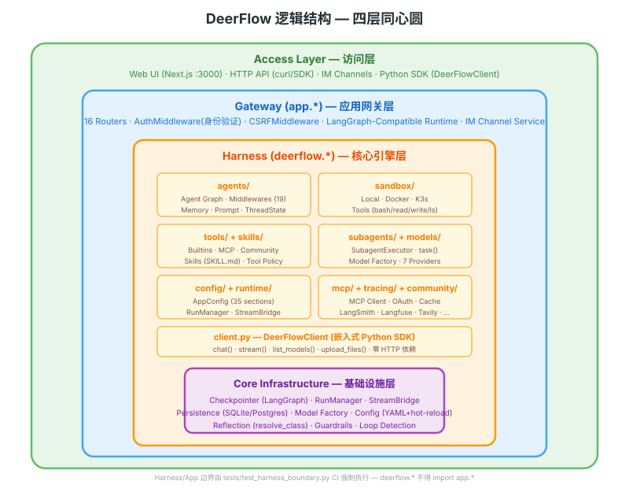
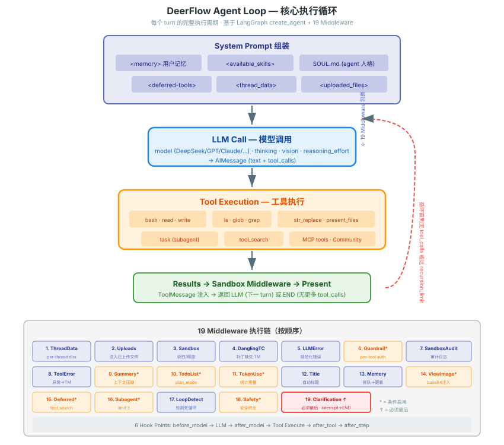
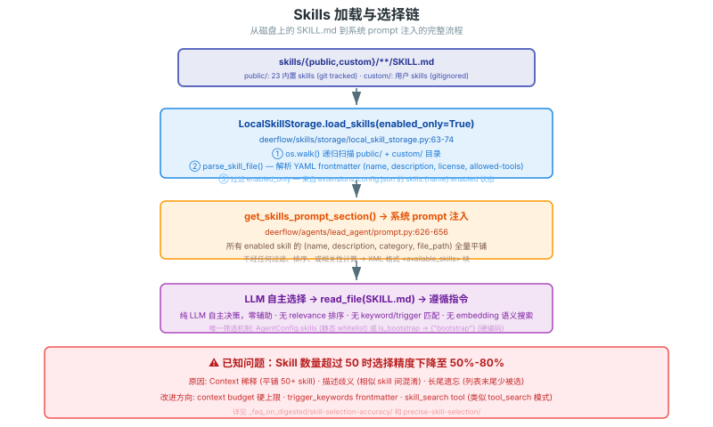
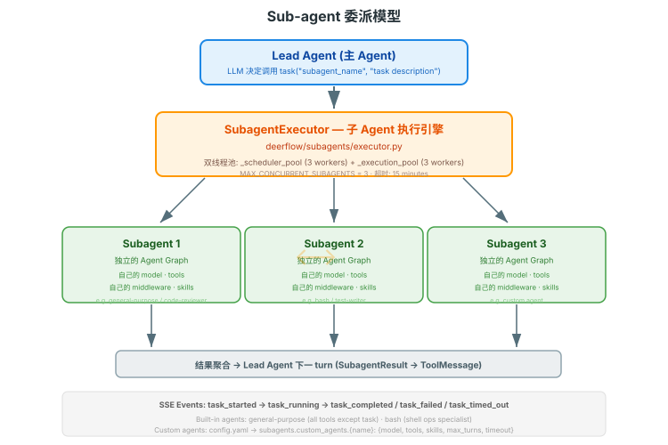
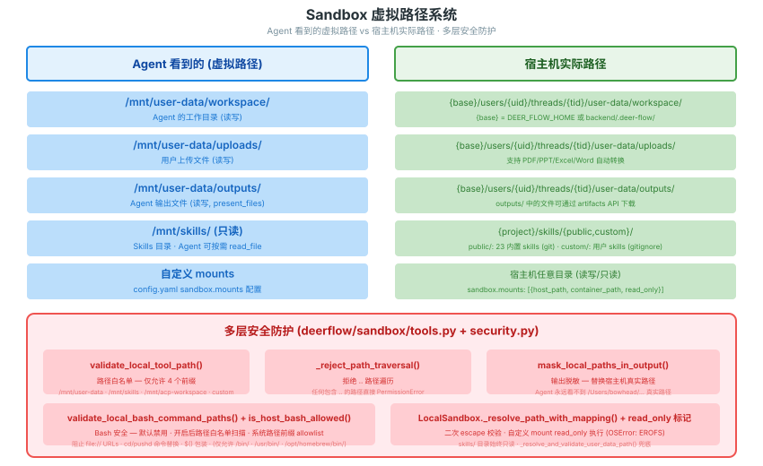

---


title: "DeerFlow 逻辑结构图"
description: 'DeerFlow 逻辑结构图：架构、契约与源码锚点。'
topics: [architecture, system-overview]
verified_against: v2.2.0
last_verified: 2026-11-08
---

# DeerFlow 逻辑结构图

> 从概念层面展示 DeerFlow 的核心抽象和它们之间的关系。不涉及物理部署，只看"是什么、怎么连"。

---

## 总览：四层同心圆



---

## Agent Loop 核心循环



---

## Middleware Chain（39 个条目位，按执行序；其中 custom / configured extension 两个槽位是可变长度）

完整目录见 [internals/middleware/03-catalog.md](../internals/middleware/03-catalog.md)。

文档化的 Hook 点：`wrap_model_call`（before_model）→ LLM → `after_model` → Tool Execute（`wrap_tool_call`）→ `after_tool` → `before_agent` / `after_agent`。权威编号表在 `backend/packages/harness/deerflow/agents/middlewares/AGENTS.md:60`-`176`（39 条，v2.1.0 为 36 条）。

---

## Skills 加载与选择链



---

## Sub-agent 委派模型



---

## Sandbox 虚拟路径系统



---

## Memory 系统

```
对话消息
    │
    ▼
MemoryMiddleware (过滤: 用户输入 + 最终 AI 回复；只排队，不写)
    │
    ▼
MemoryManager (agents/memory/manager.py:128；backend 可插拔: deermem / mem0 / noop / openviking)
    │  入队即 debounce（每会话静默期 30s），max_wait 300s 兜底
    │
    ▼
LLM 提取 (backend_config.model) → facts 落盘（memory.json，原子写）
    │  事实字段与去重由 backend 自解释；mem0/honcho 走各自 README 记的契约
    │
    ▼
下一 turn 注入：DynamicContextMiddleware 按 max_injection_tokens(默认 2000) 注入
    │  guaranteed_categories(默认 ["correction"]) 有独立预算 500 token
    │
    └─→ memory 后端检索出的是**派生投影**，不是 run 状态 authority
```

---

## 关键源码索引

| 概念 | 源码 |
|------|------|
| Agent 创建入口 | `deerflow/agents/lead_agent/agent.py:make_lead_agent()` |
| Agent 循环 | `deerflow/agents/lead_agent/agent.py:_make_lead_agent()`（内部 graph-only 入口）、`assemble_lead_agent()`（v2.2.0 新增：返回 `LeadAgentAssembly` = 编译图 + 装配描述，`agent.py:839`） |
| Middleware 组装 | `deerflow/agents/middlewares/tool_error_handling_middleware.py:_build_runtime_middlewares()`（内部）→ 公开名 `build_lead_runtime_middlewares()`（`tool_error_handling_middleware.py:538`）→ lead 侧 `build_middlewares()`（`agents/lead_agent/agent.py:485`） |
| Skills 加载 | `deerflow/skills/storage/local_skill_storage.py`（`LocalSkillStorage`，`load_skills()` 定义在基类 `skills/storage/skill_storage.py:349`） |
| 工具组装 | `deerflow/tools/tools.py:get_available_tools()` |
| Sandbox 接口 | `deerflow/sandbox/sandbox.py:Sandbox` |
| Subagent 执行 | `deerflow/subagents/executor.py:SubagentExecutor` |
| Memory 更新 | `deerflow/agents/memory/manager.py`（`MemoryManager`，`manager.py:128`；提取器 `updater.py` 住在 backend 内：`agents/memory/backends/deermem/deermem/core/updater.py`，不是 `agents/memory/updater.py`）。v2.2.0 新增 `judging.py` + `prescreen/` + `signals/` 两段判据流水线 |
| ThreadState | `deerflow/agents/thread_state.py:ThreadState` |
| 系统 prompt | `deerflow/agents/lead_agent/prompt.py:apply_prompt_template()` |
